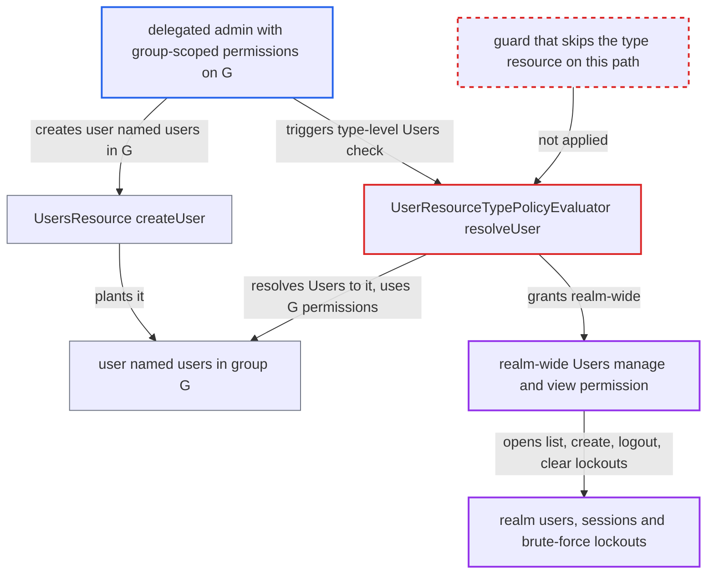

# FGAP V2 type-level Users check inherits group permissions of a user named "users"

| Field | Value |
|---|---|
| ID | `find_01HvjQqpTQhZShpfK3Tryqcp` |
| Severity | **Medium** |
| Status | open |
| CWE | CWE-863 — Improper Authorization |
| Created | 2026-10-27T21:19:25.279076Z |
| Claude Security | https://claude.ai/security/findings/find_01HvjQqpTQhZShpfK3Tryqcp |

## Description

A delegated admin who only manages one group can gain realm-wide user permissions. They can list every user, create users outside their group, clear brute-force lockouts and end sessions for any user. The attack needs fine-grained admin permissions V2 (`adminPermissionsEnabled`) and group-scoped member permissions. `UserResourceTypePolicyEvaluator.resolveUser` treats the `Users` type resource as a user lookup, so a user named `users` stands in for all users.

1. **delegated admin** creates a user named `users` inside their own group G. `UsersResource.createUser` accepts this because the admin holds `manage-members` and `manage-membership` on G, and the username is attacker-chosen unless the realm uses `registrationEmailAsUsername`. ([`services/src/main/java/org/keycloak/services/resources/admin/UsersResource.java:143-226`](https://github.com/cx-benchmark/keycloak/blob/1d7be35d0764060a8143fc74b0aabf2442743be4/services/src/main/java/org/keycloak/services/resources/admin/UsersResource.java#L143-L226))
2. **delegated admin** calls an endpoint guarded by the type-level `Users` check. `UserPermissionsV2.canManage()`, `canView()` and `canQuery()` call `hasPermission` with `modelId == null`, so the permission resource is the `Users` type resource. ([`services/src/main/java/org/keycloak/services/resources/admin/fgap/UserPermissionsV2.java:48-108`](https://github.com/cx-benchmark/keycloak/blob/1d7be35d0764060a8143fc74b0aabf2442743be4/services/src/main/java/org/keycloak/services/resources/admin/fgap/UserPermissionsV2.java#L48-L108))
3. **`FGAPPolicyEvaluator.evaluateResourcePolicies`** runs `UserResourceTypePolicyEvaluator` for the `Users` type resource. The guard that skips the type resource exists only in `evaluateResourceTypePolicies` (line 78), not on this path. ([`server-spi-private/src/main/java/org/keycloak/authorization/fgap/evaluation/FGAPPolicyEvaluator.java:55-80`](https://github.com/cx-benchmark/keycloak/blob/1d7be35d0764060a8143fc74b0aabf2442743be4/server-spi-private/src/main/java/org/keycloak/authorization/fgap/evaluation/FGAPPolicyEvaluator.java#L55-L80))
4. **`UserResourceTypePolicyEvaluator.resolveUser`** takes the resource name `Users` and looks up a user with that name. The public 4-arg `AdminPermissionsSchema.getResourceName` has no short-circuit when the name equals the resource type, and `resolveUser` falls back to `getUserByUsername`. ([`server-spi-private/src/main/java/org/keycloak/authorization/fgap/AdminPermissionsSchema.java:456-475`](https://github.com/cx-benchmark/keycloak/blob/1d7be35d0764060a8143fc74b0aabf2442743be4/server-spi-private/src/main/java/org/keycloak/authorization/fgap/AdminPermissionsSchema.java#L456-L475))
5. **user providers** match `Users` to the user `users`. `JpaUserProvider.java:721` and `UserCacheSession.java:279` lower-case the lookup, so the case difference does not matter. ([`server-spi-private/src/main/java/org/keycloak/authorization/fgap/AdminPermissionsSchema.java:255-263`](https://github.com/cx-benchmark/keycloak/blob/1d7be35d0764060a8143fc74b0aabf2442743be4/server-spi-private/src/main/java/org/keycloak/authorization/fgap/AdminPermissionsSchema.java#L255-L263))
6. **`FGAPEvaluation.isGranted`** counts G's group scopes as user scopes. `manage-members` becomes `manage` and `view-members` becomes `view`, so a `Permission` is emitted for the `Users` type resource id. ([`server-spi-private/src/main/java/org/keycloak/authorization/fgap/evaluation/FGAPEvaluation.java:47-75`](https://github.com/cx-benchmark/keycloak/blob/1d7be35d0764060a8143fc74b0aabf2442743be4/server-spi-private/src/main/java/org/keycloak/authorization/fgap/evaluation/FGAPEvaluation.java#L47-L75))
7. **`hasPermission`** accepts that permission as a realm-wide grant. Any returned `Permission` whose `resourceId` equals the `Users` type resource and contains the scope makes it return true. ([`services/src/main/java/org/keycloak/services/resources/admin/fgap/FineGrainedAdminPermissionEvaluator.java:103-126`](https://github.com/cx-benchmark/keycloak/blob/1d7be35d0764060a8143fc74b0aabf2442743be4/services/src/main/java/org/keycloak/services/resources/admin/fgap/FineGrainedAdminPermissionEvaluator.java#L103-L126))
8. **delegated admin** calls the endpoints that only check the type-level permission. These are `GET /users`, `POST /users` without groups, `POST /logout-all`, `deleteSession` and `DELETE /attack-detection/brute-force/users`. ([`services/src/main/java/org/keycloak/services/resources/admin/RealmAdminResource.java:731-770`](https://github.com/cx-benchmark/keycloak/blob/1d7be35d0764060a8143fc74b0aabf2442743be4/services/src/main/java/org/keycloak/services/resources/admin/RealmAdminResource.java#L731-L770))

## Assessment

The attacker is a delegated realm admin in a realm with `adminPermissionsEnabled`, which turns on `ADMIN_FINE_GRAINED_AUTHZ_V2`, a `Type.DEFAULT` feature. They hold FGAP V2 `manage-members`, `manage-membership` and `view` on one group G, plus `view-members` for read access. They send `POST /admin/realms/{r}/users` with `username=users` and `groups=[/G]`. After that they call the endpoints guarded only by the type-level check. The username is attacker-chosen unless the realm uses `registrationEmailAsUsername`.

Impact: The admin gains realm-wide `manage` and, with `view-members`, `view` on users. Without a `query-*` role, `GET /users` returns full representations (PII) of every user in the realm. They can also create users outside their group without credentials, clear brute-force lockouts for all users, and end any or all user sessions. Per-user operations on users outside G, such as updates, role mapping and password reset, stay gated by per-user checks.

## Recommendation

`UserResourceTypePolicyEvaluator.resolveUser` resolves a single user from the resource name even when the resource is the `Users` type resource. `AdminPermissionsSchema.getResourceName` and `resolveUser` fall back to a case-insensitive username lookup, so a user named `users` stands in for all users and its group memberships decide a realm-wide permission.

Fix criteria: A type-level (`modelId == null`) evaluation for the `Users` resource type never uses any individual user's group-membership permissions. Resolving a user from an FGAP resource name does not match a username equal to the resource type. Test: with a user `users` in group G and an admin holding only `manage-members`, `manage-membership`, `view-members` and `view` on G, `UserPermissionsV2.canManage()`, `canView()` and `canQuery()` return false. `POST /users` without groups, `POST /logout-all` and `DELETE /attack-detection/brute-force/users` return 403. `GET /users` stays denied or filtered.

## Evidence

**https://github.com/cx-benchmark/keycloak**

- [`server-spi-private/src/main/java/org/keycloak/authorization/fgap/evaluation/partial/UserResourceTypePolicyEvaluator.java:45-77`](https://github.com/cx-benchmark/keycloak/blob/1d7be35d0764060a8143fc74b0aabf2442743be4/server-spi-private/src/main/java/org/keycloak/authorization/fgap/evaluation/partial/UserResourceTypePolicyEvaluator.java#L45-L77)
- [`server-spi-private/src/main/java/org/keycloak/authorization/fgap/AdminPermissionsSchema.java:456-475`](https://github.com/cx-benchmark/keycloak/blob/1d7be35d0764060a8143fc74b0aabf2442743be4/server-spi-private/src/main/java/org/keycloak/authorization/fgap/AdminPermissionsSchema.java#L456-L475)
- [`server-spi-private/src/main/java/org/keycloak/authorization/fgap/AdminPermissionsSchema.java:255-263`](https://github.com/cx-benchmark/keycloak/blob/1d7be35d0764060a8143fc74b0aabf2442743be4/server-spi-private/src/main/java/org/keycloak/authorization/fgap/AdminPermissionsSchema.java#L255-L263)
- [`server-spi-private/src/main/java/org/keycloak/authorization/fgap/evaluation/FGAPPolicyEvaluator.java:55-80`](https://github.com/cx-benchmark/keycloak/blob/1d7be35d0764060a8143fc74b0aabf2442743be4/server-spi-private/src/main/java/org/keycloak/authorization/fgap/evaluation/FGAPPolicyEvaluator.java#L55-L80)
- [`services/src/main/java/org/keycloak/services/resources/admin/fgap/FineGrainedAdminPermissionEvaluator.java:103-126`](https://github.com/cx-benchmark/keycloak/blob/1d7be35d0764060a8143fc74b0aabf2442743be4/services/src/main/java/org/keycloak/services/resources/admin/fgap/FineGrainedAdminPermissionEvaluator.java#L103-L126)
- [`server-spi-private/src/main/java/org/keycloak/authorization/fgap/evaluation/FGAPEvaluation.java:47-75`](https://github.com/cx-benchmark/keycloak/blob/1d7be35d0764060a8143fc74b0aabf2442743be4/server-spi-private/src/main/java/org/keycloak/authorization/fgap/evaluation/FGAPEvaluation.java#L47-L75)
- [`services/src/main/java/org/keycloak/services/resources/admin/fgap/UserPermissionsV2.java:48-108`](https://github.com/cx-benchmark/keycloak/blob/1d7be35d0764060a8143fc74b0aabf2442743be4/services/src/main/java/org/keycloak/services/resources/admin/fgap/UserPermissionsV2.java#L48-L108)
- [`services/src/main/java/org/keycloak/services/resources/admin/UsersResource.java:143-226`](https://github.com/cx-benchmark/keycloak/blob/1d7be35d0764060a8143fc74b0aabf2442743be4/services/src/main/java/org/keycloak/services/resources/admin/UsersResource.java#L143-L226)
- [`server-spi-private/src/main/java/org/keycloak/authorization/fgap/evaluation/partial/PartialEvaluator.java:271-288`](https://github.com/cx-benchmark/keycloak/blob/1d7be35d0764060a8143fc74b0aabf2442743be4/server-spi-private/src/main/java/org/keycloak/authorization/fgap/evaluation/partial/PartialEvaluator.java#L271-L288)
- [`services/src/main/java/org/keycloak/services/resources/admin/RealmAdminResource.java:731-770`](https://github.com/cx-benchmark/keycloak/blob/1d7be35d0764060a8143fc74b0aabf2442743be4/services/src/main/java/org/keycloak/services/resources/admin/RealmAdminResource.java#L731-L770)
- [`services/src/main/java/org/keycloak/services/resources/admin/AttackDetectionResource.java:176-182`](https://github.com/cx-benchmark/keycloak/blob/1d7be35d0764060a8143fc74b0aabf2442743be4/services/src/main/java/org/keycloak/services/resources/admin/AttackDetectionResource.java#L176-L182)

