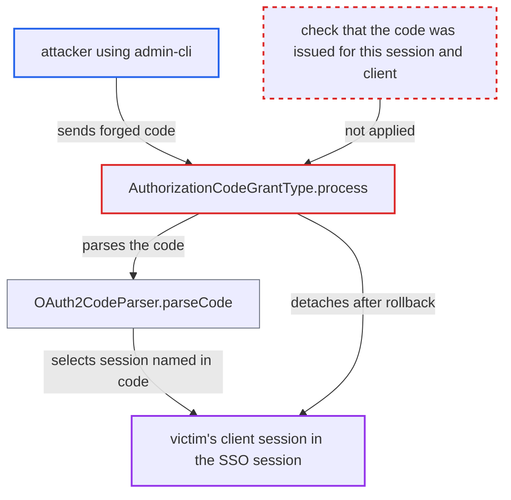

# Forged authorization code detaches any client session of a known user session

| Field | Value |
|---|---|
| ID | `find_01AE7eYRnY3N4ydPkidXsdXJ` |
| Severity | **Medium** |
| Status | open |
| CWE | CWE-639 — Authorization bypass |
| Created | 2026-10-27T21:25:26.002285Z |
| Claude Security | https://claude.ai/security/findings/find_01AE7eYRnY3N4ydPkidXsdXJ |

## Description

Anyone on the internet can detach a chosen client's session from another user's SSO session, with no credential. The client's refresh tokens then stop working, and single logout no longer reaches that client. The attacker needs the victim's user-session id and the client's internal UUID. The cause is `OAuth2CodeParser.parseCode`, which picks the client session from those two attacker-supplied segments before checking the secret part of the code, and `AuthorizationCodeGrantType.process` then detaches it.

1. **attacker** sends a forged code to the token endpoint as a public client. The request uses `grant_type=authorization_code`, `client_id=admin-cli` and `code=x.<sid>.<clientUUID>`; a public client needs no secret, and `admin-cli` exists in every realm. ([`services/src/main/java/org/keycloak/authentication/authenticators/client/ClientIdAndSecretAuthenticator.java:129-133`](https://github.com/cx-benchmark/keycloak/blob/1d7be35d0764060a8143fc74b0aabf2442743be4/services/src/main/java/org/keycloak/authentication/authenticators/client/ClientIdAndSecretAuthenticator.java#L129-L133))
2. **the token endpoint** authenticates the caller as some client and runs the authorization-code grant. `checkClient()` accepts the public client, and nothing ties the supplied `code` to that client before the grant runs. ([`services/src/main/java/org/keycloak/protocol/oidc/endpoints/TokenEndpoint.java:158-181`](https://github.com/cx-benchmark/keycloak/blob/1d7be35d0764060a8143fc74b0aabf2442743be4/services/src/main/java/org/keycloak/protocol/oidc/endpoints/TokenEndpoint.java#L158-L181))
3. **the parser `OAuth2CodeParser.parseCode`** loads the victim's client session named in the code before checking the secret. It stores `userSession.getAuthenticatedClientSessionByClient(clientUUID)` in the result, and only then looks up `code:<codeUUID>` in the single-use store. ([`services/src/main/java/org/keycloak/protocol/oidc/utils/OAuth2CodeParser.java:77-104`](https://github.com/cx-benchmark/keycloak/blob/1d7be35d0764060a8143fc74b0aabf2442743be4/services/src/main/java/org/keycloak/protocol/oidc/utils/OAuth2CodeParser.java#L77-L104))
4. **the parser `OAuth2CodeParser.parseCode`** returns `illegalCode()` with the attacker-selected client session still attached. The store entry is missing because the code was never issued, but the result is the same as for a replayed code. ([`services/src/main/java/org/keycloak/protocol/oidc/utils/OAuth2CodeParser.java:77-104`](https://github.com/cx-benchmark/keycloak/blob/1d7be35d0764060a8143fc74b0aabf2442743be4/services/src/main/java/org/keycloak/protocol/oidc/utils/OAuth2CodeParser.java#L77-L104))
5. **the grant `AuthorizationCodeGrantType.process`** enlists `detachFromUserSession()` on that client session in an after-rollback job. Every illegal code is treated as a replay, and the check that the session belongs to the authenticated client runs only on the success path. ([`services/src/main/java/org/keycloak/protocol/oidc/grants/AuthorizationCodeGrantType.java:88-100`](https://github.com/cx-benchmark/keycloak/blob/1d7be35d0764060a8143fc74b0aabf2442743be4/services/src/main/java/org/keycloak/protocol/oidc/grants/AuthorizationCodeGrantType.java#L88-L100))
6. **the error response** marks the transaction rollback-only, which starts the job. `CorsErrorResponseException` extends `RollbackWebApplicationException`, so the error response itself triggers the job. ([`services/src/main/java/org/keycloak/services/RollbackWebApplicationException.java:37-43`](https://github.com/cx-benchmark/keycloak/blob/1d7be35d0764060a8143fc74b0aabf2442743be4/services/src/main/java/org/keycloak/services/RollbackWebApplicationException.java#L37-L43))
7. **the rollback job** detaches the victim's client session in a new transaction. `runJobInTransaction` commits the detach even though the request itself failed. ([`server-spi-private/src/main/java/org/keycloak/models/utils/KeycloakModelUtils.java:380-398`](https://github.com/cx-benchmark/keycloak/blob/1d7be35d0764060a8143fc74b0aabf2442743be4/server-spi-private/src/main/java/org/keycloak/models/utils/KeycloakModelUtils.java#L380-L398))

## Assessment

The attacker needs no account or credential. They need the victim's user-session id and the target client's internal UUID. Both are segments of any authorization code, so a party who sees a leaked code or redirect URL has them. The session id is also the `sid` in every access token, so resource servers, relying-party logs and any token holder can learn it. The attacker POSTs the forged code to the token endpoint as a public client such as `admin-cli`. The request can be repeated each time the victim re-authenticates.

Impact: The attacker removes a chosen client's session from the victim's SSO session. That client's refresh grant then fails, and later single logout no longer notifies it. Offline sessions, other clients and the SSO session itself survive, re-authentication is usually silent, and nothing is disclosed. A relying party that already holds the victim's refresh token gains little, since it can end the whole SSO session through `POST /logout`.

## Recommendation

`OAuth2CodeParser.parseCode` returns the client session named by the attacker-supplied `userSessionId` and `clientUUID` segments even when `codeUUID` is not in the single-use store. `AuthorizationCodeGrantType.process` then detaches that session on every illegal code, so a never-issued code is treated like a replay of a real one.

Fix criteria: A failed code lookup revokes a client session only when the server can show the code was actually issued for that user session and client, for example through a short-lived record of consumed code ids. The session must also belong to the client that authenticated the request. Sending `code=x.<sid>.<otherClientUUID>` as `admin-cli` leaves the other client's session attached and its refresh token working. Replaying a genuinely used code still revokes its session.

## Evidence

**https://github.com/cx-benchmark/keycloak**

- [`services/src/main/java/org/keycloak/protocol/oidc/grants/AuthorizationCodeGrantType.java:88-100`](https://github.com/cx-benchmark/keycloak/blob/1d7be35d0764060a8143fc74b0aabf2442743be4/services/src/main/java/org/keycloak/protocol/oidc/grants/AuthorizationCodeGrantType.java#L88-L100)
- [`services/src/main/java/org/keycloak/protocol/oidc/utils/OAuth2CodeParser.java:77-104`](https://github.com/cx-benchmark/keycloak/blob/1d7be35d0764060a8143fc74b0aabf2442743be4/services/src/main/java/org/keycloak/protocol/oidc/utils/OAuth2CodeParser.java#L77-L104)
- [`services/src/main/java/org/keycloak/services/RollbackWebApplicationException.java:37-43`](https://github.com/cx-benchmark/keycloak/blob/1d7be35d0764060a8143fc74b0aabf2442743be4/services/src/main/java/org/keycloak/services/RollbackWebApplicationException.java#L37-L43)
- [`server-spi-private/src/main/java/org/keycloak/models/utils/KeycloakModelUtils.java:380-398`](https://github.com/cx-benchmark/keycloak/blob/1d7be35d0764060a8143fc74b0aabf2442743be4/server-spi-private/src/main/java/org/keycloak/models/utils/KeycloakModelUtils.java#L380-L398)
- [`services/src/main/java/org/keycloak/authentication/authenticators/client/ClientIdAndSecretAuthenticator.java:129-133`](https://github.com/cx-benchmark/keycloak/blob/1d7be35d0764060a8143fc74b0aabf2442743be4/services/src/main/java/org/keycloak/authentication/authenticators/client/ClientIdAndSecretAuthenticator.java#L129-L133)
- [`services/src/main/java/org/keycloak/protocol/oidc/endpoints/TokenEndpoint.java:158-181`](https://github.com/cx-benchmark/keycloak/blob/1d7be35d0764060a8143fc74b0aabf2442743be4/services/src/main/java/org/keycloak/protocol/oidc/endpoints/TokenEndpoint.java#L158-L181)
- [`services/src/main/java/org/keycloak/protocol/oidc/TokenManager.java:1130`](https://github.com/cx-benchmark/keycloak/blob/1d7be35d0764060a8143fc74b0aabf2442743be4/services/src/main/java/org/keycloak/protocol/oidc/TokenManager.java#L1130)
- [`services/src/main/java/org/keycloak/protocol/oidc/TokenManager.java:236-241`](https://github.com/cx-benchmark/keycloak/blob/1d7be35d0764060a8143fc74b0aabf2442743be4/services/src/main/java/org/keycloak/protocol/oidc/TokenManager.java#L236-L241)

