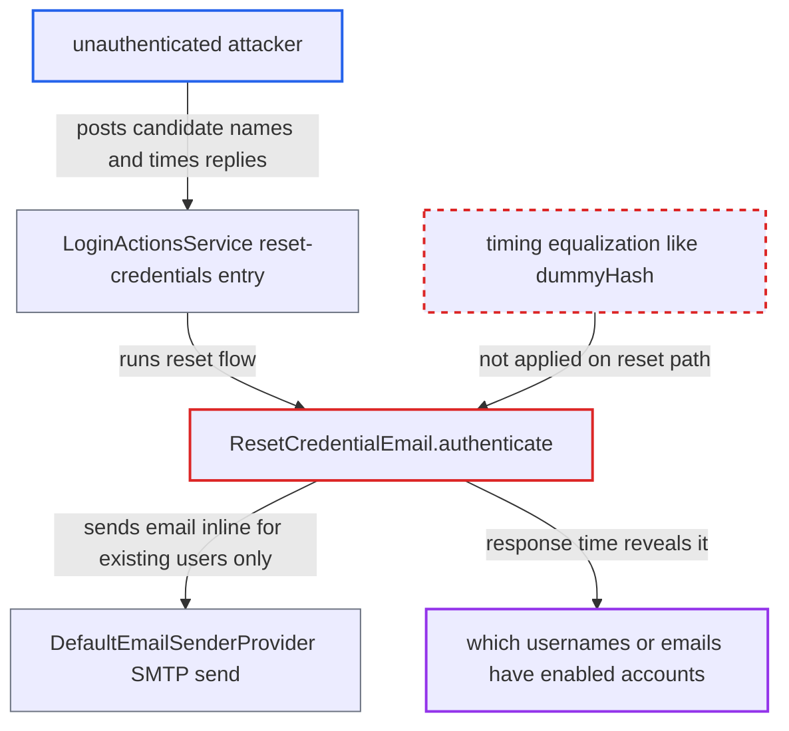

# Forgot-password flow leaks account existence through synchronous email send timing

| Field | Value |
|---|---|
| ID | `find_01MWQvGVntHRruUkqDGsXxeB` |
| Severity | **Medium** |
| Status | open |
| CWE | CWE-208 — Observable Timing Discrepancy |
| Created | 2026-10-27T21:25:45.283954Z |
| Claude Security | https://claude.ai/security/findings/find_01MWQvGVntHRruUkqDGsXxeB |

## Description

An unauthenticated remote attacker can tell which usernames, or email addresses when login with email is allowed, belong to enabled accounts that have an email address. The attack needs a realm with 'Forgot password' enabled and SMTP configured. `ResetCredentialEmail.authenticate` sends the reset email synchronously only for existing users, so the response time gives them away. Only account existence is disclosed.

1. **attacker** opens the reset-credentials form and posts a candidate username or email. `resetCredentialsGET` creates an authentication session for anyone when `resetPasswordAllowed` is enabled, and `resetCredentialsPOST` runs the realm's reset-credentials flow. ([`services/src/main/java/org/keycloak/services/resources/LoginActionsService.java:416-466`](https://github.com/cx-benchmark/keycloak/blob/1d7be35d0764060a8143fc74b0aabf2442743be4/services/src/main/java/org/keycloak/services/resources/LoginActionsService.java#L416-L466))
2. **the authenticator `ResetCredentialChooseUser.action`** resolves the submitted name and succeeds even when the user is unknown or disabled. It clears the user and still calls `context.success()`, so the visible outcome is the same for every input. ([`services/src/main/java/org/keycloak/authentication/authenticators/resetcred/ResetCredentialChooseUser.java:123-148`](https://github.com/cx-benchmark/keycloak/blob/1d7be35d0764060a8143fc74b0aabf2442743be4/services/src/main/java/org/keycloak/authentication/authenticators/resetcred/ResetCredentialChooseUser.java#L123-L148))
3. **the authenticator `ResetCredentialEmail.authenticate`** forks at once for an unknown user, a disabled user or a user without an email address. These branches call `forkWithSuccessMessage(EMAIL_SENT)` without doing any slow work, so they return in milliseconds. ([`services/src/main/java/org/keycloak/authentication/authenticators/resetcred/ResetCredentialEmail.java:85-141`](https://github.com/cx-benchmark/keycloak/blob/1d7be35d0764060a8143fc74b0aabf2442743be4/services/src/main/java/org/keycloak/authentication/authenticators/resetcred/ResetCredentialEmail.java#L85-L141))
4. **the authenticator `ResetCredentialEmail.authenticate`** signs a token, renders the email and calls `sendPasswordReset` for an existing, enabled user with an email address. The delivery runs inline in the request thread and only afterwards does the flow fork with the same `EMAIL_SENT` message. ([`services/src/main/java/org/keycloak/authentication/authenticators/resetcred/ResetCredentialEmail.java:85-141`](https://github.com/cx-benchmark/keycloak/blob/1d7be35d0764060a8143fc74b0aabf2442743be4/services/src/main/java/org/keycloak/authentication/authenticators/resetcred/ResetCredentialEmail.java#L85-L141))
5. **the sender `DefaultEmailSenderProvider`** opens the SMTP transport, authenticates and calls `transport.sendMessage` inline. The connect, TLS, AUTH and DATA exchange takes hundreds of milliseconds or more, and this time is added to the HTTP response. ([`services/src/main/java/org/keycloak/email/DefaultEmailSenderProvider.java:89-95`](https://github.com/cx-benchmark/keycloak/blob/1d7be35d0764060a8143fc74b0aabf2442743be4/services/src/main/java/org/keycloak/email/DefaultEmailSenderProvider.java#L89-L95))
6. **attacker** times each response and repeats a few times per candidate. A slow response marks an enabled account with an email address, and a fast one marks anything else; a few repetitions filter out jitter.

## Assessment

The attacker is remote and needs no login. The target realm must have 'Forgot password' enabled and SMTP configured, and the built-in `reset credentials` flow binds `ResetCredentialChooseUser` and `ResetCredentialEmail` by default. The attacker needs only to submit candidate usernames, or email addresses when login with email is allowed, and measure response times. No defence has to be bypassed. The login path hides the same leak with `AuthenticatorUtils.dummyHash`, but the reset path has no equivalent.

Impact: The attacker learns which usernames or email addresses belong to enabled accounts with an email address in the realm. No credential, token or session is gained, and the disclosure is limited to account existence. Each probe of a valid account also sends a real reset email to that user.

## Recommendation

`ResetCredentialEmail.authenticate` delivers the SMTP email synchronously only for existing users, so the reset-credentials response time depends on whether the username exists.

Fix criteria: The reset-credentials response time is independent of whether the submitted username resolves to a user. This can be done by sending the email asynchronously after the response is committed, or by doing equivalent work or fixed-delay padding on the unknown-user branch. Timing many submissions of known and unknown usernames gives latency distributions that are statistically indistinguishable. The user-visible message stays `emailSentMessage` in both cases.

## Evidence

**https://github.com/cx-benchmark/keycloak**

- [`services/src/main/java/org/keycloak/authentication/authenticators/resetcred/ResetCredentialEmail.java:85-141`](https://github.com/cx-benchmark/keycloak/blob/1d7be35d0764060a8143fc74b0aabf2442743be4/services/src/main/java/org/keycloak/authentication/authenticators/resetcred/ResetCredentialEmail.java#L85-L141)
- [`services/src/main/java/org/keycloak/authentication/authenticators/resetcred/ResetCredentialChooseUser.java:123-148`](https://github.com/cx-benchmark/keycloak/blob/1d7be35d0764060a8143fc74b0aabf2442743be4/services/src/main/java/org/keycloak/authentication/authenticators/resetcred/ResetCredentialChooseUser.java#L123-L148)
- [`services/src/main/java/org/keycloak/email/DefaultEmailSenderProvider.java:89-95`](https://github.com/cx-benchmark/keycloak/blob/1d7be35d0764060a8143fc74b0aabf2442743be4/services/src/main/java/org/keycloak/email/DefaultEmailSenderProvider.java#L89-L95)
- [`services/src/main/java/org/keycloak/services/resources/LoginActionsService.java:416-466`](https://github.com/cx-benchmark/keycloak/blob/1d7be35d0764060a8143fc74b0aabf2442743be4/services/src/main/java/org/keycloak/services/resources/LoginActionsService.java#L416-L466)
- [`services/src/main/java/org/keycloak/authentication/authenticators/util/AuthenticatorUtils.java:70-86`](https://github.com/cx-benchmark/keycloak/blob/1d7be35d0764060a8143fc74b0aabf2442743be4/services/src/main/java/org/keycloak/authentication/authenticators/util/AuthenticatorUtils.java#L70-L86)

