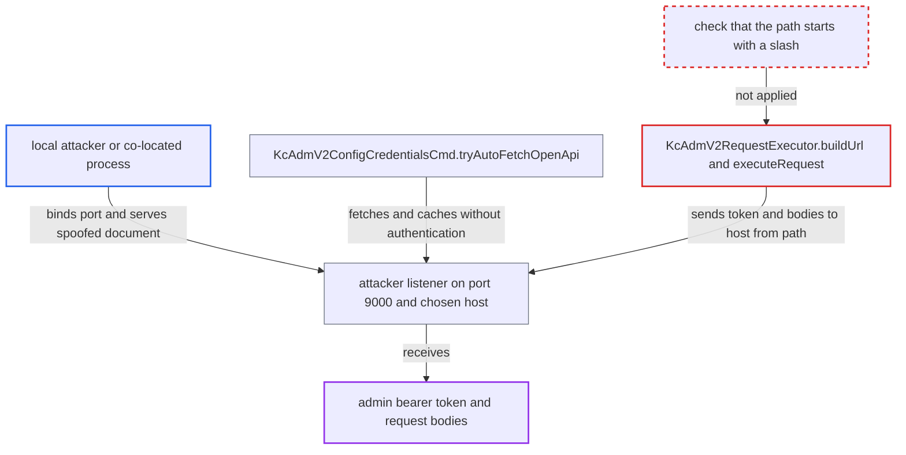

# kcadm v2 trusts unauthenticated OpenAPI paths, letting a spoofed descriptor redirect the admin token

| Field | Value |
|---|---|
| ID | `find_01Fjw8QDnUwcWK8EFLvFs3TZ` |
| Severity | **Medium** |
| Status | open |
| CWE | CWE-99 — Resource Injection |
| Created | 2026-10-27T22:14:05.608192Z |
| Claude Security | https://claude.ai/security/findings/find_01Fjw8QDnUwcWK8EFLvFs3TZ |

## Description

A local user or co-located process on the admin's machine can steal the admin's access token and the request bodies that `kcadm --v2` sends, such as client definitions or passwords. The attacker serves a spoofed OpenAPI document on port 9000, which the CLI fetches without authentication, caches and trusts. `KcAdmV2RequestExecutor.buildUrl` then joins the document's path onto the server URL as plain text, so the path can change the target host. The redirect works only when the configured server URL has no path and no trailing `/`.

1. **attacker** starts a listener on port 9000 of the host named by `--server`. Keycloak does not use that port by default, because the management interface starts only when `health-enabled`, `metrics-enabled` or `openapi-enabled` is on, and all three default to false. ([`quarkus/runtime/src/main/java/org/keycloak/quarkus/runtime/configuration/mappers/ManagementPropertyMappers.java:281-288`](https://github.com/cx-benchmark/keycloak/blob/1d7be35d0764060a8143fc74b0aabf2442743be4/quarkus/runtime/src/main/java/org/keycloak/quarkus/runtime/configuration/mappers/ManagementPropertyMappers.java#L281-L288))
2. **admin** runs `kcadm --v2 config credentials`, and `tryAutoFetchOpenApi` fetches the OpenAPI document. The fetch goes to `<server-scheme>://<server-host>:9000/openapi` without authentication, a port the user never configured. ([`integration/client-cli/admin-cli/src/main/java/org/keycloak/client/admin/cli/v2/KcAdmV2ConfigCredentialsCmd.java:54-97`](https://github.com/cx-benchmark/keycloak/blob/1d7be35d0764060a8143fc74b0aabf2442743be4/integration/client-cli/admin-cli/src/main/java/org/keycloak/client/admin/cli/v2/KcAdmV2ConfigCredentialsCmd.java#L54-L97))
3. **`KcAdmV2DescriptorBuilder.convert`** copies each `paths` key unchanged into `CommandDescriptor.path`. The attacker's document prefixes every path with a value such as `@127.0.0.1:9001`, and no validation rejects it. The CLI then caches the result for the server URL. ([`integration/client-cli/admin-cli/src/main/java/org/keycloak/client/admin/cli/v2/KcAdmV2DescriptorBuilder.java:72-104`](https://github.com/cx-benchmark/keycloak/blob/1d7be35d0764060a8143fc74b0aabf2442743be4/integration/client-cli/admin-cli/src/main/java/org/keycloak/client/admin/cli/v2/KcAdmV2DescriptorBuilder.java#L72-L104))
4. **`KcAdmV2Cmd.loadDescriptor`** uses the cached descriptor instead of the bundled one on every later v2 command. The poisoned descriptor therefore drives all later `--v2` commands against that server. ([`integration/client-cli/admin-cli/src/main/java/org/keycloak/client/admin/cli/v2/KcAdmV2Cmd.java:147-159`](https://github.com/cx-benchmark/keycloak/blob/1d7be35d0764060a8143fc74b0aabf2442743be4/integration/client-cli/admin-cli/src/main/java/org/keycloak/client/admin/cli/v2/KcAdmV2Cmd.java#L147-L159))
5. **`KcAdmV2RequestExecutor.buildUrl`** builds the request URL as `serverUrl + path`. No code checks that the path starts with `/`. `http://localhost:8080` plus `@127.0.0.1:9001/...` parses as host `127.0.0.1`, port `9001`. ([`integration/client-cli/admin-cli/src/main/java/org/keycloak/client/admin/cli/v2/KcAdmV2RequestExecutor.java:218-232`](https://github.com/cx-benchmark/keycloak/blob/1d7be35d0764060a8143fc74b0aabf2442743be4/integration/client-cli/admin-cli/src/main/java/org/keycloak/client/admin/cli/v2/KcAdmV2RequestExecutor.java#L218-L232))
6. **`executeRequest`** sends the `Authorization: Bearer` header and the request body to the host the URL names. The attacker receives the admin's token and bodies. The attacker can forward the call to the real server so the admin sees normal output. ([`integration/client-cli/admin-cli/src/main/java/org/keycloak/client/admin/cli/v2/KcAdmV2RequestExecutor.java:199-213`](https://github.com/cx-benchmark/keycloak/blob/1d7be35d0764060a8143fc74b0aabf2442743be4/integration/client-cli/admin-cli/src/main/java/org/keycloak/client/admin/cli/v2/KcAdmV2RequestExecutor.java#L199-L213))

## Assessment

The attacker is an unprivileged local user or co-located process on the host named by `--server`, for example `http://localhost:8080`, where port 9000 is free. They serve a copy of the real OpenAPI document with every path prefixed, for example, `@127.0.0.1:<port>`. A path such as `.attacker.example/...` likewise sends `https://kc.example.com` requests to `kc.example.com.attacker.example`. The admin only has to run `kcadm --v2 config credentials`. Over HTTPS the attacker also needs a certificate the CLI accepts for that host. A second way in is `kcadm --v2 config openapi <url|file>` or `--openapi-url`. These accept any URL or file, including plain HTTP from a management interface that uses `http-management-scheme=http`, so a document the admin did not write reaches the same code. The report assumes SmallRye OpenAPI does not reject `paths` keys that lack a leading slash.

Impact: The attacker obtains the admin's current access token and the request bodies of every affected command until the cached descriptor is replaced. The attacker also controls the responses the CLI prints. This is a client-side credential leak in the CLI, not server-side SSRF.

Subsequent-system impact: The stolen token is typically a master-realm admin token. It gives the attacker the admin's full rights on the Keycloak Admin REST API: reading realms and client secrets, creating administrators and deleting realms. The token is short-lived, but the CLI resends a fresh one on each command.

## Recommendation

(1) `KcAdmV2RequestExecutor.buildUrl` appends an untrusted descriptor path to the server URL by string concatenation without making sure it is only a path. Descriptor data can therefore change the URL authority and send authenticated requests away from the configured server.

Fix criteria: Every request built from a descriptor keeps the scheme, host and port of the configured server URL, whatever the descriptor contains. To verify, cache a descriptor whose path is `@127.0.0.1:1/x` or `.example.org/x`. The CLI must then refuse it or still connect only to the configured server.

(2) `KcAdmV2DescriptorBuilder.convert` and the auto-fetch in `KcAdmV2ConfigCredentialsCmd` accept and cache OpenAPI documents from an unauthenticated endpoint on an unconfigured port, or from any URL or file, without validating them.

Fix criteria: Before a descriptor is cached, every path is checked to be a well-formed absolute path (`/...`) containing only the expected placeholders. Invalid documents are rejected without replacing the bundled descriptor. Automatic fetching no longer takes its descriptor from an endpoint whose authenticity is weaker than that of the configured server connection.

## Evidence

**https://github.com/cx-benchmark/keycloak**

- [`integration/client-cli/admin-cli/src/main/java/org/keycloak/client/admin/cli/v2/KcAdmV2RequestExecutor.java:218-232`](https://github.com/cx-benchmark/keycloak/blob/1d7be35d0764060a8143fc74b0aabf2442743be4/integration/client-cli/admin-cli/src/main/java/org/keycloak/client/admin/cli/v2/KcAdmV2RequestExecutor.java#L218-L232)
- [`integration/client-cli/admin-cli/src/main/java/org/keycloak/client/admin/cli/v2/KcAdmV2RequestExecutor.java:199-213`](https://github.com/cx-benchmark/keycloak/blob/1d7be35d0764060a8143fc74b0aabf2442743be4/integration/client-cli/admin-cli/src/main/java/org/keycloak/client/admin/cli/v2/KcAdmV2RequestExecutor.java#L199-L213)
- [`integration/client-cli/admin-cli/src/main/java/org/keycloak/client/admin/cli/v2/KcAdmV2DescriptorBuilder.java:72-104`](https://github.com/cx-benchmark/keycloak/blob/1d7be35d0764060a8143fc74b0aabf2442743be4/integration/client-cli/admin-cli/src/main/java/org/keycloak/client/admin/cli/v2/KcAdmV2DescriptorBuilder.java#L72-L104)
- [`integration/client-cli/admin-cli/src/main/java/org/keycloak/client/admin/cli/v2/KcAdmV2ConfigCredentialsCmd.java:54-97`](https://github.com/cx-benchmark/keycloak/blob/1d7be35d0764060a8143fc74b0aabf2442743be4/integration/client-cli/admin-cli/src/main/java/org/keycloak/client/admin/cli/v2/KcAdmV2ConfigCredentialsCmd.java#L54-L97)
- [`quarkus/runtime/src/main/java/org/keycloak/quarkus/runtime/configuration/mappers/ManagementPropertyMappers.java:281-288`](https://github.com/cx-benchmark/keycloak/blob/1d7be35d0764060a8143fc74b0aabf2442743be4/quarkus/runtime/src/main/java/org/keycloak/quarkus/runtime/configuration/mappers/ManagementPropertyMappers.java#L281-L288)
- [`integration/client-cli/admin-cli/src/main/java/org/keycloak/client/admin/cli/v2/KcAdmV2ConfigOpenApiCmd.java:50-98`](https://github.com/cx-benchmark/keycloak/blob/1d7be35d0764060a8143fc74b0aabf2442743be4/integration/client-cli/admin-cli/src/main/java/org/keycloak/client/admin/cli/v2/KcAdmV2ConfigOpenApiCmd.java#L50-L98)
- [`integration/client-cli/admin-cli/src/main/java/org/keycloak/client/admin/cli/v2/KcAdmV2Cmd.java:147-159`](https://github.com/cx-benchmark/keycloak/blob/1d7be35d0764060a8143fc74b0aabf2442743be4/integration/client-cli/admin-cli/src/main/java/org/keycloak/client/admin/cli/v2/KcAdmV2Cmd.java#L147-L159)

