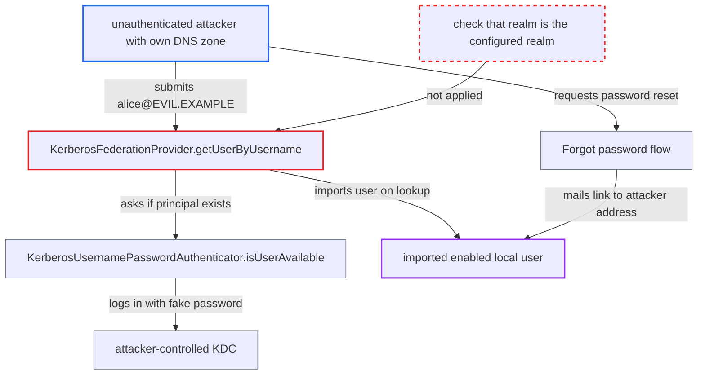

# Kerberos provider imports enabled accounts for principals of arbitrary realms before any authentication

| Field | Value |
|---|---|
| ID | `find_0163wiKkfqMpLYcaW8uV9FVU` |
| Severity | **Medium** |
| Status | open |
| CWE | CWE-346 — Origin Validation Error |
| Created | 2026-10-27T22:22:01.113696Z |
| Claude Security | https://claude.ai/security/findings/find_0163wiKkfqMpLYcaW8uV9FVU |

## Description

An unauthenticated attacker can make Keycloak create an enabled local user for a Kerberos principal from any realm. They can then take that account over and get a working login in a realm that has self-registration disabled. It needs an attacker-owned DNS zone with a KDC that answers every lookup, and the account takeover also needs 'Forgot password' enabled and the default `UNSYNCED` edit mode. The cause is that `getUserByUsername` and `isUserAvailable` never check the principal's realm, and import users on a lookup, not after authentication.

1. **attacker** submits a username such as alice\@EVIL.EXAMPLE to any unauthenticated path that resolves a username. Paths named in the report are the login form, direct grant with the default public `admin-cli` client, registration validators and 'Forgot password'. ([`federation/kerberos/src/main/java/org/keycloak/federation/kerberos/KerberosFederationProvider.java:99-112`](https://github.com/cx-benchmark/keycloak/blob/1d7be35d0764060a8143fc74b0aabf2442743be4/federation/kerberos/src/main/java/org/keycloak/federation/kerberos/KerberosFederationProvider.java#L99-L112))
2. **the provider's `getKerberosPrincipal`** builds the Kerberos principal from the input without changing its realm. When the input contains `@`, the realm is whatever the attacker wrote, not the configured realm. ([`federation/kerberos/src/main/java/org/keycloak/federation/kerberos/impl/KerberosUsernamePasswordAuthenticator.java:211-217`](https://github.com/cx-benchmark/keycloak/blob/1d7be35d0764060a8143fc74b0aabf2442743be4/federation/kerberos/src/main/java/org/keycloak/federation/kerberos/impl/KerberosUsernamePasswordAuthenticator.java#L211-L217))
3. **the method `isUserAvailable`** attempts a Krb5 login with a fake password against the KDC of the principal's own realm. The JDK finds the KDC of an unknown realm through DNS SRV records by default, so the attacker's DNS zone sends Keycloak to the attacker's KDC. ([`common/src/main/java/org/keycloak/common/util/KerberosJdkProvider.java:146-156`](https://github.com/cx-benchmark/keycloak/blob/1d7be35d0764060a8143fc74b0aabf2442743be4/common/src/main/java/org/keycloak/common/util/KerberosJdkProvider.java#L146-L156))
4. **attacker's KDC** answers with `KDC_ERR_PREAUTH_FAILED`. `isUserAvailable` treats every error except `Client not found` (and the unreachable patterns) as 'user exists', so the attacker's KDC decides the answer. ([`federation/kerberos/src/main/java/org/keycloak/federation/kerberos/impl/KerberosUsernamePasswordAuthenticator.java:72-93`](https://github.com/cx-benchmark/keycloak/blob/1d7be35d0764060a8143fc74b0aabf2442743be4/federation/kerberos/src/main/java/org/keycloak/federation/kerberos/impl/KerberosUsernamePasswordAuthenticator.java#L72-L93))
5. **the method `getUserByUsername`** calls `findOrCreateAuthenticatedUser`, which runs `importUserToKeycloak`. This creates an enabled local user `alice@evil.example` with that same address as its email, linked to the provider, although nobody has authenticated. ([`federation/kerberos/src/main/java/org/keycloak/federation/kerberos/KerberosFederationProvider.java:285-305`](https://github.com/cx-benchmark/keycloak/blob/1d7be35d0764060a8143fc74b0aabf2442743be4/federation/kerberos/src/main/java/org/keycloak/federation/kerberos/KerberosFederationProvider.java#L285-L305))
6. **attacker** requests 'Forgot password' for the imported user and follows the link mailed to their own address. The reset flow mails `user.getEmail()` and does not require a verified email. ([`services/src/main/java/org/keycloak/authentication/authenticators/resetcred/ResetCredentialEmail.java:104-125`](https://github.com/cx-benchmark/keycloak/blob/1d7be35d0764060a8143fc74b0aabf2442743be4/services/src/main/java/org/keycloak/authentication/authenticators/resetcred/ResetCredentialEmail.java#L104-L125))
7. **the method `updateCredential`** returns false, so the new password is stored locally. In the default `UNSYNCED` edit mode `updateCredential` reports 'not handled'. `isValid` then accepts the local password, so the attacker can log in. ([`federation/kerberos/src/main/java/org/keycloak/federation/kerberos/KerberosFederationProvider.java:139-145`](https://github.com/cx-benchmark/keycloak/blob/1d7be35d0764060a8143fc74b0aabf2442743be4/federation/kerberos/src/main/java/org/keycloak/federation/kerberos/KerberosFederationProvider.java#L139-L145))

## Assessment

The attacker needs no login. They need a DNS zone they control (for example `evil.example`, with `_kerberos._udp` SRV records) and a host acting as a KDC that answers `KDC_ERR_PREAUTH_FAILED`. The JDK's DNS lookup of KDCs must not be disabled. Any unauthenticated path that resolves a username can trigger the import: the login form, direct grant with `grant_type=password` and `client_id=admin-cli`, registration validators, or 'Forgot password'. Taking over the imported account also needs the 'Forgot password' flow enabled and the default `UNSYNCED` edit mode. Without the reset flow, the attacker can still create users.

Impact: The attacker gets an enabled, working account with the realm's default roles. It can use the Account API and every client that accepts any realm user, even though self-registration is disabled. They can also bulk-create arbitrary enabled users with arbitrary emails, which pollutes the user directory. They do not gain another user's data or admin rights directly.

## Recommendation

(1) `getUserByUsername` and `isUserAvailable` resolve and import principals of any realm. They trust whatever KDC the JDK finds for the attacker-supplied realm.

Fix criteria: Username lookups only consider principals of the configured Kerberos realm, or of an explicit list of trusted realms set by an admin. An input like `user@OTHER.REALM` causes no KDC exchange with, and no import from, an unconfigured realm. Submitting `alice@EVIL.EXAMPLE` to the login form produces no DNS or KDC traffic and no new user.

(2) User provisioning is tied to an existence check, not to successful authentication. An unauthenticated lookup therefore creates an enabled account with an unverified, attacker-chosen email that the reset-credentials flow trusts.

Fix criteria: A local account for a Kerberos principal is created only after that principal has authenticated (SPNEGO or password round-trip succeeded), or it is created disabled or without a usable email until then. A username lookup alone never results in an enabled user with a reset-capable email.

## Evidence

**https://github.com/cx-benchmark/keycloak**

- [`federation/kerberos/src/main/java/org/keycloak/federation/kerberos/KerberosFederationProvider.java:99-112`](https://github.com/cx-benchmark/keycloak/blob/1d7be35d0764060a8143fc74b0aabf2442743be4/federation/kerberos/src/main/java/org/keycloak/federation/kerberos/KerberosFederationProvider.java#L99-L112)
- [`federation/kerberos/src/main/java/org/keycloak/federation/kerberos/impl/KerberosUsernamePasswordAuthenticator.java:72-93`](https://github.com/cx-benchmark/keycloak/blob/1d7be35d0764060a8143fc74b0aabf2442743be4/federation/kerberos/src/main/java/org/keycloak/federation/kerberos/impl/KerberosUsernamePasswordAuthenticator.java#L72-L93)
- [`federation/kerberos/src/main/java/org/keycloak/federation/kerberos/impl/KerberosUsernamePasswordAuthenticator.java:211-217`](https://github.com/cx-benchmark/keycloak/blob/1d7be35d0764060a8143fc74b0aabf2442743be4/federation/kerberos/src/main/java/org/keycloak/federation/kerberos/impl/KerberosUsernamePasswordAuthenticator.java#L211-L217)
- [`federation/kerberos/src/main/java/org/keycloak/federation/kerberos/KerberosFederationProvider.java:285-305`](https://github.com/cx-benchmark/keycloak/blob/1d7be35d0764060a8143fc74b0aabf2442743be4/federation/kerberos/src/main/java/org/keycloak/federation/kerberos/KerberosFederationProvider.java#L285-L305)
- [`federation/kerberos/src/main/java/org/keycloak/federation/kerberos/KerberosFederationProvider.java:139-145`](https://github.com/cx-benchmark/keycloak/blob/1d7be35d0764060a8143fc74b0aabf2442743be4/federation/kerberos/src/main/java/org/keycloak/federation/kerberos/KerberosFederationProvider.java#L139-L145)
- [`common/src/main/java/org/keycloak/common/util/KerberosJdkProvider.java:146-156`](https://github.com/cx-benchmark/keycloak/blob/1d7be35d0764060a8143fc74b0aabf2442743be4/common/src/main/java/org/keycloak/common/util/KerberosJdkProvider.java#L146-L156)
- [`services/src/main/java/org/keycloak/authentication/authenticators/resetcred/ResetCredentialEmail.java:104-125`](https://github.com/cx-benchmark/keycloak/blob/1d7be35d0764060a8143fc74b0aabf2442743be4/services/src/main/java/org/keycloak/authentication/authenticators/resetcred/ResetCredentialEmail.java#L104-L125)

