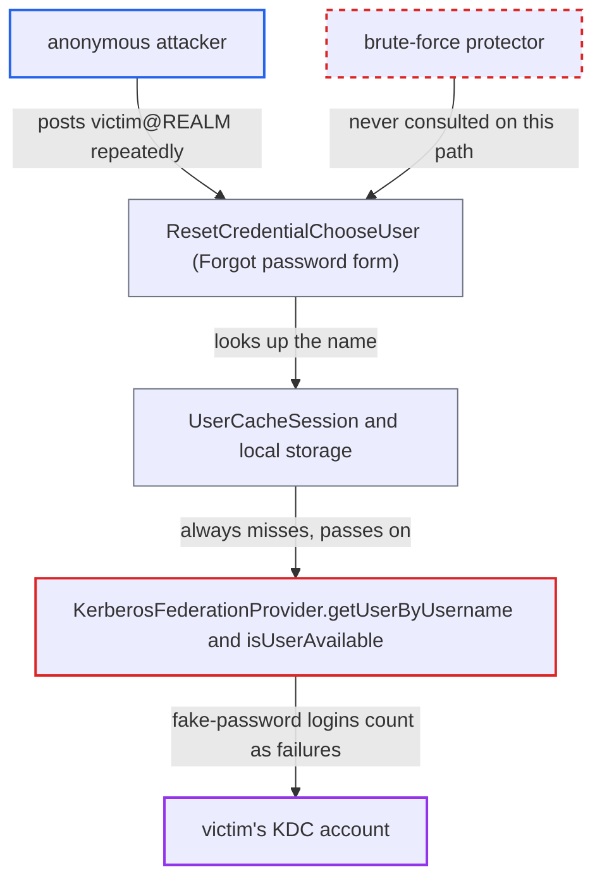

# Kerberos user lookup performs fake-password KDC login, enabling remote directory account lockout

| Field | Value |
|---|---|
| ID | `find_01WxJLXVY6YLX5CntBc4fqco` |
| Severity | **Medium** |
| Status | open |
| CWE | CWE-645 — Account Lockout Abuse |
| Created | 2026-10-27T22:11:51.653489Z |
| Claude Security | https://claude.ai/security/findings/find_01WxJLXVY6YLX5CntBc4fqco |

## Description

An anonymous attacker who knows a Kerberos username can lock that person's directory account (Active Directory or FreeIPA) by repeatedly submitting a login or 'Forgot password' form. This works when the KDC has an account lockout policy, which is the FreeIPA default and common on AD. The cause is `KerberosFederationProvider.getUserByUsername`, which calls `isUserAvailable` and makes a real login attempt with a wrong password for every lookup.

1. **anonymous attacker** submits the 'Forgot password' form with `username=victim@REALM`. The form needs no login, and `ResetCredentialChooseUser` passes the typed name to `getUserByUsername` before it tries email, with no brute-force or rate-limit check. ([`services/src/main/java/org/keycloak/authentication/authenticators/resetcred/ResetCredentialChooseUser.java:124-126`](https://github.com/cx-benchmark/keycloak/blob/1d7be35d0764060a8143fc74b0aabf2442743be4/services/src/main/java/org/keycloak/authentication/authenticators/resetcred/ResetCredentialChooseUser.java#L124-L126))
2. **`getKerberosPrincipal`** maps `victim@REALM` to the same KDC principal as `victim`. The string still differs from the imported Keycloak username `victim`, so local storage never matches it. ([`federation/kerberos/src/main/java/org/keycloak/federation/kerberos/impl/KerberosUsernamePasswordAuthenticator.java:211-217`](https://github.com/cx-benchmark/keycloak/blob/1d7be35d0764060a8143fc74b0aabf2442743be4/federation/kerberos/src/main/java/org/keycloak/federation/kerberos/impl/KerberosUsernamePasswordAuthenticator.java#L211-L217))
3. **`UserCacheSession`** discards the cached user and queries the next layer again. The cached username `victim` differs from the queried string, so nothing absorbs repeated lookups. ([`model/infinispan/src/main/java/org/keycloak/models/cache/infinispan/UserCacheSession.java:320-333`](https://github.com/cx-benchmark/keycloak/blob/1d7be35d0764060a8143fc74b0aabf2442743be4/model/infinispan/src/main/java/org/keycloak/models/cache/infinispan/UserCacheSession.java#L320-L333))
4. **`KerberosFederationProvider.getUserByUsername`** calls `isUserAvailable` unconditionally. Each lookup that misses local storage therefore sends one bogus-password request to the KDC for the named principal. ([`federation/kerberos/src/main/java/org/keycloak/federation/kerberos/KerberosFederationProvider.java:99-112`](https://github.com/cx-benchmark/keycloak/blob/1d7be35d0764060a8143fc74b0aabf2442743be4/federation/kerberos/src/main/java/org/keycloak/federation/kerberos/KerberosFederationProvider.java#L99-L112))
5. **`isUserAvailable`** runs a real JAAS `Krb5LoginModule` login with a fixed wrong password. The KDC records a failed pre-authentication (`KDC_ERR_PREAUTH_FAILED`) that counts toward the account's bad-password counter, and the method reads the error text to decide whether the user exists. ([`federation/kerberos/src/main/java/org/keycloak/federation/kerberos/impl/KerberosUsernamePasswordAuthenticator.java:72-93`](https://github.com/cx-benchmark/keycloak/blob/1d7be35d0764060a8143fc74b0aabf2442743be4/federation/kerberos/src/main/java/org/keycloak/federation/kerberos/impl/KerberosUsernamePasswordAuthenticator.java#L72-L93))
6. **anonymous attacker** repeats the submission until the lockout threshold is reached. After the threshold (FreeIPA default `krbpwdmaxfailure=6`, typical AD 5 to 10) the KDC locks the victim's account.

## Assessment

The attacker is an unauthenticated remote client who knows or guesses a Kerberos username. The attacker needs no account and no password. The KDC must have an account lockout policy, which is the default for FreeIPA and common for AD. The attacker posts `username=victim@REALM` to the realm's 'Forgot password' form. The login form or direct grant with an email that does not match the guessed name also works, and so do SAML ECP basic auth (`HttpBasicAuthenticator`) and `IdpCreateUserIfUniqueAuthenticator`, which call `getUserByUsername` directly. The `user@REALM` form always misses local storage and the cache, so the KDC is contacted on every request. Keycloak's own brute-force protector is never consulted on this path. The same error-text check also reveals whether a principal exists (`Client not found` against any other error).

Impact: The attacker can lock targeted Kerberos-federated users out of Keycloak, over SPNEGO and password login, and keep them locked indefinitely. This can be scripted for every known username. Keycloak itself stays up, non-Kerberos users are unaffected, and no data is read or changed.

Subsequent-system impact: The failed logins land on the organisation's KDC or directory (AD or FreeIPA). A locked directory account loses access to every Kerberos-authenticated service, such as workstation logon, mail and file shares, not only Keycloak. The attack can run continuously against every account whose name can be enumerated, with no credentials.

## Recommendation

(1) `KerberosFederationProvider.getUserByUsername` calls `isUserAvailable`, which spends a real failing authentication attempt on an attacker-named principal just to test that it exists. Every anonymous username lookup therefore counts toward lockout on the KDC.

Fix criteria: A username lookup for the Kerberos provider causes no credential-bearing authentication attempt for the looked-up principal. Existence is established without a failed pre-authentication, or lookups are served from local storage or a per-principal negative cache and rate-limited. Submitting the reset-credentials form repeatedly with `victim@REALM` produces no `KDC_ERR_PREAUTH_FAILED` events for `victim` on the KDC. The account's bad-password counter does not increase.

(2) `getKerberosPrincipal` accepts the `user@REALM` alias, so the same principal can be addressed by a string that never matches the stored username. This defeats local-storage and cache hits.

Fix criteria: A lookup for `prefix@<configured realm>` resolves to the already-imported local user, because the name is normalised to the stored username form before the local lookup. Repeated requests then do not reach the provider. The second lookup of `victim@REALM` causes no KDC traffic.

## Evidence

**https://github.com/cx-benchmark/keycloak**

- [`federation/kerberos/src/main/java/org/keycloak/federation/kerberos/impl/KerberosUsernamePasswordAuthenticator.java:72-93`](https://github.com/cx-benchmark/keycloak/blob/1d7be35d0764060a8143fc74b0aabf2442743be4/federation/kerberos/src/main/java/org/keycloak/federation/kerberos/impl/KerberosUsernamePasswordAuthenticator.java#L72-L93)
- [`federation/kerberos/src/main/java/org/keycloak/federation/kerberos/KerberosFederationProvider.java:99-112`](https://github.com/cx-benchmark/keycloak/blob/1d7be35d0764060a8143fc74b0aabf2442743be4/federation/kerberos/src/main/java/org/keycloak/federation/kerberos/KerberosFederationProvider.java#L99-L112)
- [`federation/kerberos/src/main/java/org/keycloak/federation/kerberos/impl/KerberosUsernamePasswordAuthenticator.java:211-217`](https://github.com/cx-benchmark/keycloak/blob/1d7be35d0764060a8143fc74b0aabf2442743be4/federation/kerberos/src/main/java/org/keycloak/federation/kerberos/impl/KerberosUsernamePasswordAuthenticator.java#L211-L217)
- [`model/infinispan/src/main/java/org/keycloak/models/cache/infinispan/UserCacheSession.java:320-333`](https://github.com/cx-benchmark/keycloak/blob/1d7be35d0764060a8143fc74b0aabf2442743be4/model/infinispan/src/main/java/org/keycloak/models/cache/infinispan/UserCacheSession.java#L320-L333)
- [`services/src/main/java/org/keycloak/authentication/authenticators/resetcred/ResetCredentialChooseUser.java:124-126`](https://github.com/cx-benchmark/keycloak/blob/1d7be35d0764060a8143fc74b0aabf2442743be4/services/src/main/java/org/keycloak/authentication/authenticators/resetcred/ResetCredentialChooseUser.java#L124-L126)

