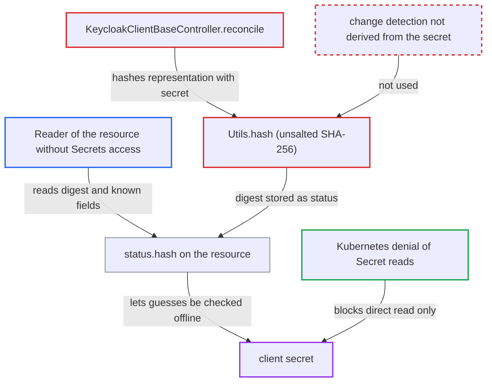

# KeycloakOIDCClient status.hash publishes unsalted SHA-256 oracle of the client secret

| Field | Value |
|---|---|
| ID | `find_01LvCJfT7BjW2RyPvwUvyvHP` |
| Severity | **Medium** |
| Status | open |
| CWE | CWE-916 — Weak password hash |
| Created | 2026-10-27T22:11:44.617859Z |
| Claude Security | https://claude.ai/security/findings/find_01LvCJfT7BjW2RyPvwUvyvHP |

## Description

A Kubernetes user who can read `KeycloakOIDCClient` resources but not Secrets can recover a guessable client secret. The operator publishes an unsalted SHA-256 of the client, secret included, in the resource's `status.hash`. The attacker needs `get` on the resource, and only weak secrets can be guessed. The weakness is in `KeycloakClientBaseController.reconcile` and `Utils.hash`.

1. **the controller `KeycloakOIDCClientController.prepareRepresentation`** reads the Secret named by `auth.secretRef` and puts its plaintext into the client representation. The Secret must carry the label `operator.keycloak.org/kind=KeycloakOIDCClient`, and the value is set with `getAuth().setSecret(...)`. ([`operator/src/main/java/org/keycloak/operator/controllers/KeycloakOIDCClientController.java:64-76`](https://github.com/cx-benchmark/keycloak/blob/1d7be35d0764060a8143fc74b0aabf2442743be4/operator/src/main/java/org/keycloak/operator/controllers/KeycloakOIDCClientController.java#L64-L76))
2. **the controller `KeycloakClientBaseController.reconcile`** hashes the full representation and writes the result to the resource status. It calls `Utils.hash(List.of(rep))` after the secret is inlined, then `status.setHash(hash)`. ([`operator/src/main/java/org/keycloak/operator/controllers/KeycloakClientBaseController.java:182-203`](https://github.com/cx-benchmark/keycloak/blob/1d7be35d0764060a8143fc74b0aabf2442743be4/operator/src/main/java/org/keycloak/operator/controllers/KeycloakClientBaseController.java#L182-L203))
3. **the helper `Utils.hash`** computes one SHA-256 over the YAML of the representation. There is no salt, no key and no work factor, so the hash is fast to compute and the secret is part of the hashed text. ([`operator/src/main/java/org/keycloak/operator/Utils.java:99-123`](https://github.com/cx-benchmark/keycloak/blob/1d7be35d0764060a8143fc74b0aabf2442743be4/operator/src/main/java/org/keycloak/operator/Utils.java#L99-L123))
4. **the attacker** reads the resource's `spec.client`, its name and `status.hash`. `status.hash` is a plain status field served to every reader of the resource, and the resource name is used as `clientId`. ([`operator/src/main/java/org/keycloak/operator/crds/v2alpha1/client/KeycloakClientStatus.java:33`](https://github.com/cx-benchmark/keycloak/blob/1d7be35d0764060a8143fc74b0aabf2442743be4/operator/src/main/java/org/keycloak/operator/crds/v2alpha1/client/KeycloakClientStatus.java#L33))
5. **the attacker** rebuilds the hashed YAML with every field known except `auth.secret`. The operator's serializer is open source, so the attacker can reproduce the exact document.
6. **the attacker** tries candidate secrets offline until the SHA-256 matches `status.hash`. Admin API v2 accepts secrets of 6 characters or more, and the guide's example uses `my-secret`, so guessable values are allowed. ([`docs/guides/operator/managing-clients.adoc:117-128`](https://github.com/cx-benchmark/keycloak/blob/1d7be35d0764060a8143fc74b0aabf2442743be4/docs/guides/operator/managing-clients.adoc#L117-L128))
7. **the attacker** authenticates as the client at the token endpoint with the recovered secret. This yields service-account tokens carrying the client's roles.

## Assessment

The attacker is a Kubernetes user who can `get` `keycloakoidcclients` in the namespace but cannot read Secrets, such as a namespace viewer or a GitOps UI user. Everything else in the hashed document is readable by the same user, so only the secret is unknown. The attack works only if the client secret can be guessed. The API allows secrets of 6 characters or more, and the docs example uses `my-secret`.

Impact: The attacker recovers a confidential client's secret without permission to read Secrets. With it they obtain tokens for that client and act in its name. Only clients with guessable secrets are exposed, and the Keycloak instance is not otherwise changed.

## Recommendation

Change detection for `KeycloakOIDCClient` hashes the plaintext client secret with a fast, unsalted digest. The result is published in `status.hash`, which gives readers who may not read the Secret an offline way to check guesses.

Fix criteria: No value that can be recomputed from a guessed client secret appears in the resource status, annotations or logs. Change detection uses data that is not a public function of the secret, such as the Secret's `resourceVersion`/`uid` or a keyed MAC under an operator-private key. To verify, take two resources that differ only in their Secret's value. An observer must not be able to confirm a guessed secret from either one's status.

## Evidence

**https://github.com/cx-benchmark/keycloak**

- [`operator/src/main/java/org/keycloak/operator/controllers/KeycloakClientBaseController.java:182-203`](https://github.com/cx-benchmark/keycloak/blob/1d7be35d0764060a8143fc74b0aabf2442743be4/operator/src/main/java/org/keycloak/operator/controllers/KeycloakClientBaseController.java#L182-L203)
- [`operator/src/main/java/org/keycloak/operator/controllers/KeycloakOIDCClientController.java:64-76`](https://github.com/cx-benchmark/keycloak/blob/1d7be35d0764060a8143fc74b0aabf2442743be4/operator/src/main/java/org/keycloak/operator/controllers/KeycloakOIDCClientController.java#L64-L76)
- [`operator/src/main/java/org/keycloak/operator/Utils.java:99-123`](https://github.com/cx-benchmark/keycloak/blob/1d7be35d0764060a8143fc74b0aabf2442743be4/operator/src/main/java/org/keycloak/operator/Utils.java#L99-L123)
- [`operator/src/main/java/org/keycloak/operator/crds/v2alpha1/client/KeycloakOIDCClientRepresentation.java:31-35`](https://github.com/cx-benchmark/keycloak/blob/1d7be35d0764060a8143fc74b0aabf2442743be4/operator/src/main/java/org/keycloak/operator/crds/v2alpha1/client/KeycloakOIDCClientRepresentation.java#L31-L35)
- [`operator/src/main/java/org/keycloak/operator/crds/v2alpha1/client/KeycloakClientStatus.java:33`](https://github.com/cx-benchmark/keycloak/blob/1d7be35d0764060a8143fc74b0aabf2442743be4/operator/src/main/java/org/keycloak/operator/crds/v2alpha1/client/KeycloakClientStatus.java#L33)
- [`docs/guides/operator/managing-clients.adoc:117-128`](https://github.com/cx-benchmark/keycloak/blob/1d7be35d0764060a8143fc74b0aabf2442743be4/docs/guides/operator/managing-clients.adoc#L117-L128)

