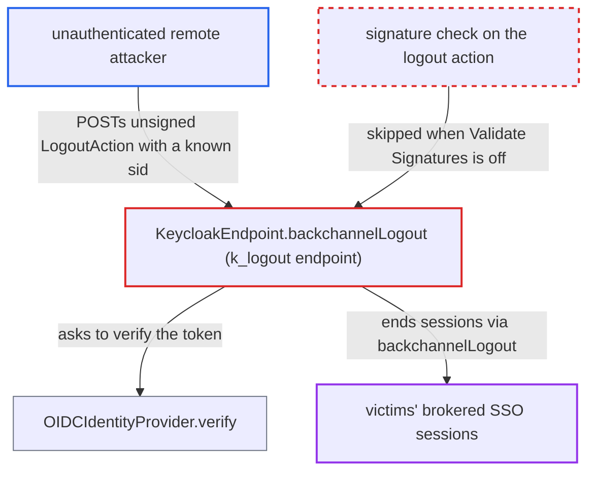

# Legacy k_logout broker endpoint accepts unsigned logout actions when Validate Signatures is off

| Field | Value |
|---|---|
| ID | `find_01Bsw2wB8k9xZWhvCTrdudAR` |
| Severity | **Medium** |
| Status | open |
| CWE | CWE-347 — Improper Signature Verification |
| Created | 2026-10-27T21:21:46.691794Z |
| Claude Security | https://claude.ai/security/findings/find_01Bsw2wB8k9xZWhvCTrdudAR |

## Description

An unauthenticated remote attacker can end chosen users' brokered login sessions in a realm. This needs a `keycloak-oidc` identity provider with `Validate Signatures` off, and the victim's upstream session id (`sid`). The `k_logout` endpoint in `KeycloakEndpoint.backchannelLogout` trusts `OIDCIdentityProvider.verify`, which accepts any token when `validateSignature` is off.

1. **attacker** obtains the victim's upstream Keycloak session id (`sid`). The report calls it a random, target-specific secret. It could come from a token the upstream realm issued to another app the attacker controls.
2. **attacker** builds an unsigned logout token and POSTs it to `/realms/{realm}/broker/{alias}/endpoint/k_logout`. The token is `header.payload` with header alg `none`. The payload has `action` set to `LOGOUT`, a future `expiration`, `resource` set to the IdP's `clientId`, and the victim's `sid` in `keycloakSessionIds`. `JWSInput` parses a token with no signature part. ([`core/src/main/java/org/keycloak/jose/jws/JWSInput.java:42-60`](https://github.com/cx-benchmark/keycloak/blob/1d7be35d0764060a8143fc74b0aabf2442743be4/core/src/main/java/org/keycloak/jose/jws/JWSInput.java#L42-L60))
3. **the handler `KeycloakEndpoint.backchannelLogout`** accepts the request after calling `provider.verify(token)`. The endpoint needs no authentication. `verify` is the only authenticity check, and it returns `true` without checking anything when `validateSignature` is off. ([`services/src/main/java/org/keycloak/broker/oidc/OIDCIdentityProvider.java:580-583`](https://github.com/cx-benchmark/keycloak/blob/1d7be35d0764060a8143fc74b0aabf2442743be4/services/src/main/java/org/keycloak/broker/oidc/OIDCIdentityProvider.java#L580-L583))
4. **the method `validateAction`** passes the forged action. It only checks that `action` is `LOGOUT`, that `expiration` is in the future, and that `resource` equals the IdP's `clientId`. The attacker controls all three values, and the `clientId` is public. ([`services/src/main/java/org/keycloak/broker/oidc/KeycloakOIDCIdentityProvider.java:115-130`](https://github.com/cx-benchmark/keycloak/blob/1d7be35d0764060a8143fc74b0aabf2442743be4/services/src/main/java/org/keycloak/broker/oidc/KeycloakOIDCIdentityProvider.java#L115-L130))
5. **the handler `KeycloakEndpoint.backchannelLogout`** looks up the user session with broker session id `alias.<sid>` and calls `AuthenticationManager.backchannelLogout`. This runs for each entry in `keycloakSessionIds`, so the victim's session and its client sessions are ended. ([`services/src/main/java/org/keycloak/broker/oidc/KeycloakOIDCIdentityProvider.java:73-113`](https://github.com/cx-benchmark/keycloak/blob/1d7be35d0764060a8143fc74b0aabf2442743be4/services/src/main/java/org/keycloak/broker/oidc/KeycloakOIDCIdentityProvider.java#L73-L113))

## Assessment

The attacker is remote and unauthenticated. Broker callbacks are public entry points. The target realm needs a `keycloak-oidc` identity provider with `Validate Signatures` off. That is the default: `isValidateSignature()` is false unless set, and only discovery import with a `jwks_uri` turns it on. A provider configured by hand or through the REST API without the option is affected. The attacker needs the victim's upstream `sid` and cannot enumerate sessions. The report rates attack complexity as high for this reason.

Impact: The attacker can end the brokered SSO sessions, with their client sessions, of users whose `sid` they know. This is a targeted denial of the login service for chosen users. No data is disclosed and nothing else changes.

## Recommendation

`KeycloakEndpoint.backchannelLogout` relies on `OIDCIdentityProvider.verify`, which accepts any JWS when `validateSignature` is false. An unsigned inbound logout request is therefore accepted with no proof that the upstream Keycloak sent it. This breaks the documented rule that logout messages are always signature-validated.

Fix criteria: A `k_logout` request is accepted only when its JWS signature verifies against the IdP's configured keys (JWKS URL or validating public key), whatever `Validate Signatures` says, as `validateLogoutToken` already does. Tokens with `alg=none` and tokens without a signature are rejected. To verify, turn `Validate Signatures` off and POST an unsigned or garbage-signed `LogoutAction` that names a live broker session id. The response is 400 and the session stays active. A correctly signed action still logs the session out.

## Evidence

**https://github.com/cx-benchmark/keycloak**

- [`services/src/main/java/org/keycloak/broker/oidc/KeycloakOIDCIdentityProvider.java:73-113`](https://github.com/cx-benchmark/keycloak/blob/1d7be35d0764060a8143fc74b0aabf2442743be4/services/src/main/java/org/keycloak/broker/oidc/KeycloakOIDCIdentityProvider.java#L73-L113)
- [`services/src/main/java/org/keycloak/broker/oidc/OIDCIdentityProvider.java:580-583`](https://github.com/cx-benchmark/keycloak/blob/1d7be35d0764060a8143fc74b0aabf2442743be4/services/src/main/java/org/keycloak/broker/oidc/OIDCIdentityProvider.java#L580-L583)
- [`services/src/main/java/org/keycloak/broker/oidc/OIDCIdentityProvider.java:721-734`](https://github.com/cx-benchmark/keycloak/blob/1d7be35d0764060a8143fc74b0aabf2442743be4/services/src/main/java/org/keycloak/broker/oidc/OIDCIdentityProvider.java#L721-L734)
- [`services/src/main/java/org/keycloak/broker/oidc/OIDCIdentityProviderConfig.java:76-78`](https://github.com/cx-benchmark/keycloak/blob/1d7be35d0764060a8143fc74b0aabf2442743be4/services/src/main/java/org/keycloak/broker/oidc/OIDCIdentityProviderConfig.java#L76-L78)
- [`services/src/main/java/org/keycloak/broker/oidc/KeycloakOIDCIdentityProvider.java:115-130`](https://github.com/cx-benchmark/keycloak/blob/1d7be35d0764060a8143fc74b0aabf2442743be4/services/src/main/java/org/keycloak/broker/oidc/KeycloakOIDCIdentityProvider.java#L115-L130)
- [`core/src/main/java/org/keycloak/jose/jws/JWSInput.java:42-60`](https://github.com/cx-benchmark/keycloak/blob/1d7be35d0764060a8143fc74b0aabf2442743be4/core/src/main/java/org/keycloak/jose/jws/JWSInput.java#L42-L60)
- [`docs/documentation/server_admin/topics/identity-broker/oidc.adoc:69-73`](https://github.com/cx-benchmark/keycloak/blob/1d7be35d0764060a8143fc74b0aabf2442743be4/docs/documentation/server_admin/topics/identity-broker/oidc.adoc#L69-L73)

