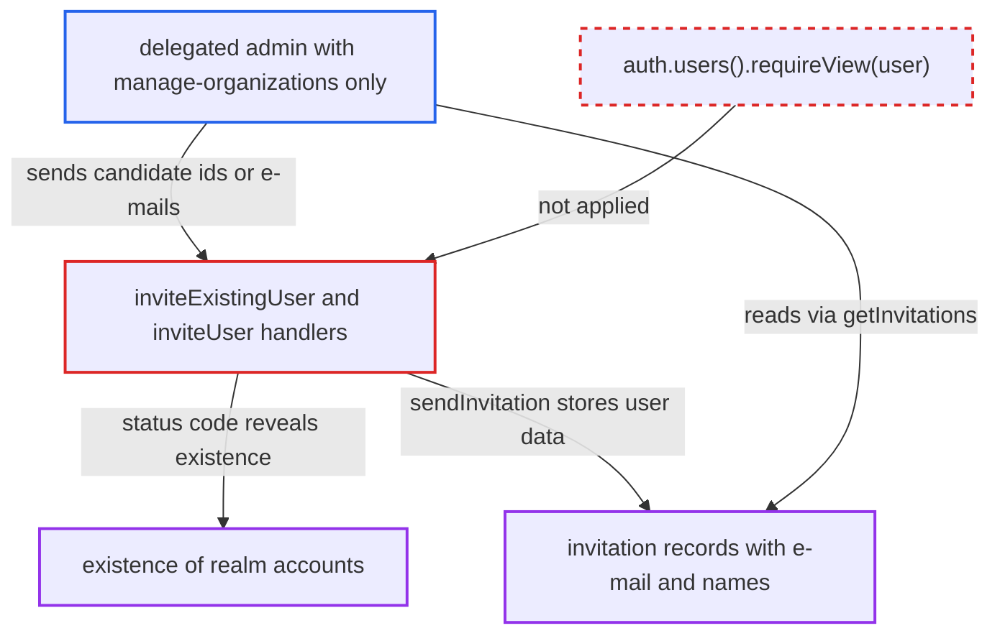

# Organization invite endpoints disclose existence, e-mail and names of realm users the admin cannot view

| Field | Value |
|---|---|
| ID | `find_0178DBVEnZUjbdpn5cknYUqR` |
| Severity | **Medium** |
| Status | open |
| CWE | CWE-639 — Insecure direct object reference |
| Created | 2026-10-27T22:18:08.185997Z |
| Claude Security | https://claude.ai/security/findings/find_0178DBVEnZUjbdpn5cknYUqR |

## Description

An admin who can manage one organization but has no permission to view users can find out whether a realm account exists for a given id or e-mail. If mail sending works, the admin can also read that account's e-mail address and first and last name. The invite endpoints `inviteExistingUser` and `inviteUser` look up any realm user without a user-level permission check such as `auth.users().requireView(user)`.

1. **delegated admin** holds only organization management rights. `canManage(organization)` is satisfied by the `manage-organizations` role or a fine-grained `MANAGE` permission on one organization, and neither grants any user permission. ([`services/src/main/java/org/keycloak/services/resources/admin/fgap/OrganizationPermissions.java:51-58`](https://github.com/cx-benchmark/keycloak/blob/1d7be35d0764060a8143fc74b0aabf2442743be4/services/src/main/java/org/keycloak/services/resources/admin/fgap/OrganizationPermissions.java#L51-L58))
2. **delegated admin** posts candidate user ids to `invite-existing-user`. The handler `inviteExistingUser` loads any realm user with `session.users().getUserById` after checking only `auth.orgs().requireManage(organization)`, and never calls `auth.users().requireView(user)`. ([`services/src/main/java/org/keycloak/organization/admin/resource/OrganizationInvitationResource.java:158-182`](https://github.com/cx-benchmark/keycloak/blob/1d7be35d0764060a8143fc74b0aabf2442743be4/services/src/main/java/org/keycloak/organization/admin/resource/OrganizationInvitationResource.java#L158-L182))
3. **the handler `inviteExistingUser`** answers differently for existing and unknown ids. An existing id gives 204 (or 400 for a user without e-mail, or 500 when mail fails). An unknown id gives 403 when the caller lacks `users().canQuery()`, so the status code reveals whether the account exists. ([`services/src/main/java/org/keycloak/organization/admin/resource/OrganizationInvitationResource.java:158-182`](https://github.com/cx-benchmark/keycloak/blob/1d7be35d0764060a8143fc74b0aabf2442743be4/services/src/main/java/org/keycloak/organization/admin/resource/OrganizationInvitationResource.java#L158-L182))
4. **delegated admin** posts candidate e-mail addresses to `invite-user`. `inviteUser` resolves the address with `getUserByEmail`. For an existing user it returns 409 if the user is already a member, and otherwise it sends an invitation using the stored user's own `firstName` and `lastName` instead of the supplied ones. ([`services/src/main/java/org/keycloak/organization/admin/resource/OrganizationInvitationResource.java:136-144`](https://github.com/cx-benchmark/keycloak/blob/1d7be35d0764060a8143fc74b0aabf2442743be4/services/src/main/java/org/keycloak/organization/admin/resource/OrganizationInvitationResource.java#L136-L144))
5. **the method `sendInvitation`** saves the probed user's e-mail and names in the invitation record. It persists `user.getEmail()`, `user.getFirstName()` and `user.getLastName()` into the record. ([`services/src/main/java/org/keycloak/organization/admin/resource/OrganizationInvitationResource.java:184-193`](https://github.com/cx-benchmark/keycloak/blob/1d7be35d0764060a8143fc74b0aabf2442743be4/services/src/main/java/org/keycloak/organization/admin/resource/OrganizationInvitationResource.java#L184-L193))
6. **delegated admin** reads the invitations through `getInvitations` or `getInvitation`. These endpoints return the stored `email`, `firstName` and `lastName` to anyone with `MANAGE` on the organization, with no filter by user permissions. ([`services/src/main/java/org/keycloak/organization/admin/resource/OrganizationInvitationResource.java:341-378`](https://github.com/cx-benchmark/keycloak/blob/1d7be35d0764060a8143fc74b0aabf2442743be4/services/src/main/java/org/keycloak/organization/admin/resource/OrganizationInvitationResource.java#L341-L378))

## Assessment

The attacker is an admin of the Admin REST API who holds `manage-organizations` or a fine-grained `MANAGE` permission on a single organization, and has no user permissions. The attacker posts candidate ids to `invite-existing-user` or candidate e-mails to `invite-user` and reads the status codes. Reading the e-mail and names needs the realm's mail sending to succeed, which using invitations presupposes. The existence check does not need mail to work.

Impact: The attacker learns whether a realm account exists for a given id or e-mail. The attacker can also read that account's e-mail address and first and last name. The exposure is limited PII, and nothing is modified beyond invitation records and mails that `invite-user` already lets the admin send to any address.

## Recommendation

(1) `inviteExistingUser` and `inviteUser` look up realm users by the caller's id or e-mail and act on them without the caller's user-level view or manage permission. The sibling `addMember` path does check it.

Fix criteria: Inviting an existing user, by id or by an e-mail that resolves to an existing user, requires user-level permission on that user, consistent with `addMember`. Responses for existing users the caller cannot view are indistinguishable from responses for non-existent ones. Test with a `manage-organizations`-only admin: probing ids and e-mails of users outside its permissions gives identical responses.

(2) The invitation record stores the existing user's own `firstName`, `lastName` and e-mail. The invitations list then returns them to any org manager.

Fix criteria: Invitation records readable by an org manager do not reveal attributes of a realm user that the manager cannot view. Test by inviting the e-mail of an out-of-scope user and checking that `GET .../invitations` shows only data the caller supplied.

## Evidence

**https://github.com/cx-benchmark/keycloak**

- [`services/src/main/java/org/keycloak/organization/admin/resource/OrganizationInvitationResource.java:158-182`](https://github.com/cx-benchmark/keycloak/blob/1d7be35d0764060a8143fc74b0aabf2442743be4/services/src/main/java/org/keycloak/organization/admin/resource/OrganizationInvitationResource.java#L158-L182)
- [`services/src/main/java/org/keycloak/organization/admin/resource/OrganizationInvitationResource.java:136-144`](https://github.com/cx-benchmark/keycloak/blob/1d7be35d0764060a8143fc74b0aabf2442743be4/services/src/main/java/org/keycloak/organization/admin/resource/OrganizationInvitationResource.java#L136-L144)
- [`services/src/main/java/org/keycloak/organization/admin/resource/OrganizationInvitationResource.java:184-193`](https://github.com/cx-benchmark/keycloak/blob/1d7be35d0764060a8143fc74b0aabf2442743be4/services/src/main/java/org/keycloak/organization/admin/resource/OrganizationInvitationResource.java#L184-L193)
- [`services/src/main/java/org/keycloak/organization/admin/resource/OrganizationInvitationResource.java:341-378`](https://github.com/cx-benchmark/keycloak/blob/1d7be35d0764060a8143fc74b0aabf2442743be4/services/src/main/java/org/keycloak/organization/admin/resource/OrganizationInvitationResource.java#L341-L378)
- [`services/src/main/java/org/keycloak/organization/admin/resource/OrganizationInvitationResource.java:456-473`](https://github.com/cx-benchmark/keycloak/blob/1d7be35d0764060a8143fc74b0aabf2442743be4/services/src/main/java/org/keycloak/organization/admin/resource/OrganizationInvitationResource.java#L456-L473)
- [`services/src/main/java/org/keycloak/organization/admin/resource/OrganizationMemberResource.java:107-113`](https://github.com/cx-benchmark/keycloak/blob/1d7be35d0764060a8143fc74b0aabf2442743be4/services/src/main/java/org/keycloak/organization/admin/resource/OrganizationMemberResource.java#L107-L113)
- [`services/src/main/java/org/keycloak/services/resources/admin/fgap/OrganizationPermissions.java:51-58`](https://github.com/cx-benchmark/keycloak/blob/1d7be35d0764060a8143fc74b0aabf2442743be4/services/src/main/java/org/keycloak/services/resources/admin/fgap/OrganizationPermissions.java#L51-L58)
- [`model/jpa/src/main/java/org/keycloak/models/jpa/JpaUserProvider.java:712-740`](https://github.com/cx-benchmark/keycloak/blob/1d7be35d0764060a8143fc74b0aabf2442743be4/model/jpa/src/main/java/org/keycloak/models/jpa/JpaUserProvider.java#L712-L740)
- [`docs/documentation/release_notes/topics/26_7_0.adoc:159-167`](https://github.com/cx-benchmark/keycloak/blob/1d7be35d0764060a8143fc74b0aabf2442743be4/docs/documentation/release_notes/topics/26_7_0.adoc#L159-L167)

