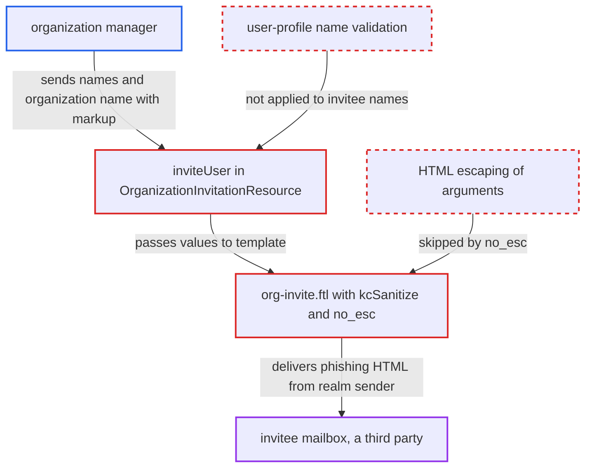

# Organization manager injects HTML into invitation e-mail via invitee names and organization name

| Field | Value |
|---|---|
| ID | `find_01X7pnCWDR1iVyXPJHqTsGrF` |
| Severity | **Medium** |
| Status | open |
| CWE | CWE-116 — Improper output escaping |
| Created | 2026-10-27T21:47:13.262397Z |
| Claude Security | https://claude.ai/security/findings/find_01X7pnCWDR1iVyXPJHqTsGrF |

## Description

An organization manager can make Keycloak send an invitation e-mail with attacker-written HTML to any outside address, from the realm's own sender. The HTML can hold disguised links, remote images and restyled blocks, which allows convincing phishing. It needs `manage-organizations` or FGAP `manage` on an organization. The cause is that `org-invite.ftl` puts `firstName`, `lastName` and `organization.name` into the HTML with only `kcSanitize` as protection.

1. **organization manager** sends an invite request for an address with no account. The request sets `email` to an external address and puts markup in `firstName` or `lastName`. The attacker can also put markup in the organization `name`. ([`services/src/main/java/org/keycloak/organization/admin/resource/OrganizationMemberResource.java:131-153`](https://github.com/cx-benchmark/keycloak/blob/1d7be35d0764060a8143fc74b0aabf2442743be4/services/src/main/java/org/keycloak/organization/admin/resource/OrganizationMemberResource.java#L131-L153))
2. **the handler `inviteUser`** copies the submitted names onto a temporary user without validating them. It checks only the e-mail format and the manage permission, so the `person-name-prohibited-characters` rule that guards names elsewhere never runs. `resendInvitation` sends the stored names again. ([`services/src/main/java/org/keycloak/organization/admin/resource/OrganizationInvitationResource.java:106-155`](https://github.com/cx-benchmark/keycloak/blob/1d7be35d0764060a8143fc74b0aabf2442743be4/services/src/main/java/org/keycloak/organization/admin/resource/OrganizationInvitationResource.java#L106-L155))
3. **`sendOrgInviteEmail`** passes the organization and the raw names to the e-mail template. The mail goes to the invitee address the caller chose, which belongs to a third party. ([`services/src/main/java/org/keycloak/email/freemarker/FreeMarkerEmailTemplateProvider.java:184-193`](https://github.com/cx-benchmark/keycloak/blob/1d7be35d0764060a8143fc74b0aabf2442743be4/services/src/main/java/org/keycloak/email/freemarker/FreeMarkerEmailTemplateProvider.java#L184-L193))
4. **the `msg` method** inserts the values into the HTML message text. `MessageFormatterMethod.exec` does no HTML escaping, and the bundle puts `{3}`, `{5}` and `{6}` inside HTML markup. ([`services/src/main/java/org/keycloak/theme/beans/MessageFormatterMethod.java:55-66`](https://github.com/cx-benchmark/keycloak/blob/1d7be35d0764060a8143fc74b0aabf2442743be4/services/src/main/java/org/keycloak/theme/beans/MessageFormatterMethod.java#L55-L66))
5. **the template `org-invite.ftl`** outputs the result of `kcSanitize` with `?no_esc`. `?no_esc` turns off the automatic escaping. `kcSanitize` first decodes all HTML entities, so encoded markup becomes live tags. ([`themes/src/main/resources/theme/base/email/html/org-invite.ftl:3-7`](https://github.com/cx-benchmark/keycloak/blob/1d7be35d0764060a8143fc74b0aabf2442743be4/themes/src/main/resources/theme/base/email/html/org-invite.ftl#L3-L7))
6. **`KeycloakSanitizerPolicy`** keeps the markup its rich-text allow-list permits. The policy keeps `a[href]` to offsite http/https/mailto URLs, `img[src]`, styling, `div`, `font`, tables and headings. It removes only scripts and event handlers. ([`services/src/main/java/org/keycloak/theme/KeycloakSanitizerPolicy.java:86-170`](https://github.com/cx-benchmark/keycloak/blob/1d7be35d0764060a8143fc74b0aabf2442743be4/services/src/main/java/org/keycloak/theme/KeycloakSanitizerPolicy.java#L86-L170))

## Assessment

The attacker holds `manage-organizations`, or FGAP `manage` on one organization, in a realm that uses organizations and sends mail over SMTP. They use the admin REST API `POST .../organizations/{id}/members/invite-user` with `email` set to any external address that has no account. They set `firstName` to something like an anchor pointing to `https://evil.example` plus a remote image. Another way in is to put the markup in the organization name. The recipient sees the result when they open the mail. An unclosed styled `div` can also wrap and visually hide the genuine link.

Impact: The attacker controls disguised links, remote images (open tracking) and styling inside a genuine Keycloak e-mail sent from the realm's sender address to any mailbox. Scripts and event handlers are stripped, and no Keycloak data is read or changed. Only the content of the e-mail is affected, to a limited degree. A `manage-realm` admin can already author this HTML through localization overrides, but an organization manager cannot.

## Recommendation

(1) `org-invite.ftl` puts `organization.name`, `firstName` and `lastName` unescaped into HTML message text that is output with `?no_esc`. The only barrier is `kcSanitize`, which decodes entities first, so escaping an argument before it would be undone.

Fix criteria: Values from callers appear as literal text in the delivered HTML. Either only trusted bundle text goes through `kcSanitize` and the arguments are escaped afterwards, or the arguments are escaped in a way `kcSanitize` does not decode. To check, invite a new address with `firstName=<a href="https://x">x</a>` and an organization named ``. The HTML body must contain neither element, and the text must show literally.

(2) `OrganizationInvitationResource.inviteUser` and `resendInvitation` accept `firstName` and `lastName` for a new invitee without the user-profile validation (`person-name-prohibited-characters`) that applies to these attributes on every other path.

Fix criteria: Names given to `invite-user` pass the same validation as the `firstName` and `lastName` user-profile attributes. Values with markup characters are rejected with 400 before an invitation is stored or a mail is sent. To check, send `firstName=<b>x</b>`. It must return 400 and no e-mail must be sent.

## Evidence

**https://github.com/cx-benchmark/keycloak**

- [`themes/src/main/resources/theme/base/email/html/org-invite.ftl:3-7`](https://github.com/cx-benchmark/keycloak/blob/1d7be35d0764060a8143fc74b0aabf2442743be4/themes/src/main/resources/theme/base/email/html/org-invite.ftl#L3-L7)
- [`services/src/main/java/org/keycloak/organization/admin/resource/OrganizationInvitationResource.java:106-155`](https://github.com/cx-benchmark/keycloak/blob/1d7be35d0764060a8143fc74b0aabf2442743be4/services/src/main/java/org/keycloak/organization/admin/resource/OrganizationInvitationResource.java#L106-L155)
- [`services/src/main/java/org/keycloak/organization/admin/resource/OrganizationMemberResource.java:131-153`](https://github.com/cx-benchmark/keycloak/blob/1d7be35d0764060a8143fc74b0aabf2442743be4/services/src/main/java/org/keycloak/organization/admin/resource/OrganizationMemberResource.java#L131-L153)
- [`services/src/main/java/org/keycloak/email/freemarker/FreeMarkerEmailTemplateProvider.java:184-193`](https://github.com/cx-benchmark/keycloak/blob/1d7be35d0764060a8143fc74b0aabf2442743be4/services/src/main/java/org/keycloak/email/freemarker/FreeMarkerEmailTemplateProvider.java#L184-L193)
- [`services/src/main/java/org/keycloak/theme/beans/MessageFormatterMethod.java:55-66`](https://github.com/cx-benchmark/keycloak/blob/1d7be35d0764060a8143fc74b0aabf2442743be4/services/src/main/java/org/keycloak/theme/beans/MessageFormatterMethod.java#L55-L66)
- [`themes/src/main/resources/theme/base/email/messages/messages_en.properties:6-8`](https://github.com/cx-benchmark/keycloak/blob/1d7be35d0764060a8143fc74b0aabf2442743be4/themes/src/main/resources/theme/base/email/messages/messages_en.properties#L6-L8)
- [`services/src/main/java/org/keycloak/theme/KeycloakSanitizerMethod.java:44-55`](https://github.com/cx-benchmark/keycloak/blob/1d7be35d0764060a8143fc74b0aabf2442743be4/services/src/main/java/org/keycloak/theme/KeycloakSanitizerMethod.java#L44-L55)
- [`services/src/main/java/org/keycloak/theme/KeycloakSanitizerPolicy.java:86-170`](https://github.com/cx-benchmark/keycloak/blob/1d7be35d0764060a8143fc74b0aabf2442743be4/services/src/main/java/org/keycloak/theme/KeycloakSanitizerPolicy.java#L86-L170)
- [`services/src/main/java/org/keycloak/organization/admin/resource/OrganizationResource.java:120-137`](https://github.com/cx-benchmark/keycloak/blob/1d7be35d0764060a8143fc74b0aabf2442743be4/services/src/main/java/org/keycloak/organization/admin/resource/OrganizationResource.java#L120-L137)
- [`services/src/main/java/org/keycloak/services/resources/admin/RealmLocalizationResource.java:86`](https://github.com/cx-benchmark/keycloak/blob/1d7be35d0764060a8143fc74b0aabf2442743be4/services/src/main/java/org/keycloak/services/resources/admin/RealmLocalizationResource.java#L86)
- [`themes/src/main/resources/theme/base/login/select-organization.ftl:13`](https://github.com/cx-benchmark/keycloak/blob/1d7be35d0764060a8143fc74b0aabf2442743be4/themes/src/main/resources/theme/base/login/select-organization.ftl#L13)

