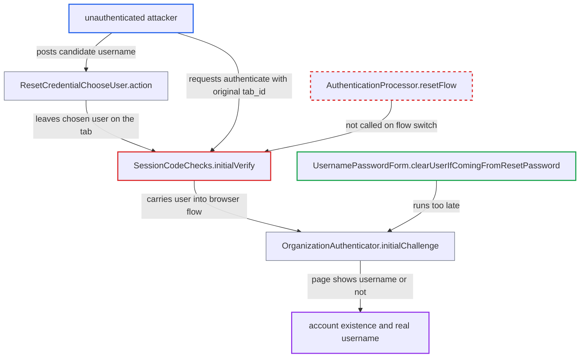

# Reset-credentials tab keeps chosen user across flow switch, exposing account existence on login

| Field | Value |
|---|---|
| ID | `find_017sTNg5ahKS4S9pcYAHwy3d` |
| Severity | **Medium** |
| Status | open |
| CWE | CWE-204 — Observable Response Discrepancy |
| Created | 2026-10-27T21:33:49.326071Z |
| Claude Security | https://claude.ai/security/findings/find_017sTNg5ahKS4S9pcYAHwy3d |

## Description

An unauthenticated attacker can test whether a username or e-mail belongs to an existing, enabled account, and can turn an e-mail into the account's real username. It needs a realm with Forgot password enabled and Organizations enabled with at least one organization. `SessionCodeChecks.initialVerify` lets a login tab move from the reset flow to the login flow while keeping the user the reset flow chose from typed input. That user then changes which login page is shown.

1. **attacker** starts a login in tab A and posts a candidate username or e-mail to the reset-credentials flow in that tab. The attacker opens `GET /login-actions/reset-credentials?client_id=X&tab_id=A` and posts the name with the form's `session_code`. ([`services/src/main/java/org/keycloak/authentication/authenticators/resetcred/ResetCredentialChooseUser.java:124-148`](https://github.com/cx-benchmark/keycloak/blob/1d7be35d0764060a8143fc74b0aabf2442743be4/services/src/main/java/org/keycloak/authentication/authenticators/resetcred/ResetCredentialChooseUser.java#L124-L148))
2. **the handler `ResetCredentialChooseUser.action`** stores the matching user on the tab, or clears it. If the account exists and is enabled, it sets `authenticatedUser` and `RESET_CREDENTIAL_USER_CHOSEN`. Otherwise it calls `clearUser()`, so the tab's state records whether the account exists. ([`services/src/main/java/org/keycloak/authentication/authenticators/resetcred/ResetCredentialChooseUser.java:124-148`](https://github.com/cx-benchmark/keycloak/blob/1d7be35d0764060a8143fc74b0aabf2442743be4/services/src/main/java/org/keycloak/authentication/authenticators/resetcred/ResetCredentialChooseUser.java#L124-L148))
3. **the fork handler in `AuthenticationProcessor`** clones a new tab for `ResetCredentialEmail` and leaves the original tab untouched. The original tab keeps the chosen user and can still be reached by its `tab_id`. ([`services/src/main/java/org/keycloak/authentication/AuthenticationProcessor.java:860-882`](https://github.com/cx-benchmark/keycloak/blob/1d7be35d0764060a8143fc74b0aabf2442743be4/services/src/main/java/org/keycloak/authentication/AuthenticationProcessor.java#L860-L882))
4. **attacker** requests `GET /login-actions/authenticate?client_id=X&tab_id=A` with no session code. `SessionCodeChecks.initialVerify` accepts this as a flow transition. It only rewrites `CURRENT_FLOW_PATH` and drops `CURRENT_AUTHENTICATION_EXECUTION`. It never calls `AuthenticationProcessor.resetFlow`, so the user carries over into the browser flow. ([`services/src/main/java/org/keycloak/services/resources/SessionCodeChecks.java:280-294`](https://github.com/cx-benchmark/keycloak/blob/1d7be35d0764060a8143fc74b0aabf2442743be4/services/src/main/java/org/keycloak/services/resources/SessionCodeChecks.java#L280-L294))
5. **the authenticator `OrganizationAuthenticator.initialChallenge`** reads `context.getUser()` and picks the page to show. With a carried user it calls `attempted(context, user.getUsername())`, which sets `ATTEMPTED_USERNAME` to the real username and sets `USERNAME_HIDDEN`. The password-only `login.ftl` page then names the account. With no user it shows the identity-first `login-username.ftl` page. ([`services/src/main/java/org/keycloak/organization/authentication/authenticators/browser/OrganizationAuthenticator.java:451-473`](https://github.com/cx-benchmark/keycloak/blob/1d7be35d0764060a8143fc74b0aabf2442743be4/services/src/main/java/org/keycloak/organization/authentication/authenticators/browser/OrganizationAuthenticator.java#L451-L473))
6. **the existing mitigation `UsernamePasswordForm.clearUserIfComingFromResetPassword`** clears the carried user, but only when the forms step runs. In the default browser flow the Organization step has priority 26 and the forms step has priority 30. The username is already in the auth notes by then, so the page still differs. ([`services/src/main/java/org/keycloak/authentication/authenticators/browser/UsernamePasswordForm.java:88-130`](https://github.com/cx-benchmark/keycloak/blob/1d7be35d0764060a8143fc74b0aabf2442743be4/services/src/main/java/org/keycloak/authentication/authenticators/browser/UsernamePasswordForm.java#L88-L130))
7. **attacker** reads which page came back. A password page naming the account means the account exists and is enabled. The username page means it does not.

## Assessment

The attacker is unauthenticated and uses their own browser. The realm must have Forgot password enabled and Organizations enabled with at least one organization. The attacker starts a login, opens reset-credentials on that tab, submits a candidate name, then requests `/login-actions/authenticate` for the same `tab_id`. Each probe also sends a reset e-mail to the account's owner if the account exists. Custom flows built on `UsernameForm` gain nothing from this trick, because direct submission there already shows whether the user exists.

Impact: The attacker learns whether a username or e-mail belongs to an existing, enabled account. A typed e-mail is also mapped to the account's real username. This helps credential stuffing and targeted attacks. Nothing is modified.

## Recommendation

(1) `SessionCodeChecks.initialVerify` switches a tab between login-actions flows but keeps the `authenticatedUser`, execution statuses and auth notes that another flow set from unverified input. This breaks each flow's assumption that any user it sees was set by its own executions.

Fix criteria: After a flow transition, the target flow does not see a user or notes set by another flow. Either the tab is reset or the transition is refused while a user is set. Verify this: in a realm with Organizations enabled, submit an existing and then a non-existent username to reset-credentials. Switch the same tab to `/authenticate` and confirm the rendered pages are identical, with `context.getUser()` null.

(2) After the reset-credentials fork, the original tab stays reachable by its `tab_id` and keeps the user chosen from the typed username.

Fix criteria: After `ResetCredentialEmail` forks, the originating tab no longer exposes the chosen user to any flow. Verify that `GET /login-actions/authenticate?tab_id=<original>` after a reset submission behaves like a fresh login, whether or not the submitted username existed.

## Evidence

**https://github.com/cx-benchmark/keycloak**

- [`services/src/main/java/org/keycloak/services/resources/SessionCodeChecks.java:280-294`](https://github.com/cx-benchmark/keycloak/blob/1d7be35d0764060a8143fc74b0aabf2442743be4/services/src/main/java/org/keycloak/services/resources/SessionCodeChecks.java#L280-L294)
- [`services/src/main/java/org/keycloak/authentication/authenticators/resetcred/ResetCredentialChooseUser.java:124-148`](https://github.com/cx-benchmark/keycloak/blob/1d7be35d0764060a8143fc74b0aabf2442743be4/services/src/main/java/org/keycloak/authentication/authenticators/resetcred/ResetCredentialChooseUser.java#L124-L148)
- [`services/src/main/java/org/keycloak/authentication/AuthenticationProcessor.java:860-882`](https://github.com/cx-benchmark/keycloak/blob/1d7be35d0764060a8143fc74b0aabf2442743be4/services/src/main/java/org/keycloak/authentication/AuthenticationProcessor.java#L860-L882)
- [`services/src/main/java/org/keycloak/organization/authentication/authenticators/browser/OrganizationAuthenticator.java:451-473`](https://github.com/cx-benchmark/keycloak/blob/1d7be35d0764060a8143fc74b0aabf2442743be4/services/src/main/java/org/keycloak/organization/authentication/authenticators/browser/OrganizationAuthenticator.java#L451-L473)
- [`server-spi-private/src/main/java/org/keycloak/models/utils/DefaultAuthenticationFlows.java:856-860`](https://github.com/cx-benchmark/keycloak/blob/1d7be35d0764060a8143fc74b0aabf2442743be4/server-spi-private/src/main/java/org/keycloak/models/utils/DefaultAuthenticationFlows.java#L856-L860)
- [`services/src/main/java/org/keycloak/authentication/authenticators/browser/UsernamePasswordForm.java:88-130`](https://github.com/cx-benchmark/keycloak/blob/1d7be35d0764060a8143fc74b0aabf2442743be4/services/src/main/java/org/keycloak/authentication/authenticators/browser/UsernamePasswordForm.java#L88-L130)

