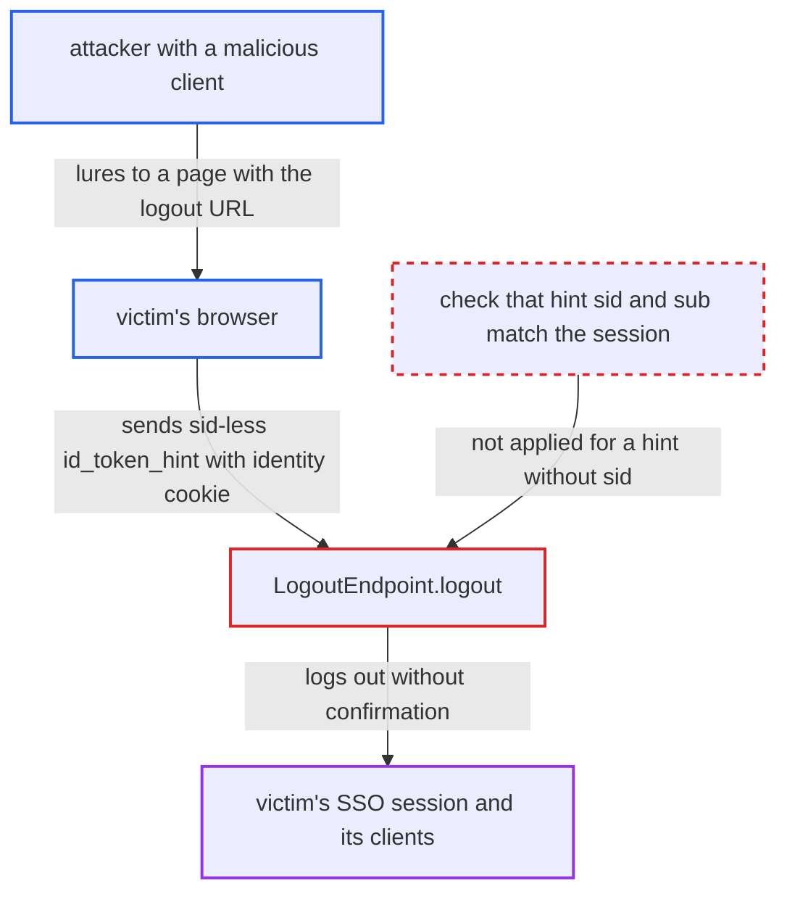

# RP-initiated logout skips confirmation for sid-less id_token_hint, enabling logout CSRF

| Field | Value |
|---|---|
| ID | `find_01RRKFTh7sNKPUUSuSAiKKN1` |
| Severity | **Medium** |
| Status | open |
| CWE | CWE-352 — Cross-site request forgery |
| Created | 2026-10-27T21:14:02.028189Z |
| Claude Security | https://claude.ai/security/findings/find_01RRKFTh7sNKPUUSuSAiKKN1 |

## Description

A malicious client in a realm can log any logged-in realm user out of their single sign-on session without the user's consent. The logout also reaches all of that session's clients and the upstream identity provider. The attacker needs a confidential client with a service account and must get the victim to load a page. The cause is `LogoutEndpoint.logout`, which skips the confirmation page for an `id_token_hint` that has no `sid` and never compares the hint's `sub` with the session's user.

1. **attacker's client** requests an ID token with the client credentials grant and `scope=openid`. The grant uses a TRANSIENT user session by default, so any confidential client with a service account can do this. ([`services/src/main/java/org/keycloak/protocol/oidc/grants/ClientCredentialsGrantType.java:117-122`](https://github.com/cx-benchmark/keycloak/blob/1d7be35d0764060a8143fc74b0aabf2442743be4/services/src/main/java/org/keycloak/protocol/oidc/grants/ClientCredentialsGrantType.java#L117-L122))
2. **the token code** issues a signed ID token with no `sid`. `OAuth2GrantTypeBase.createTokenResponseBuilder` nulls the `sid` for transient sessions, and `generateIDToken()` copies that null `sid` and the client's `azp` into the ID token. ([`services/src/main/java/org/keycloak/protocol/oidc/grants/OAuth2GrantTypeBase.java:141-154`](https://github.com/cx-benchmark/keycloak/blob/1d7be35d0764060a8143fc74b0aabf2442743be4/services/src/main/java/org/keycloak/protocol/oidc/grants/OAuth2GrantTypeBase.java#L141-L154))
3. **victim's browser** loads the logout URL with the token as `id_token_hint` and the attacker's registered `post_logout_redirect_uri`. The `KEYCLOAK_IDENTITY` cookie uses SameSite=None, so it is sent on this cross-site request. ([`server-spi-private/src/main/java/org/keycloak/cookie/CookieType.java:32-34`](https://github.com/cx-benchmark/keycloak/blob/1d7be35d0764060a8143fc74b0aabf2442743be4/server-spi-private/src/main/java/org/keycloak/cookie/CookieType.java#L32-L34))
4. **the handler `LogoutEndpoint.logout`** accepts the hint and clears `confirmationNeeded`. The hint is checked only for the realm signature and `typ=ID`. With no `client_id`, the client is taken from the hint's `azp`. ([`services/src/main/java/org/keycloak/protocol/oidc/endpoints/LogoutEndpoint.java:198-203`](https://github.com/cx-benchmark/keycloak/blob/1d7be35d0764060a8143fc74b0aabf2442743be4/services/src/main/java/org/keycloak/protocol/oidc/endpoints/LogoutEndpoint.java#L198-L203))
5. **the handler `LogoutEndpoint.logout`** does not force the confirmation page. `forcedConfirmation` is set only when the hint has a non-null `sid` that differs from the cookie session. A sid-less hint passes, and the hint's `sub` is never compared with the session's user. ([`services/src/main/java/org/keycloak/protocol/oidc/endpoints/LogoutEndpoint.java:249-256`](https://github.com/cx-benchmark/keycloak/blob/1d7be35d0764060a8143fc74b0aabf2442743be4/services/src/main/java/org/keycloak/protocol/oidc/endpoints/LogoutEndpoint.java#L249-L256))
6. **the method `doBrowserLogout`** logs out the session named by the `KEYCLOAK_IDENTITY` cookie. It skips the id-token session handling and calls `initiateBrowserLogout` on the victim's session. That runs back-channel and front-channel logout of all clients and the upstream broker logout, then redirects to the attacker's page. ([`services/src/main/java/org/keycloak/protocol/oidc/endpoints/LogoutEndpoint.java:435-469`](https://github.com/cx-benchmark/keycloak/blob/1d7be35d0764060a8143fc74b0aabf2442743be4/services/src/main/java/org/keycloak/protocol/oidc/endpoints/LogoutEndpoint.java#L435-L469))

## Assessment

The attacker controls a confidential client with a service account in the victim's realm. With it, the attacker mints a sid-less ID token through `grant_type=client_credentials&scope=openid`. The attacker then lures a logged-in realm user to a page that loads the logout URL with that token as `id_token_hint` and the client's registered `post_logout_redirect_uri`. The logout endpoint is reachable from the internet. Expired hints are accepted by design, so one minted token can be reused until the realm signing key rotates.

Impact: The attacker can end any realm user's SSO session repeatedly with one token. The logout is propagated to all of that session's clients and the upstream brokered identity provider. The user then lands on the attacker's own page. Nothing is disclosed, no data beyond session state changes, and credentials stay intact. The report says this can set up login-CSRF or phishing follow-ups.

## Recommendation

`LogoutEndpoint.logout` treats an `id_token_hint` without `sid` as matching whatever session the browser holds. It never compares the hint's subject with the session's user, so the confirmation that guards against cross-site logout is skipped.

Fix criteria: Logout without confirmation happens only when the hint demonstrably belongs to the browser's current session, with a matching `sid` and the same user. A hint without `sid`, or one naming another user, is rejected or leads to the confirmation page. Verify: with a user logged in, load the logout URL with a sid-less ID token that another client got through `client_credentials`. The confirmation page must be shown and the session must stay active.

## Evidence

**https://github.com/cx-benchmark/keycloak**

- [`services/src/main/java/org/keycloak/protocol/oidc/endpoints/LogoutEndpoint.java:249-256`](https://github.com/cx-benchmark/keycloak/blob/1d7be35d0764060a8143fc74b0aabf2442743be4/services/src/main/java/org/keycloak/protocol/oidc/endpoints/LogoutEndpoint.java#L249-L256)
- [`services/src/main/java/org/keycloak/protocol/oidc/endpoints/LogoutEndpoint.java:198-203`](https://github.com/cx-benchmark/keycloak/blob/1d7be35d0764060a8143fc74b0aabf2442743be4/services/src/main/java/org/keycloak/protocol/oidc/endpoints/LogoutEndpoint.java#L198-L203)
- [`services/src/main/java/org/keycloak/protocol/oidc/endpoints/LogoutEndpoint.java:185-196`](https://github.com/cx-benchmark/keycloak/blob/1d7be35d0764060a8143fc74b0aabf2442743be4/services/src/main/java/org/keycloak/protocol/oidc/endpoints/LogoutEndpoint.java#L185-L196)
- [`services/src/main/java/org/keycloak/protocol/oidc/endpoints/LogoutEndpoint.java:289-309`](https://github.com/cx-benchmark/keycloak/blob/1d7be35d0764060a8143fc74b0aabf2442743be4/services/src/main/java/org/keycloak/protocol/oidc/endpoints/LogoutEndpoint.java#L289-L309)
- [`services/src/main/java/org/keycloak/protocol/oidc/endpoints/LogoutEndpoint.java:435-469`](https://github.com/cx-benchmark/keycloak/blob/1d7be35d0764060a8143fc74b0aabf2442743be4/services/src/main/java/org/keycloak/protocol/oidc/endpoints/LogoutEndpoint.java#L435-L469)
- [`services/src/main/java/org/keycloak/protocol/oidc/grants/OAuth2GrantTypeBase.java:141-154`](https://github.com/cx-benchmark/keycloak/blob/1d7be35d0764060a8143fc74b0aabf2442743be4/services/src/main/java/org/keycloak/protocol/oidc/grants/OAuth2GrantTypeBase.java#L141-L154)
- [`services/src/main/java/org/keycloak/protocol/oidc/grants/ClientCredentialsGrantType.java:117-122`](https://github.com/cx-benchmark/keycloak/blob/1d7be35d0764060a8143fc74b0aabf2442743be4/services/src/main/java/org/keycloak/protocol/oidc/grants/ClientCredentialsGrantType.java#L117-L122)
- [`services/src/main/java/org/keycloak/protocol/oidc/TokenManager.java:1423-1426`](https://github.com/cx-benchmark/keycloak/blob/1d7be35d0764060a8143fc74b0aabf2442743be4/services/src/main/java/org/keycloak/protocol/oidc/TokenManager.java#L1423-L1426)
- [`server-spi-private/src/main/java/org/keycloak/cookie/CookieType.java:32-34`](https://github.com/cx-benchmark/keycloak/blob/1d7be35d0764060a8143fc74b0aabf2442743be4/server-spi-private/src/main/java/org/keycloak/cookie/CookieType.java#L32-L34)

