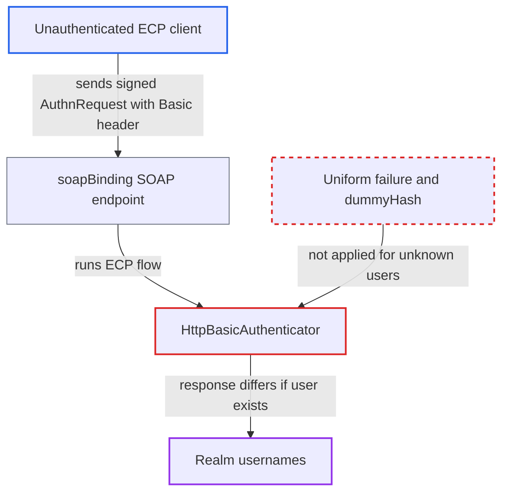

# SAML ECP HTTP Basic authenticator reveals whether a username exists

| Field | Value |
|---|---|
| ID | `find_013pPirGpwtcVwkzWjfBF26Y` |
| Severity | **Medium** |
| Status | open |
| CWE | CWE-204 — Observable response discrepancy |
| Created | 2026-10-27T21:23:47.926687Z |
| Claude Security | https://claude.ai/security/findings/find_013pPirGpwtcVwkzWjfBF26Y |

## Description

An unauthenticated client can find out which usernames exist in a realm through the SAML ECP endpoint, which helps targeted password guessing. It needs a SAML client with `saml.allow.ecp.flow=true` (off by default) and a valid AuthnRequest for that client. `HttpBasicAuthenticator` answers differently for unknown users and for known users with a wrong password.

1. **Attacker** obtains a valid AuthnRequest for an ECP-enabled client. If `saml.client.signature` is on (the default), the request must be signed by the SP; in the ECP profile the SP hands one to any client, and Keycloak does not check freshness or replay. ([`services/src/main/java/org/keycloak/protocol/saml/SamlService.java:1212-1219`](https://github.com/cx-benchmark/keycloak/blob/1d7be35d0764060a8143fc74b0aabf2442743be4/services/src/main/java/org/keycloak/protocol/saml/SamlService.java#L1212-L1219))
2. **Attacker** POSTs the request in a SOAP envelope to `/realms/{realm}/protocol/saml` with a Basic `Authorization` header. The header holds the candidate username and any password; `handleSamlRequest` only checks the request signature, and `allowECPFlow()` on the Issuer client is the only other gate. ([`services/src/main/java/org/keycloak/protocol/saml/profile/ecp/SamlEcpProfileService.java:102-113`](https://github.com/cx-benchmark/keycloak/blob/1d7be35d0764060a8143fc74b0aabf2442743be4/services/src/main/java/org/keycloak/protocol/saml/profile/ecp/SamlEcpProfileService.java#L102-L113))
3. **the authenticator `HttpBasicAuthenticator`** looks up the username with `getUserByUsername` and branches on the result. An existing user reaches the password check, while an unknown user reaches `nullUserAction` and no password is hashed. ([`services/src/main/java/org/keycloak/protocol/saml/profile/ecp/authenticator/HttpBasicAuthenticator.java:32-60`](https://github.com/cx-benchmark/keycloak/blob/1d7be35d0764060a8143fc74b0aabf2442743be4/services/src/main/java/org/keycloak/protocol/saml/profile/ecp/authenticator/HttpBasicAuthenticator.java#L32-L60))
4. **the authenticator `HttpBasicAuthenticator`** fails a known user with a wrong password through `notValidCredentialsAction`. This sets a 401 challenge, which `handleBrowserAuthenticationRequest` turns into `sendError(PASSIVE_LOGIN_REQUIRED)`, rendered as an HTTP 200 `text/xml` SOAP envelope with a SAML `NoPassive` status. ([`services/src/main/java/org/keycloak/protocol/AuthorizationEndpointBase.java:119-148`](https://github.com/cx-benchmark/keycloak/blob/1d7be35d0764060a8143fc74b0aabf2442743be4/services/src/main/java/org/keycloak/protocol/AuthorizationEndpointBase.java#L119-L148))
5. **the authenticator `HttpBasicAuthenticator`** leaves an unknown user's execution `ATTEMPTED` through the no-op `nullUserAction`. With no challenge and no authenticated user, `authenticateOnly` throws `AuthenticationFlowException(UNKNOWN_USER)`, and `handleBrowserException` renders an HTTP 400 HTML error page. ([`services/src/main/java/org/keycloak/authentication/AuthenticationProcessor.java:1121-1130`](https://github.com/cx-benchmark/keycloak/blob/1d7be35d0764060a8143fc74b0aabf2442743be4/services/src/main/java/org/keycloak/authentication/AuthenticationProcessor.java#L1121-L1130))
6. **Attacker** compares the responses and repeats the request for each candidate name. A 200 SOAP `NoPassive` answer means the user exists and a 400 HTML error page means it does not; a credential without `:` and the missing password hashing for unknown users give two more signals.

## Assessment

The attacker is a remote, unauthenticated ECP client. Some SAML client in the realm must have `saml.allow.ecp.flow=true`, which is off by default. The attacker needs a valid AuthnRequest for that client. If `saml.client.signature` is on (the default), it must be signed by the SP. The SP gives such a request to any ECP client, and Keycloak does not check freshness or replay. The attacker sends it to `/realms/{realm}/protocol/saml` with `Authorization: Basic base64(name:x)` and repeats this for each candidate name. Two other signals also reveal existence. A decoded credential without `:` makes `usernameAndPassword[1]` throw `ArrayIndexOutOfBoundsException` only for existing users, which gives a different error-page message. Unknown users skip password hashing, which opens a timing channel.

Impact: The attacker learns which usernames exist in the realm. This is a limited disclosure. It enables targeted password guessing and deliberate brute-force lockout of real accounts. No data is changed, and the service is not degraded beyond normal login load.

## Recommendation

(1) `HttpBasicAuthenticator.nullUserAction` leaves the execution `ATTEMPTED`, while `notValidCredentialsAction` fails it with a challenge. The response status, content type and SAML status depend on whether the username exists, and unknown users skip password hashing.

Fix criteria: For an ECP-enabled client, a request with a non-existent username and a request with an existing username and a wrong password give the same HTTP status, content type and SAML status, with comparable timing. Send both to `/realms/{realm}/protocol/saml` and diff the responses.

(2) `getUsernameAndPassword` returns a one-element array when the decoded credential has no `:`. The caller indexes element 1 only when the user exists, which gives a second response that depends on existence.

Fix criteria: Malformed Basic credentials are rejected the same way before any user lookup. A header without `:` gives the same response whether or not the username exists.

## Evidence

**https://github.com/cx-benchmark/keycloak**

- [`services/src/main/java/org/keycloak/protocol/saml/profile/ecp/authenticator/HttpBasicAuthenticator.java:32-60`](https://github.com/cx-benchmark/keycloak/blob/1d7be35d0764060a8143fc74b0aabf2442743be4/services/src/main/java/org/keycloak/protocol/saml/profile/ecp/authenticator/HttpBasicAuthenticator.java#L32-L60)
- [`services/src/main/java/org/keycloak/protocol/saml/profile/ecp/authenticator/HttpBasicAuthenticator.java:77-87`](https://github.com/cx-benchmark/keycloak/blob/1d7be35d0764060a8143fc74b0aabf2442743be4/services/src/main/java/org/keycloak/protocol/saml/profile/ecp/authenticator/HttpBasicAuthenticator.java#L77-L87)
- [`services/src/main/java/org/keycloak/protocol/saml/profile/ecp/authenticator/HttpBasicAuthenticator.java:113-119`](https://github.com/cx-benchmark/keycloak/blob/1d7be35d0764060a8143fc74b0aabf2442743be4/services/src/main/java/org/keycloak/protocol/saml/profile/ecp/authenticator/HttpBasicAuthenticator.java#L113-L119)
- [`services/src/main/java/org/keycloak/protocol/saml/profile/ecp/SamlEcpProfileService.java:102-113`](https://github.com/cx-benchmark/keycloak/blob/1d7be35d0764060a8143fc74b0aabf2442743be4/services/src/main/java/org/keycloak/protocol/saml/profile/ecp/SamlEcpProfileService.java#L102-L113)
- [`services/src/main/java/org/keycloak/protocol/AuthorizationEndpointBase.java:119-148`](https://github.com/cx-benchmark/keycloak/blob/1d7be35d0764060a8143fc74b0aabf2442743be4/services/src/main/java/org/keycloak/protocol/AuthorizationEndpointBase.java#L119-L148)
- [`services/src/main/java/org/keycloak/authentication/AuthenticationProcessor.java:1121-1130`](https://github.com/cx-benchmark/keycloak/blob/1d7be35d0764060a8143fc74b0aabf2442743be4/services/src/main/java/org/keycloak/authentication/AuthenticationProcessor.java#L1121-L1130)
- [`services/src/main/java/org/keycloak/protocol/saml/SamlService.java:1212-1219`](https://github.com/cx-benchmark/keycloak/blob/1d7be35d0764060a8143fc74b0aabf2442743be4/services/src/main/java/org/keycloak/protocol/saml/SamlService.java#L1212-L1219)
- [`services/src/main/java/org/keycloak/authentication/authenticators/browser/AbstractUsernameFormAuthenticator.java:118-124`](https://github.com/cx-benchmark/keycloak/blob/1d7be35d0764060a8143fc74b0aabf2442743be4/services/src/main/java/org/keycloak/authentication/authenticators/browser/AbstractUsernameFormAuthenticator.java#L118-L124)

