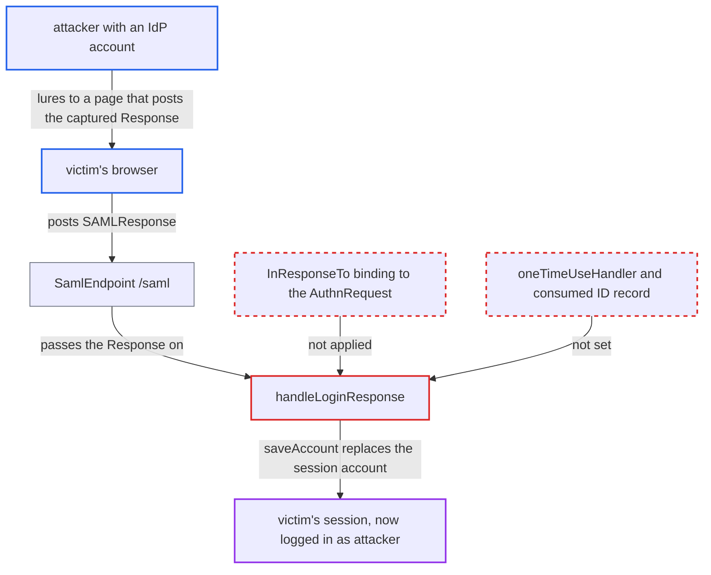

# SAML SP adapter accepts Responses not bound to its AuthnRequest: login CSRF and replay

| Field | Value |
|---|---|
| ID | `find_01EsHnj8pPk3SktfaG6G5SFU` |
| Severity | **Medium** |
| Status | open |
| CWE | CWE-352 — Cross-Site Request Forgery |
| Created | 2026-10-27T22:23:26.465477Z |
| Claude Security | https://claude.ai/security/findings/find_01EsHnj8pPk3SktfaG6G5SFU |

## Description

An attacker with any IdP account allowed to sign in to the SP can silently log a victim's browser in as the attacker. Data the victim then enters goes into the attacker's account. The attacker needs a valid signed Response from their own login and the victim must visit a page the attacker controls. The cause is that `handleLoginResponse()` never ties a Response to an AuthnRequest this browser sent, and nothing records consumed assertion IDs.

1. **attacker** starts an SP-initiated login in their own browser and signs in at the IdP. `AbstractInitiateLogin.challenge()` builds the AuthnRequest with a fresh id but stores only the redirect URI and `CurrentAction.LOGGING_IN`, so the id is discarded. ([`adapters/saml/core/src/main/java/org/keycloak/adapters/saml/AbstractInitiateLogin.java:62-76`](https://github.com/cx-benchmark/keycloak/blob/1d7be35d0764060a8143fc74b0aabf2442743be4/adapters/saml/core/src/main/java/org/keycloak/adapters/saml/AbstractInitiateLogin.java#L62-L76))
2. **attacker** captures the signed `SAMLResponse` before it is posted to the SP. The report says this can be scripted to run on demand.
3. **victim's browser** auto-submits the captured Response to the SP's `/saml` after visiting the attacker's page. The `/saml` endpoint reads `SAMLResponse` from any GET or POST and does no origin or state check. ([`adapters/saml/core/src/main/java/org/keycloak/adapters/saml/profile/webbrowsersso/SamlEndpoint.java:37-48`](https://github.com/cx-benchmark/keycloak/blob/1d7be35d0764060a8143fc74b0aabf2442743be4/adapters/saml/core/src/main/java/org/keycloak/adapters/saml/profile/webbrowsersso/SamlEndpoint.java#L37-L48))
4. **the handler `handleLoginResponse()`** accepts the Response even though this browser never started a login. When `!sessionStore.isLoggingIn()` it only logs a warning, and it never reads `Response/@InResponseTo`. ([`adapters/saml/core/src/main/java/org/keycloak/adapters/saml/profile/AbstractSamlAuthenticationHandler.java:363-400`](https://github.com/cx-benchmark/keycloak/blob/1d7be35d0764060a8143fc74b0aabf2442743be4/adapters/saml/core/src/main/java/org/keycloak/adapters/saml/profile/AbstractSamlAuthenticationHandler.java#L363-L400))
5. **`isSubjectConfirmationDataValid()`** skips binding the assertion to a request. It never calls `inResponseTo(...)`, so `validateInResponseTo()` returns true whenever no expected request ID was given. ([`adapters/saml/core/src/main/java/org/keycloak/adapters/saml/profile/AbstractSamlAuthenticationHandler.java:551-566`](https://github.com/cx-benchmark/keycloak/blob/1d7be35d0764060a8143fc74b0aabf2442743be4/adapters/saml/core/src/main/java/org/keycloak/adapters/saml/profile/AbstractSamlAuthenticationHandler.java#L551-L566))
6. **`saveAccount` in `ElytronSamlSessionStore`** attaches the attacker's principal to the victim's browser session. It creates the container session and cookie if needed and replaces any account already in that session. ([`adapters/saml/wildfly-elytron/src/main/java/org/keycloak/adapters/saml/elytron/ElytronSamlSessionStore.java:164-170`](https://github.com/cx-benchmark/keycloak/blob/1d7be35d0764060a8143fc74b0aabf2442743be4/adapters/saml/wildfly-elytron/src/main/java/org/keycloak/adapters/saml/elytron/ElytronSamlSessionStore.java#L164-L170))

## Assessment

The attacker needs any IdP account allowed to sign in to the SP. They run an SP-initiated login in their own browser and capture the signed `SAMLResponse`. Within the `Conditions` window, a victim who visits the attacker's page has that Response posted to the SP's `/saml`. The Response must still pass the signature, `NotBefore`/`NotOnOrAfter`, audience and `Recipient` checks, and it does. A second problem is that the adapter keeps no record of consumed assertion IDs. A `<OneTimeUse/>` condition is reported `VALID` by `ConditionsValidator.validateOneTimeUse()` because no `oneTimeUseHandler` is set. The same Response can therefore be accepted again until its `NotOnOrAfter` plus the allowed clock skew. Replaying a victim's own leaked Response would give a session as the victim. Under shipped defaults (Keycloak IdP forces POST binding, TLS, debug logging off), such a Response reaches only the victim, the IdP and the SP operator's logs. The report treats this as aggravating context, not the basis of the rating. Keycloak 27.0.0 added `InResponseTo` and `OneTimeUse` checks only to the server-side broker, not to this adapter.

Impact: The victim's browser is logged in to the attacker's SP account, replacing any session its cookie carried. Data the victim enters or uploads goes into an account the attacker controls and can read, and the victim's actions are recorded under the attacker's identity. This path does not give access to the victim's own account.

## Recommendation

(1) SP-initiated logins are not bound to the AuthnRequest or to the browser that sent it. The adapter throws away the request ID and never compares `Response/@InResponseTo` or the bearer `SubjectConfirmationData/@InResponseTo`. It also accepts a Response in a session with no pending login and only logs a warning.

Fix criteria: A Response that carries `InResponseTo` is accepted only if it equals an AuthnRequest ID this adapter issued for the same browser, and each ID can be consumed once. A Response with no matching pending request is refused. Unsolicited (IdP-initiated) Responses are accepted only where the deployment explicitly allows them. Posting a Response obtained in another browser's login to a victim's `/saml` creates no session.

(2) Consumed assertion IDs are not tracked, so a bearer assertion can be used again until it expires. A `<OneTimeUse/>` condition is reported valid without being enforced, because no `oneTimeUseHandler` is set.

Fix criteria: The adapter remembers consumed assertion IDs, per issuer, for at least the assertion's `NotOnOrAfter` plus the allowed clock skew, and rejects any ID already used. `OneTimeUse` is enforced through `oneTimeUseHandler`. Posting the same valid Response twice yields a session only once.

## Evidence

**https://github.com/cx-benchmark/keycloak**

- [`adapters/saml/core/src/main/java/org/keycloak/adapters/saml/profile/AbstractSamlAuthenticationHandler.java:363-400`](https://github.com/cx-benchmark/keycloak/blob/1d7be35d0764060a8143fc74b0aabf2442743be4/adapters/saml/core/src/main/java/org/keycloak/adapters/saml/profile/AbstractSamlAuthenticationHandler.java#L363-L400)
- [`adapters/saml/core/src/main/java/org/keycloak/adapters/saml/profile/AbstractSamlAuthenticationHandler.java:551-566`](https://github.com/cx-benchmark/keycloak/blob/1d7be35d0764060a8143fc74b0aabf2442743be4/adapters/saml/core/src/main/java/org/keycloak/adapters/saml/profile/AbstractSamlAuthenticationHandler.java#L551-L566)
- [`adapters/saml/core/src/main/java/org/keycloak/adapters/saml/AbstractInitiateLogin.java:62-76`](https://github.com/cx-benchmark/keycloak/blob/1d7be35d0764060a8143fc74b0aabf2442743be4/adapters/saml/core/src/main/java/org/keycloak/adapters/saml/AbstractInitiateLogin.java#L62-L76)
- [`adapters/saml/core/src/main/java/org/keycloak/adapters/saml/profile/AbstractSamlAuthenticationHandler.java:495-516`](https://github.com/cx-benchmark/keycloak/blob/1d7be35d0764060a8143fc74b0aabf2442743be4/adapters/saml/core/src/main/java/org/keycloak/adapters/saml/profile/AbstractSamlAuthenticationHandler.java#L495-L516)
- [`adapters/saml/wildfly-elytron/src/main/java/org/keycloak/adapters/saml/elytron/ElytronSamlSessionStore.java:164-170`](https://github.com/cx-benchmark/keycloak/blob/1d7be35d0764060a8143fc74b0aabf2442743be4/adapters/saml/wildfly-elytron/src/main/java/org/keycloak/adapters/saml/elytron/ElytronSamlSessionStore.java#L164-L170)
- [`adapters/saml/core/src/main/java/org/keycloak/adapters/saml/profile/webbrowsersso/SamlEndpoint.java:37-48`](https://github.com/cx-benchmark/keycloak/blob/1d7be35d0764060a8143fc74b0aabf2442743be4/adapters/saml/core/src/main/java/org/keycloak/adapters/saml/profile/webbrowsersso/SamlEndpoint.java#L37-L48)
- [`saml-core/src/main/java/org/keycloak/saml/validators/SubjectConfirmationDataValidator.java:142-146`](https://github.com/cx-benchmark/keycloak/blob/1d7be35d0764060a8143fc74b0aabf2442743be4/saml-core/src/main/java/org/keycloak/saml/validators/SubjectConfirmationDataValidator.java#L142-L146)
- [`saml-core/src/main/java/org/keycloak/saml/validators/ConditionsValidator.java:230-244`](https://github.com/cx-benchmark/keycloak/blob/1d7be35d0764060a8143fc74b0aabf2442743be4/saml-core/src/main/java/org/keycloak/saml/validators/ConditionsValidator.java#L230-L244)
- [`services/src/main/java/org/keycloak/broker/saml/SAMLEndpoint.java:612-618`](https://github.com/cx-benchmark/keycloak/blob/1d7be35d0764060a8143fc74b0aabf2442743be4/services/src/main/java/org/keycloak/broker/saml/SAMLEndpoint.java#L612-L618)
- [`services/src/main/java/org/keycloak/protocol/saml/SamlProtocol.java:491-503`](https://github.com/cx-benchmark/keycloak/blob/1d7be35d0764060a8143fc74b0aabf2442743be4/services/src/main/java/org/keycloak/protocol/saml/SamlProtocol.java#L491-L503)

