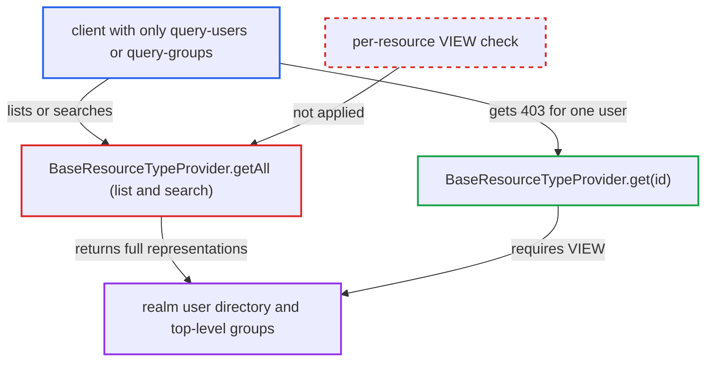

# SCIM user and group listing ignores view permission for query-only callers

| Field | Value |
|---|---|
| ID | `find_01VgCw2YhoEXKhTuz8fyifkJ` |
| Severity | **Medium** |
| Status | open |
| CWE | CWE-862 — Missing authorization |
| Created | 2026-10-27T22:16:37.353562Z |
| Claude Security | https://claude.ai/security/findings/find_01VgCw2YhoEXKhTuz8fyifkJ |

## Description

A caller holding only the `query-users` role (or `query-groups`) can read the realm's whole local user directory and all top-level group names through the SCIM list and search endpoints. This works only when the SCIM API is enabled (`isScimApiEnabled` defaults to false) and realm admin permissions are off, which is the default. `BaseResourceTypeProvider.getAll` checks only `canQuery()` and never checks `VIEW` on each resource.

1. **attacker** sends a list or search request to the SCIM endpoint. The caller uses a token with the SCIM audience and only `query-users`, for example `GET /realms/{realm}/scim/v2/Users?startIndex=N&count=100`, and pages through the results. ([`scim/services/src/main/java/org/keycloak/scim/services/ScimResourceTypeResource.java:138-165`](https://github.com/cx-benchmark/keycloak/blob/1d7be35d0764060a8143fc74b0aabf2442743be4/scim/services/src/main/java/org/keycloak/scim/services/ScimResourceTypeResource.java#L138-L165))
2. **`BaseResourceTypeProvider.getAll`** checks only the type-level `canQuery()`. `canQuery()` maps to `UserPermissionsV2.canQuery()` or `GroupPermissions.canList()`, and the `query-users` or `query-groups` role is enough to pass it. ([`scim/core/src/main/java/org/keycloak/scim/resource/spi/BaseResourceTypeProvider.java:72-80`](https://github.com/cx-benchmark/keycloak/blob/1d7be35d0764060a8143fc74b0aabf2442743be4/scim/core/src/main/java/org/keycloak/scim/resource/spi/BaseResourceTypeProvider.java#L72-L80))
3. **`UserResourceTypeProvider.getModels`** loads users from storage with an empty authorization filter. The only filter is `AdminPermissionsSchema.SCHEMA.applyAuthorizationFilters`. `PartialEvaluator.getPredicates` returns an empty list when `isSkipEvaluation` is true, and that is the case whenever the realm has admin permissions disabled. ([`server-spi-private/src/main/java/org/keycloak/authorization/fgap/evaluation/partial/PartialEvaluator.java:57-67`](https://github.com/cx-benchmark/keycloak/blob/1d7be35d0764060a8143fc74b0aabf2442743be4/server-spi-private/src/main/java/org/keycloak/authorization/fgap/evaluation/partial/PartialEvaluator.java#L57-L67))
4. **`BaseResourceTypeProvider.getAll`** turns every returned model into a full representation. No per-resource `VIEW` check runs here, although `get(id)` makes one for a single user. ([`scim/core/src/main/java/org/keycloak/scim/resource/spi/BaseResourceTypeProvider.java:72-80`](https://github.com/cx-benchmark/keycloak/blob/1d7be35d0764060a8143fc74b0aabf2442743be4/scim/core/src/main/java/org/keycloak/scim/resource/spi/BaseResourceTypeProvider.java#L72-L80))
5. **`ScimResourceTypeResource`** returns the stream unchanged in a `ListResponse`. Each non-admin user is shown with `userName`, `emails`, `name`, `active`, `locale`, `meta.created` and every user-profile attribute mapped to SCIM. Admin users are reduced to `id` and `userName`. ([`scim/services/src/main/java/org/keycloak/scim/services/ScimResourceTypeResource.java:138-165`](https://github.com/cx-benchmark/keycloak/blob/1d7be35d0764060a8143fc74b0aabf2442743be4/scim/services/src/main/java/org/keycloak/scim/services/ScimResourceTypeResource.java#L138-L165))

## Assessment

The attacker holds a token from a confidential client that carries the SCIM audience and only `query-users` (or `query-groups`). Examples are a SCIM integration given just the documented search role, or a limited human admin. The realm must have the SCIM API switched on (`isScimApiEnabled` defaults to false) and admin permissions left off, which is the default. The routes in are `GET /realms/{realm}/scim/v2/Users`, `POST /Users/.search`, and the same two for `/Groups`. The report sets no network restriction.

Impact: The caller reads every local non-service-account user: usernames, e-mail addresses, names, enabled state, locale, creation time and SCIM-mapped profile attributes. The caller also gets admin usernames and all top-level group names (`id`, `displayName`, `externalId`). Access is read-only. Writes still need `MANAGE`, admin resources stay protected and group members stay hidden behind `VIEW_MEMBERS`.

## Recommendation

`BaseResourceTypeProvider.getAll` authorises only the type-level `canQuery()` and trusts `getModels` to have removed resources the caller may not view. When realm admin permissions are disabled, `PartialEvaluator` applies no predicate, so `query-*` holders receive full representations of resources they hold no `VIEW` permission on.

Fix criteria: A SCIM list or search response contains only resources the caller may view, by the same rule `get(id)` applies, whether realm admin permissions are enabled or not. On a realm with admin permissions off, a client with only `query-users` (or `query-groups`) gets zero resources from `GET /Users`, `GET /Groups` and both `.search` endpoints. `totalResults` does not reveal the unfiltered count. A `view-users` client still sees all users and groups.

## Evidence

**https://github.com/cx-benchmark/keycloak**

- [`scim/core/src/main/java/org/keycloak/scim/resource/spi/BaseResourceTypeProvider.java:72-80`](https://github.com/cx-benchmark/keycloak/blob/1d7be35d0764060a8143fc74b0aabf2442743be4/scim/core/src/main/java/org/keycloak/scim/resource/spi/BaseResourceTypeProvider.java#L72-L80)
- [`scim/core/src/main/java/org/keycloak/scim/resource/spi/BaseResourceTypeProvider.java:52-70`](https://github.com/cx-benchmark/keycloak/blob/1d7be35d0764060a8143fc74b0aabf2442743be4/scim/core/src/main/java/org/keycloak/scim/resource/spi/BaseResourceTypeProvider.java#L52-L70)
- [`scim/core/src/main/java/org/keycloak/scim/resource/spi/BaseResourceTypeProvider.java:114-117`](https://github.com/cx-benchmark/keycloak/blob/1d7be35d0764060a8143fc74b0aabf2442743be4/scim/core/src/main/java/org/keycloak/scim/resource/spi/BaseResourceTypeProvider.java#L114-L117)
- [`services/src/main/java/org/keycloak/services/resources/admin/fgap/UserPermissionsV2.java:48-76`](https://github.com/cx-benchmark/keycloak/blob/1d7be35d0764060a8143fc74b0aabf2442743be4/services/src/main/java/org/keycloak/services/resources/admin/fgap/UserPermissionsV2.java#L48-L76)
- [`scim/model/src/main/java/org/keycloak/scim/model/user/UserResourceTypeProvider.java:208-230`](https://github.com/cx-benchmark/keycloak/blob/1d7be35d0764060a8143fc74b0aabf2442743be4/scim/model/src/main/java/org/keycloak/scim/model/user/UserResourceTypeProvider.java#L208-L230)
- [`model/jpa/src/main/java/org/keycloak/models/jpa/JpaUserProvider.java:992-1013`](https://github.com/cx-benchmark/keycloak/blob/1d7be35d0764060a8143fc74b0aabf2442743be4/model/jpa/src/main/java/org/keycloak/models/jpa/JpaUserProvider.java#L992-L1013)
- [`server-spi-private/src/main/java/org/keycloak/authorization/fgap/evaluation/partial/PartialEvaluator.java:57-67`](https://github.com/cx-benchmark/keycloak/blob/1d7be35d0764060a8143fc74b0aabf2442743be4/server-spi-private/src/main/java/org/keycloak/authorization/fgap/evaluation/partial/PartialEvaluator.java#L57-L67)
- [`server-spi-private/src/main/java/org/keycloak/authorization/fgap/AdminPermissionsSchema.java:633-649`](https://github.com/cx-benchmark/keycloak/blob/1d7be35d0764060a8143fc74b0aabf2442743be4/server-spi-private/src/main/java/org/keycloak/authorization/fgap/AdminPermissionsSchema.java#L633-L649)
- [`scim/model/src/main/java/org/keycloak/scim/model/user/UserResourceTypeProvider.java:194-206`](https://github.com/cx-benchmark/keycloak/blob/1d7be35d0764060a8143fc74b0aabf2442743be4/scim/model/src/main/java/org/keycloak/scim/model/user/UserResourceTypeProvider.java#L194-L206)
- [`scim/services/src/main/java/org/keycloak/scim/services/ScimResourceTypeResource.java:138-165`](https://github.com/cx-benchmark/keycloak/blob/1d7be35d0764060a8143fc74b0aabf2442743be4/scim/services/src/main/java/org/keycloak/scim/services/ScimResourceTypeResource.java#L138-L165)
- [`scim/model/src/main/java/org/keycloak/scim/model/group/GroupResourceTypeProvider.java:136-157`](https://github.com/cx-benchmark/keycloak/blob/1d7be35d0764060a8143fc74b0aabf2442743be4/scim/model/src/main/java/org/keycloak/scim/model/group/GroupResourceTypeProvider.java#L136-L157)
- [`services/src/main/java/org/keycloak/services/resources/admin/UsersResource.java:578-593`](https://github.com/cx-benchmark/keycloak/blob/1d7be35d0764060a8143fc74b0aabf2442743be4/services/src/main/java/org/keycloak/services/resources/admin/UsersResource.java#L578-L593)
- [`services/src/main/java/org/keycloak/services/resources/admin/GroupsResource.java:122-125`](https://github.com/cx-benchmark/keycloak/blob/1d7be35d0764060a8143fc74b0aabf2442743be4/services/src/main/java/org/keycloak/services/resources/admin/GroupsResource.java#L122-L125)
- [`services/src/main/java/org/keycloak/organization/admin/resource/OrganizationsResource.java:161-164`](https://github.com/cx-benchmark/keycloak/blob/1d7be35d0764060a8143fc74b0aabf2442743be4/services/src/main/java/org/keycloak/organization/admin/resource/OrganizationsResource.java#L161-L164)
- [`docs/documentation/server_admin/topics/scim/intro.adoc:23-24`](https://github.com/cx-benchmark/keycloak/blob/1d7be35d0764060a8143fc74b0aabf2442743be4/docs/documentation/server_admin/topics/scim/intro.adoc#L23-L24)
- [`scim/tests/base/src/test/java/org/keycloak/tests/scim/tck/AuthorizationTest.java:300-307`](https://github.com/cx-benchmark/keycloak/blob/1d7be35d0764060a8143fc74b0aabf2442743be4/scim/tests/base/src/test/java/org/keycloak/tests/scim/tck/AuthorizationTest.java#L300-L307)

