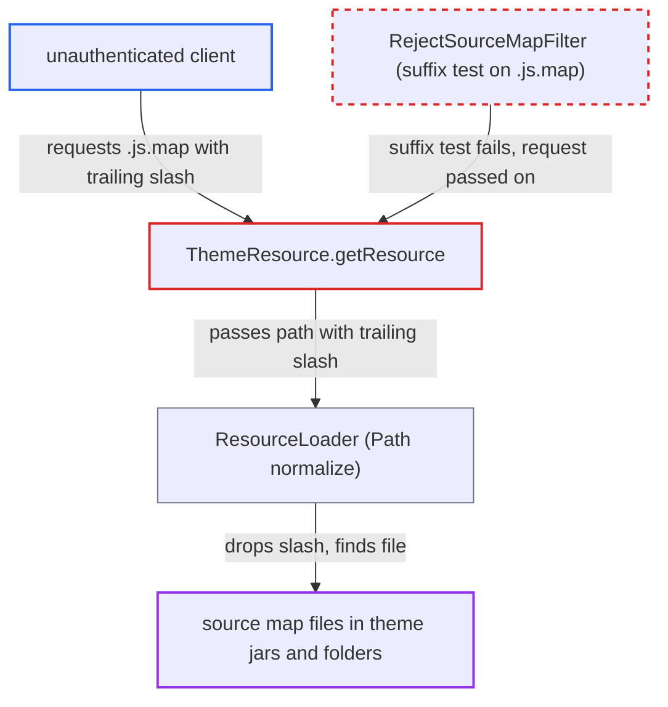

# Trailing slash on theme resource path bypasses production source-map block

| Field | Value |
|---|---|
| ID | `find_01DT2ocFCQHmjGYniBoJdWXy` |
| Severity | **Medium** |
| Status | open |
| CWE | CWE-49 — Path Equivalence |
| Created | 2026-10-27T22:09:45.123744Z |
| Claude Security | https://claude.ai/security/findings/find_01DT2ocFCQHmjGYniBoJdWXy |

## Description

An anonymous internet client can download JavaScript source maps that the server blocks in production builds. The attack adds a trailing `/` to the `.js.map` URL. The useful gain is limited to deployments with a custom theme that ships `.js.map` files, because the stock maps only reveal source that is already public. The block in `RejectSourceMapFilter` tests whether the path ends in `.js.map`, but `ResourceLoader` drops the trailing `/` when it picks the file.

1. **Unauthenticated client** reads a bundle name from the console page. The name comes from the served console HTML or from a `sourceMappingURL` comment.
2. **Unauthenticated client** requests the bundle's `.js.map` URL with a trailing slash. The request is `/resources/<5-char>/admin/keycloak.v2/assets/<bundle>.js.map/`, sent without `Accept-Encoding`.
3. **the filter `RejectSourceMapFilter`** lets the request through. Vert.x path normalization keeps the trailing `/`, so `normalizedPath().endsWith(".js.map")` is false and the filter calls `next()`. `RejectNonNormalizedPathFilter` also passes it, because the raw and normalized paths are equal and contain no `;`. ([`quarkus/runtime/src/main/java/org/keycloak/quarkus/runtime/services/RejectSourceMapFilter.java:36-47`](https://github.com/cx-benchmark/keycloak/blob/1d7be35d0764060a8143fc74b0aabf2442743be4/quarkus/runtime/src/main/java/org/keycloak/quarkus/runtime/services/RejectSourceMapFilter.java#L36-L47))
4. **the endpoint `ThemeResource.getResource`** passes the path, trailing slash included, to `theme.getResourceAsStream(path)`. `contentHashPattern=assets/.*` makes `hasContentHash` true, so any 5-character version skips the redirect branch. The endpoint does no file-type check of its own. ([`services/src/main/java/org/keycloak/services/resources/ThemeResource.java:89-186`](https://github.com/cx-benchmark/keycloak/blob/1d7be35d0764060a8143fc74b0aabf2442743be4/services/src/main/java/org/keycloak/services/resources/ThemeResource.java#L89-L186))
5. **the loader `ResourceLoader`** resolves the name to the real source-map file. `rootPath.resolve(resource).normalize()` drops the trailing separator, so the lookup finds `assets/<bundle>.js.map` in the theme jar or theme folder. ([`services/src/main/java/org/keycloak/theme/ResourceLoader.java:16-51`](https://github.com/cx-benchmark/keycloak/blob/1d7be35d0764060a8143fc74b0aabf2442743be4/services/src/main/java/org/keycloak/theme/ResourceLoader.java#L16-L51))
6. **the server** returns the source map with a 200. The file the production block was meant to withhold is sent to the anonymous client.

## Assessment

The attacker is any unauthenticated client on the internet who can reach the server. No login, special setting or user action is needed. The block applies in every non-dev build, and the bypass works in all of them. The attacker needs a bundle name, which is visible in the served console HTML or in a `sourceMappingURL` comment. The request must be sent without `Accept-Encoding`, and the version segment can be any 5-character value. Meaningful gain needs a deployment that serves a custom theme shipping `.js.map` files. The same path also serves `.js.map` files from any custom theme an operator deploys.

Impact: The attacker reads source maps the server deliberately withholds in production. For custom themes these expose the original front-end source and file layout. The report finds no secrets, tokens or user data exposed, and nothing can be changed or disrupted.

## Recommendation

(1) `RejectSourceMapFilter` decides on a string suffix of the request path. `ResourceLoader` picks the file with `java.nio.file.Path` normalization, which drops trailing separators. The two disagree on what `x.js.map/` names, so the block can be bypassed.

Fix criteria: The source-map decision is made on the same canonical name that selects the file, for example inside `ThemeResource` or `ResourceLoader` on the resolved resource name. In a production build, `GET .../<bundle>.js.map/` and `.../<bundle>.js.map%2F` return 404. `.../<bundle>.js` is still served.

(2) `ResourceLoader.getResource` and `getFile` accept a resource name with a trailing separator and silently map it to the file without the separator. A URL that names a directory therefore serves a file.

Fix criteria: A theme resource request whose name ends with a separator, or otherwise differs from the resolved file name after normalization, is not served. Requesting an existing theme file with `/` appended returns 404.

## Evidence

**https://github.com/cx-benchmark/keycloak**

- [`quarkus/runtime/src/main/java/org/keycloak/quarkus/runtime/services/RejectSourceMapFilter.java:36-47`](https://github.com/cx-benchmark/keycloak/blob/1d7be35d0764060a8143fc74b0aabf2442743be4/quarkus/runtime/src/main/java/org/keycloak/quarkus/runtime/services/RejectSourceMapFilter.java#L36-L47)
- [`services/src/main/java/org/keycloak/theme/ResourceLoader.java:16-51`](https://github.com/cx-benchmark/keycloak/blob/1d7be35d0764060a8143fc74b0aabf2442743be4/services/src/main/java/org/keycloak/theme/ResourceLoader.java#L16-L51)
- [`services/src/main/java/org/keycloak/services/resources/ThemeResource.java:89-186`](https://github.com/cx-benchmark/keycloak/blob/1d7be35d0764060a8143fc74b0aabf2442743be4/services/src/main/java/org/keycloak/services/resources/ThemeResource.java#L89-L186)
- [`js/apps/admin-ui/maven-resources/theme/keycloak.v2/admin/theme.properties`](https://github.com/cx-benchmark/keycloak/blob/1d7be35d0764060a8143fc74b0aabf2442743be4/js/apps/admin-ui/maven-resources/theme/keycloak.v2/admin/theme.properties)
- [`quarkus/deployment/src/main/java/org/keycloak/quarkus/deployment/KeycloakProcessor.java:326-329`](https://github.com/cx-benchmark/keycloak/blob/1d7be35d0764060a8143fc74b0aabf2442743be4/quarkus/deployment/src/main/java/org/keycloak/quarkus/deployment/KeycloakProcessor.java#L326-L329)

