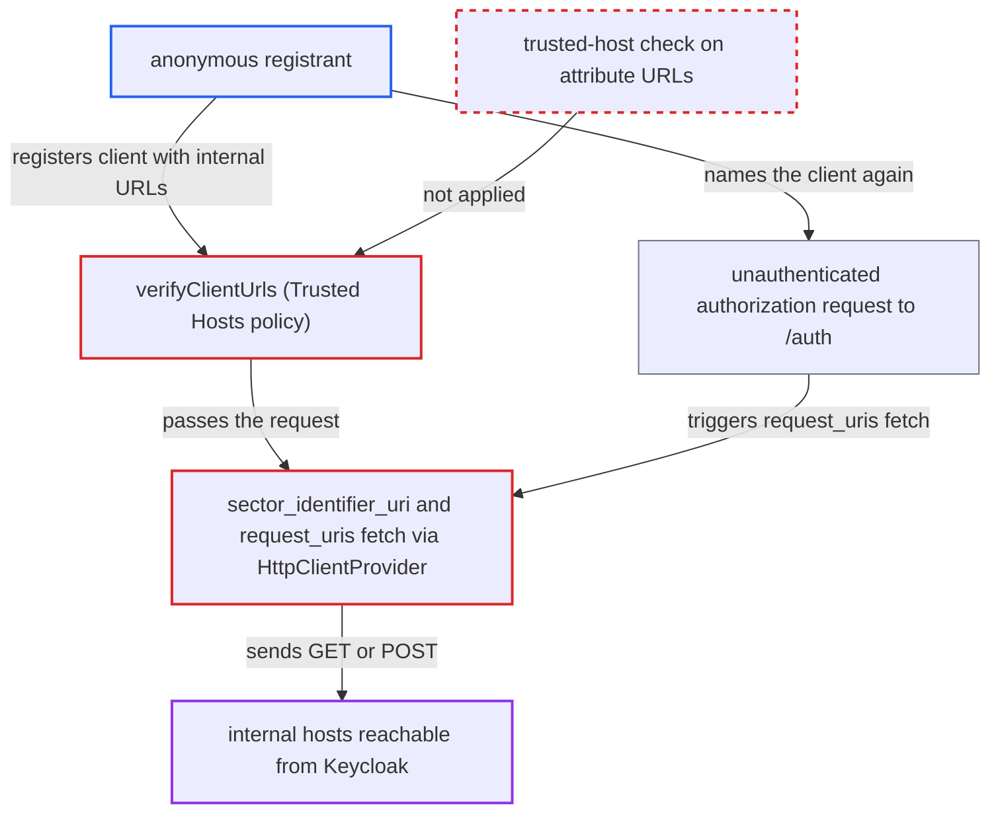

# Trusted Hosts policy ignores server-fetched OIDC URLs, letting anonymous registrants trigger SSRF

| Field | Value |
|---|---|
| ID | `find_0151A8D1AYmJZLibAW795UPW` |
| Severity | **Medium** |
| Status | open |
| CWE | CWE-918 — Server-Side Request Forgery |
| Created | 2026-10-27T21:21:46.622677Z |
| Claude Security | https://claude.ai/security/findings/find_0151A8D1AYmJZLibAW795UPW |

## Description

An anonymous client registrant can make Keycloak send requests to internal hosts, and can register logout redirects to untrusted hosts. Response bodies are not returned, so the attacker learns only reachability, timing and some error text. It needs a realm with a non-empty Trusted Hosts list. The attacker must either send from a trusted host or have `host-sending-registration-request-must-match` switched off. The cause is that `TrustedHostClientRegistrationPolicy.verifyClientUrls` checks only `rootUrl`, `baseUrl`, `adminUrl` and `redirectUris`, so other URL fields skip the trusted-host check.

1. **attacker** posts an OIDC client registration with trusted-host `redirect_uris` and `sector_identifier_uri` set to an internal URL. The anonymous chain allows this when the request comes from a trusted host, or from anywhere if `host-sending-registration-request-must-match` is off.
2. **`DescriptionConverter.toInternal`** copies the extra URL fields into client attributes. `request_uris`, `backchannel_logout_uri`, `sector_identifier_uri`, `post_logout_redirect_uris`, `frontchannel_logout_uri`, CIBA `backchannel_client_notification_endpoint` and `jwks_uri` are stored as attributes, not as the fields the policy reads. ([`services/src/main/java/org/keycloak/services/clientregistration/oidc/DescriptionConverter.java:208-282`](https://github.com/cx-benchmark/keycloak/blob/1d7be35d0764060a8143fc74b0aabf2442743be4/services/src/main/java/org/keycloak/services/clientregistration/oidc/DescriptionConverter.java#L208-L282))
3. **`TrustedHostClientRegistrationPolicy.verifyClientUrls`** approves the request after checking only a fixed set of URLs. It checks `rootUrl`, `baseUrl`, `adminUrl` and `redirectUris`, and never reads client attributes. ([`services/src/main/java/org/keycloak/services/clientregistration/policy/impl/TrustedHostClientRegistrationPolicy.java:214-247`](https://github.com/cx-benchmark/keycloak/blob/1d7be35d0764060a8143fc74b0aabf2442743be4/services/src/main/java/org/keycloak/services/clientregistration/policy/impl/TrustedHostClientRegistrationPolicy.java#L214-L247))
4. **`createOIDC`** calls `validateClient` after the policies pass. `updateOIDC` does the same, so the attacker can repeat the fetch with the registration access token. ([`services/src/main/java/org/keycloak/services/clientregistration/oidc/OIDCClientRegistrationProvider.java:96-105`](https://github.com/cx-benchmark/keycloak/blob/1d7be35d0764060a8143fc74b0aabf2442743be4/services/src/main/java/org/keycloak/services/clientregistration/oidc/OIDCClientRegistrationProvider.java#L96-L105))
5. **`validatePairwiseInOIDCClient`** validates `sector_identifier_uri` whenever it is set. It does this whatever the `subject_type` is. ([`services/src/main/java/org/keycloak/validation/DefaultClientValidationProvider.java:451-472`](https://github.com/cx-benchmark/keycloak/blob/1d7be35d0764060a8143fc74b0aabf2442743be4/services/src/main/java/org/keycloak/validation/DefaultClientValidationProvider.java#L451-L472))
6. **`PairwiseSubMapperValidator.getSectorRedirects`** sends a GET to the attacker-chosen URL through `HttpClientProvider.getString`. The request goes out before the transaction is rolled back, and the error text differs between a failed fetch and a mismatched redirect list. ([`services/src/main/java/org/keycloak/protocol/oidc/utils/PairwiseSubMapperValidator.java:91-103`](https://github.com/cx-benchmark/keycloak/blob/1d7be35d0764060a8143fc74b0aabf2442743be4/services/src/main/java/org/keycloak/protocol/oidc/utils/PairwiseSubMapperValidator.java#L91-L103))
7. **`DefaultHttpClientFactory`** performs the request with no destination filtering. Loopback, private and link-local addresses are not refused. ([`services/src/main/java/org/keycloak/connections/httpclient/DefaultHttpClientFactory.java:126-135`](https://github.com/cx-benchmark/keycloak/blob/1d7be35d0764060a8143fc74b0aabf2442743be4/services/src/main/java/org/keycloak/connections/httpclient/DefaultHttpClientFactory.java#L126-L135))
8. **`AuthorizationEndpointRequestParserProcessor`** later fetches registered `request_uris` on unauthenticated authorization requests that name the client. Wildcards are allowed in `request_uris`, so the attacker gets a reusable GET through `/auth`. ([`services/src/main/java/org/keycloak/protocol/oidc/endpoints/request/AuthorizationEndpointRequestParserProcessor.java:96-102`](https://github.com/cx-benchmark/keycloak/blob/1d7be35d0764060a8143fc74b0aabf2442743be4/services/src/main/java/org/keycloak/protocol/oidc/endpoints/request/AuthorizationEndpointRequestParserProcessor.java#L96-L102))

## Assessment

The realm admin has listed trusted hosts in the anonymous Trusted Hosts policy. The default list is empty, which disables anonymous registration. The attacker either registers from a trusted host, or registers from anywhere because `host-sending-registration-request-must-match` is off. The factory allows that setting as long as `client-uris-must-match` stays on, and then it is the only limit on internet registrants. With both switches on, a registrant on a trusted host still reaches hosts the admin did not trust. Other fetched or contacted URLs are `jwks_uri`, fetched during `private_key_jwt` authentication, and the backchannel logout and CIBA endpoints, which receive server POSTs. No victim is involved.

Impact: The attacker can create or update clients whose URLs break the trusted-host restriction the admin relied on. This includes `post_logout_redirect_uris` on untrusted hosts, which makes the logout endpoint an open redirect. No Keycloak secrets or tokens are disclosed by this path.

Subsequent-system impact: Keycloak sends GETs, and through the logout and CIBA endpoints POSTs, to internal hosts it can reach, such as metadata services and management ports. Response bodies are not returned. The attacker learns only reachability, timing, and whether the response was a JSON string array (through the sector identifier error text). The impact is limited reconnaissance and disclosure.

## Recommendation

(1) `TrustedHostClientRegistrationPolicy.verifyClientUrls` applies `client-uris-must-match` to a hard-coded subset of client URLs, so URLs stored as OIDC attributes bypass the trusted-host boundary.

Fix criteria: With `client-uris-must-match` enabled, every URL-valued property of a registration or update request is rejected unless its host matches a trusted host or domain. These are `jwks_uri`, `sector_identifier_uri`, `request_uris`, `backchannel_logout_uri`, `frontchannel_logout_uri`, `post_logout_redirect_uris`, CIBA `backchannel_client_notification_endpoint`, and `logo_uri`, `policy_uri` and `tos_uri`. Registering through the anonymous chain with an internal-host `sector_identifier_uri` or `request_uris` entry gives a policy rejection before any outbound request is made.

(2) Server-initiated fetches of registrant-supplied URLs (`sector_identifier_uri`, `request_uris`, `jwks_uri`) go through `HttpClientProvider` with no destination restrictions, so any policy gap becomes SSRF.

Fix criteria: Server-side fetches of client-supplied URLs refuse loopback, link-local, private and otherwise non-routable destinations, and ideally non-HTTPS schemes, unless configuration explicitly allows them. A client registration then cannot direct the server at internal services, even where a policy check is missing.

## Evidence

**https://github.com/cx-benchmark/keycloak**

- [`services/src/main/java/org/keycloak/services/clientregistration/policy/impl/TrustedHostClientRegistrationPolicy.java:214-247`](https://github.com/cx-benchmark/keycloak/blob/1d7be35d0764060a8143fc74b0aabf2442743be4/services/src/main/java/org/keycloak/services/clientregistration/policy/impl/TrustedHostClientRegistrationPolicy.java#L214-L247)
- [`services/src/main/java/org/keycloak/services/clientregistration/oidc/DescriptionConverter.java:208-282`](https://github.com/cx-benchmark/keycloak/blob/1d7be35d0764060a8143fc74b0aabf2442743be4/services/src/main/java/org/keycloak/services/clientregistration/oidc/DescriptionConverter.java#L208-L282)
- [`services/src/main/java/org/keycloak/services/clientregistration/oidc/OIDCClientRegistrationProvider.java:96-105`](https://github.com/cx-benchmark/keycloak/blob/1d7be35d0764060a8143fc74b0aabf2442743be4/services/src/main/java/org/keycloak/services/clientregistration/oidc/OIDCClientRegistrationProvider.java#L96-L105)
- [`services/src/main/java/org/keycloak/validation/DefaultClientValidationProvider.java:451-472`](https://github.com/cx-benchmark/keycloak/blob/1d7be35d0764060a8143fc74b0aabf2442743be4/services/src/main/java/org/keycloak/validation/DefaultClientValidationProvider.java#L451-L472)
- [`services/src/main/java/org/keycloak/protocol/oidc/utils/PairwiseSubMapperValidator.java:91-103`](https://github.com/cx-benchmark/keycloak/blob/1d7be35d0764060a8143fc74b0aabf2442743be4/services/src/main/java/org/keycloak/protocol/oidc/utils/PairwiseSubMapperValidator.java#L91-L103)
- [`services/src/main/java/org/keycloak/services/clientregistration/policy/impl/TrustedHostClientRegistrationPolicyFactory.java:76-84`](https://github.com/cx-benchmark/keycloak/blob/1d7be35d0764060a8143fc74b0aabf2442743be4/services/src/main/java/org/keycloak/services/clientregistration/policy/impl/TrustedHostClientRegistrationPolicyFactory.java#L76-L84)
- [`services/src/main/java/org/keycloak/protocol/oidc/endpoints/request/AuthorizationEndpointRequestParserProcessor.java:96-102`](https://github.com/cx-benchmark/keycloak/blob/1d7be35d0764060a8143fc74b0aabf2442743be4/services/src/main/java/org/keycloak/protocol/oidc/endpoints/request/AuthorizationEndpointRequestParserProcessor.java#L96-L102)
- [`services/src/main/java/org/keycloak/connections/httpclient/DefaultHttpClientFactory.java:126-135`](https://github.com/cx-benchmark/keycloak/blob/1d7be35d0764060a8143fc74b0aabf2442743be4/services/src/main/java/org/keycloak/connections/httpclient/DefaultHttpClientFactory.java#L126-L135)

