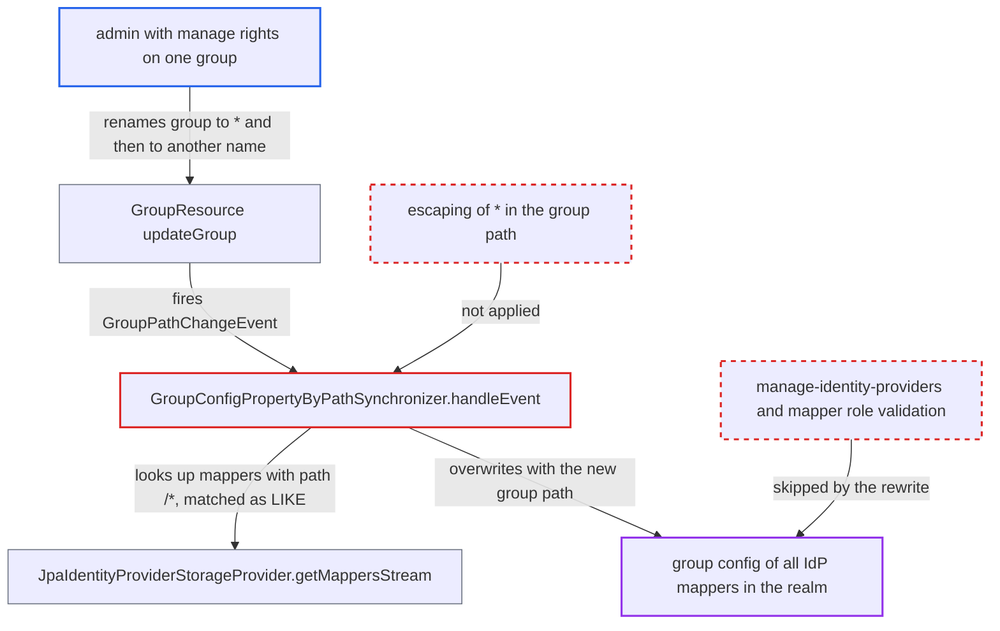

# Unescaped `*` in group path turns IdP mapper sync into realm-wide mapper rewrite

| Field | Value |
|---|---|
| ID | `find_012d8ZRENdtjGZ1SwjZdFgqG` |
| Severity | **Medium** |
| Status | open |
| CWE | CWE-155 — Improper wildcard neutralization |
| Created | 2026-10-27T21:48:25.192358Z |
| Claude Security | https://claude.ai/security/findings/find_012d8ZRENdtjGZ1SwjZdFgqG |

## Description

An admin who can manage one top-level group can overwrite the `group` setting of every identity provider (IdP) mapper in the realm, without holding `manage-identity-providers`. The attacker needs `manage-users` or FGAP `manage` on the group, and must rename it to `*` and then to another name. The cause is `GroupConfigPropertyByPathSynchronizer.handleEvent`, which does not escape `*` in the old group path before the mapper lookup treats it as a wildcard.

1. **admin without `manage-identity-providers`** renames a top-level group to `*`, then renames it again to another name. The update endpoint needs only manage rights on that group, and group names are rejected only when blank or a duplicate sibling, so `*` is accepted. ([`services/src/main/java/org/keycloak/services/resources/admin/GroupResource.java:129-154`](https://github.com/cx-benchmark/keycloak/blob/1d7be35d0764060a8143fc74b0aabf2442743be4/services/src/main/java/org/keycloak/services/resources/admin/GroupResource.java#L129-L154))
2. **group update handler** builds the previous and new paths and fires `GroupPathChangeEvent`. On the second rename the previous path is `/*`, and the event reaches the synchronizer in the same session and transaction. ([`services/src/main/java/org/keycloak/services/resources/admin/GroupResource.java:289-301`](https://github.com/cx-benchmark/keycloak/blob/1d7be35d0764060a8143fc74b0aabf2442743be4/services/src/main/java/org/keycloak/services/resources/admin/GroupResource.java#L289-L301))
3. **synchronizer `GroupConfigPropertyByPathSynchronizer.handleEvent`** passes the unescaped previous path as the supposedly exact `group` option to `getMappersStream`. It also passes `previousPath + "/*"` for sub-paths, and never escapes `*` in either value. ([`server-spi-private/src/main/java/org/keycloak/broker/provider/mappersync/GroupConfigPropertyByPathSynchronizer.java:46-68`](https://github.com/cx-benchmark/keycloak/blob/1d7be35d0764060a8143fc74b0aabf2442743be4/server-spi-private/src/main/java/org/keycloak/broker/provider/mappersync/GroupConfigPropertyByPathSynchronizer.java#L46-L68))
4. **`JpaIdentityProviderStorageProvider.getMappersStream`** turns the value `/*` into the SQL pattern `LIKE '/%'`. A value ending in `*` is treated as a pattern, with `%` and `_` escaped but every `*` turned into `%`, so every mapper with a `group` config matches. Oracle uses a `DBMS_LOB.INSTR` prefix match instead. ([`model/jpa/src/main/java/org/keycloak/models/jpa/JpaIdentityProviderStorageProvider.java:505-510`](https://github.com/cx-benchmark/keycloak/blob/1d7be35d0764060a8143fc74b0aabf2442743be4/model/jpa/src/main/java/org/keycloak/models/jpa/JpaIdentityProviderStorageProvider.java#L505-L510))
5. **synchronizer `GroupConfigPropertyByPathSynchronizer.handleEvent`** overwrites the `group` config of every matched mapper with the renamed group's new path. The original targets are lost. The rewrite skips the manage-identity-providers check and the mapper admin role validation that the mapper API enforces. ([`server-spi-private/src/main/java/org/keycloak/broker/provider/mappersync/GroupConfigPropertyByPathSynchronizer.java:46-68`](https://github.com/cx-benchmark/keycloak/blob/1d7be35d0764060a8143fc74b0aabf2442743be4/server-spi-private/src/main/java/org/keycloak/broker/provider/mappersync/GroupConfigPropertyByPathSynchronizer.java#L46-L68))
6. **IdP group mapper `AbstractClaimToGroupMapper`** adds brokered users to the attacker's group when they log in. This happens on first login and on forced sync, because the rewritten `group` config now points at that group. ([`services/src/main/java/org/keycloak/broker/oidc/mappers/AbstractClaimToGroupMapper.java:35-66`](https://github.com/cx-benchmark/keycloak/blob/1d7be35d0764060a8143fc74b0aabf2442743be4/services/src/main/java/org/keycloak/broker/oidc/mappers/AbstractClaimToGroupMapper.java#L35-L66))
7. **admin who also holds `manage-members` on the group** manages the users who joined the group. Manage-members on a group gives manage rights over its members, including password reset, even for users outside the admin's delegation. ([`services/src/main/java/org/keycloak/services/resources/admin/fgap/UserPermissions.java:624-626`](https://github.com/cx-benchmark/keycloak/blob/1d7be35d0764060a8143fc74b0aabf2442743be4/services/src/main/java/org/keycloak/services/resources/admin/fgap/UserPermissions.java#L624-L626))

## Assessment

The attacker is a realm admin with `manage-users`, or a delegated admin with FGAP `manage` on a top-level group. They do not hold `manage-identity-providers`. They send `PUT /admin/realms/{realm}/groups/{id}` twice, first to name the group `*` and then to give it another name. A name such as `adm*` limits the rewrite to mappers whose path starts with `/adm`. A group name containing a slash is mangled by the second, sub-path pass. Any admin who renames such a group triggers the rewrite by accident. The rewrite always points at the renamed group itself. The same unescaped pattern exists in `RoleConfigPropertyByRoleNameSynchronizer`, where a realm role named `*` gives `LIKE '%'` over all `role` configs. It also exists in `RoleConfigPropertyByClientIdSynchronizer`, where `previousClientId + ".*"` is always a pattern and a `*` inside the client id widens it to other clients' role mappers.

Impact: The attacker silently breaks or redirects all IdP-driven group provisioning in the realm, and the original mapper targets are lost. The target can only be the attacker's own group. If the attacker holds `manage-members` on it, brokered users who log in afterwards can be managed by the attacker. That includes password reset and profile edits, so it allows takeover of accounts outside the delegation and lets the attacker read their profiles.

## Recommendation

(1) The synchronizers put admin-chosen names (group path, client id, role name) into `getMappersStream` option values. A trailing `*` there acts as a wildcard and an inner `*` becomes `%`, so a crafted name widens an exact or sub-path match to unrelated mappers.

Fix criteria: Mapper lookups by the synchronizers match only the renamed entity's exact path or qualifier and its true sub-paths, whatever `*`, `%` or `_` the name contains. Escaping the name before building the pattern, or filtering candidates in Java with `equals` and `startsWith(previousPath + "/")`, are both acceptable. Renaming a group named `*` while unrelated group mappers exist leaves their `group` config unchanged.

(2) The storage search API has an implicit convention that `*` means a wildcard. Callers can trigger it by accident with user-controlled values.

Fix criteria: The API offers a distinct exact-match option or an escape helper for literal matching, or literal `*` in option values not meant as patterns is escaped. A value ending in `*` supplied as an exact-match option no longer matches other rows.

## Evidence

**https://github.com/cx-benchmark/keycloak**

- [`server-spi-private/src/main/java/org/keycloak/broker/provider/mappersync/GroupConfigPropertyByPathSynchronizer.java:46-68`](https://github.com/cx-benchmark/keycloak/blob/1d7be35d0764060a8143fc74b0aabf2442743be4/server-spi-private/src/main/java/org/keycloak/broker/provider/mappersync/GroupConfigPropertyByPathSynchronizer.java#L46-L68)
- [`model/jpa/src/main/java/org/keycloak/models/jpa/JpaIdentityProviderStorageProvider.java:505-510`](https://github.com/cx-benchmark/keycloak/blob/1d7be35d0764060a8143fc74b0aabf2442743be4/model/jpa/src/main/java/org/keycloak/models/jpa/JpaIdentityProviderStorageProvider.java#L505-L510)
- [`services/src/main/java/org/keycloak/services/resources/admin/GroupResource.java:129-154`](https://github.com/cx-benchmark/keycloak/blob/1d7be35d0764060a8143fc74b0aabf2442743be4/services/src/main/java/org/keycloak/services/resources/admin/GroupResource.java#L129-L154)
- [`services/src/main/java/org/keycloak/services/resources/admin/GroupResource.java:289-301`](https://github.com/cx-benchmark/keycloak/blob/1d7be35d0764060a8143fc74b0aabf2442743be4/services/src/main/java/org/keycloak/services/resources/admin/GroupResource.java#L289-L301)
- [`model/jpa/src/main/java/org/keycloak/models/jpa/GroupAdapter.java:94-100`](https://github.com/cx-benchmark/keycloak/blob/1d7be35d0764060a8143fc74b0aabf2442743be4/model/jpa/src/main/java/org/keycloak/models/jpa/GroupAdapter.java#L94-L100)
- [`services/src/main/java/org/keycloak/services/resources/admin/IdentityProviderResource.java:426-452`](https://github.com/cx-benchmark/keycloak/blob/1d7be35d0764060a8143fc74b0aabf2442743be4/services/src/main/java/org/keycloak/services/resources/admin/IdentityProviderResource.java#L426-L452)
- [`services/src/main/java/org/keycloak/broker/oidc/mappers/AbstractClaimToGroupMapper.java:35-66`](https://github.com/cx-benchmark/keycloak/blob/1d7be35d0764060a8143fc74b0aabf2442743be4/services/src/main/java/org/keycloak/broker/oidc/mappers/AbstractClaimToGroupMapper.java#L35-L66)
- [`services/src/main/java/org/keycloak/services/resources/admin/fgap/UserPermissions.java:624-626`](https://github.com/cx-benchmark/keycloak/blob/1d7be35d0764060a8143fc74b0aabf2442743be4/services/src/main/java/org/keycloak/services/resources/admin/fgap/UserPermissions.java#L624-L626)
- [`server-spi-private/src/main/java/org/keycloak/broker/provider/mappersync/RoleConfigPropertyByRoleNameSynchronizer.java:46-58`](https://github.com/cx-benchmark/keycloak/blob/1d7be35d0764060a8143fc74b0aabf2442743be4/server-spi-private/src/main/java/org/keycloak/broker/provider/mappersync/RoleConfigPropertyByRoleNameSynchronizer.java#L46-L58)
- [`server-spi-private/src/main/java/org/keycloak/broker/provider/mappersync/RoleConfigPropertyByClientIdSynchronizer.java:46-58`](https://github.com/cx-benchmark/keycloak/blob/1d7be35d0764060a8143fc74b0aabf2442743be4/server-spi-private/src/main/java/org/keycloak/broker/provider/mappersync/RoleConfigPropertyByClientIdSynchronizer.java#L46-L58)

