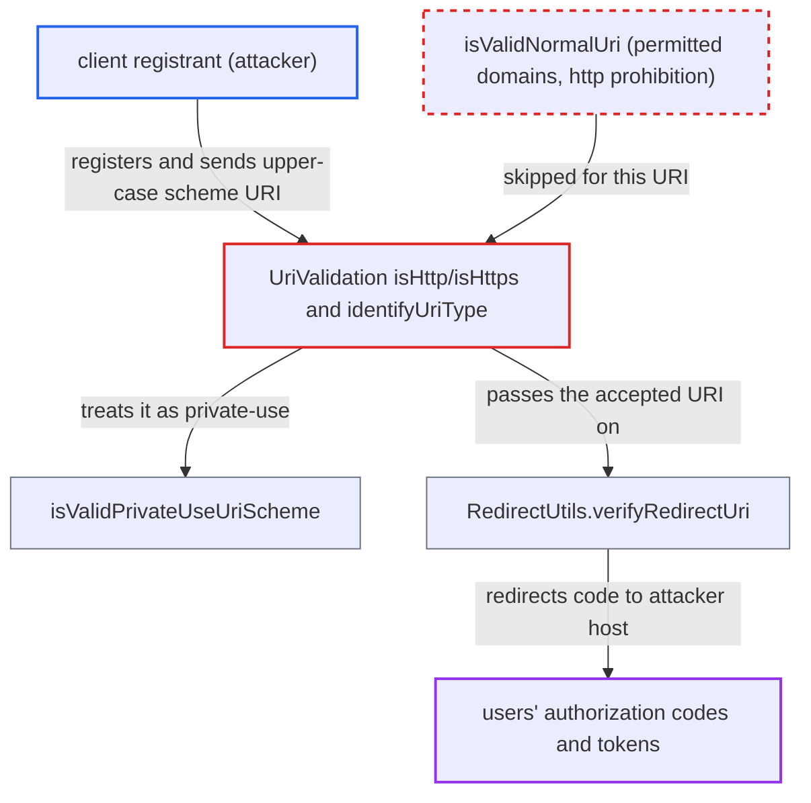

# Upper-case http(s) scheme bypasses secure-redirect-uris-enforcer domain and https restrictions

| Field | Value |
|---|---|
| ID | `find_0114ToU6a4eNTnxSNYeZNhGR` |
| Severity | **Medium** |
| Status | open |
| CWE | CWE-178 — Improper handling of case sensitivity |
| Created | 2026-10-27T21:27:52.947328Z |
| Claude Security | https://claude.ai/security/findings/find_0114ToU6a4eNTnxSNYeZNhGR |

## Description

A client registrant can register a redirect address on any web host, or a plain-http address, by writing the scheme in capitals. Users who sign in to that client then have their authorization codes sent to the attacker's host. It needs a custom client profile with `allow-private-use-uri-scheme` on, `oauth-2-1-compliant` off, and permitted domains or `allow-http-scheme=false` set. The scheme checks in `isHttp()`/`isHttps()` compare case-sensitively.

1. **attacker with an initial access token, a create-client bearer token for DCR, or manage-clients rights** registers a client whose redirect URI has an upper-case scheme. The URI is `HTTPS://attacker.example/cb`, on a host outside the permitted domains.
2. **the methods `isHttp()` and `isHttps()`** fail to recognise the URI as http(s). They compare `uri.getScheme()` with `"http"` and `"https"` using case-sensitive `String.equals`, and `getScheme()` keeps the case as written. ([`services/src/main/java/org/keycloak/services/clientpolicy/executor/SecureRedirectUrisEnforcerExecutor.java:527-533`](https://github.com/cx-benchmark/keycloak/blob/1d7be35d0764060a8143fc74b0aabf2442743be4/services/src/main/java/org/keycloak/services/clientpolicy/executor/SecureRedirectUrisEnforcerExecutor.java#L527-L533))
3. **the method `isPrivateUseScheme()`** classifies the URI as a private-use scheme. It is true for any absolute URI that is neither http nor https, so `identifyUriType()` returns `PRIVATE_USE_URI_SCHEME` instead of `NORMAL_URI`. ([`services/src/main/java/org/keycloak/services/clientpolicy/executor/SecureRedirectUrisEnforcerExecutor.java:353-360`](https://github.com/cx-benchmark/keycloak/blob/1d7be35d0764060a8143fc74b0aabf2442743be4/services/src/main/java/org/keycloak/services/clientpolicy/executor/SecureRedirectUrisEnforcerExecutor.java#L353-L360))
4. **the method `isValidPrivateUseUriScheme()`** accepts the URI without checking the host or the scheme's security. It checks only wildcards and fragments. The `allow-permitted-domains` and `allow-http-scheme` rules sit in `isValidNormalUri()` and are never run. Only `oauth-2-1-compliant`, which requires a dot in the scheme, would reject it. ([`services/src/main/java/org/keycloak/services/clientpolicy/executor/SecureRedirectUrisEnforcerExecutor.java:433-468`](https://github.com/cx-benchmark/keycloak/blob/1d7be35d0764060a8143fc74b0aabf2442743be4/services/src/main/java/org/keycloak/services/clientpolicy/executor/SecureRedirectUrisEnforcerExecutor.java#L433-L468))
5. **attacker** lures a realm user to the authorization endpoint with `redirect_uri=HTTPS://attacker.example/cb`. The runtime checks at `PRE_AUTHORIZATION_REQUEST` and `AUTHORIZATION_REQUEST` misclassify the parameter in the same way, so they pass. ([`services/src/main/java/org/keycloak/services/clientpolicy/executor/SecureRedirectUrisEnforcerExecutor.java:189-212`](https://github.com/cx-benchmark/keycloak/blob/1d7be35d0764060a8143fc74b0aabf2442743be4/services/src/main/java/org/keycloak/services/clientpolicy/executor/SecureRedirectUrisEnforcerExecutor.java#L189-L212))
6. **the method `RedirectUtils.verifyRedirectUri`** matches the parameter against the registered value and allows the redirect. Matching is exact string equality, so the identical upper-case value matches. Nothing downstream normalises or rejects the capitalised scheme. The browser lower-cases the scheme and sends the authorization code to the attacker's host. ([`services/src/main/java/org/keycloak/protocol/oidc/utils/RedirectUtils.java:232-243`](https://github.com/cx-benchmark/keycloak/blob/1d7be35d0764060a8143fc74b0aabf2442743be4/services/src/main/java/org/keycloak/protocol/oidc/utils/RedirectUtils.java#L232-L243))

## Assessment

The attacker needs an initial access token or a create-client bearer token for DCR, or must be a manage-clients admin. The realm must use a custom client profile with `secure-redirect-uris-enforcer`, `allow-private-use-uri-scheme=true`, `oauth-2-1-compliant=false`, and permitted domains or `allow-http-scheme=false`. The attacker registers `HTTPS://attacker.example/cb` and lures a realm user to `/protocol/openid-connect/auth?client_id=<theirs>&redirect_uri=HTTPS://attacker.example/cb&response_type=code`. The same misclassification lets `HTTP://127.0.0.1` past the `allow-http-scheme=false` loopback check. It also defeats the runtime check for clients whose registered redirect URIs were never vetted by the policy. Keycloak's built-in `oauth-2-1-*` profiles are not affected, because they set `oauth-2-1-compliant=true`.

Impact: The attacker gets a client whose redirect target lies outside the allowed domains. It receives authorization codes, and after exchange the ID, access and refresh tokens, for any user who signs in to it. Authenticated DCR clients get no Full Scope Disabled or Consent Required policy by default, so an SSO user can be redirected silently. The attacker can act as the victim at APIs that accept those tokens, limited to the client's scopes. There is no availability impact.

## Recommendation

`isHttp()` and `isHttps()` compare the URI scheme case-sensitively. A capitalised `HTTP` or `HTTPS` scheme therefore escapes the normal-URI rules (permitted domains, https-only) and is treated as a private-use scheme.

Fix criteria: Scheme classification is case-insensitive, as RFC 3986 §3.1 requires. Any URI whose scheme equals `http` or `https` ignoring case is validated by the normal-URI rules, and the private-use branch never accepts an http(s) URI. Registering or sending `HTTPS://host/cb` and `HTTP://host/cb` is rejected exactly as the lower-case forms are under `allow-permitted-domains` and `allow-http-scheme=false`, including with `allow-private-use-uri-scheme=true`. Unit tests with mixed-case schemes exist and pass.

## Evidence

**https://github.com/cx-benchmark/keycloak**

- [`services/src/main/java/org/keycloak/services/clientpolicy/executor/SecureRedirectUrisEnforcerExecutor.java:527-533`](https://github.com/cx-benchmark/keycloak/blob/1d7be35d0764060a8143fc74b0aabf2442743be4/services/src/main/java/org/keycloak/services/clientpolicy/executor/SecureRedirectUrisEnforcerExecutor.java#L527-L533)
- [`services/src/main/java/org/keycloak/services/clientpolicy/executor/SecureRedirectUrisEnforcerExecutor.java:353-360`](https://github.com/cx-benchmark/keycloak/blob/1d7be35d0764060a8143fc74b0aabf2442743be4/services/src/main/java/org/keycloak/services/clientpolicy/executor/SecureRedirectUrisEnforcerExecutor.java#L353-L360)
- [`services/src/main/java/org/keycloak/services/clientpolicy/executor/SecureRedirectUrisEnforcerExecutor.java:433-468`](https://github.com/cx-benchmark/keycloak/blob/1d7be35d0764060a8143fc74b0aabf2442743be4/services/src/main/java/org/keycloak/services/clientpolicy/executor/SecureRedirectUrisEnforcerExecutor.java#L433-L468)
- [`services/src/main/java/org/keycloak/services/clientpolicy/executor/SecureRedirectUrisEnforcerExecutor.java:470-497`](https://github.com/cx-benchmark/keycloak/blob/1d7be35d0764060a8143fc74b0aabf2442743be4/services/src/main/java/org/keycloak/services/clientpolicy/executor/SecureRedirectUrisEnforcerExecutor.java#L470-L497)
- [`services/src/main/java/org/keycloak/services/clientpolicy/executor/SecureRedirectUrisEnforcerExecutor.java:189-212`](https://github.com/cx-benchmark/keycloak/blob/1d7be35d0764060a8143fc74b0aabf2442743be4/services/src/main/java/org/keycloak/services/clientpolicy/executor/SecureRedirectUrisEnforcerExecutor.java#L189-L212)
- [`services/src/main/java/org/keycloak/protocol/oidc/utils/RedirectUtils.java:232-243`](https://github.com/cx-benchmark/keycloak/blob/1d7be35d0764060a8143fc74b0aabf2442743be4/services/src/main/java/org/keycloak/protocol/oidc/utils/RedirectUtils.java#L232-L243)

