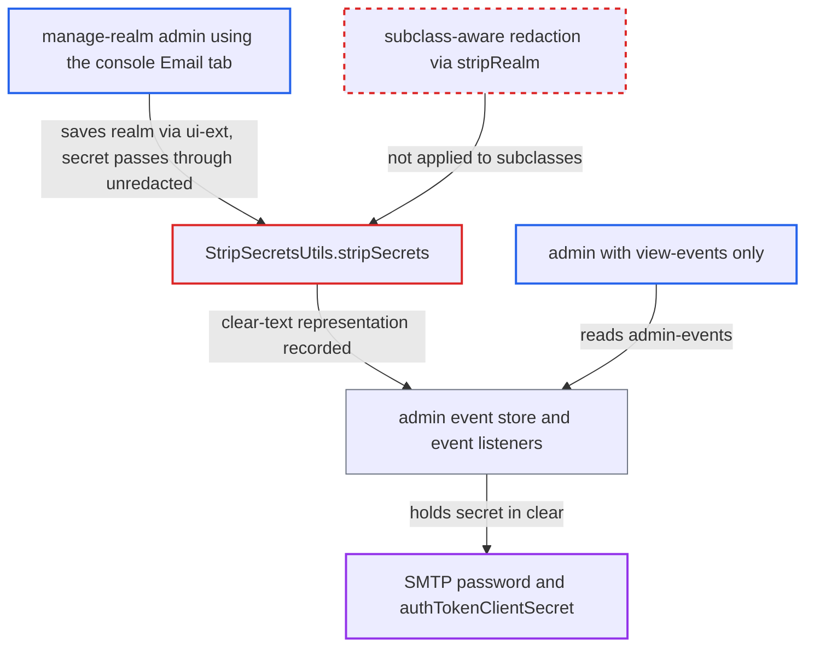

# Admin events store SMTP password in clear when realm is saved via ui-ext subclass

| Field | Value |
|---|---|
| ID | `find_01NiDR1QgiT7fL4uMYvn2jK9` |
| Severity | **Low** |
| Status | open |
| CWE | CWE-212 — Sensitive Information Exposure |
| Created | 2026-10-27T22:02:17.245519Z |
| Claude Security | https://claude.ai/security/findings/find_01NiDR1QgiT7fL4uMYvn2jK9 |

## Description

A realm admin who has only `view-events` can read the realm's SMTP password or OAuth token secret in clear text from stored admin events. This needs admin events with Include representation turned on (both off by default) and a `manage-realm` admin saving the Email tab. `StripSecretsUtils.stripSecrets` picks its redactor by exact class, so the subclass `UIRealmRepresentation` is never redacted.

1. **`manage-realm` admin** saves a new SMTP password or `authTokenClientSecret` on the Email tab. The admin console sends the whole realm, including `smtpServer`, with `PUT /admin/realms/{realm}/ui-ext`. ([`js/apps/admin-ui/src/realm-settings/RealmSettingsTabs.tsx:266-282`](https://github.com/cx-benchmark/keycloak/blob/1d7be35d0764060a8143fc74b0aabf2442743be4/js/apps/admin-ui/src/realm-settings/RealmSettingsTabs.tsx#L266-L282))
2. **the handler `UIRealmResource.updateRealm`** binds the body to `UIRealmRepresentation` and passes it to `RealmAdminResource.updateRealm`. `UIRealmRepresentation extends RealmRepresentation`, so its runtime class is not a key in the redaction map. ([`rest/admin-ui-ext/src/main/java/org/keycloak/admin/ui/rest/UIRealmResource.java:68-79`](https://github.com/cx-benchmark/keycloak/blob/1d7be35d0764060a8143fc74b0aabf2442743be4/rest/admin-ui-ext/src/main/java/org/keycloak/admin/ui/rest/UIRealmResource.java#L68-L79))
3. **`RealmAdminResource.updateRealm`** records the update with `adminEvent.operation(UPDATE).representation(rep)`. `rep` still holds the typed credential, because `DefaultExportImportManager.updateRealm` copies `smtpServer` into a new map instead of changing the request object. ([`services/src/main/java/org/keycloak/services/resources/admin/RealmAdminResource.java:535-543`](https://github.com/cx-benchmark/keycloak/blob/1d7be35d0764060a8143fc74b0aabf2442743be4/services/src/main/java/org/keycloak/services/resources/admin/RealmAdminResource.java#L535-L543))
4. **`StripSecretsUtils.stripSecrets`** finds no redactor and returns the representation unchanged. It looks up `formatters.get(representation.getClass())`, an exact-class match, so `stripRealm` never runs. ([`server-spi-private/src/main/java/org/keycloak/models/utils/StripSecretsUtils.java:85-95`](https://github.com/cx-benchmark/keycloak/blob/1d7be35d0764060a8143fc74b0aabf2442743be4/server-spi-private/src/main/java/org/keycloak/models/utils/StripSecretsUtils.java#L85-L95))
5. **`AdminEventBuilder.representation`** serialises the unredacted object into the admin event. `send()` hands the event to the store and to every event listener. ([`services/src/main/java/org/keycloak/services/resources/admin/AdminEventBuilder.java:256-273`](https://github.com/cx-benchmark/keycloak/blob/1d7be35d0764060a8143fc74b0aabf2442743be4/services/src/main/java/org/keycloak/services/resources/admin/AdminEventBuilder.java#L256-L273))
6. **attacker with `view-events`** calls `GET /admin/realms/{realm}/admin-events?resourceTypes=REALM`. This endpoint needs only `requireViewEvents` and returns the stored representation, including `smtpServer.password`. ([`services/src/main/java/org/keycloak/services/resources/admin/RealmAdminResource.java:1024-1033`](https://github.com/cx-benchmark/keycloak/blob/1d7be35d0764060a8143fc74b0aabf2442743be4/services/src/main/java/org/keycloak/services/resources/admin/RealmAdminResource.java#L1024-L1033))

## Assessment

The attacker is a realm admin holding only `view-events` (or `manage-events`). Two conditions lie outside the attacker's control. The realm must store admin events with Include representation enabled, and both are off by default. A `manage-realm` admin must also save a new SMTP password or token secret from the admin console. The stored event can be read through `GET /admin/realms/{realm}/admin-events`. The credential also goes to every event listener. The built-in `jboss-logging` listener writes it to the server log when its `include-representation` option is on. The same exact-class lookup also skips redaction for other subclasses passed to `stripSecrets`, for example `BruteUser`, `MemberRepresentation` and `ApplicationRepresentation`.

Impact: A principal who can only read events obtains the realm's outbound mail credential, either the SMTP password or the OAuth client secret. Anyone with access to the server log can also read it when the `jboss-logging` listener includes representations. Elsewhere Keycloak masks this value, even from realm viewers and managers. Nothing is modified and the service stays available.

Subsequent-system impact: The leaked credential authenticates to the realm's mail relay. The attacker can send mail as the realm's configured sender, for example convincing password-reset phishing aimed at realm users. The report does not show that the credential also allows reading mail.

## Recommendation

(1) `StripSecretsUtils.stripSecrets` picks the redactor by the exact runtime class of the representation. Subclasses such as `UIRealmRepresentation` therefore bypass the redaction that protects admin events and admin API responses.

Fix criteria: Redaction applies to any representation that is a registered type, whether a subclass or the exact class, for example by walking the class hierarchy or using `isInstance` when no exact match exists. Save realm Email settings with a new SMTP password through `PUT /admin/realms/{realm}/ui-ext` with admin-event representations enabled, then read the stored admin event. `smtpServer.password` and `smtpServer.authTokenClientSecret` must be the mask constant or the untouched `${vault.*}` reference.

(2) `AdminEventBuilder.representation` has no fallback when `stripSecrets` finds no formatter, so representation types it does not know are recorded as they are.

Fix criteria: Admin-event recording fails closed for unknown representation types that may carry secrets, for example by mapping the ui-ext payload to the base `RealmRepresentation` before recording, or by redacting generically known secret keys. No admin event stores a clear-text `smtpServer.password` for any realm-update path.

## Evidence

**https://github.com/cx-benchmark/keycloak**

- [`server-spi-private/src/main/java/org/keycloak/models/utils/StripSecretsUtils.java:85-95`](https://github.com/cx-benchmark/keycloak/blob/1d7be35d0764060a8143fc74b0aabf2442743be4/server-spi-private/src/main/java/org/keycloak/models/utils/StripSecretsUtils.java#L85-L95)
- [`server-spi-private/src/main/java/org/keycloak/models/utils/StripSecretsUtils.java:70-79`](https://github.com/cx-benchmark/keycloak/blob/1d7be35d0764060a8143fc74b0aabf2442743be4/server-spi-private/src/main/java/org/keycloak/models/utils/StripSecretsUtils.java#L70-L79)
- [`rest/admin-ui-ext/src/main/java/org/keycloak/admin/ui/rest/UIRealmResource.java:68-79`](https://github.com/cx-benchmark/keycloak/blob/1d7be35d0764060a8143fc74b0aabf2442743be4/rest/admin-ui-ext/src/main/java/org/keycloak/admin/ui/rest/UIRealmResource.java#L68-L79)
- [`rest/admin-ui-ext/src/main/java/org/keycloak/admin/ui/rest/model/UIRealmRepresentation.java:25-36`](https://github.com/cx-benchmark/keycloak/blob/1d7be35d0764060a8143fc74b0aabf2442743be4/rest/admin-ui-ext/src/main/java/org/keycloak/admin/ui/rest/model/UIRealmRepresentation.java#L25-L36)
- [`services/src/main/java/org/keycloak/services/resources/admin/RealmAdminResource.java:535-543`](https://github.com/cx-benchmark/keycloak/blob/1d7be35d0764060a8143fc74b0aabf2442743be4/services/src/main/java/org/keycloak/services/resources/admin/RealmAdminResource.java#L535-L543)
- [`services/src/main/java/org/keycloak/services/resources/admin/AdminEventBuilder.java:256-273`](https://github.com/cx-benchmark/keycloak/blob/1d7be35d0764060a8143fc74b0aabf2442743be4/services/src/main/java/org/keycloak/services/resources/admin/AdminEventBuilder.java#L256-L273)
- [`model/storage-private/src/main/java/org/keycloak/storage/datastore/DefaultExportImportManager.java:932-934`](https://github.com/cx-benchmark/keycloak/blob/1d7be35d0764060a8143fc74b0aabf2442743be4/model/storage-private/src/main/java/org/keycloak/storage/datastore/DefaultExportImportManager.java#L932-L934)
- [`services/src/main/java/org/keycloak/services/resources/admin/RealmAdminResource.java:1024-1033`](https://github.com/cx-benchmark/keycloak/blob/1d7be35d0764060a8143fc74b0aabf2442743be4/services/src/main/java/org/keycloak/services/resources/admin/RealmAdminResource.java#L1024-L1033)
- [`js/apps/admin-ui/src/realm-settings/RealmSettingsTabs.tsx:266-282`](https://github.com/cx-benchmark/keycloak/blob/1d7be35d0764060a8143fc74b0aabf2442743be4/js/apps/admin-ui/src/realm-settings/RealmSettingsTabs.tsx#L266-L282)

