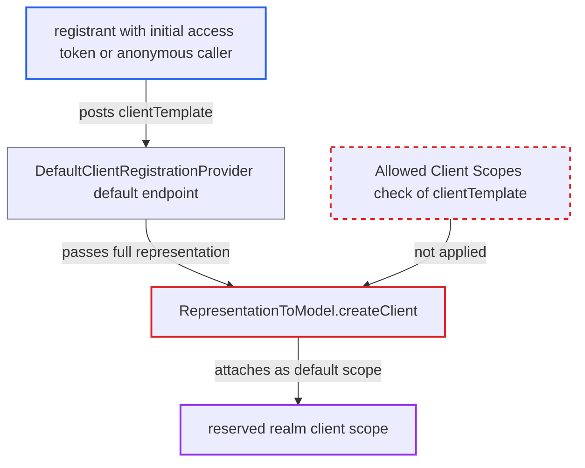

# Allowed Client Scopes registration policy bypassed via deprecated clientTemplate field

| Field | Value |
|---|---|
| ID | `find_01VjJA2fLYwDWk56d1Bipf99` |
| Severity | **Low** |
| Status | open |
| CWE | CWE-863 — Improper Authorization |
| Created | 2026-10-27T21:28:36.471958Z |
| Claude Security | https://claude.ai/security/findings/find_01VjJA2fLYwDWk56d1Bipf99 |

## Description

A client registrant can attach a realm client scope that the administrator kept out of the 'Allowed Client Scopes' allow-list. Every token issued to the new client is then shaped by that scope. The attacker needs an initial access token, or anonymous access in a realm with trusted hosts configured, and a victim who logs in to the client. The policy `ClientScopesClientRegistrationPolicy` checks only the two scope lists, not the deprecated `clientTemplate` field that `RepresentationToModel.createClient` also applies.

1. **registrant** posts a client representation with `clientTemplate` set to a reserved scope. The request goes to `/realms/{realm}/clients-registrations/default`, and the registrant names a scope that is not on the allow-list. ([`services/src/main/java/org/keycloak/services/clientregistration/DefaultClientRegistrationProvider.java:55-64`](https://github.com/cx-benchmark/keycloak/blob/1d7be35d0764060a8143fc74b0aabf2442743be4/services/src/main/java/org/keycloak/services/clientregistration/DefaultClientRegistrationProvider.java#L55-L64))
2. **`ClientRepresentation`** deserializes `clientTemplate` from the request body. The field is `@Deprecated` but not `@JsonIgnore`d, and it has a public getter, so it is read from the request. ([`core/src/main/java/org/keycloak/representations/idm/ClientRepresentation.java:69-70`](https://github.com/cx-benchmark/keycloak/blob/1d7be35d0764060a8143fc74b0aabf2442743be4/core/src/main/java/org/keycloak/representations/idm/ClientRepresentation.java#L69-L70))
3. **`ClientScopesClientRegistrationPolicy`** approves the request after checking only the two scope lists. `beforeRegister` compares `getDefaultClientScopes()` and `getOptionalClientScopes()` with the allow-list and never looks at `clientTemplate`. ([`services/src/main/java/org/keycloak/services/clientregistration/policy/impl/ClientScopesClientRegistrationPolicy.java:55-66`](https://github.com/cx-benchmark/keycloak/blob/1d7be35d0764060a8143fc74b0aabf2442743be4/services/src/main/java/org/keycloak/services/clientregistration/policy/impl/ClientScopesClientRegistrationPolicy.java#L55-L66))
4. **the registration provider** runs the policies and then creates the client. The policies run in `auth.requireCreate` before `ClientManager.createClient`, and `stripPrivilegedAttributes` removes only `ssf.*` attributes, so `clientTemplate` survives. ([`services/src/main/java/org/keycloak/services/clientregistration/AbstractClientRegistrationProvider.java:96-111`](https://github.com/cx-benchmark/keycloak/blob/1d7be35d0764060a8143fc74b0aabf2442743be4/services/src/main/java/org/keycloak/services/clientregistration/AbstractClientRegistrationProvider.java#L96-L111))
5. **`RepresentationToModel.createClient`** attaches the named scope to the client as a default scope. It resolves the name with `KeycloakModelUtils.getClientScopeByName`, which matches any scope in the realm, and calls `addClientScopeToClient(..., true)`. ([`server-spi-private/src/main/java/org/keycloak/models/utils/RepresentationToModel.java:432-437`](https://github.com/cx-benchmark/keycloak/blob/1d7be35d0764060a8143fc74b0aabf2442743be4/server-spi-private/src/main/java/org/keycloak/models/utils/RepresentationToModel.java#L432-L437))
6. **`TokenManager`** applies the scope to every token issued to the client. The scope's protocol mappers run, and `getAccess` merges its role scope mappings even when full scope is disabled. ([`services/src/main/java/org/keycloak/protocol/oidc/TokenManager.java:610-618`](https://github.com/cx-benchmark/keycloak/blob/1d7be35d0764060a8143fc74b0aabf2442743be4/services/src/main/java/org/keycloak/protocol/oidc/TokenManager.java#L610-L618))

## Assessment

The attacker is a registrant the realm's policies are meant to constrain. That is either the holder of an initial access token, or an anonymous caller in a realm with trusted hosts configured. They send the request to the internet-facing `/realms/{realm}/clients-registrations/default` endpoint. The deprecated `default` provider is still registered and enabled. The realm must contain a scope the administrator kept out of the allow-list. The attacker then needs a victim to log in to the client, and to give consent where consent is required. The OIDC DCR endpoint is not affected, because `DescriptionConverter.toInternal` never sets `clientTemplate`.

Impact: The attacker's client gets a scope it should not have, and the scope stays on later updates because `beforeUpdate` accepts scopes already on the client. The scope's protocol mappers run for every token, including mapper types the 'Allowed Protocol Mapper Types' policy would refuse if requested directly. Its role scope mappings add the victim's roles even under 'Full Scope Disabled'. The gain is limited to scopes that already exist in the realm and to roles the user really holds, unless a mapper hard-codes them.

## Recommendation

`ClientScopesClientRegistrationPolicy` checks only two of the three representation fields that attach a scope. `RepresentationToModel.createClient` applies `clientTemplate` after the policies have run, so the allow-list is bypassed on the `default` registration provider.

Fix criteria: No registration or update request can attach a client scope that the Allowed Client Scopes policy would reject, whatever field the representation uses. Either the policy checks `clientTemplate` (and any other field that attaches a scope) against the same allow-list, or the registration path rejects or clears `clientTemplate` before model conversion. To verify, register through `/clients-registrations/default` with `clientTemplate` set to a scope that is not on the allow-list. The request must be refused and no scope attached.

## Evidence

**https://github.com/cx-benchmark/keycloak**

- [`services/src/main/java/org/keycloak/services/clientregistration/policy/impl/ClientScopesClientRegistrationPolicy.java:55-66`](https://github.com/cx-benchmark/keycloak/blob/1d7be35d0764060a8143fc74b0aabf2442743be4/services/src/main/java/org/keycloak/services/clientregistration/policy/impl/ClientScopesClientRegistrationPolicy.java#L55-L66)
- [`server-spi-private/src/main/java/org/keycloak/models/utils/RepresentationToModel.java:432-437`](https://github.com/cx-benchmark/keycloak/blob/1d7be35d0764060a8143fc74b0aabf2442743be4/server-spi-private/src/main/java/org/keycloak/models/utils/RepresentationToModel.java#L432-L437)
- [`server-spi-private/src/main/java/org/keycloak/models/utils/KeycloakModelUtils.java:1343-1349`](https://github.com/cx-benchmark/keycloak/blob/1d7be35d0764060a8143fc74b0aabf2442743be4/server-spi-private/src/main/java/org/keycloak/models/utils/KeycloakModelUtils.java#L1343-L1349)
- [`services/src/main/java/org/keycloak/services/clientregistration/AbstractClientRegistrationProvider.java:96-111`](https://github.com/cx-benchmark/keycloak/blob/1d7be35d0764060a8143fc74b0aabf2442743be4/services/src/main/java/org/keycloak/services/clientregistration/AbstractClientRegistrationProvider.java#L96-L111)
- [`services/src/main/java/org/keycloak/services/clientregistration/DefaultClientRegistrationProvider.java:55-64`](https://github.com/cx-benchmark/keycloak/blob/1d7be35d0764060a8143fc74b0aabf2442743be4/services/src/main/java/org/keycloak/services/clientregistration/DefaultClientRegistrationProvider.java#L55-L64)
- [`core/src/main/java/org/keycloak/representations/idm/ClientRepresentation.java:69-70`](https://github.com/cx-benchmark/keycloak/blob/1d7be35d0764060a8143fc74b0aabf2442743be4/core/src/main/java/org/keycloak/representations/idm/ClientRepresentation.java#L69-L70)
- [`services/src/main/java/org/keycloak/protocol/oidc/TokenManager.java:610-618`](https://github.com/cx-benchmark/keycloak/blob/1d7be35d0764060a8143fc74b0aabf2442743be4/services/src/main/java/org/keycloak/protocol/oidc/TokenManager.java#L610-L618)

