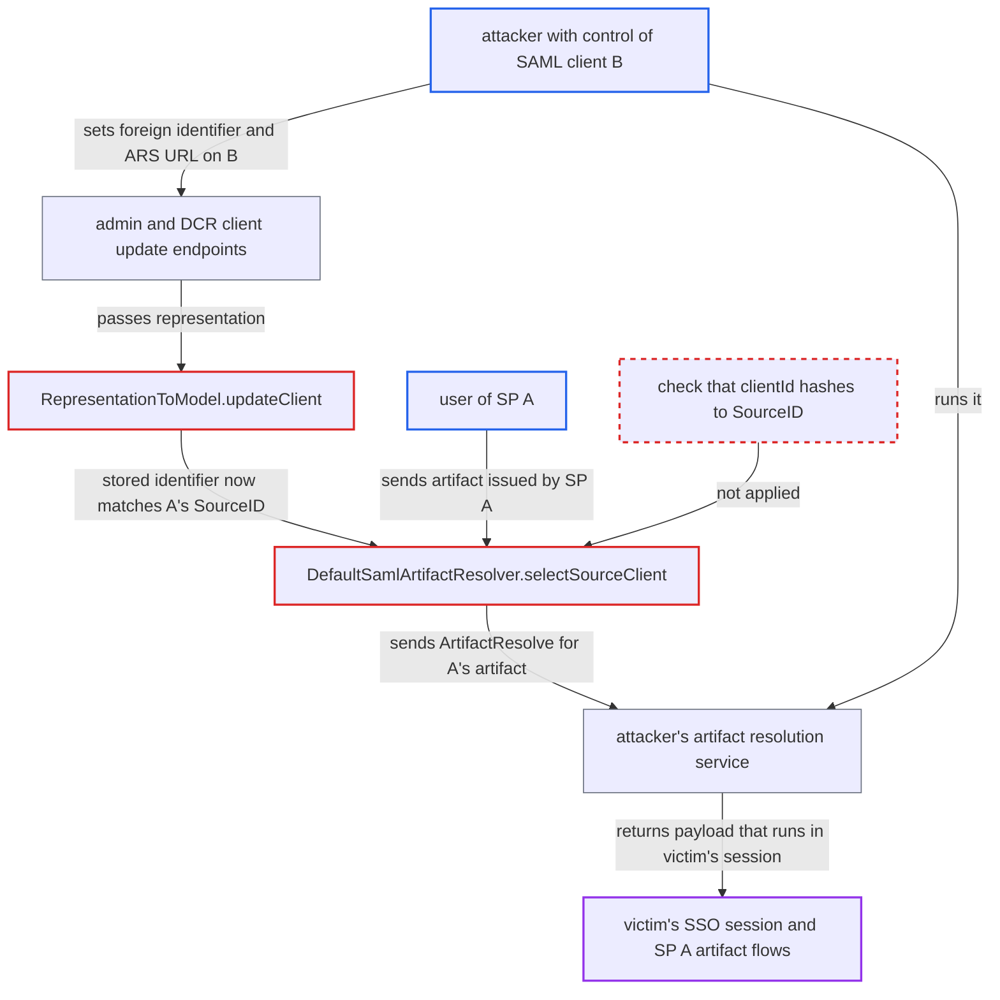

# Caller-settable SAML artifact SourceID attribute lets one client hijack another SP's artifact flows

| Field | Value |
|---|---|
| ID | `find_01TkZVzx4oViKaunjbh6na7t` |
| Severity | **Low** |
| Status | open |
| CWE | CWE-346 — Origin Validation Error |
| Created | 2026-10-27T22:06:08.597493Z |
| Claude Security | https://claude.ai/security/findings/find_01TkZVzx4oViKaunjbh6na7t |

## Description

A user who controls one SAML client can take over another service provider's (SP's) artifact-bound logins and logouts. Every artifact that SP A issues is then sent to the attacker's server, and the reply is run in the victim's browser session. The attacker needs configure rights on their own client or its registration access token. The cause is `selectSourceClient`, which trusts a caller-settable attribute and never checks the client's clientId against the artifact.

1. **attacker** creates or renames SAML client B so its clientId sorts before SP A's clientId. Search results are ordered by `clientId` and only the first match is used, so B must come first.
2. **attacker** updates B through `PUT /admin/realms/{realm}/clients/{id}` or the DCR `PUT /realms/{realm}/clients-registrations/default/{clientId}`. The update sets `saml.artifact.binding.identifier` to base64 of SHA-1 of A's clientId and sets `saml_artifact_resolution_service_url` to the attacker's server; the admin route needs only `requireConfigure` on B. ([`services/src/main/java/org/keycloak/services/resources/admin/ClientResource.java:163-169`](https://github.com/cx-benchmark/keycloak/blob/1d7be35d0764060a8143fc74b0aabf2442743be4/services/src/main/java/org/keycloak/services/resources/admin/ClientResource.java#L163-L169))
3. **`RepresentationToModel.updateClient`** keeps the supplied identifier and stores it unchanged. It recomputes the value only when the representation leaves the key out, and `updateClientProperties` copies every other attribute as given. ([`server-spi-private/src/main/java/org/keycloak/models/utils/RepresentationToModel.java:592-602`](https://github.com/cx-benchmark/keycloak/blob/1d7be35d0764060a8143fc74b0aabf2442743be4/server-spi-private/src/main/java/org/keycloak/models/utils/RepresentationToModel.java#L592-L602))
4. **user of SP A** starts an artifact-bound login or logout, so the browser delivers a `SAMLart` to `/realms/{realm}/protocol/saml`. `handleArtifact` then has to find which SP issued the artifact. ([`services/src/main/java/org/keycloak/protocol/saml/SamlService.java:390-449`](https://github.com/cx-benchmark/keycloak/blob/1d7be35d0764060a8143fc74b0aabf2442743be4/services/src/main/java/org/keycloak/protocol/saml/SamlService.java#L390-L449))
5. **`DefaultSamlArtifactResolver.selectSourceClient`** returns client B as the artifact's source. It returns the first client whose attribute equals the SourceID and never checks that the client's own clientId hashes to that SourceID. ([`services/src/main/java/org/keycloak/protocol/saml/DefaultSamlArtifactResolver.java:46-53`](https://github.com/cx-benchmark/keycloak/blob/1d7be35d0764060a8143fc74b0aabf2442743be4/services/src/main/java/org/keycloak/protocol/saml/DefaultSamlArtifactResolver.java#L46-L53))
6. **`SamlService.handleArtifact`** sends an `ArtifactResolve` carrying A's artifact to B's `saml_artifact_resolution_service_url`. The request is signed with the realm key if B asks for signing, and it goes to the attacker's server. ([`services/src/main/java/org/keycloak/protocol/saml/SamlService.java:390-449`](https://github.com/cx-benchmark/keycloak/blob/1d7be35d0764060a8143fc74b0aabf2442743be4/services/src/main/java/org/keycloak/protocol/saml/SamlService.java#L390-L449))
7. **`ArtifactResolutionRunnable.run`** executes the unsigned `ArtifactResponse` that the attacker's server returns, in the victim's browser request. A returned `AuthnRequest` or `LogoutRequest` with Issuer B is looked up by `Issuer` and is signature-checked only if client B requires it. ([`services/src/main/java/org/keycloak/protocol/saml/SamlService.java:1545-1557`](https://github.com/cx-benchmark/keycloak/blob/1d7be35d0764060a8143fc74b0aabf2442743be4/services/src/main/java/org/keycloak/protocol/saml/SamlService.java#L1545-L1557))

## Assessment

The attacker controls one SAML client B. That means either limited admin rights with `requireConfigure` (FGAP configure or manage) on B, or B's DCR registration access token. The attacker gives B a clientId that sorts before A's and sets its attribute and ARS URL by an update. Realm import would also keep a caller-supplied value at create, but the report names the update paths as the way in. The attack works only when SP A sends its SP-to-IdP messages by HTTP-Artifact binding, and it lasts while the collision stands. The artifact request reaches `/realms/{realm}/protocol/saml` unauthenticated. The same first-match-on-a-free-form-attribute pattern exists for `saml_idp_initiated_sso_url_name` in `SamlService.idpInitiatedSSO`.

Impact: The attacker decides what Keycloak runs for every artifact-bound flow that SP A starts. An `AuthnRequest` for B sends an assertion about the victim to B's ACS with B's mappers, even though the victim only used A. A `LogoutRequest` ends the victim's SSO session, and a logout started at A can be swallowed so the session stays alive. Assertions are scoped to audience B, and no assertion for A or any other SP can be forged. The IdP-to-SP `/resolve` path is not affected.

Subsequent-system impact: While the collision stands, SP A's HTTP-Artifact login and single logout stop working for all its users, because its artifacts are never resolved at A's own ARS. The report says the attacker cannot read or change data held by A.

## Recommendation

(1) `DefaultSamlArtifactResolver.selectSourceClient` treats the free-form attribute `saml.artifact.binding.identifier` as proof that a client issued the artifact. A client carrying another SP's identifier is therefore resolved as that SP.

Fix criteria: An artifact whose SourceID is SHA-1 of SP A's clientId is only ever resolved against client A. The resolver confirms that the selected client's own clientId hashes to the SourceID, or finds the client by that property, and rejects the artifact otherwise. Test: give a second SAML client the same identifier and a different ARS URL, and confirm that artifacts for A still go to A's ARS or are rejected, never sent to the second client.

(2) `RepresentationToModel.updateClient`, `createClient` and the dynamic client registration update keep a caller-supplied `saml.artifact.binding.identifier`. A configure-level client admin or a registration-access-token holder can therefore write a security-relevant value that should be derived from the clientId.

Fix criteria: The stored identifier always equals SHA-1 of the client's current clientId, whatever the admin API, the DCR endpoints or an import supply. Caller values are ignored or overwritten on every create and update. Test: PUT a client with a foreign identifier through `ClientResource.update` and through `/clients-registrations/default/{clientId}`, then read back the computed value.

## Evidence

**https://github.com/cx-benchmark/keycloak**

- [`services/src/main/java/org/keycloak/protocol/saml/DefaultSamlArtifactResolver.java:46-53`](https://github.com/cx-benchmark/keycloak/blob/1d7be35d0764060a8143fc74b0aabf2442743be4/services/src/main/java/org/keycloak/protocol/saml/DefaultSamlArtifactResolver.java#L46-L53)
- [`services/src/main/java/org/keycloak/protocol/saml/SamlService.java:390-449`](https://github.com/cx-benchmark/keycloak/blob/1d7be35d0764060a8143fc74b0aabf2442743be4/services/src/main/java/org/keycloak/protocol/saml/SamlService.java#L390-L449)
- [`services/src/main/java/org/keycloak/protocol/saml/SamlService.java:1545-1557`](https://github.com/cx-benchmark/keycloak/blob/1d7be35d0764060a8143fc74b0aabf2442743be4/services/src/main/java/org/keycloak/protocol/saml/SamlService.java#L1545-L1557)
- [`server-spi-private/src/main/java/org/keycloak/models/utils/RepresentationToModel.java:471-479`](https://github.com/cx-benchmark/keycloak/blob/1d7be35d0764060a8143fc74b0aabf2442743be4/server-spi-private/src/main/java/org/keycloak/models/utils/RepresentationToModel.java#L471-L479)
- [`server-spi-private/src/main/java/org/keycloak/models/utils/RepresentationToModel.java:592-602`](https://github.com/cx-benchmark/keycloak/blob/1d7be35d0764060a8143fc74b0aabf2442743be4/server-spi-private/src/main/java/org/keycloak/models/utils/RepresentationToModel.java#L592-L602)
- [`services/src/main/java/org/keycloak/services/resources/admin/ClientResource.java:163-169`](https://github.com/cx-benchmark/keycloak/blob/1d7be35d0764060a8143fc74b0aabf2442743be4/services/src/main/java/org/keycloak/services/resources/admin/ClientResource.java#L163-L169)
- [`services/src/main/java/org/keycloak/services/clientregistration/AbstractClientRegistrationProvider.java:200-253`](https://github.com/cx-benchmark/keycloak/blob/1d7be35d0764060a8143fc74b0aabf2442743be4/services/src/main/java/org/keycloak/services/clientregistration/AbstractClientRegistrationProvider.java#L200-L253)
- [`model/jpa/src/main/java/org/keycloak/models/jpa/JpaRealmProvider.java:1096-1131`](https://github.com/cx-benchmark/keycloak/blob/1d7be35d0764060a8143fc74b0aabf2442743be4/model/jpa/src/main/java/org/keycloak/models/jpa/JpaRealmProvider.java#L1096-L1131)
- [`services/src/main/java/org/keycloak/protocol/saml/SamlProtocolFactory.java:210`](https://github.com/cx-benchmark/keycloak/blob/1d7be35d0764060a8143fc74b0aabf2442743be4/services/src/main/java/org/keycloak/protocol/saml/SamlProtocolFactory.java#L210)

