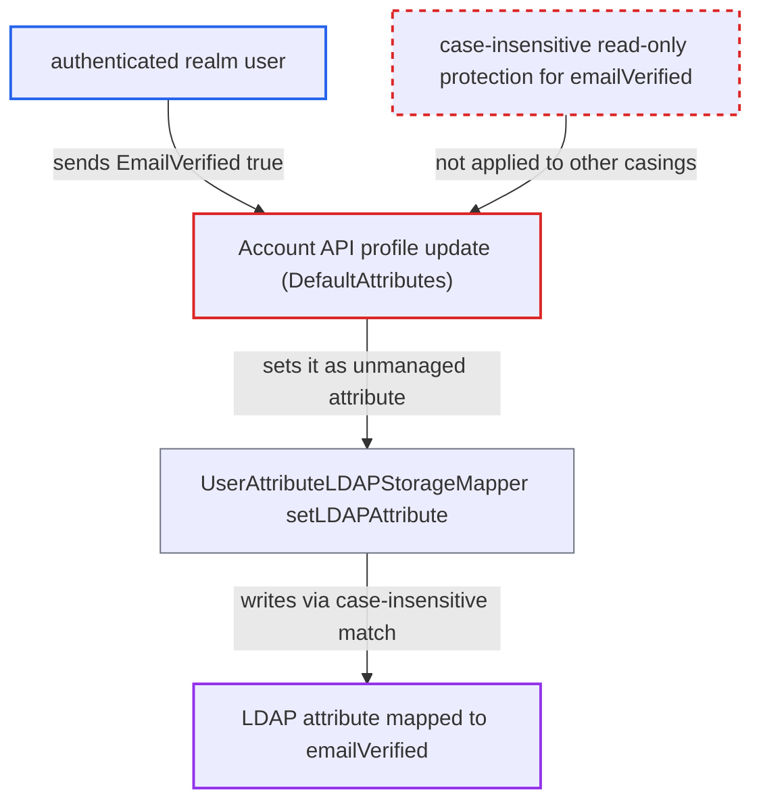

# Case-variant unmanaged attribute sets LDAP-mapped emailVerified flag through Account API

| Field | Value |
|---|---|
| ID | `find_01TtstAd7UXXE4SDGSBzicsC` |
| Severity | **Low** |
| Status | open |
| CWE | CWE-178 — Case sensitivity bypass |
| Created | 2026-10-27T21:32:49.463344Z |
| Claude Security | https://claude.ai/security/findings/find_01TtstAd7UXXE4SDGSBzicsC |

## Description

A logged-in user whose account comes from a writable LDAP provider can mark their own email address as verified without proving it. The attack needs the default `manage-account` role and `unmanagedAttributePolicy: ENABLED`, and only their own record changes. The cause is that the protection on `emailVerified` matches the exact, case-sensitive name, so a key like `EmailVerified` is accepted as an ordinary attribute.

1. **authenticated realm user** sends a profile update to the Account API with the key `EmailVerified`. The request is `POST /realms/{realm}/account` with `attributes: {"EmailVerified": ["true"]}`. The exact key `emailVerified` would be dropped, so the attacker changes the letter case. ([`services/src/main/java/org/keycloak/services/resources/account/AccountRestService.java:157-167`](https://github.com/cx-benchmark/keycloak/blob/1d7be35d0764060a8143fc74b0aabf2442743be4/services/src/main/java/org/keycloak/services/resources/account/AccountRestService.java#L157-L167))
2. **the user profile code in `DefaultAttributes`** treats `EmailVerified` as an unmanaged, writable attribute. `isManagedAttribute()` is a case-sensitive lookup and the built-in read-only list names only `EMAIL_VERIFIED`. With `unmanagedAttributePolicy: ENABLED`, `getWritable()` therefore keeps the key. ([`server-spi-private/src/main/java/org/keycloak/userprofile/DefaultAttributes.java:400-410`](https://github.com/cx-benchmark/keycloak/blob/1d7be35d0764060a8143fc74b0aabf2442743be4/server-spi-private/src/main/java/org/keycloak/userprofile/DefaultAttributes.java#L400-L410))
3. **`DefaultUserProfile.updateInternal()`** calls `user.setAttribute` with `EmailVerified` and `true`. The call is made for the writable unmanaged key, so the value goes on to the user model. ([`server-spi-private/src/main/java/org/keycloak/userprofile/DefaultUserProfile.java:129-149`](https://github.com/cx-benchmark/keycloak/blob/1d7be35d0764060a8143fc74b0aabf2442743be4/server-spi-private/src/main/java/org/keycloak/userprofile/DefaultUserProfile.java#L129-L149))
4. **the LDAP mapper proxy in `UserAttributeLDAPStorageMapper`** passes the attribute to `setLDAPAttribute()`. In WRITABLE mode, every name other than exactly `username` and `email` is passed on. ([`federation/ldap/src/main/java/org/keycloak/storage/ldap/mappers/UserAttributeLDAPStorageMapper.java:241-250`](https://github.com/cx-benchmark/keycloak/blob/1d7be35d0764060a8143fc74b0aabf2442743be4/federation/ldap/src/main/java/org/keycloak/storage/ldap/mappers/UserAttributeLDAPStorageMapper.java#L241-L250))
5. **`setLDAPAttribute()`** writes the LDAP attribute mapped to `emailVerified`. It compares names with `equalsIgnoreCase`, so `EmailVerified` matches the mapper's `emailVerified`. The change is committed through the `LDAPTransaction`. ([`federation/ldap/src/main/java/org/keycloak/storage/ldap/mappers/UserAttributeLDAPStorageMapper.java:322-355`](https://github.com/cx-benchmark/keycloak/blob/1d7be35d0764060a8143fc74b0aabf2442743be4/federation/ldap/src/main/java/org/keycloak/storage/ldap/mappers/UserAttributeLDAPStorageMapper.java#L322-L355))
6. **Keycloak** reports the email as verified. `isEmailVerified()` returns the LDAP value at once with `always.read.value.from.ldap` or in no-import mode. Otherwise it returns it after the next sync through `onImportUserFromLDAP()`. ([`federation/ldap/src/main/java/org/keycloak/storage/ldap/mappers/UserAttributeLDAPStorageMapper.java:464-471`](https://github.com/cx-benchmark/keycloak/blob/1d7be35d0764060a8143fc74b0aabf2442743be4/federation/ldap/src/main/java/org/keycloak/storage/ldap/mappers/UserAttributeLDAPStorageMapper.java#L464-L471))

## Assessment

The attacker is an authenticated realm user with the default `manage-account` role. Their account must come from a WRITABLE LDAP provider that has a non-read-only `user-attribute-ldap-mapper` on `emailVerified`. The realm must use `unmanagedAttributePolicy: ENABLED`, which the migration sets automatically on realms migrated from versions before 24. The attacker may first change their email through the Account API, then send the request with a case variant such as `EmailVerified`. No victim has to act.

Impact: The attacker sets `isEmailVerified()` to true on their own account for any email address that the Account API lets them set and that no other realm user holds. `VERIFY_EMAIL` stops firing, and issued tokens carry `email_verified: true` for an address they never proved. Only the attacker's own record changes, and nothing is disclosed or made unavailable.

## Recommendation

(1) The built-in read-only list protects the federated-storage name `EMAIL_VERIFIED` but not the model name `emailVerified`. The LDAP decorator's admin-only metadata covers only the exact name, so any other casing of `emailVerified` passes as a user-writable unmanaged attribute.

Fix criteria: In every non-admin user-profile context, a submitted attribute whose name equals `emailVerified` in any letter case is rejected or dropped, whatever the unmanaged-attribute policy. The same holds for other model properties that LDAP mappers honour. Verify with `unmanagedAttributePolicy: ENABLED` and a writable `emailVerified` LDAP mapper. A `POST /realms/{r}/account` with `EmailVerified`, `EMAILVERIFIED` or `emailVerified` set to `true` must change neither the LDAP attribute nor `isEmailVerified()`.

(2) `UserAttributeLDAPStorageMapper.setLDAPAttribute()` matches the incoming model attribute name case-insensitively, but the user-profile layer decides managed and read-only status by exact name. A differently cased unmanaged attribute is therefore written to the LDAP attribute behind a protected model property.

Fix criteria: The user-profile layer and the LDAP mappers match attribute names the same way. An attribute the profile treats as unmanaged is never written to an LDAP attribute that is mapped to a managed or read-only model attribute. Verify that writing a case variant of any mapped name through the Account API leaves the mapped LDAP attribute unchanged.

## Evidence

**https://github.com/cx-benchmark/keycloak**

- [`services/src/main/java/org/keycloak/userprofile/DeclarativeUserProfileProviderFactory.java:103`](https://github.com/cx-benchmark/keycloak/blob/1d7be35d0764060a8143fc74b0aabf2442743be4/services/src/main/java/org/keycloak/userprofile/DeclarativeUserProfileProviderFactory.java#L103)
- [`server-spi-private/src/main/java/org/keycloak/userprofile/DefaultAttributes.java:400-410`](https://github.com/cx-benchmark/keycloak/blob/1d7be35d0764060a8143fc74b0aabf2442743be4/server-spi-private/src/main/java/org/keycloak/userprofile/DefaultAttributes.java#L400-L410)
- [`server-spi-private/src/main/java/org/keycloak/userprofile/DefaultAttributes.java:96-109`](https://github.com/cx-benchmark/keycloak/blob/1d7be35d0764060a8143fc74b0aabf2442743be4/server-spi-private/src/main/java/org/keycloak/userprofile/DefaultAttributes.java#L96-L109)
- [`federation/ldap/src/main/java/org/keycloak/storage/ldap/LDAPStorageProvider.java:1229-1250`](https://github.com/cx-benchmark/keycloak/blob/1d7be35d0764060a8143fc74b0aabf2442743be4/federation/ldap/src/main/java/org/keycloak/storage/ldap/LDAPStorageProvider.java#L1229-L1250)
- [`server-spi-private/src/main/java/org/keycloak/userprofile/UserProfileUtil.java:83-85`](https://github.com/cx-benchmark/keycloak/blob/1d7be35d0764060a8143fc74b0aabf2442743be4/server-spi-private/src/main/java/org/keycloak/userprofile/UserProfileUtil.java#L83-L85)
- [`services/src/main/java/org/keycloak/services/resources/account/AccountRestService.java:157-167`](https://github.com/cx-benchmark/keycloak/blob/1d7be35d0764060a8143fc74b0aabf2442743be4/services/src/main/java/org/keycloak/services/resources/account/AccountRestService.java#L157-L167)
- [`server-spi-private/src/main/java/org/keycloak/userprofile/DefaultUserProfile.java:129-149`](https://github.com/cx-benchmark/keycloak/blob/1d7be35d0764060a8143fc74b0aabf2442743be4/server-spi-private/src/main/java/org/keycloak/userprofile/DefaultUserProfile.java#L129-L149)
- [`federation/ldap/src/main/java/org/keycloak/storage/ldap/mappers/UserAttributeLDAPStorageMapper.java:241-250`](https://github.com/cx-benchmark/keycloak/blob/1d7be35d0764060a8143fc74b0aabf2442743be4/federation/ldap/src/main/java/org/keycloak/storage/ldap/mappers/UserAttributeLDAPStorageMapper.java#L241-L250)
- [`federation/ldap/src/main/java/org/keycloak/storage/ldap/mappers/UserAttributeLDAPStorageMapper.java:322-355`](https://github.com/cx-benchmark/keycloak/blob/1d7be35d0764060a8143fc74b0aabf2442743be4/federation/ldap/src/main/java/org/keycloak/storage/ldap/mappers/UserAttributeLDAPStorageMapper.java#L322-L355)
- [`federation/ldap/src/main/java/org/keycloak/storage/ldap/mappers/UserAttributeLDAPStorageMapper.java:464-471`](https://github.com/cx-benchmark/keycloak/blob/1d7be35d0764060a8143fc74b0aabf2442743be4/federation/ldap/src/main/java/org/keycloak/storage/ldap/mappers/UserAttributeLDAPStorageMapper.java#L464-L471)
- [`model/storage/src/main/java/org/keycloak/storage/adapter/AbstractUserAdapterFederatedStorage.java:55`](https://github.com/cx-benchmark/keycloak/blob/1d7be35d0764060a8143fc74b0aabf2442743be4/model/storage/src/main/java/org/keycloak/storage/adapter/AbstractUserAdapterFederatedStorage.java#L55)
- [`model/storage-private/src/main/java/org/keycloak/migration/migrators/MigrateTo24_0_0.java:69-74`](https://github.com/cx-benchmark/keycloak/blob/1d7be35d0764060a8143fc74b0aabf2442743be4/model/storage-private/src/main/java/org/keycloak/migration/migrators/MigrateTo24_0_0.java#L69-L74)

