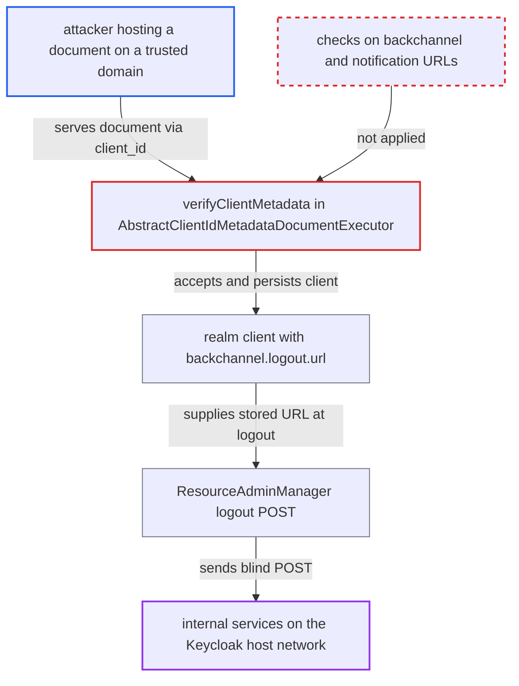

# CIMD metadata verification omits backchannel logout and CIBA notification URLs, allowing SSRF

| Field | Value |
|---|---|
| ID | `find_01MxXYgCWXPcK466KzWcQMyh` |
| Severity | **Low** |
| Status | open |
| CWE | CWE-918 — Server-Side Request Forgery |
| Created | 2026-10-27T21:23:47.861004Z |
| Claude Security | https://claude.ai/security/findings/find_01MxXYgCWXPcK466KzWcQMyh |

## Description

A party who can host a JSON document on a trusted CIMD domain can make Keycloak send server-side POST requests to internal addresses, such as `http://169.254.169.254/...` or `http://localhost:9000/...`. It also lets them redirect users to untrusted sites after logout. This needs the non-default `cimd` feature and a `client-id-metadata-document` executor. `verifyClientMetadata` never checks `backchannel_logout_uri`, `backchannel_client_notification_endpoint`, `frontchannel_logout_uri` or `post_logout_redirect_uris`.

1. **attacker** publishes a metadata document on a trusted domain. The document sets `backchannel_logout_uri` to an internal address such as `http://169.254.169.254/...` or `http://localhost:9000/...`.
2. **attacker** sends an authorization request with the document URL as `client_id`. Keycloak fetches the document because the URL is on a trusted domain.
3. **executor method `verifyClientMetadata`** validates the document and lets it pass. It checks only `client_id`, `redirect_uris`, `logo_uri`, `client_uri`, `tos_uri`, `policy_uri`, `jwks_uri`, `sector_identifier_uri` and `request_uris`, so the logout and notification URLs are never examined. ([`services/src/main/java/org/keycloak/protocol/oauth2/cimd/clientpolicy/executor/AbstractClientIdMetadataDocumentExecutor.java:705-735`](https://github.com/cx-benchmark/keycloak/blob/1d7be35d0764060a8143fc74b0aabf2442743be4/services/src/main/java/org/keycloak/protocol/oauth2/cimd/clientpolicy/executor/AbstractClientIdMetadataDocumentExecutor.java#L705-L735))
4. **provider `createClientMetadata`** saves the document as a realm client. The unverified `backchannel_logout_uri` becomes the client attribute `backchannel.logout.url`, and the CIBA endpoint becomes `ciba.backchannel.client.notification.endpoint`. ([`services/src/main/java/org/keycloak/protocol/oauth2/cimd/provider/AbstractPersistentClientIdMetadataDocumentProvider.java:138-160`](https://github.com/cx-benchmark/keycloak/blob/1d7be35d0764060a8143fc74b0aabf2442743be4/services/src/main/java/org/keycloak/protocol/oauth2/cimd/provider/AbstractPersistentClientIdMetadataDocumentProvider.java#L138-L160))
5. **attacker or a victim** logs in through this client and then logs out. Any realm account can be used for the login.
6. **`ResourceAdminManager.sendBackChannelLogoutRequestToClientUri`** POSTs a `logout_token` form body to the stored URL. The shared HttpClient does not filter destinations, so the request reaches the internal address. ([`services/src/main/java/org/keycloak/services/managers/ResourceAdminManager.java:217-240`](https://github.com/cx-benchmark/keycloak/blob/1d7be35d0764060a8143fc74b0aabf2442743be4/services/src/main/java/org/keycloak/services/managers/ResourceAdminManager.java#L217-L240))

## Assessment

The attacker must be able to host a JSON document on a host that matches one of the realm's CIMD trusted domains, for example any tenant of a shared domain the admin trusted. The non-default `cimd` feature and a client policy with the `client-id-metadata-document` executor must be enabled. The attacker sends an authorization request to the internet-facing protocol endpoint with `client_id` set to the document URL. They then log in through that client with any realm account, or get a victim to, and trigger a logout. The same document can use `backchannel_client_notification_endpoint` for CIBA-enabled confidential clients, where Keycloak later POSTs for ping or push delivery. It can also use `post_logout_redirect_uris` and `frontchannel_logout_uri` to steer the browser at logout to an untrusted host.

Impact: Keycloak sends POST requests with a fixed `logout_token` body to attacker-chosen URLs. The attacker learns nothing from the response but can probe reachability through timing. The realm also stores a client that breaks the configured domain policy, and its logout can redirect users to untrusted hosts. No Keycloak data is disclosed directly.

Subsequent-system impact: Internal services reachable only from the Keycloak host receive blind HTTP POSTs with a fixed body. The attacker can probe which of them are reachable and can hit unauthenticated endpoints that have side effects. The effect on those systems is limited.

## Recommendation

`AbstractClientIdMetadataDocumentExecutor.verifyClientMetadata` lists URL properties by hand and misses `backchannel_logout_uri`, `backchannel_client_notification_endpoint`, `frontchannel_logout_uri` and `post_logout_redirect_uris`. These URLs escape the trusted-domain, https and private-address rules that the executor advertises as its SSRF protection. The `restrictSameDomain` option's property list also omits them.

Fix criteria: Every URL-valued property of a fetched document passes the trusted-domain check. Every URL Keycloak itself requests, namely `backchannel_logout_uri` and the CIBA notification endpoint, also passes the scheme and private-address checks. `restrictSameDomain` covers the same set. To verify, serve a document on a trusted domain with `backchannel_logout_uri` set to `http://127.0.0.1:9000/x`. The authorization request must then be rejected with `invalid_request` before the client is persisted.

## Evidence

**https://github.com/cx-benchmark/keycloak**

- [`services/src/main/java/org/keycloak/protocol/oauth2/cimd/clientpolicy/executor/AbstractClientIdMetadataDocumentExecutor.java:705-735`](https://github.com/cx-benchmark/keycloak/blob/1d7be35d0764060a8143fc74b0aabf2442743be4/services/src/main/java/org/keycloak/protocol/oauth2/cimd/clientpolicy/executor/AbstractClientIdMetadataDocumentExecutor.java#L705-L735)
- [`services/src/main/java/org/keycloak/protocol/oauth2/cimd/provider/AbstractPersistentClientIdMetadataDocumentProvider.java:138-160`](https://github.com/cx-benchmark/keycloak/blob/1d7be35d0764060a8143fc74b0aabf2442743be4/services/src/main/java/org/keycloak/protocol/oauth2/cimd/provider/AbstractPersistentClientIdMetadataDocumentProvider.java#L138-L160)
- [`services/src/main/java/org/keycloak/services/managers/ResourceAdminManager.java:217-240`](https://github.com/cx-benchmark/keycloak/blob/1d7be35d0764060a8143fc74b0aabf2442743be4/services/src/main/java/org/keycloak/services/managers/ResourceAdminManager.java#L217-L240)
- [`services/src/main/java/org/keycloak/protocol/oauth2/cimd/clientpolicy/executor/AbstractClientIdMetadataDocumentExecutor.java:895-920`](https://github.com/cx-benchmark/keycloak/blob/1d7be35d0764060a8143fc74b0aabf2442743be4/services/src/main/java/org/keycloak/protocol/oauth2/cimd/clientpolicy/executor/AbstractClientIdMetadataDocumentExecutor.java#L895-L920)

