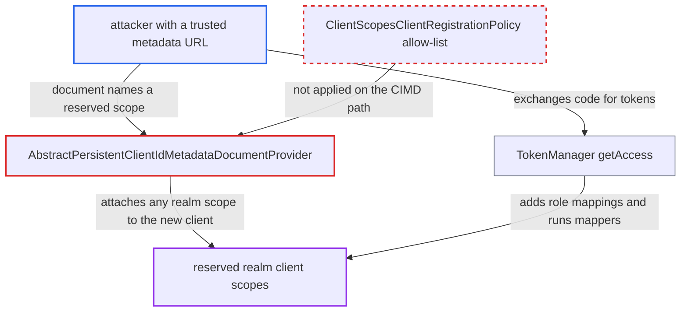

# CIMD self-registered clients can attach any realm client scope without an allow-list

| Field | Value |
|---|---|
| ID | `find_01QMZJvGfY67NybjugmfkLxu` |
| Severity | **Low** |
| Status | open |
| CWE | CWE-862 — Missing Authorization |
| Created | 2026-10-27T21:25:26.094635Z |
| Claude Security | https://claude.ai/security/findings/find_01QMZJvGfY67NybjugmfkLxu |

## Description

An attacker who controls a URL on a domain the realm's CIMD executor trusts can make Keycloak create a client that holds client scopes the admin reserved for other clients. After a victim logs in and consents, the attacker's tokens carry those scopes' audiences, claims and roles, limited to roles the victim holds. This needs the experimental `cimd` feature and a `client-id-metadata-document` executor. The cause is that `AbstractPersistentClientIdMetadataDocumentProvider` accepts the document's `scope` list without the allow-list that anonymous registration applies.

1. **attacker** publishes a client metadata document at a URL on a trusted domain. The document holds the `client_id`, `redirect_uris` and a `scope` string such as `openid <reserved-scope>`, where the second name is a scope the admin meant for other clients.
2. **attacker** sends the victim to the unauthenticated `/protocol/openid-connect/auth` endpoint with the document URL as `client_id`. The endpoint fires `PreAuthorizationRequestContext` before any client lookup, and that starts the fetch and creation of a client from the attacker-chosen URL. ([`services/src/main/java/org/keycloak/protocol/oidc/endpoints/AuthorizationEndpoint.java:138-153`](https://github.com/cx-benchmark/keycloak/blob/1d7be35d0764060a8143fc74b0aabf2442743be4/services/src/main/java/org/keycloak/protocol/oidc/endpoints/AuthorizationEndpoint.java#L138-L153))
3. **the provider `createClientMetadata`** converts the fetched document and passes the requested scopes on to client creation. `DescriptionConverter.toInternal` copies the space-separated `scope` string into `optionalClientScopes`, and no allow-list is checked against those names. ([`services/src/main/java/org/keycloak/protocol/oauth2/cimd/provider/AbstractPersistentClientIdMetadataDocumentProvider.java:138-160`](https://github.com/cx-benchmark/keycloak/blob/1d7be35d0764060a8143fc74b0aabf2442743be4/services/src/main/java/org/keycloak/protocol/oauth2/cimd/provider/AbstractPersistentClientIdMetadataDocumentProvider.java#L138-L160))
4. **`getClientScopeByName`** resolves each requested name to a realm client scope and attaches it. It returns any scope of the realm, including scopes of type None that the admin meant to assign only to specific clients. ([`server-spi-private/src/main/java/org/keycloak/models/utils/KeycloakModelUtils.java:1343-1349`](https://github.com/cx-benchmark/keycloak/blob/1d7be35d0764060a8143fc74b0aabf2442743be4/server-spi-private/src/main/java/org/keycloak/models/utils/KeycloakModelUtils.java#L1343-L1349))
5. **`PersistentClientIdMetadataDocumentProvider`** applies only two of the three default anonymous-registration policies. It sets `consentRequired=true` and `fullScopeAllowed=false` but leaves out the 'Allowed Client Scopes' policy that `ClientScopesClientRegistrationPolicy` enforces. ([`services/src/main/java/org/keycloak/protocol/oauth2/cimd/provider/PersistentClientIdMetadataDocumentProvider.java:51-53`](https://github.com/cx-benchmark/keycloak/blob/1d7be35d0764060a8143fc74b0aabf2442743be4/services/src/main/java/org/keycloak/protocol/oauth2/cimd/provider/PersistentClientIdMetadataDocumentProvider.java#L51-L53))
6. **victim** logs in and consents to the new client. Scopes with `display.on.consent.screen=false` are granted without appearing on the consent page. ([`services/src/main/java/org/keycloak/services/managers/AuthenticationManager.java:1264-1276`](https://github.com/cx-benchmark/keycloak/blob/1d7be35d0764060a8143fc74b0aabf2442743be4/services/src/main/java/org/keycloak/services/managers/AuthenticationManager.java#L1264-L1276))
7. **`TokenManager.getAccess`** adds the attached scope's role scope mappings and runs its protocol mappers. This happens even though full scope is disabled for the client, because the scope was named in the `scope` parameter. ([`services/src/main/java/org/keycloak/protocol/oidc/TokenManager.java:572-640`](https://github.com/cx-benchmark/keycloak/blob/1d7be35d0764060a8143fc74b0aabf2442743be4/services/src/main/java/org/keycloak/protocol/oidc/TokenManager.java#L572-L640))
8. **attacker** receives the code at the redirect and exchanges it with a public PKCE client. The resulting tokens carry the reserved scope's audience, claims and roles.

## Assessment

The attacker controls a URL on a domain the realm's CIMD executor trusts, for example a malicious or compromised MCP client vendor. The realm must have the experimental `cimd` feature on and a `client-id-metadata-document` client-policy executor configured. The attacker needs no account. A victim must open the authorization link, log in and approve consent. The same gap applies on re-fetch: `updateClientMetadata` replaces the optional scopes with whatever the new document lists, so changing `scope` in the document later can attach new scopes. Names that resolve to clients through the `getClientByClientId` fallback are stored but have no effect at token time.

Impact: The attacker's client gets tokens with audiences, claims and roles from scopes the admin never assigned to it, and the admin's control over scopes is bypassed. Attributes the reserved mappers expose are disclosed for the consenting victim. Roles are limited to those the victim holds within the attached scopes' mappings. Nothing in the realm changes beyond the attacker's own client record.

## Recommendation

`createClientMetadata` and `updateClientMetadata` in `AbstractPersistentClientIdMetadataDocumentProvider` accept the document's `scope` list without the allow-list that anonymous registration applies through `ClientScopesClientRegistrationPolicy`. A self-registered CIMD client can therefore give itself admin-controlled scopes.

Fix criteria: A CIMD-created or re-fetched client can be bound only to realm default or optional client scopes, or to scopes the admin allow-listed in the executor configuration. Unknown names and names that resolve to clients are rejected or ignored. Test 1: serve a document whose `scope` names a type-None custom scope, and confirm the authorization request is rejected or the scope is not attached. Test 2: change the document's `scope` on re-fetch, and confirm no new non-allowed scope gets attached.

## Evidence

**https://github.com/cx-benchmark/keycloak**

- [`services/src/main/java/org/keycloak/protocol/oauth2/cimd/provider/AbstractPersistentClientIdMetadataDocumentProvider.java:138-160`](https://github.com/cx-benchmark/keycloak/blob/1d7be35d0764060a8143fc74b0aabf2442743be4/services/src/main/java/org/keycloak/protocol/oauth2/cimd/provider/AbstractPersistentClientIdMetadataDocumentProvider.java#L138-L160)
- [`services/src/main/java/org/keycloak/protocol/oauth2/cimd/provider/AbstractPersistentClientIdMetadataDocumentProvider.java:208-244`](https://github.com/cx-benchmark/keycloak/blob/1d7be35d0764060a8143fc74b0aabf2442743be4/services/src/main/java/org/keycloak/protocol/oauth2/cimd/provider/AbstractPersistentClientIdMetadataDocumentProvider.java#L208-L244)
- [`services/src/main/java/org/keycloak/services/clientregistration/oidc/DescriptionConverter.java:88-91`](https://github.com/cx-benchmark/keycloak/blob/1d7be35d0764060a8143fc74b0aabf2442743be4/services/src/main/java/org/keycloak/services/clientregistration/oidc/DescriptionConverter.java#L88-L91)
- [`server-spi-private/src/main/java/org/keycloak/models/utils/RepresentationToModel.java:711-740`](https://github.com/cx-benchmark/keycloak/blob/1d7be35d0764060a8143fc74b0aabf2442743be4/server-spi-private/src/main/java/org/keycloak/models/utils/RepresentationToModel.java#L711-L740)
- [`server-spi-private/src/main/java/org/keycloak/models/utils/KeycloakModelUtils.java:1343-1349`](https://github.com/cx-benchmark/keycloak/blob/1d7be35d0764060a8143fc74b0aabf2442743be4/server-spi-private/src/main/java/org/keycloak/models/utils/KeycloakModelUtils.java#L1343-L1349)
- [`services/src/main/java/org/keycloak/protocol/oauth2/cimd/provider/PersistentClientIdMetadataDocumentProvider.java:51-53`](https://github.com/cx-benchmark/keycloak/blob/1d7be35d0764060a8143fc74b0aabf2442743be4/services/src/main/java/org/keycloak/protocol/oauth2/cimd/provider/PersistentClientIdMetadataDocumentProvider.java#L51-L53)
- [`services/src/main/java/org/keycloak/services/clientregistration/policy/DefaultClientRegistrationPolicies.java:87-113`](https://github.com/cx-benchmark/keycloak/blob/1d7be35d0764060a8143fc74b0aabf2442743be4/services/src/main/java/org/keycloak/services/clientregistration/policy/DefaultClientRegistrationPolicies.java#L87-L113)
- [`services/src/main/java/org/keycloak/services/clientregistration/policy/impl/ClientScopesClientRegistrationPolicy.java:55-66`](https://github.com/cx-benchmark/keycloak/blob/1d7be35d0764060a8143fc74b0aabf2442743be4/services/src/main/java/org/keycloak/services/clientregistration/policy/impl/ClientScopesClientRegistrationPolicy.java#L55-L66)
- [`services/src/main/java/org/keycloak/protocol/oidc/endpoints/AuthorizationEndpoint.java:138-153`](https://github.com/cx-benchmark/keycloak/blob/1d7be35d0764060a8143fc74b0aabf2442743be4/services/src/main/java/org/keycloak/protocol/oidc/endpoints/AuthorizationEndpoint.java#L138-L153)
- [`services/src/main/java/org/keycloak/protocol/oidc/TokenManager.java:572-640`](https://github.com/cx-benchmark/keycloak/blob/1d7be35d0764060a8143fc74b0aabf2442743be4/services/src/main/java/org/keycloak/protocol/oidc/TokenManager.java#L572-L640)
- [`services/src/main/java/org/keycloak/services/managers/AuthenticationManager.java:1264-1276`](https://github.com/cx-benchmark/keycloak/blob/1d7be35d0764060a8143fc74b0aabf2442743be4/services/src/main/java/org/keycloak/services/managers/AuthenticationManager.java#L1264-L1276)

