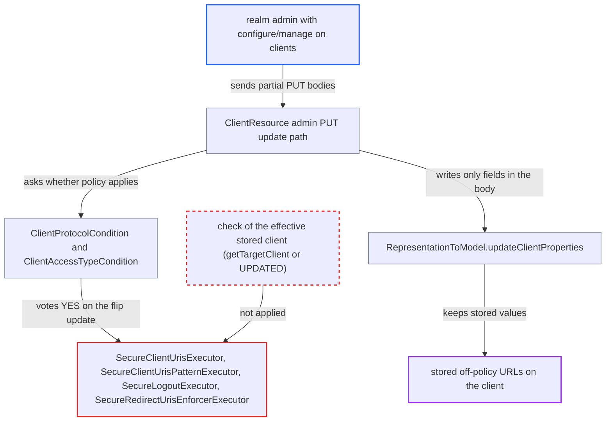

# Client URI/logout executors check only the update delta, so values survive a policy-class flip

| Field | Value |
|---|---|
| ID | `find_01JhVXcvTbK4zPG5esR7FwTi` |
| Severity | **Low** |
| Status | open |
| CWE | CWE-863 — Incorrect authorization |
| Created | 2026-10-27T21:58:44.005980Z |
| Claude Security | https://claude.ai/security/findings/find_01JhVXcvTbK4zPG5esR7FwTi |

## Description

A realm admin with configure/manage rights on clients can leave forbidden URLs on a client that a client policy is meant to police. Examples are plain `http` or off-allow-list `jwks.url`, `backchannel.logout.url` and `redirectUris`. This needs a realm policy that binds `secure-client-uris`, `secure-client-uris-pattern` or `secure-logout` to a `client-type` or `client-access-type` condition, and none is active by default. The OIDC executors check only the fields in the update body, not the stored client.

1. **realm admin** sends `PUT {"protocol":"saml"}` to an OIDC client. The policy runs on this update, but the body carries no URIs, so there is nothing to reject. ([`services/src/main/java/org/keycloak/services/resources/admin/ClientResource.java:163-179`](https://github.com/cx-benchmark/keycloak/blob/1d7be35d0764060a8143fc74b0aabf2442743be4/services/src/main/java/org/keycloak/services/resources/admin/ClientResource.java#L163-L179))
2. **realm admin** sends a second `PUT` that sets `jwks.url`, `backchannel.logout.url` or `redirectUris` to off-policy values. `ClientProtocolCondition` votes `NO` because the stored client is `saml` and the body has no `protocol`, so the executors do not run on these values. ([`services/src/main/java/org/keycloak/services/clientpolicy/condition/ClientProtocolCondition.java:80-92`](https://github.com/cx-benchmark/keycloak/blob/1d7be35d0764060a8143fc74b0aabf2442743be4/services/src/main/java/org/keycloak/services/clientpolicy/condition/ClientProtocolCondition.java#L80-L92))
3. **`updateClientProperties`** writes the off-policy values to the client model. It writes only the attributes present in the body and keeps the stored value for every field that is null in the body. ([`server-spi-private/src/main/java/org/keycloak/models/utils/RepresentationToModel.java:563-593`](https://github.com/cx-benchmark/keycloak/blob/1d7be35d0764060a8143fc74b0aabf2442743be4/server-spi-private/src/main/java/org/keycloak/models/utils/RepresentationToModel.java#L563-L593))
4. **realm admin** sends `PUT {"protocol":"openid-connect"}`. The condition now votes `YES` because the body moves the client into the policed protocol, so the executors run, but the body is an empty delta. ([`services/src/main/java/org/keycloak/services/clientpolicy/condition/ClientProtocolCondition.java:80-92`](https://github.com/cx-benchmark/keycloak/blob/1d7be35d0764060a8143fc74b0aabf2442743be4/services/src/main/java/org/keycloak/services/clientpolicy/condition/ClientProtocolCondition.java#L80-L92))
5. **the handler in `SecureClientUrisExecutor`** validates only the proposed body and passes. Each URL kind is checked only when its value is not null, and `getTargetClient()` is never read, so the stored off-policy values stay and the client is now matched by the policy. ([`services/src/main/java/org/keycloak/services/clientpolicy/executor/SecureClientUrisExecutor.java:97-101`](https://github.com/cx-benchmark/keycloak/blob/1d7be35d0764060a8143fc74b0aabf2442743be4/services/src/main/java/org/keycloak/services/clientpolicy/executor/SecureClientUrisExecutor.java#L97-L101))

## Assessment

The attacker is a realm admin with configure/manage on clients. They work through the Admin REST API with partial `PUT /admin/realms/{realm}/clients/{id}` bodies, on a new or existing client. The realm must have a policy that binds the URI or logout executors to `client-type` or `client-access-type` conditions. For the protocol hop they send `{"protocol":"saml"}`, then the URI attributes, then `{"protocol":"openid-connect"}`. The access-type hop works the same way. First they send `{"publicClient":true, <URIs>}`, and the body must say `true` because a missing value counts as confidential. Then they send `{"publicClient":false}`. A holder of a DCR registration-access-token has only the access-type flip, because `AbstractClientRegistrationProvider` blocks protocol changes. An unknown protocol such as `x` does not work, because `validateProtocol` rejects it on create and update. Under a confidential-only policy a public client may already carry the same URLs, so that route gains little. The clearest gain is the protocol hop under per-protocol policies.

Impact: The client ends up matched by the policy while keeping URLs the policy forbids. Examples are `jwks.url`, `backchannel.logout.url`, `request.uris`, the CIBA notification endpoint, `post.logout.redirect.uris`, `redirectUris`, `webOrigins` and front-channel logout. Keycloak then fetches its JWKS and request objects, and posts back-channel logout tokens and CIBA notifications, to the retained plain-`http` or off-allow-list URLs, internal hosts included. It also honours retained wildcard web origins and post-logout URIs. The admin already controls the client, so the gain is limited to the forbidden destinations and schemes for that client's traffic. No other client's data is directly exposed.

## Recommendation

(1) `SecureClientUrisExecutor`, `SecureClientUrisPatternExecutor`, `SecureLogoutExecutor` and the post-logout and flow-disabled branches of `SecureRedirectUrisEnforcerExecutor` validate only the fields in the proposed representation on `UPDATE`. The conditions make the transition update the first check of values stored while the client was outside the policy.

Fix criteria: After any create or update that leaves a client matched by the policy, every URI and logout rule holds for the client's effective stored state. That state is the body merged over `getTargetClient()`, or the model in an `UPDATED` handler, as `SamlSecureClientUrisExecutor` does. Verify with a `secure-client-uris` policy on `client-type: openid-connect`. Send `PUT {"protocol":"saml"}`, then `PUT` with `attributes.jwks.url=http://...`, then `PUT {"protocol":"openid-connect"}`. The last call must be rejected. The same must hold for the public-to-confidential flip.

(2) `ClientAccessTypeCondition` and `ClientProtocolCondition` vote `YES` on the transition update, but nothing tells the executors that the client was previously unpoliced. The delta is treated as if all other fields had already been validated.

Fix criteria: When a condition is satisfied only by the proposed representation and not by the stored client, the whole effective client is validated as on an initial registration. Verify that a client whose URIs were set while it was public or `saml` cannot be moved into the policed class without those URIs being checked.

## Evidence

**https://github.com/cx-benchmark/keycloak**

- [`services/src/main/java/org/keycloak/services/clientpolicy/executor/SecureClientUrisExecutor.java:97-101`](https://github.com/cx-benchmark/keycloak/blob/1d7be35d0764060a8143fc74b0aabf2442743be4/services/src/main/java/org/keycloak/services/clientpolicy/executor/SecureClientUrisExecutor.java#L97-L101)
- [`services/src/main/java/org/keycloak/services/clientpolicy/executor/SecureClientUrisPatternExecutor.java:137-141`](https://github.com/cx-benchmark/keycloak/blob/1d7be35d0764060a8143fc74b0aabf2442743be4/services/src/main/java/org/keycloak/services/clientpolicy/executor/SecureClientUrisPatternExecutor.java#L137-L141)
- [`services/src/main/java/org/keycloak/services/clientpolicy/executor/SecureLogoutExecutor.java:78-88`](https://github.com/cx-benchmark/keycloak/blob/1d7be35d0764060a8143fc74b0aabf2442743be4/services/src/main/java/org/keycloak/services/clientpolicy/executor/SecureLogoutExecutor.java#L78-L88)
- [`services/src/main/java/org/keycloak/services/clientpolicy/executor/SecureRedirectUrisEnforcerExecutor.java:217-243`](https://github.com/cx-benchmark/keycloak/blob/1d7be35d0764060a8143fc74b0aabf2442743be4/services/src/main/java/org/keycloak/services/clientpolicy/executor/SecureRedirectUrisEnforcerExecutor.java#L217-L243)
- [`services/src/main/java/org/keycloak/services/clientpolicy/condition/ClientAccessTypeCondition.java:77-82`](https://github.com/cx-benchmark/keycloak/blob/1d7be35d0764060a8143fc74b0aabf2442743be4/services/src/main/java/org/keycloak/services/clientpolicy/condition/ClientAccessTypeCondition.java#L77-L82)
- [`services/src/main/java/org/keycloak/services/clientpolicy/condition/ClientProtocolCondition.java:80-92`](https://github.com/cx-benchmark/keycloak/blob/1d7be35d0764060a8143fc74b0aabf2442743be4/services/src/main/java/org/keycloak/services/clientpolicy/condition/ClientProtocolCondition.java#L80-L92)
- [`server-spi-private/src/main/java/org/keycloak/models/utils/RepresentationToModel.java:563-593`](https://github.com/cx-benchmark/keycloak/blob/1d7be35d0764060a8143fc74b0aabf2442743be4/server-spi-private/src/main/java/org/keycloak/models/utils/RepresentationToModel.java#L563-L593)
- [`services/src/main/java/org/keycloak/services/resources/admin/ClientResource.java:163-179`](https://github.com/cx-benchmark/keycloak/blob/1d7be35d0764060a8143fc74b0aabf2442743be4/services/src/main/java/org/keycloak/services/resources/admin/ClientResource.java#L163-L179)
- [`services/src/main/java/org/keycloak/services/clientpolicy/executor/SamlSecureClientUrisExecutor.java:92-98`](https://github.com/cx-benchmark/keycloak/blob/1d7be35d0764060a8143fc74b0aabf2442743be4/services/src/main/java/org/keycloak/services/clientpolicy/executor/SamlSecureClientUrisExecutor.java#L92-L98)
- [`services/src/main/java/org/keycloak/validation/DefaultClientValidationProvider.java:264-283`](https://github.com/cx-benchmark/keycloak/blob/1d7be35d0764060a8143fc74b0aabf2442743be4/services/src/main/java/org/keycloak/validation/DefaultClientValidationProvider.java#L264-L283)
- [`services/src/main/java/org/keycloak/services/clientregistration/AbstractClientRegistrationProvider.java:213-222`](https://github.com/cx-benchmark/keycloak/blob/1d7be35d0764060a8143fc74b0aabf2442743be4/services/src/main/java/org/keycloak/services/clientregistration/AbstractClientRegistrationProvider.java#L213-L222)

