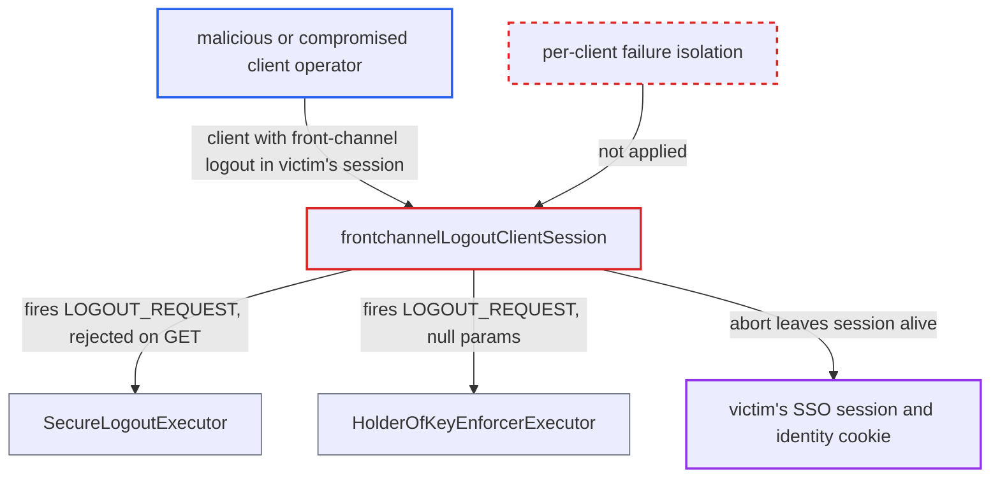

# Client-policy failure on one front-channel client aborts browser logout, SSO session survives

| Field | Value |
|---|---|
| ID | `find_015CANQCzGTP7eiXhma84urz` |
| Severity | **Low** |
| Status | open |
| CWE | CWE-613 — Insufficient Session Expiration |
| Created | 2026-10-27T21:45:31.321055Z |
| Claude Security | https://claude.ai/security/findings/find_015CANQCzGTP7eiXhma84urz |

## Description

A malicious or compromised OIDC client can stop a user's browser logout from ending their Keycloak SSO session. The user stays logged in, and the next person on a shared device can reuse the session. This needs a realm client policy whose `LOGOUT_REQUEST` executor matches the client, and the client must have `frontchannel_logout_uri` set. The cause is `frontchannelLogoutClientSession`, which turns one client's policy failure into a rollback of the whole logout.

1. **attacker's client app** gets a client session inside the victim's SSO session. Any OIDC client in the realm can do this by sending the browser through the authorization endpoint, silently with `prompt=none` when no consent is required. The client is registered with `frontchannel_logout_uri`, so it gets `frontchannelLogout=true`.
2. **victim** requests logout with `GET /realms/{realm}/protocol/openid-connect/logout`. The request goes through `doBrowserLogout` and `initiateBrowserLogout` to `AuthenticationManager.browserLogout`. ([`services/src/main/java/org/keycloak/protocol/oidc/endpoints/LogoutEndpoint.java:297-305`](https://github.com/cx-benchmark/keycloak/blob/1d7be35d0764060a8143fc74b0aabf2442743be4/services/src/main/java/org/keycloak/protocol/oidc/endpoints/LogoutEndpoint.java#L297-L305))
3. **`browserLogoutAllClients`** sends back-channel logout POSTs to the non-front-channel clients. This happens first, and these HTTP calls are not part of the database transaction. Downstream apps are therefore told the user has logged out. ([`services/src/main/java/org/keycloak/services/managers/AuthenticationManager.java:757-823`](https://github.com/cx-benchmark/keycloak/blob/1d7be35d0764060a8143fc74b0aabf2442743be4/services/src/main/java/org/keycloak/services/managers/AuthenticationManager.java#L757-L823))
4. **`frontchannelLogoutClientSession`** fires the `LOGOUT_REQUEST` client-policy event for the attacker's front-channel client. The event carries a `LogoutRequestContext` with no params. `SecureLogoutExecutor` throws for a `GET` logout when `allow-front-channel-logout` is false. `HolderOfKeyEnforcerExecutor.checkLogout` throws a `NullPointerException` because it calls `context.getParams()`, which is null. ([`services/src/main/java/org/keycloak/services/managers/AuthenticationManager.java:592-646`](https://github.com/cx-benchmark/keycloak/blob/1d7be35d0764060a8143fc74b0aabf2442743be4/services/src/main/java/org/keycloak/services/managers/AuthenticationManager.java#L592-L646))
5. **`ErrorResponseException`** aborts the request and rolls back the transaction. A `ClientPolicyException` is converted into this exception, which extends `RollbackWebApplicationException`. Unchecked executor exceptions propagate unchanged. In both cases the logout ends before `expireIdentityCookie` and `removeUserSession` run. ([`services/src/main/java/org/keycloak/services/ErrorResponseException.java:28`](https://github.com/cx-benchmark/keycloak/blob/1d7be35d0764060a8143fc74b0aabf2442743be4/services/src/main/java/org/keycloak/services/ErrorResponseException.java#L28))
6. **Keycloak** leaves the SSO session and identity cookie in place. The `LOGGING_OUT` state is rolled back. The user sees an error, and a later visit to any client silently logs the user in again. ([`services/src/main/java/org/keycloak/services/managers/AuthenticationManager.java:757-823`](https://github.com/cx-benchmark/keycloak/blob/1d7be35d0764060a8143fc74b0aabf2442743be4/services/src/main/java/org/keycloak/services/managers/AuthenticationManager.java#L757-L823))

## Assessment

The attacker operates an OIDC client registered in the realm, or has compromised one. The client has `frontchannel_logout_uri` set. The realm must run a client policy that applies a `LOGOUT_REQUEST` executor to that client. Two shipped executors fail this way: `secure-logout` (`SecureLogoutExecutor`) and `holder-of-key-enforcer` (`HolderOfKeyEnforcerExecutor`). `holder-of-key-enforcer` is part of the shipped `fapi-1-advanced`, `fapi-2-security-profile`, `fapi-2-message-signing` and `oauth-2-1-for-confidential-client` profiles. The victim must be logged in to Keycloak and must visit the attacker's app, which silently gets a client session. The victim later asks for logout. The report calls this deployment-dependent.

Impact: The victim's explicit browser logout fails and their Keycloak SSO session survives, while downstream apps already treat them as logged out. The session can be silently reused by the next person on a shared device or kiosk. The attacker does not get the session themselves and cannot read or alter other data.

## Recommendation

(1) `frontchannelLogoutClientSession` turns a per-client client-policy failure into a request-wide rollback exception, after back-channel notifications have already been sent. One client's policy result therefore decides whether the SSO session ends at all.

Fix criteria: A user-requested logout ends the SSO session and expires the identity cookie even when a policy rejects, or an executor errors for, an individual client. The failing client is skipped, or policies are evaluated before any back-channel side effects, and the failure is logged or evented. Test: attach a front-channel client that a `LOGOUT_REQUEST` executor rejects and confirm that `GET /logout` still removes the user session.

(2) `HolderOfKeyEnforcerExecutor.checkLogout` assumes `LogoutRequestContext.getParams()` is non-null. The front-channel logout context carries no params, so the executor throws a `NullPointerException` instead of making a policy decision.

Fix criteria: The executor treats a `LOGOUT_REQUEST` context without params as not applicable, because there is no refresh token to bind, and returns without error. Test: a browser logout completes successfully in a realm where the `fapi-1-advanced` or `oauth-2-1-for-confidential-client` profile applies to a front-channel client.

## Evidence

**https://github.com/cx-benchmark/keycloak**

- [`services/src/main/java/org/keycloak/services/managers/AuthenticationManager.java:592-646`](https://github.com/cx-benchmark/keycloak/blob/1d7be35d0764060a8143fc74b0aabf2442743be4/services/src/main/java/org/keycloak/services/managers/AuthenticationManager.java#L592-L646)
- [`services/src/main/java/org/keycloak/services/managers/AuthenticationManager.java:757-823`](https://github.com/cx-benchmark/keycloak/blob/1d7be35d0764060a8143fc74b0aabf2442743be4/services/src/main/java/org/keycloak/services/managers/AuthenticationManager.java#L757-L823)
- [`services/src/main/java/org/keycloak/services/ErrorResponseException.java:28`](https://github.com/cx-benchmark/keycloak/blob/1d7be35d0764060a8143fc74b0aabf2442743be4/services/src/main/java/org/keycloak/services/ErrorResponseException.java#L28)
- [`services/src/main/java/org/keycloak/services/clientpolicy/executor/HolderOfKeyEnforcerExecutor.java:129-131`](https://github.com/cx-benchmark/keycloak/blob/1d7be35d0764060a8143fc74b0aabf2442743be4/services/src/main/java/org/keycloak/services/clientpolicy/executor/HolderOfKeyEnforcerExecutor.java#L129-L131)
- [`services/src/main/java/org/keycloak/services/clientpolicy/executor/SecureLogoutExecutor.java:89-94`](https://github.com/cx-benchmark/keycloak/blob/1d7be35d0764060a8143fc74b0aabf2442743be4/services/src/main/java/org/keycloak/services/clientpolicy/executor/SecureLogoutExecutor.java#L89-L94)
- [`services/src/main/java/org/keycloak/protocol/oidc/endpoints/LogoutEndpoint.java:297-305`](https://github.com/cx-benchmark/keycloak/blob/1d7be35d0764060a8143fc74b0aabf2442743be4/services/src/main/java/org/keycloak/protocol/oidc/endpoints/LogoutEndpoint.java#L297-L305)

