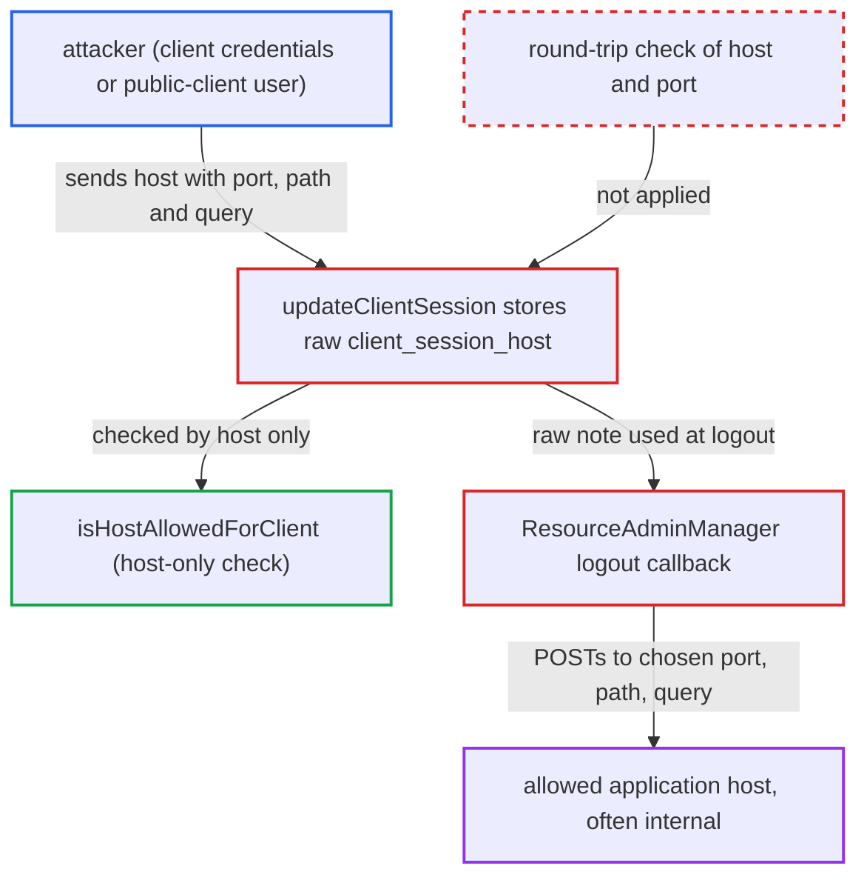

# client_session_host validated by host only, raw value injects path/query into logout callback URLs

| Field | Value |
|---|---|
| ID | `find_0138b37iqHf54g3sNwXwsYdy` |
| Severity | **Low** |
| Status | open |
| CWE | CWE-918 — Server-side request forgery |
| Created | 2026-10-27T21:51:51.987315Z |
| Claude Security | https://claude.ai/security/findings/find_0138b37iqHf54g3sNwXwsYdy |

## Description

An attacker can make Keycloak send its logout callback POST to a port, path and query of their choosing on an application host the client already allows. The attacker needs the client's credentials, or any user of a public client, and the client's logout URL must use `${application.session.host}`. The cause is that `ClientHostUtils.isHostAllowedForClient` checks only the parsed host, while the raw `client_session_host` string is stored and substituted into the URL.

1. **attacker** sends a token request with a crafted `client_session_host`. The value has an allowed host followed by a port, path and a trailing `?`, for example `node1.internal:9090/internal/action?`, together with `client_session_state=x`. ([`services/src/main/java/org/keycloak/protocol/oidc/grants/OAuth2GrantTypeBase.java:236-257`](https://github.com/cx-benchmark/keycloak/blob/1d7be35d0764060a8143fc74b0aabf2442743be4/services/src/main/java/org/keycloak/protocol/oidc/grants/OAuth2GrantTypeBase.java#L236-L257))
2. **`isHostAllowedForClient`** accepts the value after comparing only its host. It reduces the value to `new URI("https://" + value).getHost()`, so the port, path, query and fragment are ignored, and it returns only a boolean. ([`services/src/main/java/org/keycloak/protocol/oidc/utils/ClientHostUtils.java:65-111`](https://github.com/cx-benchmark/keycloak/blob/1d7be35d0764060a8143fc74b0aabf2442743be4/services/src/main/java/org/keycloak/protocol/oidc/utils/ClientHostUtils.java#L65-L111))
3. **`updateClientSession`** stores the untouched string as the client-session note. This happens at the code grant and the refresh grant once the host-only check passes. ([`services/src/main/java/org/keycloak/protocol/oidc/grants/OAuth2GrantTypeBase.java:236-257`](https://github.com/cx-benchmark/keycloak/blob/1d7be35d0764060a8143fc74b0aabf2442743be4/services/src/main/java/org/keycloak/protocol/oidc/grants/OAuth2GrantTypeBase.java#L236-L257))
4. **attacker** logs out their own session. This triggers the backchannel logout when front-channel logout is off. ([`services/src/main/java/org/keycloak/protocol/oidc/OIDCLoginProtocol.java:505-512`](https://github.com/cx-benchmark/keycloak/blob/1d7be35d0764060a8143fc74b0aabf2442743be4/services/src/main/java/org/keycloak/protocol/oidc/OIDCLoginProtocol.java#L505-L512))
5. **`ResourceAdminManager`** replaces `${application.session.host}` with the raw note. It uses a plain `String.replace`, and `formatAsUriHost` only brackets IPv6 literals, so the path and query characters become part of the URL. ([`services/src/main/java/org/keycloak/protocol/oidc/utils/ClientHostUtils.java:158-167`](https://github.com/cx-benchmark/keycloak/blob/1d7be35d0764060a8143fc74b0aabf2442743be4/services/src/main/java/org/keycloak/protocol/oidc/utils/ClientHostUtils.java#L158-L167))
6. **`ResourceAdminManager`** POSTs to the resulting URL. On the backchannel path the result goes straight to `new HttpPost(...)`. On the admin-URL path `/k_logout` is appended, so the attacker controls the port, the leading path and the query but not the ending. ([`services/src/main/java/org/keycloak/services/managers/ResourceAdminManager.java:198-243`](https://github.com/cx-benchmark/keycloak/blob/1d7be35d0764060a8143fc74b0aabf2442743be4/services/src/main/java/org/keycloak/services/managers/ResourceAdminManager.java#L198-L243))

## Assessment

The client's Backchannel Logout URL or Admin URL must use `${application.session.host}`, and front-channel logout must be off. The client's allowlist must contain a host such as `node1.internal`. The attacker holds the client's credentials, or is any user of a public client. They send the crafted `client_session_host` in a code or refresh token exchange and then log out their own session. Both the backchannel-logout URL and the admin-URL are affected. Turning on `secure-client-node-hostname` does not stop this.

Impact: Keycloak sends a POST with a fixed body to an allowed application host, at a port, path and query the attacker chose. The host cannot be changed and no response is returned to the attacker. Keycloak itself discloses no data and changes no state.

Subsequent-system impact: The allowed application host is often reachable only from Keycloak. It receives a server-originated POST on a path the attacker chose, so any endpoint there that acts on any POST can be triggered. One allowed host may front several applications. The body is fixed and the host cannot be changed. The report rates the effect as limited to low integrity impact.

## Recommendation

(1) `isHostAllowedForClient` validates only the derived `URI.getHost()`, while the raw string is stored. Characters such as `/`, `?` and `#` therefore pass the allowlist.

Fix criteria: The token endpoint accepts `client_session_host` only if it is exactly a host, or `host:port` if ports stay supported. It rejects any value whose parsed host and port do not round-trip to the input, such as one containing `/`, `?`, `#`, `@`, whitespace, or a bare `:` outside IPv6 brackets. A request with `client_session_host=node1.internal/x?` is not stored, and the following logout sends no request to `/x`.

(2) `ResourceAdminManager` builds the callback URL by plain string replacement of `${application.session.host}`, so whatever the note contains becomes URL structure.

Fix criteria: Only a validated host, and port, replaces the placeholder at use time, or the result is checked to keep the configured template's path and query. A note containing path or query characters, for example from a session created before the fix, produces no outbound request. Alternatively, the request it produces has a path equal to the administrator's template.

## Evidence

**https://github.com/cx-benchmark/keycloak**

- [`services/src/main/java/org/keycloak/protocol/oidc/utils/ClientHostUtils.java:65-111`](https://github.com/cx-benchmark/keycloak/blob/1d7be35d0764060a8143fc74b0aabf2442743be4/services/src/main/java/org/keycloak/protocol/oidc/utils/ClientHostUtils.java#L65-L111)
- [`services/src/main/java/org/keycloak/protocol/oidc/grants/OAuth2GrantTypeBase.java:236-257`](https://github.com/cx-benchmark/keycloak/blob/1d7be35d0764060a8143fc74b0aabf2442743be4/services/src/main/java/org/keycloak/protocol/oidc/grants/OAuth2GrantTypeBase.java#L236-L257)
- [`services/src/main/java/org/keycloak/services/managers/ResourceAdminManager.java:198-243`](https://github.com/cx-benchmark/keycloak/blob/1d7be35d0764060a8143fc74b0aabf2442743be4/services/src/main/java/org/keycloak/services/managers/ResourceAdminManager.java#L198-L243)
- [`services/src/main/java/org/keycloak/services/managers/ResourceAdminManager.java:148-156`](https://github.com/cx-benchmark/keycloak/blob/1d7be35d0764060a8143fc74b0aabf2442743be4/services/src/main/java/org/keycloak/services/managers/ResourceAdminManager.java#L148-L156)
- [`services/src/main/java/org/keycloak/protocol/oidc/OIDCLoginProtocol.java:505-512`](https://github.com/cx-benchmark/keycloak/blob/1d7be35d0764060a8143fc74b0aabf2442743be4/services/src/main/java/org/keycloak/protocol/oidc/OIDCLoginProtocol.java#L505-L512)
- [`services/src/main/java/org/keycloak/protocol/oidc/utils/ClientHostUtils.java:158-167`](https://github.com/cx-benchmark/keycloak/blob/1d7be35d0764060a8143fc74b0aabf2442743be4/services/src/main/java/org/keycloak/protocol/oidc/utils/ClientHostUtils.java#L158-L167)
- [`services/src/main/java/org/keycloak/services/clientpolicy/executor/SecureClientNodeExecutor.java:173-216`](https://github.com/cx-benchmark/keycloak/blob/1d7be35d0764060a8143fc74b0aabf2442743be4/services/src/main/java/org/keycloak/services/clientpolicy/executor/SecureClientNodeExecutor.java#L173-L216)

