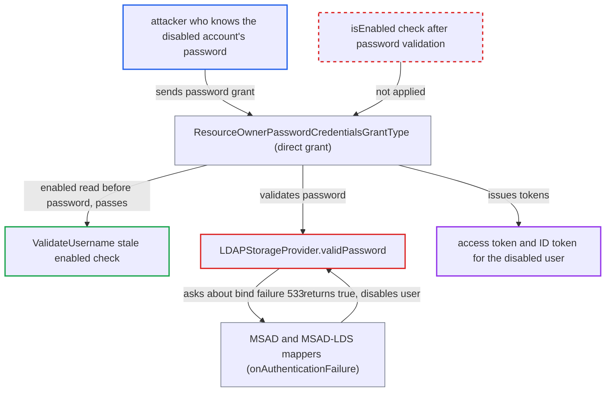

# Direct grant issues tokens for AD-disabled LDAP user (bind error 533 treated as valid password)

| Field | Value |
|---|---|
| ID | `find_011eD5XzYNhcEwXz4K91BQsw` |
| Severity | **Low** |
| Status | open |
| CWE | CWE-287 — Improper Authentication |
| Created | 2026-10-27T21:56:09.779003Z |
| Claude Security | https://claude.ai/security/findings/find_011eD5XzYNhcEwXz4K91BQsw |

## Description

A person who knows the password of an Active Directory (AD) or AD LDS account that was disabled in the directory can get one access token and ID token for it. The token comes from the direct-grant (password) login. This works only when the LDAP provider is `WRITABLE` with import on, and an MSAD or MSAD-LDS mapper has `alwaysReadEnabledValueFromLDAP=false`. `LDAPStorageProvider.validPassword` treats the failed bind for a disabled account as a valid password, and the direct-grant flow never checks `isEnabled()` again.

1. **attacker** posts a password grant to the realm token endpoint. The request uses `grant_type=password`, `client_id=admin-cli`, and the disabled account's username and correct password. `admin-cli` has direct access grants enabled in every realm, so no special client is needed.
2. **the authenticator `ValidateUsername`** checks `isEnabled()` before the password is checked. With `alwaysReadEnabledValueFromLDAP=false` it reads the stored Keycloak `enabled` flag. That flag is still `true` because only import and sync update it. ([`services/src/main/java/org/keycloak/authentication/authenticators/directgrant/ValidateUsername.java:120-134`](https://github.com/cx-benchmark/keycloak/blob/1d7be35d0764060a8143fc74b0aabf2442743be4/services/src/main/java/org/keycloak/authentication/authenticators/directgrant/ValidateUsername.java#L120-L134))
3. **the method `LDAPStorageProvider.validPassword`** catches the failed LDAP bind and asks every mapper's `onAuthenticationFailure`. The directory refuses the bind with sub-code `533` (account disabled). The method returns the OR of the mappers' answers as the password result. ([`federation/ldap/src/main/java/org/keycloak/storage/ldap/LDAPStorageProvider.java:867-878`](https://github.com/cx-benchmark/keycloak/blob/1d7be35d0764060a8143fc74b0aabf2442743be4/federation/ldap/src/main/java/org/keycloak/storage/ldap/LDAPStorageProvider.java#L867-L878))
4. **the MSAD or MSAD-LDS mapper** calls `user.setEnabled(false)` and returns `true`. This happens in `WRITABLE` mode. Returning `true` marks the failed bind as handled, and `validPassword` reports it as a valid password. ([`federation/ldap/src/main/java/org/keycloak/storage/ldap/mappers/msad/MSADUserAccountControlStorageMapper.java:183-188`](https://github.com/cx-benchmark/keycloak/blob/1d7be35d0764060a8143fc74b0aabf2442743be4/federation/ldap/src/main/java/org/keycloak/storage/ldap/mappers/msad/MSADUserAccountControlStorageMapper.java#L183-L188))
5. **the authenticator `ValidatePassword`** calls `context.success()` because `isValid` returned `true`. `isValid` passes the result of `validPassword` back to the credential manager. `ValidatePassword` does not look at the user's state again after the mapper disabled it. ([`services/src/main/java/org/keycloak/authentication/authenticators/directgrant/ValidatePassword.java:48-59`](https://github.com/cx-benchmark/keycloak/blob/1d7be35d0764060a8143fc74b0aabf2442743be4/services/src/main/java/org/keycloak/authentication/authenticators/directgrant/ValidatePassword.java#L48-L59))
6. **the class `ResourceOwnerPasswordCredentialsGrantType`** attaches a session and generates the access token. After authentication it checks only required actions. It never rechecks `isEnabled()`, so tokens are issued for the now-disabled user. ([`services/src/main/java/org/keycloak/protocol/oidc/grants/ResourceOwnerPasswordCredentialsGrantType.java:118-151`](https://github.com/cx-benchmark/keycloak/blob/1d7be35d0764060a8143fc74b0aabf2442743be4/services/src/main/java/org/keycloak/protocol/oidc/grants/ResourceOwnerPasswordCredentialsGrantType.java#L118-L151))

## Assessment

The attacker knows the password of an account that was disabled in AD or AD LDS after Keycloak last imported or synced it, for example an off-boarded employee. The realm's LDAP provider must be `WRITABLE` with import enabled. It needs an MSAD or MSAD-LDS mapper with `alwaysReadEnabledValueFromLDAP=false`. That is the shipped default of the AD LDS mapper, which is never auto-created, and of a manually created MSAD mapper. A default AD-vendor setup is not affected, because its auto-created mapper uses `true` for `WRITABLE` and `READ_ONLY`. The attack also assumes the directory returns sub-code `533` only when the password is correct and `52e` otherwise. The report states this as an assumption about the directory. The browser login form is not affected, because it validates the password before it checks the user.

Impact: The attacker gets an access token and ID token as the disabled user, with that user's roles and scopes. This defeats the account-disable control. Each stale account yields one token pair. Resource servers that validate JWTs locally honour it until it expires. Keycloak's own refresh, userinfo and introspection checks reject the session afterwards, because the mapper's `setEnabled(false)` commits with the request.

## Recommendation

(1) `LDAPStorageProvider.validPassword` returns the mappers' `onAuthenticationFailure` result as the password-validation result. The MSAD and MSAD-LDS mappers return `true` for bind sub-code `533` (account disabled), so a failed bind for a disabled account counts as a valid credential.

Fix criteria: A failed LDAP bind counts as a valid password only for usable-credential cases, such as an expired or must-change password with an `UPDATE_PASSWORD` action added. It never counts for a disabled account. A direct-grant request for an AD-disabled account whose Keycloak `enabled` flag is stale returns `invalid_grant` and issues no tokens.

(2) The direct-grant flow and `ResourceOwnerPasswordCredentialsGrantType` check `user.isEnabled()` only before password validation. Credential validation can change the user's state, and nothing checks it again.

Fix criteria: Before tokens are issued, the grant confirms that the authenticated user is still enabled after the whole authentication flow has run. A user disabled during password validation gets no user session and no tokens.

## Evidence

**https://github.com/cx-benchmark/keycloak**

- [`federation/ldap/src/main/java/org/keycloak/storage/ldap/LDAPStorageProvider.java:867-878`](https://github.com/cx-benchmark/keycloak/blob/1d7be35d0764060a8143fc74b0aabf2442743be4/federation/ldap/src/main/java/org/keycloak/storage/ldap/LDAPStorageProvider.java#L867-L878)
- [`federation/ldap/src/main/java/org/keycloak/storage/ldap/mappers/msad/MSADUserAccountControlStorageMapper.java:183-188`](https://github.com/cx-benchmark/keycloak/blob/1d7be35d0764060a8143fc74b0aabf2442743be4/federation/ldap/src/main/java/org/keycloak/storage/ldap/mappers/msad/MSADUserAccountControlStorageMapper.java#L183-L188)
- [`federation/ldap/src/main/java/org/keycloak/storage/ldap/mappers/msadlds/MSADLDSUserAccountControlStorageMapper.java:147-152`](https://github.com/cx-benchmark/keycloak/blob/1d7be35d0764060a8143fc74b0aabf2442743be4/federation/ldap/src/main/java/org/keycloak/storage/ldap/mappers/msadlds/MSADLDSUserAccountControlStorageMapper.java#L147-L152)
- [`federation/ldap/src/main/java/org/keycloak/storage/ldap/LDAPStorageProvider.java:952-956`](https://github.com/cx-benchmark/keycloak/blob/1d7be35d0764060a8143fc74b0aabf2442743be4/federation/ldap/src/main/java/org/keycloak/storage/ldap/LDAPStorageProvider.java#L952-L956)
- [`services/src/main/java/org/keycloak/authentication/authenticators/directgrant/ValidateUsername.java:120-134`](https://github.com/cx-benchmark/keycloak/blob/1d7be35d0764060a8143fc74b0aabf2442743be4/services/src/main/java/org/keycloak/authentication/authenticators/directgrant/ValidateUsername.java#L120-L134)
- [`services/src/main/java/org/keycloak/authentication/authenticators/directgrant/ValidatePassword.java:48-59`](https://github.com/cx-benchmark/keycloak/blob/1d7be35d0764060a8143fc74b0aabf2442743be4/services/src/main/java/org/keycloak/authentication/authenticators/directgrant/ValidatePassword.java#L48-L59)
- [`services/src/main/java/org/keycloak/protocol/oidc/grants/ResourceOwnerPasswordCredentialsGrantType.java:118-151`](https://github.com/cx-benchmark/keycloak/blob/1d7be35d0764060a8143fc74b0aabf2442743be4/services/src/main/java/org/keycloak/protocol/oidc/grants/ResourceOwnerPasswordCredentialsGrantType.java#L118-L151)
- [`services/src/main/java/org/keycloak/authentication/authenticators/browser/AbstractUsernameFormAuthenticator.java:140-144`](https://github.com/cx-benchmark/keycloak/blob/1d7be35d0764060a8143fc74b0aabf2442743be4/services/src/main/java/org/keycloak/authentication/authenticators/browser/AbstractUsernameFormAuthenticator.java#L140-L144)
- [`federation/ldap/src/main/java/org/keycloak/storage/ldap/mappers/msadlds/MSADLDSUserAccountControlStorageMapperFactory.java:49-53`](https://github.com/cx-benchmark/keycloak/blob/1d7be35d0764060a8143fc74b0aabf2442743be4/federation/ldap/src/main/java/org/keycloak/storage/ldap/mappers/msadlds/MSADLDSUserAccountControlStorageMapperFactory.java#L49-L53)
- [`federation/ldap/src/main/java/org/keycloak/storage/ldap/LDAPStorageProviderFactory.java:459-564`](https://github.com/cx-benchmark/keycloak/blob/1d7be35d0764060a8143fc74b0aabf2442743be4/federation/ldap/src/main/java/org/keycloak/storage/ldap/LDAPStorageProviderFactory.java#L459-L564)

