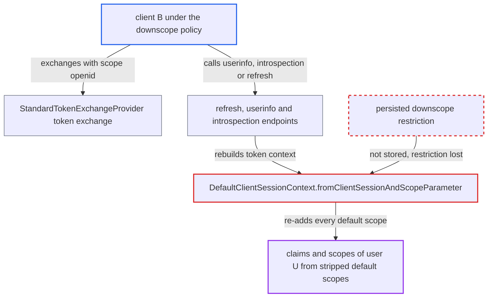

# Downscope policy lost on recomputation: refresh, userinfo and introspection re-add stripped default scopes

| Field | Value |
|---|---|
| ID | `find_01PW8mWD5Jdg9naCNUDPo37m` |
| Severity | **Low** |
| Status | open |
| CWE | CWE-863 — Incorrect authorization |
| Created | 2026-10-27T21:55:41.439068Z |
| Claude Security | https://claude.ai/security/findings/find_01PW8mWD5Jdg9naCNUDPo37m |

## Description

A client that the operator put under the `downscope-assertion-grant-enforcer` policy can get back user claims and scopes that the policy removed from its exchanged token. It needs a subject token for a user and a standard token exchange. The restriction lives only in the per-request `DefaultClientSessionContext`, and `fromClientSessionAndScopeParameter` rebuilds later contexts with `restrictedScopes = null`. Refresh, userinfo and introspection therefore re-add every default scope.

1. **client `B`** exchanges a subject token for user `U` with `scope=openid`. `B` is a confidential client under the `downscope-assertion-grant-enforcer` policy, and the policy strips `B`'s default scopes that are absent from the subject token. ([`services/src/main/java/org/keycloak/services/clientpolicy/executor/DownscopeAssertionGrantEnforcerExecutor.java:58-115`](https://github.com/cx-benchmark/keycloak/blob/1d7be35d0764060a8143fc74b0aabf2442743be4/services/src/main/java/org/keycloak/services/clientpolicy/executor/DownscopeAssertionGrantEnforcerExecutor.java#L58-L115))
2. **the exchange code in `StandardTokenExchangeProvider`** passes the restricted scope set to `attachAuthenticationSession`. The set is kept only in the returned per-request context, and a refresh token can also be issued when `requested_token_type=refresh_token` is allowed for the client. ([`services/src/main/java/org/keycloak/protocol/oidc/tokenexchange/StandardTokenExchangeProvider.java:307-308`](https://github.com/cx-benchmark/keycloak/blob/1d7be35d0764060a8143fc74b0aabf2442743be4/services/src/main/java/org/keycloak/protocol/oidc/tokenexchange/StandardTokenExchangeProvider.java#L307-L308))
3. **`isAllowed` in `DefaultClientSessionContext`** applies the restriction only to that one request. Nothing writes the restriction to the client session, the access token or the refresh token. ([`services/src/main/java/org/keycloak/services/util/DefaultClientSessionContext.java:267-271`](https://github.com/cx-benchmark/keycloak/blob/1d7be35d0764060a8143fc74b0aabf2442743be4/services/src/main/java/org/keycloak/services/util/DefaultClientSessionContext.java#L267-L271))
4. **client `B`** calls `/userinfo`, introspects the downscoped token, or refreshes the exchanged refresh token. Each of these paths builds a new token context from the token's scope string. ([`services/src/main/java/org/keycloak/protocol/oidc/endpoints/UserInfoEndpoint.java:332`](https://github.com/cx-benchmark/keycloak/blob/1d7be35d0764060a8143fc74b0aabf2442743be4/services/src/main/java/org/keycloak/protocol/oidc/endpoints/UserInfoEndpoint.java#L332))
5. **`fromClientSessionAndScopeParameter`** rebuilds the context with `restrictedScopes = null`. The restriction computed at exchange time is lost at this point. ([`services/src/main/java/org/keycloak/services/util/DefaultClientSessionContext.java:101-112`](https://github.com/cx-benchmark/keycloak/blob/1d7be35d0764060a8143fc74b0aabf2442743be4/services/src/main/java/org/keycloak/services/util/DefaultClientSessionContext.java#L101-L112))
6. **`getRequestedClientScopes`** adds every default client scope of the client again. It does this whatever the scope string says, so the stripped scopes (for example `email`, `address` or a custom default scope) come back. ([`services/src/main/java/org/keycloak/protocol/oidc/TokenManager.java:610-619`](https://github.com/cx-benchmark/keycloak/blob/1d7be35d0764060a8143fc74b0aabf2442743be4/services/src/main/java/org/keycloak/protocol/oidc/TokenManager.java#L610-L619))
7. **the refresh, userinfo and introspection endpoints** return the re-added scopes' claims. Userinfo and introspection responses include the claims, and a refreshed access token gets the `scope` entry, mapper claims and role scope mappings. ([`services/src/main/java/org/keycloak/protocol/oidc/refresh/AbstractRefreshTokenProvider.java:87-100`](https://github.com/cx-benchmark/keycloak/blob/1d7be35d0764060a8143fc74b0aabf2442743be4/services/src/main/java/org/keycloak/protocol/oidc/refresh/AbstractRefreshTokenProvider.java#L87-L100))

## Assessment

The attacker is a malicious or compromised confidential client `B`. The operator must have enabled it for standard token exchange and put it under the `downscope-assertion-grant-enforcer` policy. `B` holds a subject token for user `U`, issued to another client with `B` in its audience. `B` exchanges it with `scope=openid`, then calls `/userinfo` or introspects the downscoped token. Where `B` may request `refresh_token`, it can instead refresh once. Userinfo needs `openid` in the token scope. The refresh, userinfo and introspection re-expansion happens with the default feature set. Separately, with the non-default preview feature `parameterized-scopes` enabled, `getScopeString` builds the `scope` claim and the refresh-token scope through `buildScopesStringFromAuthorizationRequest`. That method ignores `restrictedScopes`, so even the first exchanged token lists the stripped scopes.

Impact: `B` gets claims of `U` from default scopes the policy removed, through userinfo and introspection. After a refresh it gets an access token whose `scope`, mapper claims and, with full scope disabled, role scope mappings exceed the subject token. This breaks the documented promise that 'no additional scopes will ever be granted'. The gain is limited to the client scopes the admin assigned to `B` and permitted for `U`. The report names no key, cross-realm or availability impact.

## Recommendation

(1) The downscope restriction exists only in the per-request `DefaultClientSessionContext`. `fromClientSessionAndScopeParameter` rebuilds later contexts with `restrictedScopes = null`, and `getRequestedClientScopes` re-adds every default client scope. Refresh, userinfo and introspection therefore re-expand a downscoped grant.

Fix criteria: Every token, userinfo response and introspection response derived from a downscoped exchange contains only scopes allowed by the original restriction: the subject-token scopes plus the defaults that are not include-in-token-scope. To check, exchange under the executor with a requester default scope absent from the subject token. Then call userinfo, introspect, and refresh an exchanged refresh token. None of them may return that scope's claims, roles or `scope` entry.

(2) With `parameterized-scopes` enabled, `getScopeString` builds the `scope` claim and the refresh-token scope through `buildScopesStringFromAuthorizationRequest`, which never applies `restrictedScopes`.

Fix criteria: The access-token `scope` claim, the token-response `scope` and the refresh-token scope list only scopes that pass `isAllowed`, whatever the feature flag. `JWTAuthorizationGrantDownscopeClientPoliciesTest.testDownscope` and the token-exchange downscope test pass with `parameterized-scopes` enabled.

## Evidence

**https://github.com/cx-benchmark/keycloak**

- [`services/src/main/java/org/keycloak/services/util/DefaultClientSessionContext.java:101-112`](https://github.com/cx-benchmark/keycloak/blob/1d7be35d0764060a8143fc74b0aabf2442743be4/services/src/main/java/org/keycloak/services/util/DefaultClientSessionContext.java#L101-L112)
- [`services/src/main/java/org/keycloak/protocol/oidc/TokenManager.java:610-619`](https://github.com/cx-benchmark/keycloak/blob/1d7be35d0764060a8143fc74b0aabf2442743be4/services/src/main/java/org/keycloak/protocol/oidc/TokenManager.java#L610-L619)
- [`services/src/main/java/org/keycloak/protocol/oidc/TokenManager.java:274`](https://github.com/cx-benchmark/keycloak/blob/1d7be35d0764060a8143fc74b0aabf2442743be4/services/src/main/java/org/keycloak/protocol/oidc/TokenManager.java#L274)
- [`services/src/main/java/org/keycloak/protocol/oidc/refresh/AbstractRefreshTokenProvider.java:87-100`](https://github.com/cx-benchmark/keycloak/blob/1d7be35d0764060a8143fc74b0aabf2442743be4/services/src/main/java/org/keycloak/protocol/oidc/refresh/AbstractRefreshTokenProvider.java#L87-L100)
- [`services/src/main/java/org/keycloak/protocol/oidc/endpoints/UserInfoEndpoint.java:332`](https://github.com/cx-benchmark/keycloak/blob/1d7be35d0764060a8143fc74b0aabf2442743be4/services/src/main/java/org/keycloak/protocol/oidc/endpoints/UserInfoEndpoint.java#L332)
- [`services/src/main/java/org/keycloak/protocol/oidc/AccessTokenIntrospectionProvider.java:161`](https://github.com/cx-benchmark/keycloak/blob/1d7be35d0764060a8143fc74b0aabf2442743be4/services/src/main/java/org/keycloak/protocol/oidc/AccessTokenIntrospectionProvider.java#L161)
- [`services/src/main/java/org/keycloak/services/util/DefaultClientSessionContext.java:267-271`](https://github.com/cx-benchmark/keycloak/blob/1d7be35d0764060a8143fc74b0aabf2442743be4/services/src/main/java/org/keycloak/services/util/DefaultClientSessionContext.java#L267-L271)
- [`services/src/main/java/org/keycloak/protocol/oidc/tokenexchange/StandardTokenExchangeProvider.java:307-308`](https://github.com/cx-benchmark/keycloak/blob/1d7be35d0764060a8143fc74b0aabf2442743be4/services/src/main/java/org/keycloak/protocol/oidc/tokenexchange/StandardTokenExchangeProvider.java#L307-L308)
- [`services/src/main/java/org/keycloak/services/clientpolicy/executor/DownscopeAssertionGrantEnforcerExecutor.java:58-115`](https://github.com/cx-benchmark/keycloak/blob/1d7be35d0764060a8143fc74b0aabf2442743be4/services/src/main/java/org/keycloak/services/clientpolicy/executor/DownscopeAssertionGrantEnforcerExecutor.java#L58-L115)
- [`services/src/main/java/org/keycloak/services/util/DefaultClientSessionContext.java:195-245`](https://github.com/cx-benchmark/keycloak/blob/1d7be35d0764060a8143fc74b0aabf2442743be4/services/src/main/java/org/keycloak/services/util/DefaultClientSessionContext.java#L195-L245)
- [`docs/documentation/server_admin/topics/clients/con-client-scopes.adoc:139`](https://github.com/cx-benchmark/keycloak/blob/1d7be35d0764060a8143fc74b0aabf2442743be4/docs/documentation/server_admin/topics/clients/con-client-scopes.adoc#L139)
- [`testsuite/integration-arquillian/tests/base/src/test/java/org/keycloak/testsuite/oauth/tokenexchange/StandardTokenExchangeV2Test.java:1082-1091`](https://github.com/cx-benchmark/keycloak/blob/1d7be35d0764060a8143fc74b0aabf2442743be4/testsuite/integration-arquillian/tests/base/src/test/java/org/keycloak/testsuite/oauth/tokenexchange/StandardTokenExchangeV2Test.java#L1082-L1091)

