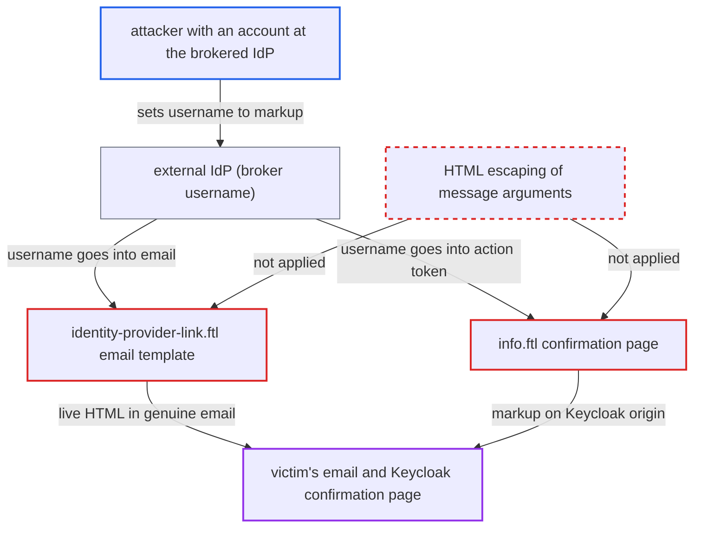

# IdP-asserted broker username injected as HTML into account-link email and confirmation page

| Field | Value |
|---|---|
| ID | `find_015RzTQ766XrWzDYkxE99ays` |
| Severity | **Low** |
| Status | open |
| CWE | CWE-79 — HTML injection |
| Created | 2026-10-27T21:31:50.502243Z |
| Claude Security | https://claude.ai/security/findings/find_015RzTQ766XrWzDYkxE99ays |

## Description

An attacker with an account at an identity provider (IdP) that the realm brokers can put phishing links, images and styled text into an account-link email. The email comes from the realm's real sender address. The same markup also appears on the Keycloak confirmation page. Script execution is stripped, so the harm is content injection and phishing. The attack needs working SMTP. The cause is that the IdP-asserted broker username is inserted unescaped into messages that are then output with `kcSanitize(...)?no_esc`.

1. **attacker** sets up an account at the brokered IdP with the victim's email and markup as the username. For OIDC the broker username is `preferred_username`, and nothing restricts its characters. ([`services/src/main/java/org/keycloak/broker/oidc/OIDCIdentityProvider.java:493-501`](https://github.com/cx-benchmark/keycloak/blob/1d7be35d0764060a8143fc74b0aabf2442743be4/services/src/main/java/org/keycloak/broker/oidc/OIDCIdentityProvider.java#L493-L501))
2. **attacker** renames the username on the review page during first broker login. In the default case the broker username is copied into the model `username`, so `username-prohibited-characters` forces the review page. Renaming sets `UPDATE_PROFILE_USERNAME_CHANGED`, which would normally stop the email. ([`services/src/main/java/org/keycloak/services/resources/IdentityBrokerService.java:782-793`](https://github.com/cx-benchmark/keycloak/blob/1d7be35d0764060a8143fc74b0aabf2442743be4/services/src/main/java/org/keycloak/services/resources/IdentityBrokerService.java#L782-L793))
3. **attacker** presses Review profile on the confirm-link page, which resets the flow. The reset clears all auth notes, including the rename marker. It keeps the saved context that still holds the original `brokerUsername`. ([`services/src/main/java/org/keycloak/authentication/authenticators/broker/IdpConfirmLinkAuthenticator.java:77-83`](https://github.com/cx-benchmark/keycloak/blob/1d7be35d0764060a8143fc74b0aabf2442743be4/services/src/main/java/org/keycloak/authentication/authenticators/broker/IdpConfirmLinkAuthenticator.java#L77-L83))
4. **attacker** resubmits the review page unchanged, then presses Add to existing account. No marker is set this time, so the check in `IdpEmailVerificationAuthenticator` lets the email go out and puts the raw broker username into the action token. ([`services/src/main/java/org/keycloak/authentication/authenticators/broker/IdpEmailVerificationAuthenticator.java:87-92`](https://github.com/cx-benchmark/keycloak/blob/1d7be35d0764060a8143fc74b0aabf2442743be4/services/src/main/java/org/keycloak/authentication/authenticators/broker/IdpEmailVerificationAuthenticator.java#L87-L92))
5. **template `identity-provider-link.ftl`** emails the existing account's owner with the markup as live HTML. The username is argument `{2}` of `identityProviderLinkBodyHtml`, inserted without escaping. `KeycloakSanitizerPolicy` then keeps offsite links, images, headings, tables and inline styling. ([`themes/src/main/resources/theme/base/email/html/identity-provider-link.ftl:3`](https://github.com/cx-benchmark/keycloak/blob/1d7be35d0764060a8143fc74b0aabf2442743be4/themes/src/main/resources/theme/base/email/html/identity-provider-link.ftl#L3))
6. **victim** opens the link, and the handler `IdpVerifyAccountLinkActionTokenHandler` builds `messageHeader` from the token's username. `info.ftl` passes that string back through `msg()` as a key. It is parsed again as a `MessageFormat` pattern, `${...}` is resolved, and the result is output unescaped on the Keycloak origin. ([`services/src/main/java/org/keycloak/authentication/actiontoken/idpverifyemail/IdpVerifyAccountLinkActionTokenHandler.java:128-133`](https://github.com/cx-benchmark/keycloak/blob/1d7be35d0764060a8143fc74b0aabf2442743be4/services/src/main/java/org/keycloak/authentication/actiontoken/idpverifyemail/IdpVerifyAccountLinkActionTokenHandler.java#L128-L133))

## Assessment

The attacker holds an account at an IdP that the realm brokers and needs no Keycloak account. Broker callbacks are reachable from the internet. The attacker sets that account's email to the victim's and `preferred_username` to markup, for example a link plus an image pointing at an attacker host. The realm must be able to send email. In the default flow the attacker needs the rename, Review profile and resubmit sequence to get past the check in `IdpEmailVerificationAuthenticator`. No reset is needed in other setups where the model username differs from the broker username. These are realm email-as-username, a Username Template Importer or Attribute Importer mapper that sets the local username, and review profile `off`. The victim must open the emailed link for the confirmation page to show the injected content.

Impact: The attacker controls links, images, headings and styling inside a genuine account-security email and on the Keycloak-hosted confirmation page. This allows convincing phishing, and an offsite image reveals the victim's IP address when the mail is opened. The sanitizer strips script and event handlers, and the injection reads no Keycloak data or sessions.

## Recommendation

(1) The broker username from the external IdP is inserted unescaped into HTML messages such as `identityProviderLinkBodyHtml`, which are output with `?no_esc`. The permissive `kcSanitize` allow-list is the only barrier, and it is meant for administrator-written HTML.

Fix criteria: Values from an external party, such as the broker username, are HTML-escaped before they enter any message output with `?no_esc`. Alternatively, only trusted bundle text passes through `kcSanitize`. Test: broker an identity whose `preferred_username` is `<a href="https://x">x</a>` against an existing user's email, using the review/reset sequence or an email-as-username realm. The email body and the confirmation page must show the literal text, with no anchor or image element.

(2) `info.ftl` and `register.ftl` pass an already-formatted `messageHeader` back through `msg()` as a key. Attacker-influenced text is re-parsed as a `MessageFormat` pattern, `${...}` placeholders are resolved, and the result is output unescaped.

Fix criteria: A pre-formatted header is output as escaped plain text, or resolved from a bundle key with escaped parameters. It is never re-read as a `MessageFormat` pattern or variable template. Test: a broker username containing `{`, `'` or `${lang}` renders literally on the confirmation page, with no 500 error and no substitution.

## Evidence

**https://github.com/cx-benchmark/keycloak**

- [`themes/src/main/resources/theme/base/email/html/identity-provider-link.ftl:3`](https://github.com/cx-benchmark/keycloak/blob/1d7be35d0764060a8143fc74b0aabf2442743be4/themes/src/main/resources/theme/base/email/html/identity-provider-link.ftl#L3)
- [`themes/src/main/resources/theme/base/login/info.ftl:4-6`](https://github.com/cx-benchmark/keycloak/blob/1d7be35d0764060a8143fc74b0aabf2442743be4/themes/src/main/resources/theme/base/login/info.ftl#L4-L6)
- [`services/src/main/java/org/keycloak/authentication/actiontoken/idpverifyemail/IdpVerifyAccountLinkActionTokenHandler.java:128-133`](https://github.com/cx-benchmark/keycloak/blob/1d7be35d0764060a8143fc74b0aabf2442743be4/services/src/main/java/org/keycloak/authentication/actiontoken/idpverifyemail/IdpVerifyAccountLinkActionTokenHandler.java#L128-L133)
- [`services/src/main/java/org/keycloak/theme/beans/MessageFormatterMethod.java:55-66`](https://github.com/cx-benchmark/keycloak/blob/1d7be35d0764060a8143fc74b0aabf2442743be4/services/src/main/java/org/keycloak/theme/beans/MessageFormatterMethod.java#L55-L66)
- [`themes/src/main/resources/theme/base/email/messages/messages_en.properties:17`](https://github.com/cx-benchmark/keycloak/blob/1d7be35d0764060a8143fc74b0aabf2442743be4/themes/src/main/resources/theme/base/email/messages/messages_en.properties#L17)
- [`services/src/main/java/org/keycloak/theme/KeycloakSanitizerPolicy.java:86-170`](https://github.com/cx-benchmark/keycloak/blob/1d7be35d0764060a8143fc74b0aabf2442743be4/services/src/main/java/org/keycloak/theme/KeycloakSanitizerPolicy.java#L86-L170)
- [`services/src/main/java/org/keycloak/authentication/authenticators/broker/IdpEmailVerificationAuthenticator.java:87-92`](https://github.com/cx-benchmark/keycloak/blob/1d7be35d0764060a8143fc74b0aabf2442743be4/services/src/main/java/org/keycloak/authentication/authenticators/broker/IdpEmailVerificationAuthenticator.java#L87-L92)
- [`services/src/main/java/org/keycloak/services/resources/IdentityBrokerService.java:782-793`](https://github.com/cx-benchmark/keycloak/blob/1d7be35d0764060a8143fc74b0aabf2442743be4/services/src/main/java/org/keycloak/services/resources/IdentityBrokerService.java#L782-L793)
- [`services/src/main/java/org/keycloak/authentication/authenticators/broker/IdpConfirmLinkAuthenticator.java:77-83`](https://github.com/cx-benchmark/keycloak/blob/1d7be35d0764060a8143fc74b0aabf2442743be4/services/src/main/java/org/keycloak/authentication/authenticators/broker/IdpConfirmLinkAuthenticator.java#L77-L83)
- [`services/src/main/java/org/keycloak/userprofile/validator/UsernameProhibitedCharactersValidator.java:72-81`](https://github.com/cx-benchmark/keycloak/blob/1d7be35d0764060a8143fc74b0aabf2442743be4/services/src/main/java/org/keycloak/userprofile/validator/UsernameProhibitedCharactersValidator.java#L72-L81)
- [`services/src/main/java/org/keycloak/broker/oidc/OIDCIdentityProvider.java:493-501`](https://github.com/cx-benchmark/keycloak/blob/1d7be35d0764060a8143fc74b0aabf2442743be4/services/src/main/java/org/keycloak/broker/oidc/OIDCIdentityProvider.java#L493-L501)
- [`services/src/main/java/org/keycloak/email/freemarker/FreeMarkerEmailTemplateProvider.java:140-156`](https://github.com/cx-benchmark/keycloak/blob/1d7be35d0764060a8143fc74b0aabf2442743be4/services/src/main/java/org/keycloak/email/freemarker/FreeMarkerEmailTemplateProvider.java#L140-L156)

