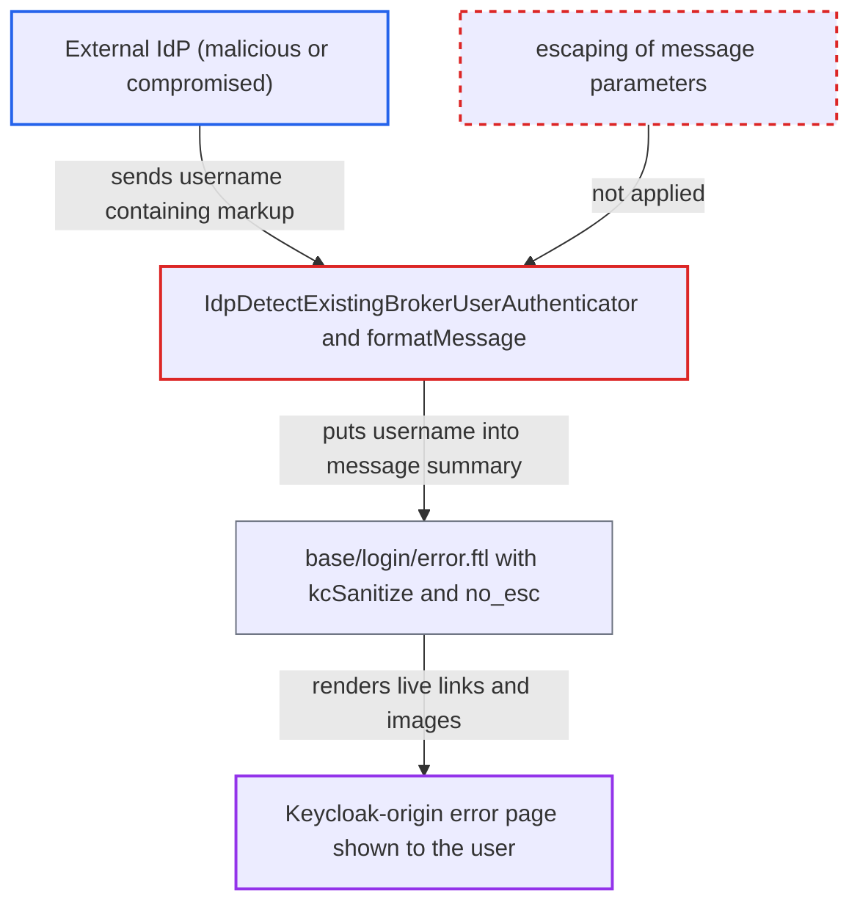

# IdP-asserted broker username rendered as sanitized HTML on first-broker-login error and alert pages

| Field | Value |
|---|---|
| ID | `find_01Ry8ATuduT5Qmz6z1ATjphH` |
| Severity | **Low** |
| Status | open |
| CWE | CWE-79 — HTML injection |
| Created | 2026-10-27T21:55:34.442009Z |
| Claude Security | https://claude.ai/security/findings/find_01Ry8ATuduT5Qmz6z1ATjphH |

## Description

A malicious or compromised external identity provider (IdP) can put its own links, images and styled text on a genuine Keycloak login error page. This could be used to phish the user, for example for the local Keycloak password. The attacker needs no Keycloak account, and the victim must act on the content. The sanitizer strips script, so this is content injection only. The cause is that the IdP-asserted username is inserted unescaped into messages that `base/login/error.ftl` prints with `kcSanitize(message.summary)?no_esc`.

1. **the IdP** returns a username that contains HTML markup. The `preferred_username` (or configured claim) of OIDC, or the SAML principal, is used as the broker username and matches no local user. ([`services/src/main/java/org/keycloak/broker/oidc/OIDCIdentityProvider.java:419-501`](https://github.com/cx-benchmark/keycloak/blob/1d7be35d0764060a8143fc74b0aabf2442743be4/services/src/main/java/org/keycloak/broker/oidc/OIDCIdentityProvider.java#L419-L501))
2. **Keycloak broker code** keeps the username as the model username. It is only trimmed, and no user-profile or character validation runs before the first-login flow. ([`services/src/main/java/org/keycloak/services/resources/IdentityBrokerService.java:782-793`](https://github.com/cx-benchmark/keycloak/blob/1d7be35d0764060a8143fc74b0aabf2442743be4/services/src/main/java/org/keycloak/services/resources/IdentityBrokerService.java#L782-L793))
3. **the authenticator `IdpDetectExistingBrokerUserAuthenticator`** passes the username into `federatedIdentityUnavailableMessage`. When no local user matches, the username goes in unchanged as `{0}` and the error page is rendered. ([`services/src/main/java/org/keycloak/authentication/authenticators/broker/IdpDetectExistingBrokerUserAuthenticator.java:53-68`](https://github.com/cx-benchmark/keycloak/blob/1d7be35d0764060a8143fc74b0aabf2442743be4/services/src/main/java/org/keycloak/authentication/authenticators/broker/IdpDetectExistingBrokerUserAuthenticator.java#L53-L68))
4. **`formatMessage` in `FreeMarkerLoginFormsProvider`** inserts the parameter into the message without escaping. `handleMessages` then copies the result unchanged into `message.summary`. ([`services/src/main/java/org/keycloak/forms/login/freemarker/FreeMarkerLoginFormsProvider.java:877-885`](https://github.com/cx-benchmark/keycloak/blob/1d7be35d0764060a8143fc74b0aabf2442743be4/services/src/main/java/org/keycloak/forms/login/freemarker/FreeMarkerLoginFormsProvider.java#L877-L885))
5. **`kcSanitize`** decodes entities and keeps links and images. It entity-decodes the input up to five times, so earlier escaping is undone, and its policy allows offsite `a[href]`, `img[src]`, headings, tables and styling. ([`services/src/main/java/org/keycloak/theme/KeycloakSanitizerMethod.java:44-77`](https://github.com/cx-benchmark/keycloak/blob/1d7be35d0764060a8143fc74b0aabf2442743be4/services/src/main/java/org/keycloak/theme/KeycloakSanitizerMethod.java#L44-L77))
6. **the template `base/login/error.ftl`** prints the sanitized message as live HTML. `keycloak.v2` has no `error.ftl` of its own and inherits this one, so the default theme is affected. ([`themes/src/main/resources/theme/base/login/error.ftl:7`](https://github.com/cx-benchmark/keycloak/blob/1d7be35d0764060a8143fc74b0aabf2442743be4/themes/src/main/resources/theme/base/login/error.ftl#L7))
7. **the victim** sees the injected content on the Keycloak page and acts on it. The link or image appears on the real Keycloak origin, so the victim may trust it and click.

## Assessment

The attacker operates, or has compromised, an external IdP that is configured in the realm. No Keycloak account is needed. The realm must use the documented Detect Existing Broker User first-login flow, with that step set to REQUIRED. A user logs in through that IdP, and the IdP returns a username with markup that matches no local user. The victim then has to click or follow what is shown. Two more sinks exist only in the legacy `keycloak` login theme, or in custom themes that use `base/login/template.ftl:186`. One is `nestedFirstBrokerFlowMessage`, the alert above the re-authentication password form in `IdpUsernamePasswordForm`. The other is `federatedIdentityConfirmOverrideMessage` in `IdpConfirmOverrideLinkAuthenticator`. In the default `keycloak.v2` theme the layout alert is auto-escaped, so those two show plain text only.

Impact: The IdP can place links, images, headings and styled text on a genuine Keycloak login page and use them to phish the user. The sanitizer removes script, event handlers, forms and iframes. No session, token or page data can be read, and the harm is limited to the displayed content.

## Recommendation

IdP-asserted usernames are inserted unescaped as `MessageFormat` parameters into messages. `base/login/error.ftl:7` and the legacy `base/login/template.ftl:186` then emit them through `kcSanitize(...)?no_esc`. `kcSanitize` decodes entities first and uses a permissive allow-list, so escaping done earlier is undone and links and images survive.

Fix criteria: Message parameters taken from broker responses reach the browser as literal text on the first-broker-login error page, the re-authentication alert and the confirm-override page. This holds in both `keycloak.v2` and the legacy `keycloak` login theme. The escaping survives the entity decoding in `kcSanitize`. To verify, use a Detect Existing Broker User first-login flow and broker an identity whose `preferred_username` is `<a href="https://evil.example">x</a>` and matches no local user. The error page must show the markup as text, with no anchor or image element.

## Evidence

**https://github.com/cx-benchmark/keycloak**

- [`themes/src/main/resources/theme/base/login/error.ftl:7`](https://github.com/cx-benchmark/keycloak/blob/1d7be35d0764060a8143fc74b0aabf2442743be4/themes/src/main/resources/theme/base/login/error.ftl#L7)
- [`services/src/main/java/org/keycloak/authentication/authenticators/broker/IdpDetectExistingBrokerUserAuthenticator.java:53-68`](https://github.com/cx-benchmark/keycloak/blob/1d7be35d0764060a8143fc74b0aabf2442743be4/services/src/main/java/org/keycloak/authentication/authenticators/broker/IdpDetectExistingBrokerUserAuthenticator.java#L53-L68)
- [`services/src/main/java/org/keycloak/authentication/authenticators/broker/IdpCreateUserIfUniqueAuthenticator.java:197-199`](https://github.com/cx-benchmark/keycloak/blob/1d7be35d0764060a8143fc74b0aabf2442743be4/services/src/main/java/org/keycloak/authentication/authenticators/broker/IdpCreateUserIfUniqueAuthenticator.java#L197-L199)
- [`services/src/main/java/org/keycloak/services/resources/IdentityBrokerService.java:782-793`](https://github.com/cx-benchmark/keycloak/blob/1d7be35d0764060a8143fc74b0aabf2442743be4/services/src/main/java/org/keycloak/services/resources/IdentityBrokerService.java#L782-L793)
- [`services/src/main/java/org/keycloak/broker/oidc/OIDCIdentityProvider.java:419-501`](https://github.com/cx-benchmark/keycloak/blob/1d7be35d0764060a8143fc74b0aabf2442743be4/services/src/main/java/org/keycloak/broker/oidc/OIDCIdentityProvider.java#L419-L501)
- [`services/src/main/java/org/keycloak/forms/login/freemarker/FreeMarkerLoginFormsProvider.java:877-885`](https://github.com/cx-benchmark/keycloak/blob/1d7be35d0764060a8143fc74b0aabf2442743be4/services/src/main/java/org/keycloak/forms/login/freemarker/FreeMarkerLoginFormsProvider.java#L877-L885)
- [`services/src/main/java/org/keycloak/theme/KeycloakSanitizerMethod.java:44-77`](https://github.com/cx-benchmark/keycloak/blob/1d7be35d0764060a8143fc74b0aabf2442743be4/services/src/main/java/org/keycloak/theme/KeycloakSanitizerMethod.java#L44-L77)
- [`services/src/main/java/org/keycloak/theme/KeycloakSanitizerPolicy.java:86-168`](https://github.com/cx-benchmark/keycloak/blob/1d7be35d0764060a8143fc74b0aabf2442743be4/services/src/main/java/org/keycloak/theme/KeycloakSanitizerPolicy.java#L86-L168)
- [`themes/src/main/resources/theme/keycloak.v2/login/template.ftl:242`](https://github.com/cx-benchmark/keycloak/blob/1d7be35d0764060a8143fc74b0aabf2442743be4/themes/src/main/resources/theme/keycloak.v2/login/template.ftl#L242)
- [`services/src/main/java/org/keycloak/authentication/authenticators/broker/IdpUsernamePasswordForm.java:107-112`](https://github.com/cx-benchmark/keycloak/blob/1d7be35d0764060a8143fc74b0aabf2442743be4/services/src/main/java/org/keycloak/authentication/authenticators/broker/IdpUsernamePasswordForm.java#L107-L112)
- [`services/src/main/java/org/keycloak/authentication/authenticators/broker/IdpConfirmOverrideLinkAuthenticator.java:57-69`](https://github.com/cx-benchmark/keycloak/blob/1d7be35d0764060a8143fc74b0aabf2442743be4/services/src/main/java/org/keycloak/authentication/authenticators/broker/IdpConfirmOverrideLinkAuthenticator.java#L57-L69)
- [`themes/src/main/resources/theme/base/login/template.ftl:186`](https://github.com/cx-benchmark/keycloak/blob/1d7be35d0764060a8143fc74b0aabf2442743be4/themes/src/main/resources/theme/base/login/template.ftl#L186)
- [`docs/documentation/server_admin/topics/identity-broker/first-login-flow.adoc:98-117`](https://github.com/cx-benchmark/keycloak/blob/1d7be35d0764060a8143fc74b0aabf2442743be4/docs/documentation/server_admin/topics/identity-broker/first-login-flow.adoc#L98-L117)

