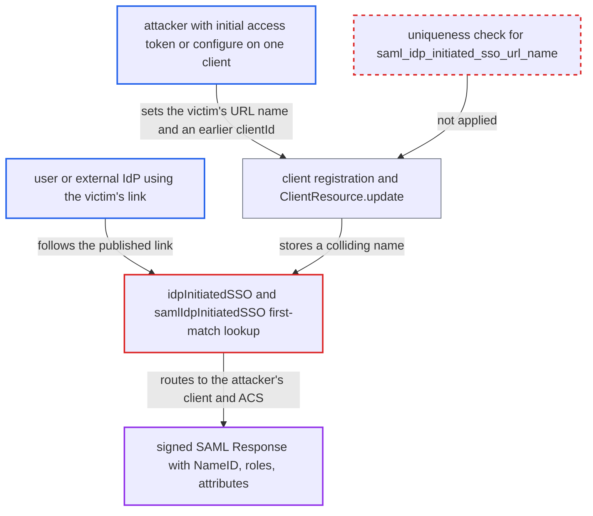

# IdP-initiated SAML SSO URL name is not unique; lowest clientId shadows another SP

| Field | Value |
|---|---|
| ID | `find_016LMECvvz2qnY3vW8J5uAnK` |
| Severity | **Low** |
| Status | open |
| CWE | CWE-694 — Duplicate identifier |
| Created | 2026-10-27T21:51:57.802878Z |
| Claude Security | https://claude.ai/security/findings/find_016LMECvvz2qnY3vW8J5uAnK |

## Description

A party who controls one SAML client in a realm can take over another SAML client's IdP-initiated login link. Users who follow the link are signed in to the attacker's service, and the real service's IdP-initiated login stops working. The attacker needs an initial access token or `configure` permission on one client, and the victim must use IdP-initiated SSO, which is off by default. The lookup by `saml_idp_initiated_sso_url_name` in `SamlService.idpInitiatedSSO` and `SAMLEndpoint.samlIdpInitiatedSSO` takes the first match, and nothing makes the name unique.

1. **attacker** registers or edits a SAML client with the victim's URL name. The client gets `saml_idp_initiated_sso_url_name` set to the victim SP's public name, `saml_assertion_consumer_url_post` set to the attacker's server, and a `clientId` that sorts before the victim's. ([`services/src/main/java/org/keycloak/services/clientregistration/AbstractClientRegistrationProvider.java:82-111`](https://github.com/cx-benchmark/keycloak/blob/1d7be35d0764060a8143fc74b0aabf2442743be4/services/src/main/java/org/keycloak/services/clientregistration/AbstractClientRegistrationProvider.java#L82-L111))
2. **Keycloak admin API** accepts the colliding attributes and the `clientId` change. `ClientResource.update` needs only the `configure` permission on the client being edited, and no validator checks that the name is unique. ([`services/src/main/java/org/keycloak/services/resources/admin/ClientResource.java:163-169`](https://github.com/cx-benchmark/keycloak/blob/1d7be35d0764060a8143fc74b0aabf2442743be4/services/src/main/java/org/keycloak/services/resources/admin/ClientResource.java#L163-L169))
3. **user or external IdP** requests the victim's IdP-initiated URL. A user follows `/realms/{realm}/protocol/saml/clients/{name}`, or an external IdP posts an unsolicited Response to `/realms/{realm}/broker/{alias}/endpoint/clients/{name}`.
4. **the handler `idpInitiatedSSO`** looks up the client by name and takes the first match. It calls `searchClientsByAttributes(...).findFirst()`, and the JPA query orders by `clientId` ascending, so the attacker's client wins. ([`services/src/main/java/org/keycloak/protocol/saml/SamlService.java:1062-1082`](https://github.com/cx-benchmark/keycloak/blob/1d7be35d0764060a8143fc74b0aabf2442743be4/services/src/main/java/org/keycloak/protocol/saml/SamlService.java#L1062-L1082))
5. **the handler `samlIdpInitiatedSSO`** does the same first-match lookup for the brokered route. It passes the found client to `getOrCreateLoginSessionForIdpInitiatedSso`, which builds the session with the attacker's ACS. ([`services/src/main/java/org/keycloak/broker/saml/SAMLEndpoint.java:756-779`](https://github.com/cx-benchmark/keycloak/blob/1d7be35d0764060a8143fc74b0aabf2442743be4/services/src/main/java/org/keycloak/broker/saml/SAMLEndpoint.java#L756-L779))
6. **Keycloak realm** signs a SAML Response and auto-POSTs it to the attacker's ACS after login. The Response carries the user's NameID, roles and any attributes the attacker client's permitted mappers request, and the login is silent if the user already has an SSO session.

## Assessment

The attacker needs an initial access token for dynamic client registration, or the fine-grained `configure` permission on one client. With the token, they register a `saml` client through `POST /realms/{realm}/clients-registrations/default`. With `configure`, they edit their own client through `ClientResource.update`. A registration access token can also update the client. The victim must be a SAML client in the same realm that uses IdP-initiated SSO, so its URL name is set. That feature is off by default. Users reach the lookup in either of two ways: by following the published `/protocol/saml/clients/{name}` link, or through an external IdP posting an unsolicited Response to `/broker/{alias}/endpoint/clients/{name}`. The SAML endpoints are exposed to the internet without authentication.

Impact: The attacker receives realm-signed SAML assertions with the user's NameID, roles and the attributes their client's permitted mappers request. Users land on the attacker's service believing it is the real one. The real SP's IdP-initiated login is broken while the collision lasts. The assertion's audience is the attacker's client, so it cannot be replayed to the real SP. Keys, other clients' tokens and other sessions are not affected.

## Recommendation

(1) `saml_idp_initiated_sso_url_name` is used to route `/protocol/saml/clients/{name}` but is stored as ordinary free text with no uniqueness guarantee in the realm. The `findFirst()` lookup can therefore return a client other than the one the URL was published for.

Fix criteria: Within a realm, at most one client can hold a given `saml_idp_initiated_sso_url_name`. Every creation and update path (Admin API, DCR default provider, entity-descriptor provider, import) rejects a value already used by a different client. `idpInitiatedSSO` and `samlIdpInitiatedSSO` fail closed, with an error and no auth session, if more than one client matches. To check: register a second client with a colliding name through DCR and through the Admin API. Both requests must be refused, and the original SP must still receive the login.

(2) The fine-grained `configure` permission and dynamic client registration let someone who controls one client set attributes (`saml_idp_initiated_sso_url_name`, `clientId`) that change how requests for other clients are routed. This crosses the boundary between clients.

Fix criteria: Setting or changing the IdP-initiated SSO URL name, and renaming `clientId` where applicable, requires realm-level `manage-clients` authority or equivalent. At minimum it is subject to the uniqueness check above, so it cannot collide with a client the caller does not manage. To check: a `configure`-only admin and a registration-access-token holder cannot make their client answer another client's IdP-initiated URL.

## Evidence

**https://github.com/cx-benchmark/keycloak**

- [`services/src/main/java/org/keycloak/protocol/saml/SamlService.java:1062-1082`](https://github.com/cx-benchmark/keycloak/blob/1d7be35d0764060a8143fc74b0aabf2442743be4/services/src/main/java/org/keycloak/protocol/saml/SamlService.java#L1062-L1082)
- [`model/jpa/src/main/java/org/keycloak/models/jpa/JpaRealmProvider.java:1126-1130`](https://github.com/cx-benchmark/keycloak/blob/1d7be35d0764060a8143fc74b0aabf2442743be4/model/jpa/src/main/java/org/keycloak/models/jpa/JpaRealmProvider.java#L1126-L1130)
- [`services/src/main/java/org/keycloak/broker/saml/SAMLEndpoint.java:756-779`](https://github.com/cx-benchmark/keycloak/blob/1d7be35d0764060a8143fc74b0aabf2442743be4/services/src/main/java/org/keycloak/broker/saml/SAMLEndpoint.java#L756-L779)
- [`services/src/main/java/org/keycloak/services/clientregistration/AbstractClientRegistrationProvider.java:82-111`](https://github.com/cx-benchmark/keycloak/blob/1d7be35d0764060a8143fc74b0aabf2442743be4/services/src/main/java/org/keycloak/services/clientregistration/AbstractClientRegistrationProvider.java#L82-L111)
- [`services/src/main/java/org/keycloak/services/resources/admin/ClientResource.java:163-169`](https://github.com/cx-benchmark/keycloak/blob/1d7be35d0764060a8143fc74b0aabf2442743be4/services/src/main/java/org/keycloak/services/resources/admin/ClientResource.java#L163-L169)

