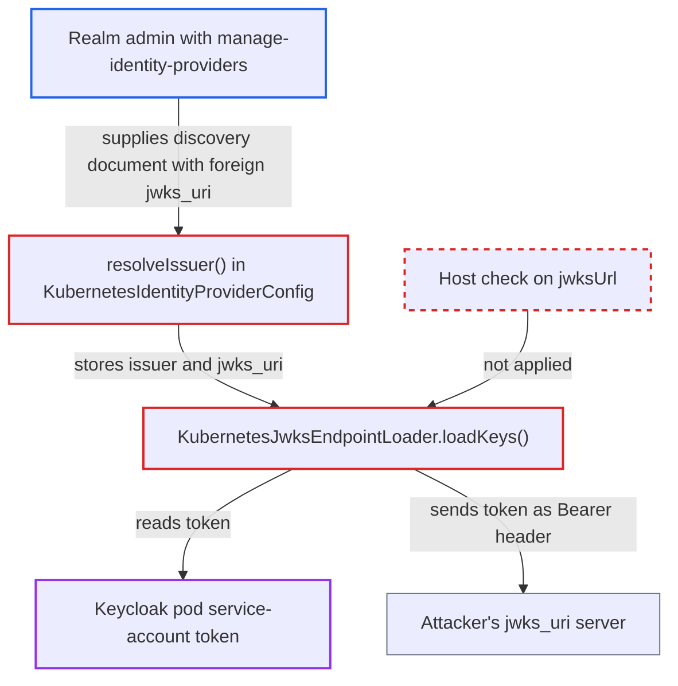

# Kubernetes IdP JWKS loader sends pod service-account token to admin-controlled jwks_uri

| Field | Value |
|---|---|
| ID | `find_011dagYZRhHDoCKiu4Ybc5Ab` |
| Severity | **Low** |
| Status | open |
| CWE | CWE-201 — Credential exposure |
| Created | 2026-10-27T21:19:30.786849Z |
| Claude Security | https://claude.ai/security/findings/find_011dagYZRhHDoCKiu4Ybc5Ab |

## Description

A realm administrator with `manage-identity-providers` can make Keycloak send its own Kubernetes service-account token to a server the administrator controls. The leaked token is a live credential for the Keycloak deployment's cluster account. The attack needs Keycloak running in Kubernetes with a mounted token. The cause is that `KubernetesJwksEndpointLoader.loadKeys()` attaches the token after comparing issuer strings only. It never checks the host of `jwksUrl`.

1. **Realm admin** creates a Kubernetes identity provider with an attacker-hosted `issuerDiscoveryUrl`. The attacker's HTTPS server returns a discovery document with `issuer` set to `https://kubernetes.default.svc.cluster.local` and `jwks_uri` set to `https://attacker/jwks`.
2. **`resolveIssuer()`** saves `issuer` and `jwks_uri` from the discovery document as they are. Only `checkUrl` (scheme and https) is applied. Nothing ties `jwks_uri` to the issuer's host or to the cluster API server. ([`services/src/main/java/org/keycloak/broker/kubernetes/KubernetesIdentityProviderConfig.java:85-123`](https://github.com/cx-benchmark/keycloak/blob/1d7be35d0764060a8143fc74b0aabf2442743be4/services/src/main/java/org/keycloak/broker/kubernetes/KubernetesIdentityProviderConfig.java#L85-L123))
3. **Realm admin** creates a client that uses the federated-JWT authenticator bound to that identity provider, then posts a JWT with an unknown `kid` as `client_assertion` to the token endpoint. The unknown `kid` makes the key lookup miss the cache.
4. **`verifySignature()`** asks the key storage for the key through a new `KubernetesJwksEndpointLoader`. The cache miss makes the storage call `loadKeys()`. ([`services/src/main/java/org/keycloak/broker/kubernetes/KubernetesIdentityProvider.java:55-61`](https://github.com/cx-benchmark/keycloak/blob/1d7be35d0764060a8143fc74b0aabf2442743be4/services/src/main/java/org/keycloak/broker/kubernetes/KubernetesIdentityProvider.java#L55-L61))
5. **`getServiceAccountToken(issuer)`** returns the pod's service-account token. It returns the token because the token's `iss` claim equals the configured issuer, which the attacker set to the well-known default value. ([`services/src/main/java/org/keycloak/broker/kubernetes/KubernetesUtils.java:53-70`](https://github.com/cx-benchmark/keycloak/blob/1d7be35d0764060a8143fc74b0aabf2442743be4/services/src/main/java/org/keycloak/broker/kubernetes/KubernetesUtils.java#L53-L70))
6. **`loadKeys()`** sends the token as an `Authorization: Bearer` header in a GET to the attacker's `jwksUrl`. The decision to attach the token rests on the issuer string. The host the request goes to is not checked. ([`services/src/main/java/org/keycloak/broker/kubernetes/KubernetesJwksEndpointLoader.java:31-56`](https://github.com/cx-benchmark/keycloak/blob/1d7be35d0764060a8143fc74b0aabf2442743be4/services/src/main/java/org/keycloak/broker/kubernetes/KubernetesJwksEndpointLoader.java#L31-L56))

## Assessment

The attacker is a realm administrator with `manage-identity-providers`, and also `manage-clients` to create the client. The feature `KUBERNETES_SERVICE_ACCOUNTS` is enabled by default. Keycloak must run in Kubernetes with a mounted service-account token. The attacker's discovery document must return the cluster's real issuer, which defaults to `https://kubernetes.default.svc.cluster.local` and is also Keycloak's default. The leak happens on the next key load, which any client assertion with an unknown `kid` triggers. The report notes that the validate-time code in `resolveIssuer()` attaches the token only when the discovery URL equals `https://kubernetes.default.svc`. The runtime loader has no such check.

Impact: The attacker obtains Keycloak's Kubernetes service-account token. This lets a realm-scoped admin cross from realm administration into the Kubernetes control plane. The leak itself reads or changes nothing else on Keycloak. It exposes a single credential.

Subsequent-system impact: The token authenticates to the Kubernetes API server, and to any other party that trusts the cluster's service-account issuer, as Keycloak's service account. What it can read or change is limited by that account's RBAC, which the report does not say. At minimum it gives an authenticated cluster identity and material for lateral movement.

## Recommendation

(1) `KubernetesJwksEndpointLoader.loadKeys()` decides to attach the service-account token by comparing issuer strings. It then sends the request to a separately configured `jwksUrl`, or to a discovery URL derived from the issuer, whose host is never checked.

Fix criteria: The service-account token is sent only to endpoints that are demonstrably the token's own issuer or the in-cluster API server, never to an arbitrary `jwks_uri` from a discovery document. For example, the request host equals the issuer's host or the default API server, as `resolveIssuer()` already enforces at validate time. To verify, configure a discovery document whose `jwks_uri` points to a foreign host. Confirm the JWKS request carries no `Authorization` header.

(2) `KubernetesIdentityProviderConfig.resolveIssuer()` accepts `issuer` and `jwks_uri` from an admin-supplied discovery document without requiring them to share an origin with the discovery URL or the issuer. An admin can therefore bind the well-known cluster issuer to a foreign JWKS host.

Fix criteria: A discovery-derived `jwks_uri` (and `issuer`) is checked against the origin of the discovery URL or of the resolved issuer before it is saved. The stored `issuer` is not accepted when it names the in-cluster issuer but came from a non-cluster discovery URL. To verify, submit a discovery document that returns the default cluster issuer with an external `jwks_uri`. Confirm it is rejected on identity provider create and update.

## Evidence

**https://github.com/cx-benchmark/keycloak**

- [`services/src/main/java/org/keycloak/broker/kubernetes/KubernetesJwksEndpointLoader.java:31-56`](https://github.com/cx-benchmark/keycloak/blob/1d7be35d0764060a8143fc74b0aabf2442743be4/services/src/main/java/org/keycloak/broker/kubernetes/KubernetesJwksEndpointLoader.java#L31-L56)
- [`services/src/main/java/org/keycloak/broker/kubernetes/KubernetesIdentityProviderConfig.java:85-123`](https://github.com/cx-benchmark/keycloak/blob/1d7be35d0764060a8143fc74b0aabf2442743be4/services/src/main/java/org/keycloak/broker/kubernetes/KubernetesIdentityProviderConfig.java#L85-L123)
- [`services/src/main/java/org/keycloak/broker/kubernetes/KubernetesUtils.java:53-70`](https://github.com/cx-benchmark/keycloak/blob/1d7be35d0764060a8143fc74b0aabf2442743be4/services/src/main/java/org/keycloak/broker/kubernetes/KubernetesUtils.java#L53-L70)
- [`services/src/main/java/org/keycloak/broker/kubernetes/KubernetesIdentityProvider.java:55-61`](https://github.com/cx-benchmark/keycloak/blob/1d7be35d0764060a8143fc74b0aabf2442743be4/services/src/main/java/org/keycloak/broker/kubernetes/KubernetesIdentityProvider.java#L55-L61)

