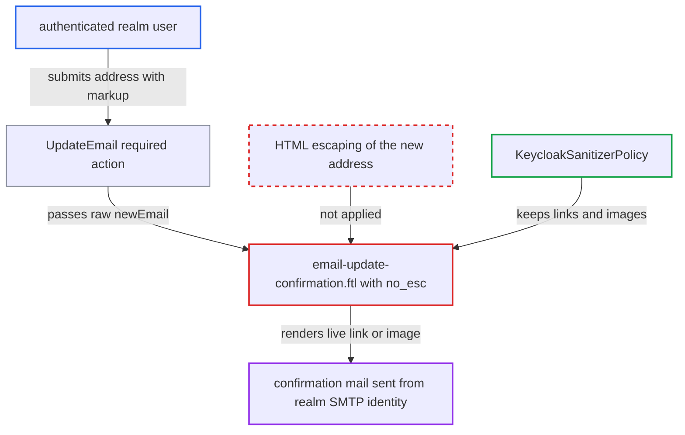

# New e-mail address with quoted local part injected as HTML into update-email confirmation mail

| Field | Value |
|---|---|
| ID | `find_01F3CqJYCexdKA5tBmy3XTtE` |
| Severity | **Low** |
| Status | open |
| CWE | CWE-116 — Improper output escaping |
| Created | 2026-10-27T21:48:55.226244Z |
| Claude Security | https://claude.ai/security/findings/find_01F3CqJYCexdKA5tBmy3XTtE |

## Description

A logged-in realm user can put a live link, image or styled text into a genuine Keycloak account-security email. Third parties see it only where the recipient domain delivers the quoted address to a real mailbox. It needs the `UPDATE_EMAIL` required action enabled and SMTP configured. The template `email-update-confirmation.ftl` emits the new address with `kcSanitize(...)?no_esc`, and the address validator allows markup characters in a quoted local part.

1. **authenticated realm user** opens `kc_action=UPDATE_EMAIL` and submits a crafted new address. The address is `"<a href=https://evil.example/x>Verify now</a>"@victim.example`, a quoted local part that contains markup. ([`services/src/main/java/org/keycloak/authentication/requiredactions/UpdateEmail.java:160-168`](https://github.com/cx-benchmark/keycloak/blob/1d7be35d0764060a8143fc74b0aabf2442743be4/services/src/main/java/org/keycloak/authentication/requiredactions/UpdateEmail.java#L160-L168))
2. **`EmailValidationUtil`** accepts the address as valid. A quoted local part of up to 64 characters may contain `<`, `>`, space, `=`, `/`, `:` and `.`, and the default user profile adds no prohibited-characters rule for `email`. ([`server-spi-private/src/main/java/org/keycloak/utils/EmailValidationUtil.java:18-28`](https://github.com/cx-benchmark/keycloak/blob/1d7be35d0764060a8143fc74b0aabf2442743be4/server-spi-private/src/main/java/org/keycloak/utils/EmailValidationUtil.java#L18-L28))
3. **`UpdateEmail`** re-reads the raw form value and passes it to `sendEmailUpdateConfirmation`. `requiredActionChallenge` also sends the confirmation for any `email` parameter in the form POST without running user-profile validation. ([`services/src/main/java/org/keycloak/authentication/requiredactions/UpdateEmail.java:189-263`](https://github.com/cx-benchmark/keycloak/blob/1d7be35d0764060a8143fc74b0aabf2442743be4/services/src/main/java/org/keycloak/authentication/requiredactions/UpdateEmail.java#L189-L263))
4. **`FreeMarkerEmailTemplateProvider`** puts `newEmail` into the template attributes and uses it as the mail's destination. The value goes in as-is, so the same string is both the recipient and the text to render. ([`services/src/main/java/org/keycloak/email/freemarker/FreeMarkerEmailTemplateProvider.java:196-205`](https://github.com/cx-benchmark/keycloak/blob/1d7be35d0764060a8143fc74b0aabf2442743be4/services/src/main/java/org/keycloak/email/freemarker/FreeMarkerEmailTemplateProvider.java#L196-L205))
5. **template `email-update-confirmation.ftl`** formats the address into `emailUpdateConfirmationBodyHtml` as argument `{1}` without HTML escaping. `MessageFormatterMethod.exec` inserts the argument verbatim, and `?no_esc` switches off the automatic escaping that would otherwise neutralise it. ([`themes/src/main/resources/theme/base/email/html/email-update-confirmation.ftl:3`](https://github.com/cx-benchmark/keycloak/blob/1d7be35d0764060a8143fc74b0aabf2442743be4/themes/src/main/resources/theme/base/email/html/email-update-confirmation.ftl#L3))
6. **`KeycloakSanitizerPolicy`** lets the injected markup through. The policy keeps `a[href]` for http, https and mailto URLs (adding `rel=nofollow`), plus `img[src]`, styling and block elements, and removes only script and event handlers. ([`services/src/main/java/org/keycloak/theme/KeycloakSanitizerPolicy.java:102-113`](https://github.com/cx-benchmark/keycloak/blob/1d7be35d0764060a8143fc74b0aabf2442743be4/services/src/main/java/org/keycloak/theme/KeycloakSanitizerPolicy.java#L102-L113))
7. **`DefaultEmailSenderProvider`** sends the mail to the quoted address from the realm's SMTP identity. The mail holds the attacker's link or image next to the real confirmation link, and the plain-text part carries the raw value but is not interpreted as HTML. ([`services/src/main/java/org/keycloak/email/DefaultEmailSenderProvider.java:80-94`](https://github.com/cx-benchmark/keycloak/blob/1d7be35d0764060a8143fc74b0aabf2442743be4/services/src/main/java/org/keycloak/email/DefaultEmailSenderProvider.java#L80-L94))

## Assessment

The attacker is any authenticated realm user, including a self-registered one where registration is open. The realm must have the `UPDATE_EMAIL` required action enabled (it is off per realm by default) and SMTP configured. The attacker submits the crafted address through `kc_action=UPDATE_EMAIL`. The same value can also be sent as an extra `email` field in the current form POST, which `requiredActionChallenge` accepts without user-profile validation. So a stricter email validator added by an admin does not reliably block it. The mail goes to the injected address itself. A third party reads it only where the recipient domain delivers that quoted local part to a real mailbox, for example through catch-all or sub-address handling, which the attacker does not control. Otherwise the attacker reaches only a mailbox they chose. The recipient then only has to open the mail.

Impact: The attacker controls a link, an image or styled text inside a genuine Keycloak-sent account-security mail, next to the real confirmation link. This allows convincing phishing, or open and IP tracking through a remote image. The 64-character local-part limit restricts the payload. The sanitizer strips script and event handlers, and no Keycloak data is read or changed.

## Recommendation

The update-email template interpolates the user-chosen address (`newEmail`) into HTML without escaping and emits it with `?no_esc`. It relies on `kcSanitize`, a rich-text allow-list meant for administrator HTML that keeps links, images and styles. The address validator legitimately admits markup characters inside a quoted local part.

Fix criteria: The new address appears in the delivered HTML only as literal text. Either user-supplied `msg` arguments are HTML-escaped before interpolation, or only the trusted bundle text goes through `kcSanitize`. To verify, submit `"<a href=https://x.example>y</a>"@d.example` through `kc_action=UPDATE_EMAIL`, and also as an extra `email` field on the login POST. The HTML part of the resulting mail must contain `&lt;a href` and no anchor or image element taken from the argument.

## Evidence

**https://github.com/cx-benchmark/keycloak**

- [`themes/src/main/resources/theme/base/email/html/email-update-confirmation.ftl:3`](https://github.com/cx-benchmark/keycloak/blob/1d7be35d0764060a8143fc74b0aabf2442743be4/themes/src/main/resources/theme/base/email/html/email-update-confirmation.ftl#L3)
- [`themes/src/main/resources/theme/base/email/messages/messages_en.properties:11`](https://github.com/cx-benchmark/keycloak/blob/1d7be35d0764060a8143fc74b0aabf2442743be4/themes/src/main/resources/theme/base/email/messages/messages_en.properties#L11)
- [`services/src/main/java/org/keycloak/theme/beans/MessageFormatterMethod.java:56-64`](https://github.com/cx-benchmark/keycloak/blob/1d7be35d0764060a8143fc74b0aabf2442743be4/services/src/main/java/org/keycloak/theme/beans/MessageFormatterMethod.java#L56-L64)
- [`server-spi-private/src/main/java/org/keycloak/utils/EmailValidationUtil.java:18-28`](https://github.com/cx-benchmark/keycloak/blob/1d7be35d0764060a8143fc74b0aabf2442743be4/server-spi-private/src/main/java/org/keycloak/utils/EmailValidationUtil.java#L18-L28)
- [`services/src/main/resources/org/keycloak/userprofile/config/keycloak-default-user-profile.json:43-48`](https://github.com/cx-benchmark/keycloak/blob/1d7be35d0764060a8143fc74b0aabf2442743be4/services/src/main/resources/org/keycloak/userprofile/config/keycloak-default-user-profile.json#L43-L48)
- [`services/src/main/java/org/keycloak/authentication/requiredactions/UpdateEmail.java:189-263`](https://github.com/cx-benchmark/keycloak/blob/1d7be35d0764060a8143fc74b0aabf2442743be4/services/src/main/java/org/keycloak/authentication/requiredactions/UpdateEmail.java#L189-L263)
- [`services/src/main/java/org/keycloak/authentication/requiredactions/UpdateEmail.java:160-168`](https://github.com/cx-benchmark/keycloak/blob/1d7be35d0764060a8143fc74b0aabf2442743be4/services/src/main/java/org/keycloak/authentication/requiredactions/UpdateEmail.java#L160-L168)
- [`services/src/main/java/org/keycloak/email/freemarker/FreeMarkerEmailTemplateProvider.java:196-205`](https://github.com/cx-benchmark/keycloak/blob/1d7be35d0764060a8143fc74b0aabf2442743be4/services/src/main/java/org/keycloak/email/freemarker/FreeMarkerEmailTemplateProvider.java#L196-L205)
- [`services/src/main/java/org/keycloak/theme/freemarker/DefaultFreeMarkerProvider.java:61-65`](https://github.com/cx-benchmark/keycloak/blob/1d7be35d0764060a8143fc74b0aabf2442743be4/services/src/main/java/org/keycloak/theme/freemarker/DefaultFreeMarkerProvider.java#L61-L65)
- [`services/src/main/java/org/keycloak/theme/KeycloakSanitizerPolicy.java:102-113`](https://github.com/cx-benchmark/keycloak/blob/1d7be35d0764060a8143fc74b0aabf2442743be4/services/src/main/java/org/keycloak/theme/KeycloakSanitizerPolicy.java#L102-L113)
- [`services/src/main/java/org/keycloak/email/DefaultEmailSenderProvider.java:80-94`](https://github.com/cx-benchmark/keycloak/blob/1d7be35d0764060a8143fc74b0aabf2442743be4/services/src/main/java/org/keycloak/email/DefaultEmailSenderProvider.java#L80-L94)

