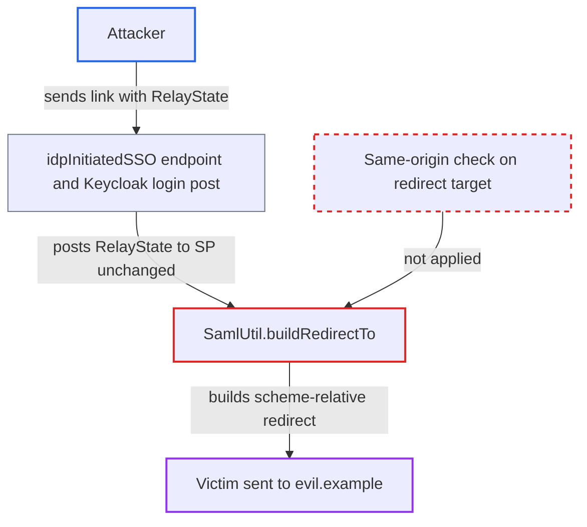

# Open redirect after SAML login via redirectTo in RelayState for root-context deployments

| Field | Value |
|---|---|
| ID | `find_01RrfKsw8hu8zvisDXF5jFoX` |
| Severity | **Low** |
| Status | open |
| CWE | CWE-601 — Open Redirect |
| Created | 2026-10-27T22:20:06.371706Z |
| Claude Security | https://claude.ai/security/findings/find_01RrfKsw8hu8zvisDXF5jFoX |

## Description

An attacker can send a victim to a site of the attacker's choosing right after the victim logs in to a SAML application. The victim lands on a page that can imitate the application, for phishing. It works only when the application runs at the root context, IdP-initiated SSO is enabled for the client, and the victim's session holds no saved redirect. The cause is `SamlUtil.buildRedirectTo`, which builds the redirect target from `RelayState` without checking the origin.

1. **Attacker** sends the victim a link to the IdP-initiated SSO URL of the SP client. The link carries `RelayState=redirectTo%3D%2F%2Fevil.example` in its query string, and the attacker needs no login. ([`services/src/main/java/org/keycloak/protocol/saml/SamlService.java:1146-1150`](https://github.com/cx-benchmark/keycloak/blob/1d7be35d0764060a8143fc74b0aabf2442743be4/services/src/main/java/org/keycloak/protocol/saml/SamlService.java#L1146-L1150))
2. **Keycloak endpoint `idpInitiatedSSO`** stores the link's `RelayState` in the auth session. The value is saved unvalidated as a client note, after the victim logs in or when an existing SSO session is reused. ([`services/src/main/java/org/keycloak/protocol/saml/SamlService.java:1146-1150`](https://github.com/cx-benchmark/keycloak/blob/1d7be35d0764060a8143fc74b0aabf2442743be4/services/src/main/java/org/keycloak/protocol/saml/SamlService.java#L1146-L1150))
3. **Keycloak** auto-posts the login Response and `RelayState` to the SP's `/saml` endpoint. `RelayState` is not covered by the POST-binding signature, so the attacker's value passes unchanged. ([`adapters/saml/wildfly-elytron/src/main/java/org/keycloak/adapters/saml/elytron/KeycloakHttpServerAuthenticationMechanism.java:96-106`](https://github.com/cx-benchmark/keycloak/blob/1d7be35d0764060a8143fc74b0aabf2442743be4/adapters/saml/wildfly-elytron/src/main/java/org/keycloak/adapters/saml/elytron/KeycloakHttpServerAuthenticationMechanism.java#L96-L106))
4. **`ElytronSamlSessionStore.getRedirectUri()`** computes the redirect base from the request path alone. No `SAML_REDIRECT_URI` was saved, because the login was IdP-initiated. For a root-context application `contextPath` and `baseUri` are both an empty string. ([`adapters/saml/wildfly-elytron/src/main/java/org/keycloak/adapters/saml/elytron/ElytronSamlSessionStore.java:188-205`](https://github.com/cx-benchmark/keycloak/blob/1d7be35d0764060a8143fc74b0aabf2442743be4/adapters/saml/wildfly-elytron/src/main/java/org/keycloak/adapters/saml/elytron/ElytronSamlSessionStore.java#L188-L205))
5. **`SamlUtil.buildRedirectTo`** returns `//evil.example` as the target. It removes one leading `/` and returns `baseUri + "/" + target`. With an empty base this is a scheme-relative URL that browsers send to the attacker's host. `/\evil.example` behaves the same way. ([`adapters/saml/core/src/main/java/org/keycloak/adapters/saml/SamlUtil.java:70-97`](https://github.com/cx-benchmark/keycloak/blob/1d7be35d0764060a8143fc74b0aabf2442743be4/adapters/saml/core/src/main/java/org/keycloak/adapters/saml/SamlUtil.java#L70-L97))
6. **`AbstractSamlAuthenticationHandler.handleLoginResponse()`** sends a 302 with the computed value as the `Location` header. This happens right after `saveAccount`, so the victim is logged in and then moved to the attacker's site. ([`adapters/saml/core/src/main/java/org/keycloak/adapters/saml/profile/AbstractSamlAuthenticationHandler.java:507-513`](https://github.com/cx-benchmark/keycloak/blob/1d7be35d0764060a8143fc74b0aabf2442743be4/adapters/saml/core/src/main/java/org/keycloak/adapters/saml/profile/AbstractSamlAuthenticationHandler.java#L507-L513))

## Assessment

The attacker needs no account. They only need the victim to open a crafted link to the IdP-initiated SSO URL of the SP client, `/realms/{realm}/protocol/saml/clients/{name}?RelayState=redirectTo%3D%2F%2Fevil.example`. The attack works only if the SP is deployed at the root context, IdP-initiated SSO is enabled for the client, and the victim's SP session holds no saved redirect. The `redirectTo` value can come from the `RelayState` parameter or from a `redirectTo` query parameter. Under a non-root context the same input becomes `/app//evil.example`, which stays on the site.

Impact: The victim, now logged in to the SP, is redirected from the trusted SP origin to a site the attacker picks. That site can impersonate the application for phishing. The redirect itself discloses no SP data or session identifier, and the harm is limited to misdirecting the user.

## Recommendation

`SamlUtil.buildRedirectTo` assumes that prefixing with `baseUri` keeps the target on the site. With an empty `baseUri` (root context) and a target that starts with `//` or `/\`, the result is a scheme-relative URL. `getRedirectTo` does no origin validation of the attacker-controlled `redirectTo`.

Fix criteria: The post-login redirect target always resolves to the application's own origin. Targets whose first path segment is empty or that contain a backslash are rejected or normalised. Alternatively, the redirect is computed against an absolute base with scheme and host, and the result's origin is verified. Test: IdP-initiated login with `RelayState=redirectTo=//evil.example` and with `redirectTo=/\evil.example` on a root-context deployment redirects within the application.

## Evidence

**https://github.com/cx-benchmark/keycloak**

- [`adapters/saml/core/src/main/java/org/keycloak/adapters/saml/SamlUtil.java:70-97`](https://github.com/cx-benchmark/keycloak/blob/1d7be35d0764060a8143fc74b0aabf2442743be4/adapters/saml/core/src/main/java/org/keycloak/adapters/saml/SamlUtil.java#L70-L97)
- [`adapters/saml/wildfly-elytron/src/main/java/org/keycloak/adapters/saml/elytron/ElytronSamlSessionStore.java:188-205`](https://github.com/cx-benchmark/keycloak/blob/1d7be35d0764060a8143fc74b0aabf2442743be4/adapters/saml/wildfly-elytron/src/main/java/org/keycloak/adapters/saml/elytron/ElytronSamlSessionStore.java#L188-L205)
- [`adapters/saml/core/src/main/java/org/keycloak/adapters/saml/profile/AbstractSamlAuthenticationHandler.java:507-513`](https://github.com/cx-benchmark/keycloak/blob/1d7be35d0764060a8143fc74b0aabf2442743be4/adapters/saml/core/src/main/java/org/keycloak/adapters/saml/profile/AbstractSamlAuthenticationHandler.java#L507-L513)
- [`adapters/saml/wildfly-elytron/src/main/java/org/keycloak/adapters/saml/elytron/KeycloakHttpServerAuthenticationMechanism.java:96-106`](https://github.com/cx-benchmark/keycloak/blob/1d7be35d0764060a8143fc74b0aabf2442743be4/adapters/saml/wildfly-elytron/src/main/java/org/keycloak/adapters/saml/elytron/KeycloakHttpServerAuthenticationMechanism.java#L96-L106)
- [`services/src/main/java/org/keycloak/protocol/saml/SamlService.java:1146-1150`](https://github.com/cx-benchmark/keycloak/blob/1d7be35d0764060a8143fc74b0aabf2442743be4/services/src/main/java/org/keycloak/protocol/saml/SamlService.java#L1146-L1150)

