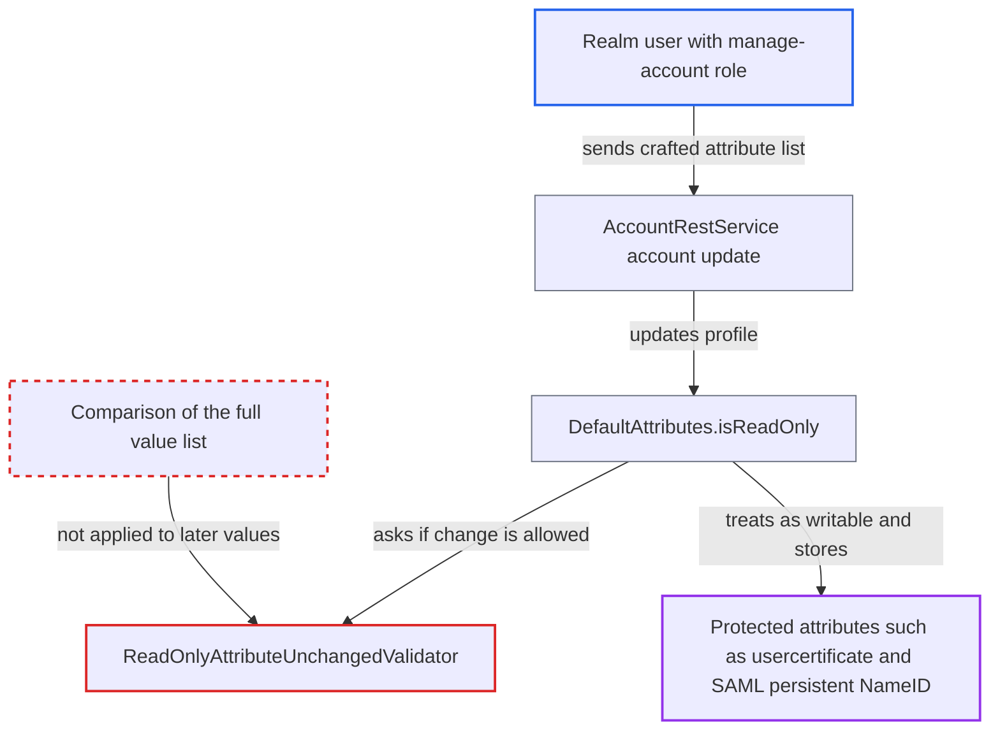

# Read-only attribute guard checks only the first value, letting users write protected attributes

| Field | Value |
|---|---|
| ID | `find_01AwgoPdzNK4JhUvtwadPW9g` |
| Severity | **Low** |
| Status | open |
| CWE | CWE-1023 — Incomplete comparison |
| Created | 2026-10-27T21:30:28.473451Z |
| Claude Security | https://claude.ai/security/findings/find_01AwgoPdzNK4JhUvtwadPW9g |

## Description

A logged-in realm user can write to attributes that are documented as always read-only, such as `usercertificate` and `saml.persistent.name.id.for.*`. This works only when the realm's `unmanagedAttributePolicy` is `ENABLED`. Realm upgrades from before version 24 set that policy. The cause is `ReadOnlyAttributeUnchangedValidator`, which compares only the first submitted value, so extra values or a blank-first list get through.

1. **Realm user** sends POST /realms/{r}/account with a crafted attribute list. The list is either `[<current>, <extra>]` or `["", <value>]` for a protected name such as `usercertificate` or `saml.persistent.name.id.for.<sp>`; the default `manage-account` role is enough. ([`services/src/main/java/org/keycloak/services/resources/account/AccountRestService.java:157-167`](https://github.com/cx-benchmark/keycloak/blob/1d7be35d0764060a8143fc74b0aabf2442743be4/services/src/main/java/org/keycloak/services/resources/account/AccountRestService.java#L157-L167))
2. **`normalizeAttributes()`** keeps the submitted list as an unmanaged attribute. Only nulls are dropped, so blanks and extra values stay in the list when the policy is `ENABLED`. ([`server-spi-private/src/main/java/org/keycloak/userprofile/DefaultAttributes.java:404-415`](https://github.com/cx-benchmark/keycloak/blob/1d7be35d0764060a8143fc74b0aabf2442743be4/server-spi-private/src/main/java/org/keycloak/userprofile/DefaultAttributes.java#L404-L415))
3. **`isReadOnlyInternalAttribute()`** runs `ReadOnlyAttributeUnchangedValidator` on the submitted values. The validator compares only `values.get(0)` with `user.getFirstAttribute(key)`, and accepts a blank first element when nothing is stored, so the change is judged as no change. ([`services/src/main/java/org/keycloak/userprofile/validator/ReadOnlyAttributeUnchangedValidator.java:77-100`](https://github.com/cx-benchmark/keycloak/blob/1d7be35d0764060a8143fc74b0aabf2442743be4/services/src/main/java/org/keycloak/userprofile/validator/ReadOnlyAttributeUnchangedValidator.java#L77-L100))
4. **`isReadOnly()`** falls back to the unmanaged-attribute rule. The protected names are not in the user profile config, and with `unmanagedAttributePolicy` set to `ENABLED` such a name counts as writable. ([`server-spi-private/src/main/java/org/keycloak/userprofile/DefaultAttributes.java:96-109`](https://github.com/cx-benchmark/keycloak/blob/1d7be35d0764060a8143fc74b0aabf2442743be4/server-spi-private/src/main/java/org/keycloak/userprofile/DefaultAttributes.java#L96-L109))
5. **`getWritable()`** keeps the protected attribute in the set to update. It keeps every attribute for which `isReadOnly()` is false. ([`server-spi-private/src/main/java/org/keycloak/userprofile/DefaultAttributes.java:254-268`](https://github.com/cx-benchmark/keycloak/blob/1d7be35d0764060a8143fc74b0aabf2442743be4/server-spi-private/src/main/java/org/keycloak/userprofile/DefaultAttributes.java#L254-L268))
6. **`updateInternal()`** stores the list with blanks removed. `[current, extra]` is saved as two values, and `["", V]` is saved as the single value `V`. ([`server-spi-private/src/main/java/org/keycloak/userprofile/DefaultUserProfile.java:129-149`](https://github.com/cx-benchmark/keycloak/blob/1d7be35d0764060a8143fc74b0aabf2442743be4/server-spi-private/src/main/java/org/keycloak/userprofile/DefaultUserProfile.java#L129-L149))
7. **Consumer features** trust the attacker-written value. The X.509 custom-attribute mapper fails with `ModelDuplicateException` when two users match, and the SAML persistent NameID code reads `saml.persistent.name.id.for.<clientId>` or the wildcard. ([`services/src/main/java/org/keycloak/authentication/authenticators/x509/UserIdentityToModelMapper.java:60-76`](https://github.com/cx-benchmark/keycloak/blob/1d7be35d0764060a8143fc74b0aabf2442743be4/services/src/main/java/org/keycloak/authentication/authenticators/x509/UserIdentityToModelMapper.java#L60-L76))

## Assessment

The attacker is any realm user with the default `manage-account` role. The realm must have `unmanagedAttributePolicy` set to `ENABLED`. Realms upgraded from a version before 24 without the declarative user profile get this setting from `MigrateTo24_0_0`. The attacker can append values to an attribute they already hold, or set a value when they hold none. No victim action is needed. The effect also needs a consumer feature: X.509 custom-attribute mapping, or a SAML service provider that uses a persistent NameID. Operator-configured `read-only-attributes` can be bypassed the same way.

Impact: The attacker can write identity-mapping attributes that users should never change. One demonstrated effect is blocking a chosen victim's X.509 certificate login, because two users then match and `ModelDuplicateException` is thrown. The attacker can also choose the persistent NameID that Keycloak signs for a SAML service provider. Impersonation there needs the victim's NameID, which the code does not give the attacker, so this is limited. The attacker cannot read data. Users from LDAP or Kerberos whose storage provider marks attributes read-only are protected separately. Realms with the `DISABLED` or `ADMIN_EDIT` policy are not affected through this path.

## Recommendation

(1) `ReadOnlyAttributeUnchangedValidator` looks only at the first submitted value. Extra values after it are ignored, and a blank first value passes when nothing is stored. `DefaultAttributes.isReadOnlyInternalAttribute()` reuses this check, so the same gap decides writability.

Fix criteria: The guard compares the whole submitted value list, ignoring blanks, with the whole stored list and rejects any difference. That includes extra values and any non-blank value when nothing is stored. With `unmanagedAttributePolicy: ENABLED`, submitting `[<current>, <extra>]` or `["", <value>]` for `usercertificate` or `saml.persistent.name.id.for.x` through `POST /realms/{r}/account` fails with `updateReadOnlyAttributesRejectedMessage`. The stored attribute does not change.

(2) `DefaultAttributes.isReadOnly()` lets the unmanaged-attribute policy decide writability for built-in internal attribute names whenever the value-dependent internal check passes. The read-only status of protected names therefore depends on the submitted values.

Fix criteria: Attribute names matching the built-in or configured read-only patterns are reported read-only in end-user contexts, whatever the submitted values and the unmanaged-attribute policy are. `getWritable()` never returns them for ACCOUNT, UPDATE_PROFILE, REGISTRATION or IDP_REVIEW.

## Evidence

**https://github.com/cx-benchmark/keycloak**

- [`services/src/main/java/org/keycloak/userprofile/validator/ReadOnlyAttributeUnchangedValidator.java:77-100`](https://github.com/cx-benchmark/keycloak/blob/1d7be35d0764060a8143fc74b0aabf2442743be4/services/src/main/java/org/keycloak/userprofile/validator/ReadOnlyAttributeUnchangedValidator.java#L77-L100)
- [`server-spi-private/src/main/java/org/keycloak/userprofile/DefaultAttributes.java:556-575`](https://github.com/cx-benchmark/keycloak/blob/1d7be35d0764060a8143fc74b0aabf2442743be4/server-spi-private/src/main/java/org/keycloak/userprofile/DefaultAttributes.java#L556-L575)
- [`server-spi-private/src/main/java/org/keycloak/userprofile/DefaultAttributes.java:96-109`](https://github.com/cx-benchmark/keycloak/blob/1d7be35d0764060a8143fc74b0aabf2442743be4/server-spi-private/src/main/java/org/keycloak/userprofile/DefaultAttributes.java#L96-L109)
- [`server-spi-private/src/main/java/org/keycloak/userprofile/DefaultAttributes.java:404-415`](https://github.com/cx-benchmark/keycloak/blob/1d7be35d0764060a8143fc74b0aabf2442743be4/server-spi-private/src/main/java/org/keycloak/userprofile/DefaultAttributes.java#L404-L415)
- [`server-spi-private/src/main/java/org/keycloak/userprofile/DefaultAttributes.java:254-268`](https://github.com/cx-benchmark/keycloak/blob/1d7be35d0764060a8143fc74b0aabf2442743be4/server-spi-private/src/main/java/org/keycloak/userprofile/DefaultAttributes.java#L254-L268)
- [`server-spi-private/src/main/java/org/keycloak/userprofile/DefaultUserProfile.java:129-149`](https://github.com/cx-benchmark/keycloak/blob/1d7be35d0764060a8143fc74b0aabf2442743be4/server-spi-private/src/main/java/org/keycloak/userprofile/DefaultUserProfile.java#L129-L149)
- [`services/src/main/java/org/keycloak/services/resources/account/AccountRestService.java:157-167`](https://github.com/cx-benchmark/keycloak/blob/1d7be35d0764060a8143fc74b0aabf2442743be4/services/src/main/java/org/keycloak/services/resources/account/AccountRestService.java#L157-L167)
- [`services/src/main/java/org/keycloak/userprofile/DeclarativeUserProfileProviderFactory.java:103`](https://github.com/cx-benchmark/keycloak/blob/1d7be35d0764060a8143fc74b0aabf2442743be4/services/src/main/java/org/keycloak/userprofile/DeclarativeUserProfileProviderFactory.java#L103)
- [`model/storage-private/src/main/java/org/keycloak/migration/migrators/MigrateTo24_0_0.java:63-74`](https://github.com/cx-benchmark/keycloak/blob/1d7be35d0764060a8143fc74b0aabf2442743be4/model/storage-private/src/main/java/org/keycloak/migration/migrators/MigrateTo24_0_0.java#L63-L74)
- [`services/src/main/java/org/keycloak/authentication/authenticators/x509/UserIdentityToModelMapper.java:60-76`](https://github.com/cx-benchmark/keycloak/blob/1d7be35d0764060a8143fc74b0aabf2442743be4/services/src/main/java/org/keycloak/authentication/authenticators/x509/UserIdentityToModelMapper.java#L60-L76)
- [`services/src/main/java/org/keycloak/protocol/saml/SamlProtocol.java:463-482`](https://github.com/cx-benchmark/keycloak/blob/1d7be35d0764060a8143fc74b0aabf2442743be4/services/src/main/java/org/keycloak/protocol/saml/SamlProtocol.java#L463-L482)
- [`docs/documentation/server_admin/topics/threat/read-only-attributes.adoc:26-28`](https://github.com/cx-benchmark/keycloak/blob/1d7be35d0764060a8143fc74b0aabf2442743be4/docs/documentation/server_admin/topics/threat/read-only-attributes.adoc#L26-L28)

