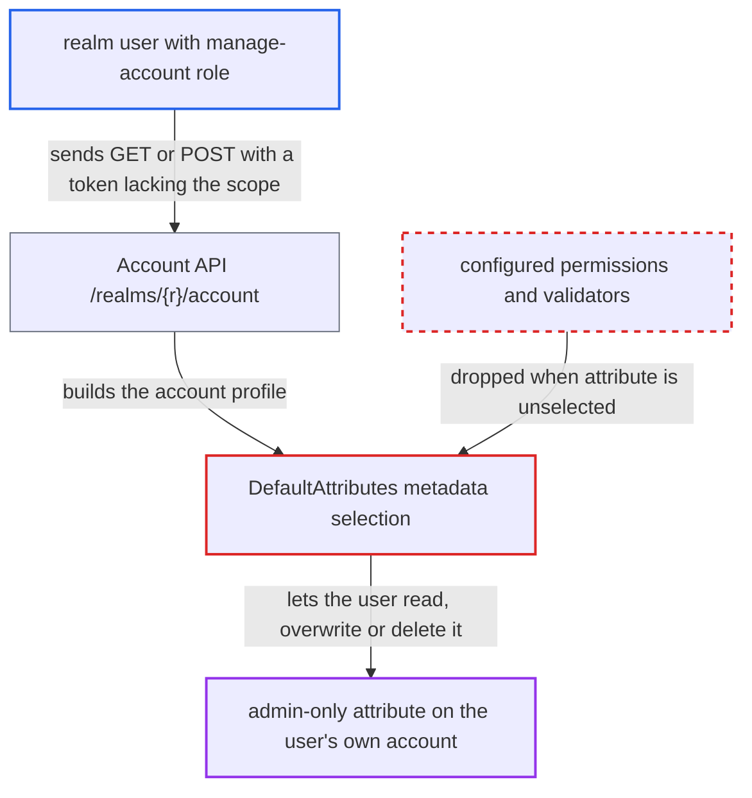

# Scope-unselected user-profile attributes are treated as unmanaged, bypassing admin-only permissions

| Field | Value |
|---|---|
| ID | `find_01QZyV7onRgssR1iWUNyjdhP` |
| Severity | **Low** |
| Status | open |
| CWE | CWE-863 — Incorrect Authorization |
| Created | 2026-10-27T21:27:48.319575Z |
| Claude Security | https://claude.ai/security/findings/find_01QZyV7onRgssR1iWUNyjdhP |

## Description

A normal realm user can read, overwrite or delete an attribute that the admin made admin-only, but only on their own account. It needs `unmanagedAttributePolicy: ENABLED` and an attribute with `selector.scopes` and admin-only `permissions`. `DefaultAttributes` drops an attribute whose scope is not in the caller's token and then treats it as unmanaged, so its configured permissions and validators never run.

1. **realm user** gets an access token that lacks the selector scope. The token comes from `account-console` or from any client whose tokens carry the `account` audience, and the user does not request the scope the attribute is selected by. ([`services/src/main/java/org/keycloak/services/resources/account/AccountLoader.java:117-140`](https://github.com/cx-benchmark/keycloak/blob/1d7be35d0764060a8143fc74b0aabf2442743be4/services/src/main/java/org/keycloak/services/resources/account/AccountLoader.java#L117-L140))
2. **realm user** calls `GET` or `POST` on `/realms/{r}/account`. The user needs only the `manage-account` role, and the submitted attribute names and values go to the `ACCOUNT` profile. ([`services/src/main/java/org/keycloak/services/resources/account/AccountRestService.java:157-167`](https://github.com/cx-benchmark/keycloak/blob/1d7be35d0764060a8143fc74b0aabf2442743be4/services/src/main/java/org/keycloak/services/resources/account/AccountRestService.java#L157-L167))
3. **the selector `requestedScopePredicate`** decides the attribute is not selected. It checks the `scope` claim and the `azp` client of the caller's own token, and the token does not carry the configured scope. ([`services/src/main/java/org/keycloak/userprofile/DeclarativeUserProfileProvider.java:80-93`](https://github.com/cx-benchmark/keycloak/blob/1d7be35d0764060a8143fc74b0aabf2442743be4/services/src/main/java/org/keycloak/userprofile/DeclarativeUserProfileProvider.java#L80-L93))
4. **`configureMetadata()` in `DefaultAttributes`** leaves the attribute out of `metadataByAttribute`. Only metadata whose selector matches is kept, so the `writeAllowed` and `readAllowed` predicates and validators such as `ImmutableAttributeValidator` are dropped with it. ([`server-spi-private/src/main/java/org/keycloak/userprofile/DefaultAttributes.java:339-352`](https://github.com/cx-benchmark/keycloak/blob/1d7be35d0764060a8143fc74b0aabf2442743be4/server-spi-private/src/main/java/org/keycloak/userprofile/DefaultAttributes.java#L339-L352))
5. **`normalizeAttributes()` and `isReadOnly()` in `DefaultAttributes`** treat the attribute as an unmanaged one. Under `ENABLED` the value is stored in `unmanagedAttributes`, merged into the profile and considered writable, and `createUnmanagedAttributeMetadata()` also allows viewing it. ([`server-spi-private/src/main/java/org/keycloak/userprofile/DefaultAttributes.java:396-410`](https://github.com/cx-benchmark/keycloak/blob/1d7be35d0764060a8143fc74b0aabf2442743be4/server-spi-private/src/main/java/org/keycloak/userprofile/DefaultAttributes.java#L396-L410))
6. **`updateInternal()` in `DefaultUserProfile`** writes the supplied value with `user.setAttribute()` or removes the attribute. A request that leaves the attribute out deletes it, because `update()` removes missing attributes by default. ([`server-spi-private/src/main/java/org/keycloak/userprofile/DefaultUserProfile.java:129-190`](https://github.com/cx-benchmark/keycloak/blob/1d7be35d0764060a8143fc74b0aabf2442743be4/server-spi-private/src/main/java/org/keycloak/userprofile/DefaultUserProfile.java#L129-L190))

## Assessment

The attacker is an ordinary realm user with the default `manage-account` role, and no victim is involved. The attacker uses an access token from `account-console`, or from any client whose tokens carry the `account` audience, that does not carry the scope named in the attribute's `selector.scopes`. Two realm settings must hold: `unmanagedAttributePolicy: ENABLED` and a non-built-in attribute with `selector.scopes` and restricted `permissions`. `ENABLED` is also what `MigrateTo24_0_0` writes for every realm upgraded without the preview declarative profile. The attacker calls `GET /realms/{r}/account` to read the attribute, or `POST` to set a new value. Posting without the attribute deletes it.

Impact: The user can read attributes the admin limited to administrators, and can set or delete attributes marked admin-edit-only. This works only on the user's own record. Only the generic 2048-character length check still applies to the value.

## Recommendation

`DefaultAttributes` treats an attribute that is not selected for the current request as if it were not defined in the user-profile configuration. A configured attribute then falls under the permissive unmanaged-attribute rules (view and edit under `ENABLED`, plus removal) instead of its configured `permissions` and validators.

Fix criteria: An attribute defined in the realm user-profile configuration is never classified as unmanaged, whatever its selector evaluates to. When it is unselected, user-context reads do not return it, and writes or omissions neither change nor remove it. Test with `unmanagedAttributePolicy: ENABLED` and an attribute with `selector.scopes:["x"]` and `permissions.edit/view:["admin"]`. Call `GET` and `POST` on `/realms/{r}/account` with a token lacking `x`. The attribute is not returned, a POST that sets it is rejected or ignored, and a POST that omits it leaves the stored value intact.

## Evidence

**https://github.com/cx-benchmark/keycloak**

- [`server-spi-private/src/main/java/org/keycloak/userprofile/DefaultAttributes.java:339-352`](https://github.com/cx-benchmark/keycloak/blob/1d7be35d0764060a8143fc74b0aabf2442743be4/server-spi-private/src/main/java/org/keycloak/userprofile/DefaultAttributes.java#L339-L352)
- [`server-spi-private/src/main/java/org/keycloak/userprofile/DefaultAttributes.java:396-410`](https://github.com/cx-benchmark/keycloak/blob/1d7be35d0764060a8143fc74b0aabf2442743be4/server-spi-private/src/main/java/org/keycloak/userprofile/DefaultAttributes.java#L396-L410)
- [`server-spi-private/src/main/java/org/keycloak/userprofile/DefaultAttributes.java:96-133`](https://github.com/cx-benchmark/keycloak/blob/1d7be35d0764060a8143fc74b0aabf2442743be4/server-spi-private/src/main/java/org/keycloak/userprofile/DefaultAttributes.java#L96-L133)
- [`server-spi-private/src/main/java/org/keycloak/userprofile/DefaultAttributes.java:599-612`](https://github.com/cx-benchmark/keycloak/blob/1d7be35d0764060a8143fc74b0aabf2442743be4/server-spi-private/src/main/java/org/keycloak/userprofile/DefaultAttributes.java#L599-L612)
- [`services/src/main/java/org/keycloak/userprofile/DeclarativeUserProfileProvider.java:342-348`](https://github.com/cx-benchmark/keycloak/blob/1d7be35d0764060a8143fc74b0aabf2442743be4/services/src/main/java/org/keycloak/userprofile/DeclarativeUserProfileProvider.java#L342-L348)
- [`services/src/main/java/org/keycloak/userprofile/DeclarativeUserProfileProvider.java:80-93`](https://github.com/cx-benchmark/keycloak/blob/1d7be35d0764060a8143fc74b0aabf2442743be4/services/src/main/java/org/keycloak/userprofile/DeclarativeUserProfileProvider.java#L80-L93)
- [`services/src/main/java/org/keycloak/userprofile/DeclarativeUserProfileProvider.java:322-363`](https://github.com/cx-benchmark/keycloak/blob/1d7be35d0764060a8143fc74b0aabf2442743be4/services/src/main/java/org/keycloak/userprofile/DeclarativeUserProfileProvider.java#L322-L363)
- [`services/src/main/java/org/keycloak/services/managers/AuthenticationManager.java:1806-1816`](https://github.com/cx-benchmark/keycloak/blob/1d7be35d0764060a8143fc74b0aabf2442743be4/services/src/main/java/org/keycloak/services/managers/AuthenticationManager.java#L1806-L1816)
- [`services/src/main/java/org/keycloak/protocol/oidc/TokenManager.java:610-640`](https://github.com/cx-benchmark/keycloak/blob/1d7be35d0764060a8143fc74b0aabf2442743be4/services/src/main/java/org/keycloak/protocol/oidc/TokenManager.java#L610-L640)
- [`services/src/main/java/org/keycloak/services/resources/account/AccountLoader.java:117-140`](https://github.com/cx-benchmark/keycloak/blob/1d7be35d0764060a8143fc74b0aabf2442743be4/services/src/main/java/org/keycloak/services/resources/account/AccountLoader.java#L117-L140)
- [`services/src/main/java/org/keycloak/services/resources/account/AccountRestService.java:157-167`](https://github.com/cx-benchmark/keycloak/blob/1d7be35d0764060a8143fc74b0aabf2442743be4/services/src/main/java/org/keycloak/services/resources/account/AccountRestService.java#L157-L167)
- [`server-spi-private/src/main/java/org/keycloak/userprofile/DefaultUserProfile.java:129-190`](https://github.com/cx-benchmark/keycloak/blob/1d7be35d0764060a8143fc74b0aabf2442743be4/server-spi-private/src/main/java/org/keycloak/userprofile/DefaultUserProfile.java#L129-L190)
- [`model/storage-private/src/main/java/org/keycloak/migration/migrators/MigrateTo24_0_0.java:69-74`](https://github.com/cx-benchmark/keycloak/blob/1d7be35d0764060a8143fc74b0aabf2442743be4/model/storage-private/src/main/java/org/keycloak/migration/migrators/MigrateTo24_0_0.java#L69-L74)

