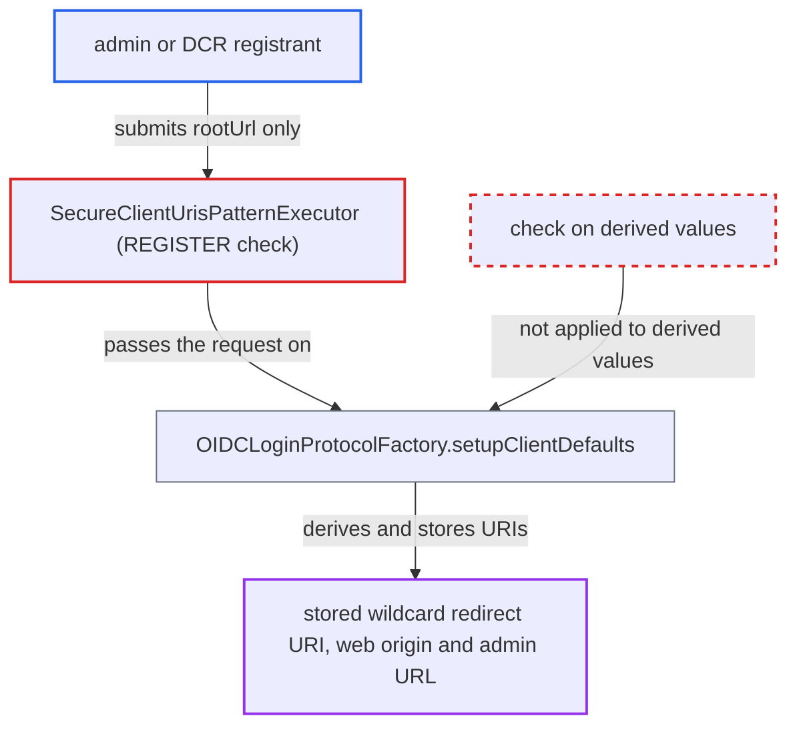

# secure-client-uris-pattern bypassed by redirect URI, web origin and admin URL derived from rootUrl

| Field | Value |
|---|---|
| ID | `find_01Ncd3p1zT1Mzub9Z7q5XXEM` |
| Severity | **Low** |
| Status | open |
| CWE | CWE-179 — Early validation |
| Created | 2026-10-27T21:54:26.268497Z |
| Claude Security | https://claude.ai/security/findings/find_01Ncd3p1zT1Mzub9Z7q5XXEM |

## Description

An admin with client-creation rights, or a dynamic client registration (DCR) caller with an initial access token, can create a client whose stored redirect URI, web origin and admin URL were never checked against the realm's `secure-client-uris-pattern` allow-list. If `rootUrl` is not a configured field, the redirect host and admin URL are attacker-chosen. Users who authorize that client can then have their authorization codes sent to the attacker. The cause is that `SecureClientUrisPatternExecutor` checks only the submitted representation on `REGISTER`, and `setupClientDefaults` derives the other URIs afterwards.

1. **attacker** sends a create-client request with a `rootUrl` and no `redirectUris` or `adminUrl`. The admin path goes through `ClientsResource`. The DCR path goes through `ClientRegistrationAuth` and accepts `rootUrl` directly. ([`services/src/main/java/org/keycloak/services/clientregistration/ClientRegistrationAuth.java:161-187`](https://github.com/cx-benchmark/keycloak/blob/1d7be35d0764060a8143fc74b0aabf2442743be4/services/src/main/java/org/keycloak/services/clientregistration/ClientRegistrationAuth.java#L161-L187))
2. **the `REGISTER` policy event** fires before the client model is built. Both creation paths fire it on the submitted representation, before `ClientManager.createClient` runs. ([`services/src/main/java/org/keycloak/services/resources/admin/ClientsResource.java:219-230`](https://github.com/cx-benchmark/keycloak/blob/1d7be35d0764060a8143fc74b0aabf2442743be4/services/src/main/java/org/keycloak/services/resources/admin/ClientsResource.java#L219-L230))
3. **the executor `SecureClientUrisPatternExecutor`** validates only the fields present in the representation. `validateClientUris` skips null or empty fields, so only `rootUrl` is checked, or nothing if `rootUrl` is not a configured field. It has no `REGISTERED` or later handler. ([`services/src/main/java/org/keycloak/services/clientpolicy/executor/SecureClientUrisPatternExecutor.java:148-160`](https://github.com/cx-benchmark/keycloak/blob/1d7be35d0764060a8143fc74b0aabf2442743be4/services/src/main/java/org/keycloak/services/clientpolicy/executor/SecureClientUrisPatternExecutor.java#L148-L160))
4. **`ClientManager.createClient`** calls `setupClientDefaults` after the policy check has passed. The model is built only after the `REGISTER` event has already passed. ([`services/src/main/java/org/keycloak/services/managers/ClientManager.java:82-90`](https://github.com/cx-benchmark/keycloak/blob/1d7be35d0764060a8143fc74b0aabf2442743be4/services/src/main/java/org/keycloak/services/managers/ClientManager.java#L82-L90))
5. **`OIDCLoginProtocolFactory.setupClientDefaults`** derives and stores a redirect URI, a web origin and a management URL from `rootUrl`. It stores `rootUrl + "/*"` as a redirect URI and the origin of `rootUrl` as the web origin. When `adminUrl` is absent it copies `rootUrl` into the management URL. None of these values goes through the allow-list. ([`services/src/main/java/org/keycloak/protocol/oidc/OIDCLoginProtocolFactory.java:733-760`](https://github.com/cx-benchmark/keycloak/blob/1d7be35d0764060a8143fc74b0aabf2442743be4/services/src/main/java/org/keycloak/protocol/oidc/OIDCLoginProtocolFactory.java#L733-L760))
6. **attacker** lures a realm user into authorizing the client with a `redirect_uri` under the stored prefix. The wildcard redirect URI is honoured, so the authorization code is delivered to the attacker-chosen location.

## Assessment

The attacker is a `manage-clients` or `create-client` admin, or a DCR registrant holding an initial access token. The realm must apply a policy with `secure-client-uris-pattern`. The attacker creates an `openid-connect` client with a `rootUrl` and no `redirectUris` or `adminUrl`. With the default field list, `rootUrl` is itself validated, so the derived values stay on an allow-listed host. A pattern set that admits `rootUrl` but rejects wildcards or other paths (for example an exact-path pattern, or one excluding `*`) still ends up with a prefix wildcard redirect URI and a bare-origin web origin. If the operator selects specific fields and omits `rootUrl` (for example `redirectUris`, `webOrigins` or `adminUrl`), the derived values are wholly attacker-chosen. The attack then also needs a realm user to be lured into authorizing the client.

Impact: The operator's URI allow-list is defeated for clients the attacker creates. When `rootUrl` is not a validated field, authorization codes for lured users reach the attacker's host. Keycloak also sends admin callbacks such as `k_logout` to an attacker-chosen management URL, which is the server-side-request target the executor is documented to protect. The impact is limited to the attacker's own client and the users who authorize it.

## Recommendation

`SecureClientUrisPatternExecutor` validates only the proposed representation on `REGISTER`. `ClientManager.createClient` then calls `OIDCLoginProtocolFactory.setupClientDefaults`, which derives a redirect URI, a web origin and a management URL from `rootUrl` that the allow-list never checks.

Fix criteria: Every redirect URI, web origin and admin URL stored on a newly created client is subject to the configured patterns, whether it was submitted or derived. Under a pattern policy that admits `https://app.example.com/callback` but no wildcard, creating a client with that `rootUrl` and no `redirectUris` either fails or stores no `/*` redirect URI. With `redirectUris` and `adminUrl` as the only configured fields, a client with `rootUrl=https://evil.example` does not end up with an `https://evil.example/*` redirect URI or an evil management URL.

## Evidence

**https://github.com/cx-benchmark/keycloak**

- [`services/src/main/java/org/keycloak/services/clientpolicy/executor/SecureClientUrisPatternExecutor.java:126-146`](https://github.com/cx-benchmark/keycloak/blob/1d7be35d0764060a8143fc74b0aabf2442743be4/services/src/main/java/org/keycloak/services/clientpolicy/executor/SecureClientUrisPatternExecutor.java#L126-L146)
- [`services/src/main/java/org/keycloak/services/clientpolicy/executor/SecureClientUrisPatternExecutor.java:148-160`](https://github.com/cx-benchmark/keycloak/blob/1d7be35d0764060a8143fc74b0aabf2442743be4/services/src/main/java/org/keycloak/services/clientpolicy/executor/SecureClientUrisPatternExecutor.java#L148-L160)
- [`services/src/main/java/org/keycloak/services/managers/ClientManager.java:82-90`](https://github.com/cx-benchmark/keycloak/blob/1d7be35d0764060a8143fc74b0aabf2442743be4/services/src/main/java/org/keycloak/services/managers/ClientManager.java#L82-L90)
- [`services/src/main/java/org/keycloak/protocol/oidc/OIDCLoginProtocolFactory.java:733-760`](https://github.com/cx-benchmark/keycloak/blob/1d7be35d0764060a8143fc74b0aabf2442743be4/services/src/main/java/org/keycloak/protocol/oidc/OIDCLoginProtocolFactory.java#L733-L760)
- [`services/src/main/java/org/keycloak/services/resources/admin/ClientsResource.java:219-230`](https://github.com/cx-benchmark/keycloak/blob/1d7be35d0764060a8143fc74b0aabf2442743be4/services/src/main/java/org/keycloak/services/resources/admin/ClientsResource.java#L219-L230)
- [`services/src/main/java/org/keycloak/services/clientregistration/ClientRegistrationAuth.java:161-187`](https://github.com/cx-benchmark/keycloak/blob/1d7be35d0764060a8143fc74b0aabf2442743be4/services/src/main/java/org/keycloak/services/clientregistration/ClientRegistrationAuth.java#L161-L187)
- [`services/src/main/java/org/keycloak/services/clientpolicy/executor/SecureClientUrisExecutor.java:84-92`](https://github.com/cx-benchmark/keycloak/blob/1d7be35d0764060a8143fc74b0aabf2442743be4/services/src/main/java/org/keycloak/services/clientpolicy/executor/SecureClientUrisExecutor.java#L84-L92)

