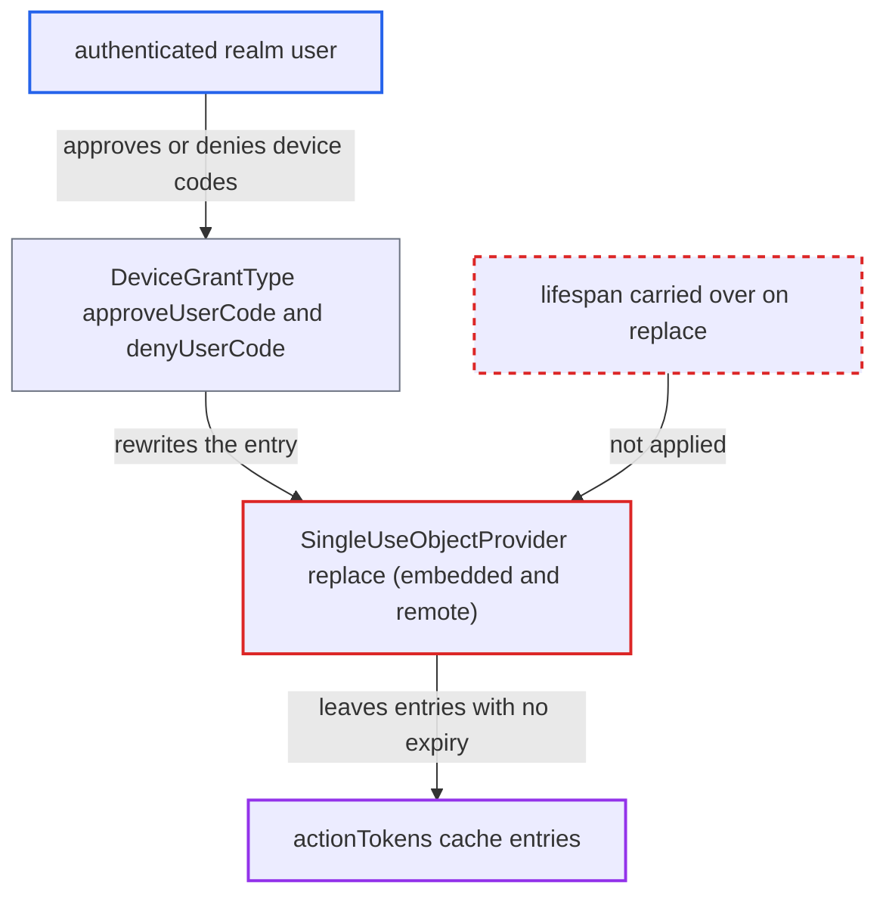

# Single-use store replace() drops entry lifespan, making approved device codes immortal in cache

| Field | Value |
|---|---|
| ID | `find_014bJVtPbEWYeF8s5T68a2V7` |
| Severity | **Low** |
| Status | open |
| CWE | CWE-772 — Missing Release of Resource |
| Created | 2026-10-27T21:55:12.482006Z |
| Claude Security | https://claude.ai/security/findings/find_014bJVtPbEWYeF8s5T68a2V7 |

## Description

A user with an ordinary account can make the `actionTokens` cache grow without limit, which slowly uses up memory and can degrade the login service. It needs a realm with a client that has the OAuth 2.0 Device Authorization Grant enabled, which is not the default. Both `SingleUseObjectProvider` implementations call `replace` without a lifespan, so approved or denied device codes never expire.

1. **Attacker** requests device codes from the device endpoint. The endpoint `/protocol/openid-connect/auth/device` needs no login, and each code is stored with a bounded lifespan (device-code lifespan + interval + 10 s). ([`services/src/main/java/org/keycloak/protocol/oidc/grants/device/endpoints/DeviceEndpoint.java:194-200`](https://github.com/cx-benchmark/keycloak/blob/1d7be35d0764060a8143fc74b0aabf2442743be4/services/src/main/java/org/keycloak/protocol/oidc/grants/device/endpoints/DeviceEndpoint.java#L194-L200))
2. **Attacker** approves or denies each user code with their own session at the verification URL. This runs `DeviceGrantType.approveUserCode` or `denyUserCode`, which rewrite the device-code entry through `replace()`. ([`services/src/main/java/org/keycloak/protocol/oidc/grants/device/DeviceGrantType.java:197-217`](https://github.com/cx-benchmark/keycloak/blob/1d7be35d0764060a8143fc74b0aabf2442743be4/services/src/main/java/org/keycloak/protocol/oidc/grants/device/DeviceGrantType.java#L197-L217))
3. **the provider `InfinispanSingleUseObjectProvider`** replaces the entry with a bare `singleUseObjectCache.replace(key, new SingleUseObjectValueEntity(notes))`. No lifespan is passed, so the new value gets the cache default instead of the remaining lifespan. ([`model/infinispan/src/main/java/org/keycloak/models/sessions/infinispan/InfinispanSingleUseObjectProvider.java:97-105`](https://github.com/cx-benchmark/keycloak/blob/1d7be35d0764060a8143fc74b0aabf2442743be4/model/infinispan/src/main/java/org/keycloak/models/sessions/infinispan/InfinispanSingleUseObjectProvider.java#L97-L105))
4. **the provider `RemoteInfinispanSingleUseObjectProvider`** replaces the entry with `RemoteCache.replace(key, value)` in remote mode. A Hot Rod lifespan of 0 means the server default, which for the recommended external `actionTokens` cache is also unlimited. ([`model/infinispan/src/main/java/org/keycloak/models/sessions/infinispan/remote/RemoteInfinispanSingleUseObjectProvider.java:90-94`](https://github.com/cx-benchmark/keycloak/blob/1d7be35d0764060a8143fc74b0aabf2442743be4/model/infinispan/src/main/java/org/keycloak/models/sessions/infinispan/remote/RemoteInfinispanSingleUseObjectProvider.java#L90-L94))
5. **the `actionTokens` cache** keeps the entry with no expiry. The cache is created with `ACTION_TOKEN_CACHE_DEFAULT_MAX = -1` and `ACTION_TOKEN_MAX_IDLE_SECONDS = -1`, so the default lifespan is unlimited. ([`model/infinispan/src/main/java/org/keycloak/connections/infinispan/InfinispanConnectionProvider.java:61-64`](https://github.com/cx-benchmark/keycloak/blob/1d7be35d0764060a8143fc74b0aabf2442743be4/model/infinispan/src/main/java/org/keycloak/connections/infinispan/InfinispanConnectionProvider.java#L61-L64))
6. **Attacker** never redeems the codes and repeats the process. Only a successful redemption via `removeDeviceByDeviceCode` removes the entry, and the expired branch in `DeviceGrantType.process` throws without removing it, so entries pile up. ([`services/src/main/java/org/keycloak/protocol/oidc/grants/device/DeviceGrantType.java:197-217`](https://github.com/cx-benchmark/keycloak/blob/1d7be35d0764060a8143fc74b0aabf2442743be4/services/src/main/java/org/keycloak/protocol/oidc/grants/device/DeviceGrantType.java#L197-L217))

## Assessment

The realm must have a client with the OAuth 2.0 Device Authorization Grant enabled, which is not the default. The attacker needs an ordinary account in that realm. They request device codes without logging in, then approve or deny each user code with their own session. No victim interaction is needed. Ordinary users' approvals or denials that are never redeemed leak entries the same way over time. The embedded and the remote Infinispan providers are both affected.

Impact: Entries in the `actionTokens` cache accumulate permanently on every owner node or on the external Infinispan. Memory use grows and can eventually degrade the availability of the login service. Nothing is disclosed, and stale codes are still rejected by `OAuth2DeviceCodeModel.isExpired()`.

## Recommendation

(1) `replace()` in both single-use providers rewrites the value without re-specifying expiration, so Infinispan applies the cache default (unlimited) instead of the remaining lifespan the entry was created with.

Fix criteria: After `replace(key, notes)` the entry still expires no later than it would have before the call. This can be done by carrying over the remaining lifespan from the existing entry's metadata, or by extending the SPI so callers pass an explicit lifespan. Approve a device code and check that the `actionTokens` entry is gone, either through the cache's entry metadata or by advancing time past the device-code lifespan. Check this in remote-cache mode too.

(2) Expired device-code entries are never removed on the token endpoint's expired branch, so even bounded entries rely only on cache expiration.

Fix criteria: When `DeviceGrantType.process` rejects a device code as expired or denied, the matching single-use entries are removed, so no code outlives its lifespan in the store. The report calls this defence in depth and notes it lies outside the scope of the files it reviewed.

## Evidence

**https://github.com/cx-benchmark/keycloak**

- [`model/infinispan/src/main/java/org/keycloak/models/sessions/infinispan/InfinispanSingleUseObjectProvider.java:97-105`](https://github.com/cx-benchmark/keycloak/blob/1d7be35d0764060a8143fc74b0aabf2442743be4/model/infinispan/src/main/java/org/keycloak/models/sessions/infinispan/InfinispanSingleUseObjectProvider.java#L97-L105)
- [`model/infinispan/src/main/java/org/keycloak/models/sessions/infinispan/remote/RemoteInfinispanSingleUseObjectProvider.java:90-94`](https://github.com/cx-benchmark/keycloak/blob/1d7be35d0764060a8143fc74b0aabf2442743be4/model/infinispan/src/main/java/org/keycloak/models/sessions/infinispan/remote/RemoteInfinispanSingleUseObjectProvider.java#L90-L94)
- [`model/infinispan/src/main/java/org/keycloak/connections/infinispan/InfinispanConnectionProvider.java:61-64`](https://github.com/cx-benchmark/keycloak/blob/1d7be35d0764060a8143fc74b0aabf2442743be4/model/infinispan/src/main/java/org/keycloak/connections/infinispan/InfinispanConnectionProvider.java#L61-L64)
- [`services/src/main/java/org/keycloak/protocol/oidc/grants/device/DeviceGrantType.java:197-217`](https://github.com/cx-benchmark/keycloak/blob/1d7be35d0764060a8143fc74b0aabf2442743be4/services/src/main/java/org/keycloak/protocol/oidc/grants/device/DeviceGrantType.java#L197-L217)
- [`services/src/main/java/org/keycloak/protocol/oidc/grants/device/endpoints/DeviceEndpoint.java:194-200`](https://github.com/cx-benchmark/keycloak/blob/1d7be35d0764060a8143fc74b0aabf2442743be4/services/src/main/java/org/keycloak/protocol/oidc/grants/device/endpoints/DeviceEndpoint.java#L194-L200)

