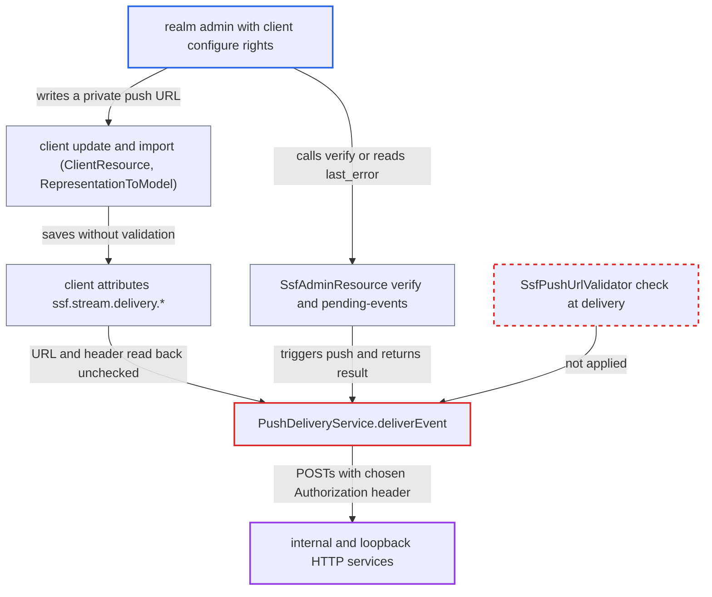

# SSF push endpoint written as raw client attribute skips push-URL SSRF guard

| Field | Value |
|---|---|
| ID | `find_01D5YR9ZeXFfqcXYECdM3aZA` |
| Severity | **Low** |
| Status | open |
| CWE | CWE-918 — Server-Side Request Forgery |
| Created | 2026-10-27T22:47:09.507793Z |
| Claude Security | https://claude.ai/security/findings/find_01D5YR9ZeXFfqcXYECdM3aZA |

## Description

A realm admin who can edit a client can make Keycloak send POST requests to internal, loopback or plaintext HTTP addresses, with an Authorization header of their choosing. They can also read back the status, up to 1024 characters of the response body, or the error message. This needs the experimental SSF feature on and `ssf.transmitterEnabled=true` in the realm. The push-URL check in `SsfPushUrlValidator` runs only for `StreamService` input, so a stream written as plain client attributes skips it, and `PushDeliveryService.deliverEvent` never re-checks the URL.

1. **Realm admin** updates a client with stream attributes through the Admin REST API. The PUT sets `ssf.enabled=true`, a new `ssf.stream.id`, `ssf.stream.delivery.method=urn:ietf:rfc:8935`, an internal `ssf.stream.delivery.endpointUrl` such as `http://10.0.0.5:8080/x`, and any `ssf.stream.delivery.authorizationHeader`; the endpoint only requires `requireConfigure` on the client. ([`services/src/main/java/org/keycloak/services/resources/admin/ClientResource.java:163-166`](https://github.com/cx-benchmark/keycloak/blob/1d7be35d0764060a8143fc74b0aabf2442743be4/services/src/main/java/org/keycloak/services/resources/admin/ClientResource.java#L163-L166))
2. **`RepresentationToModel.updateClientProperties`** copies every submitted attribute onto the client. Only `realm_client` is skipped, so the `ssf.stream.*` attributes are saved without going through `StreamService`. ([`server-spi-private/src/main/java/org/keycloak/models/utils/RepresentationToModel.java:593-601`](https://github.com/cx-benchmark/keycloak/blob/1d7be35d0764060a8143fc74b0aabf2442743be4/server-spi-private/src/main/java/org/keycloak/models/utils/RepresentationToModel.java#L593-L601))
3. **hook `validateImportedStreamId`** checks the saved client for a duplicate stream id and nothing else. It never looks at the delivery endpoint, so the private or plaintext URL is accepted. ([`ssf/transmitter/src/main/java/org/keycloak/ssf/transmitter/DefaultSsfTransmitterProviderFactory.java:673-700`](https://github.com/cx-benchmark/keycloak/blob/1d7be35d0764060a8143fc74b0aabf2442743be4/ssf/transmitter/src/main/java/org/keycloak/ssf/transmitter/DefaultSsfTransmitterProviderFactory.java#L673-L700))
4. **`extractFromSplitAttributes`** rebuilds the stream configuration from the client attributes. It copies `ssf.stream.delivery.endpointUrl` and resolves the authorization header with no validation. ([`ssf/transmitter/src/main/java/org/keycloak/ssf/transmitter/stream/storage/client/ClientStreamStore.java:493-540`](https://github.com/cx-benchmark/keycloak/blob/1d7be35d0764060a8143fc74b0aabf2442743be4/ssf/transmitter/src/main/java/org/keycloak/ssf/transmitter/stream/storage/client/ClientStreamStore.java#L493-L540))
5. **outbox drainer `SsfPushDeliveryHandler`** loads the stream from the client attributes and hands it to the push service. It calls `PushDeliveryService.deliverEvent`. The synchronous verification path calls the same method through `deliverEventSync`. ([`ssf/transmitter/src/main/java/org/keycloak/ssf/transmitter/outbox/SsfPushDeliveryHandler.java:104-120`](https://github.com/cx-benchmark/keycloak/blob/1d7be35d0764060a8143fc74b0aabf2442743be4/ssf/transmitter/src/main/java/org/keycloak/ssf/transmitter/outbox/SsfPushDeliveryHandler.java#L104-L120))
6. **`PushDeliveryService.deliverEvent`** POSTs the signed event to the stored URL with the stored `Authorization` header. There is no scheme, host or `ssf.validPushUrls` check at connect time, so the loopback or private target is contacted. ([`ssf/transmitter/src/main/java/org/keycloak/ssf/transmitter/delivery/push/PushDeliveryService.java:51-66`](https://github.com/cx-benchmark/keycloak/blob/1d7be35d0764060a8143fc74b0aabf2442743be4/ssf/transmitter/src/main/java/org/keycloak/ssf/transmitter/delivery/push/PushDeliveryService.java#L51-L66))
7. **Realm admin** reads the outcome of the request. `stream/verify` returns 204 if the target answered 2xx and 404 otherwise. After `events/emit`, `pending-events/{jti}` returns `last_error`, which holds the status and up to 1024 characters of the response body, or the connection error. ([`ssf/services/src/main/java/org/keycloak/ssf/services/admin/SsfAdminResource.java:464-509`](https://github.com/cx-benchmark/keycloak/blob/1d7be35d0764060a8143fc74b0aabf2442743be4/ssf/services/src/main/java/org/keycloak/ssf/services/admin/SsfAdminResource.java#L464-L509))

## Assessment

The attacker is a realm admin, not the server operator. They hold `configure` and `manage` on one client (FGAP) or `manage-clients`. The experimental `SSF` feature must be on, and the realm must set `ssf.transmitterEnabled=true`. The operator option `allow-insecure-push-targets` defaults to `false` and is not relaxed in dev mode, but it does not matter here because no check runs on this path. The attacker can set the attributes by updating the client, creating it, or importing it. They then call `stream/verify` to learn whether the target answered 2xx. Alternatively they call `events/emit` and read `pending-events/{jti}` for the target's status, body excerpt or connection error.

Impact: Keycloak can be made to POST a fixed `application/secevent+jwt` body to internal or loopback HTTP services over plaintext, with an attacker-chosen URL and `Authorization` header. The attacker can see up to 1024 characters of non-2xx responses and connection errors, which allows port and service discovery and limited data disclosure. Keycloak's own data is not newly exposed, and state changes are limited to what such a POST can trigger. The same admin could already make blind POSTs through the management URL and the backchannel logout URL, so the new gain is bypassing SSF's operator-only policy and reading responses back.

Subsequent-system impact: Internal and loopback services become reachable from Keycloak's network position over plaintext. They may receive POSTs with an attacker-chosen `Authorization` header. Limited response data and errors from them flow back to the attacker. The report does not rate any availability impact.

## Recommendation

(1) The push endpoint is trusted at delivery time only because it sits in the `ssf.stream.delivery.endpointUrl` client attribute. `SsfPushUrlValidator` runs only on the `StreamService` input path, so anyone who can write client attributes bypasses it.

Fix criteria: Every outbound push re-validates the endpoint URL immediately before connecting. This covers the drainer (`SsfPushDeliveryHandler` and `PushDeliveryService`) and the synchronous `deliverEventSync` verification path. The check uses the receiver's `ssf.validPushUrls` and the transmitter-wide scheme and host policy, and honours `allow-insecure-push-targets`. Rows whose URL fails are refused and dead-lettered or orphaned. To verify, write a loopback or `http://` endpoint directly into the attribute. No HTTP request may be issued, the admin verify endpoint must not report success, and no response data may appear in `lastError`.

(2) Client saves that carry `ssf.stream.*` delivery attributes are accepted without SSF-side validation. The `ClientUpdatedEvent` hook only checks for duplicate stream ids.

Fix criteria: Admin and import writes of `ssf.stream.delivery.*` are rejected or stripped unless they pass the same validation `StreamService` applies. Alternatively, the stream delivery state is writable only through `StreamService`. To verify, send a client PUT or import containing an invalid push endpoint. It must be refused with an error and leave no deliverable stream behind.

## Evidence

**https://github.com/cx-benchmark/keycloak**

- [`ssf/transmitter/src/main/java/org/keycloak/ssf/transmitter/delivery/push/PushDeliveryService.java:51-66`](https://github.com/cx-benchmark/keycloak/blob/1d7be35d0764060a8143fc74b0aabf2442743be4/ssf/transmitter/src/main/java/org/keycloak/ssf/transmitter/delivery/push/PushDeliveryService.java#L51-L66)
- [`ssf/transmitter/src/main/java/org/keycloak/ssf/transmitter/outbox/SsfPushDeliveryHandler.java:104-120`](https://github.com/cx-benchmark/keycloak/blob/1d7be35d0764060a8143fc74b0aabf2442743be4/ssf/transmitter/src/main/java/org/keycloak/ssf/transmitter/outbox/SsfPushDeliveryHandler.java#L104-L120)
- [`ssf/transmitter/src/main/java/org/keycloak/ssf/transmitter/stream/storage/client/ClientStreamStore.java:493-540`](https://github.com/cx-benchmark/keycloak/blob/1d7be35d0764060a8143fc74b0aabf2442743be4/ssf/transmitter/src/main/java/org/keycloak/ssf/transmitter/stream/storage/client/ClientStreamStore.java#L493-L540)
- [`ssf/transmitter/src/main/java/org/keycloak/ssf/transmitter/stream/StreamService.java:609-624`](https://github.com/cx-benchmark/keycloak/blob/1d7be35d0764060a8143fc74b0aabf2442743be4/ssf/transmitter/src/main/java/org/keycloak/ssf/transmitter/stream/StreamService.java#L609-L624)
- [`ssf/transmitter/src/main/java/org/keycloak/ssf/transmitter/support/SsfPushUrlValidator.java:199-237`](https://github.com/cx-benchmark/keycloak/blob/1d7be35d0764060a8143fc74b0aabf2442743be4/ssf/transmitter/src/main/java/org/keycloak/ssf/transmitter/support/SsfPushUrlValidator.java#L199-L237)
- [`server-spi-private/src/main/java/org/keycloak/models/utils/RepresentationToModel.java:593-601`](https://github.com/cx-benchmark/keycloak/blob/1d7be35d0764060a8143fc74b0aabf2442743be4/server-spi-private/src/main/java/org/keycloak/models/utils/RepresentationToModel.java#L593-L601)
- [`services/src/main/java/org/keycloak/services/resources/admin/ClientResource.java:163-166`](https://github.com/cx-benchmark/keycloak/blob/1d7be35d0764060a8143fc74b0aabf2442743be4/services/src/main/java/org/keycloak/services/resources/admin/ClientResource.java#L163-L166)
- [`ssf/transmitter/src/main/java/org/keycloak/ssf/transmitter/DefaultSsfTransmitterProviderFactory.java:673-700`](https://github.com/cx-benchmark/keycloak/blob/1d7be35d0764060a8143fc74b0aabf2442743be4/ssf/transmitter/src/main/java/org/keycloak/ssf/transmitter/DefaultSsfTransmitterProviderFactory.java#L673-L700)
- [`ssf/services/src/main/java/org/keycloak/ssf/services/admin/SsfAdminResource.java:464-509`](https://github.com/cx-benchmark/keycloak/blob/1d7be35d0764060a8143fc74b0aabf2442743be4/ssf/services/src/main/java/org/keycloak/ssf/services/admin/SsfAdminResource.java#L464-L509)
- [`ssf/transmitter/src/main/java/org/keycloak/ssf/transmitter/SsfTransmitterConfig.java:64-78`](https://github.com/cx-benchmark/keycloak/blob/1d7be35d0764060a8143fc74b0aabf2442743be4/ssf/transmitter/src/main/java/org/keycloak/ssf/transmitter/SsfTransmitterConfig.java#L64-L78)
- [`services/src/main/java/org/keycloak/services/managers/ResourceAdminManager.java:355-410`](https://github.com/cx-benchmark/keycloak/blob/1d7be35d0764060a8143fc74b0aabf2442743be4/services/src/main/java/org/keycloak/services/managers/ResourceAdminManager.java#L355-L410)

