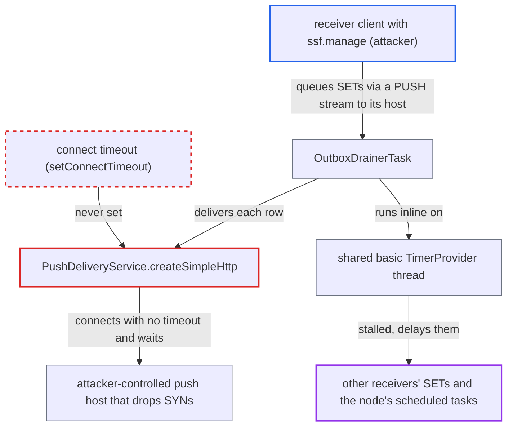

# SSF push never sets a TCP connect timeout; blackholed receiver stalls shared scheduler thread

| Field | Value |
|---|---|
| ID | `find_01NznFRqp88CWMNdFmj94uFd` |
| Severity | **Low** |
| Status | open |
| CWE | CWE-1088 — Missing timeout |
| Created | 2026-10-27T22:13:07.013014Z |
| Claude Security | https://claude.ai/security/findings/find_01NznFRqp88CWMNdFmj94uFd |

## Description

A malicious or compromised client that has `ssf.manage` can delay security-event delivery to every other SSF receiver on a node. It can also delay that node's other scheduled maintenance. It needs an allow-listed push host it controls, and the experimental SSF feature must be enabled. `PushDeliveryService.createSimpleHttp` passes the connect timeout to `setConnectionRequestTimeout` and never calls `setConnectTimeout`, so the TCP connect has no bound.

1. **attacker (receiver client)** registers a PUSH stream to a host it controls. The `delivery.endpoint_url` only has to match the admin-set `ssf.validPushUrls` and not resolve to private addresses when the stream is created; unresolvable hosts are accepted, and the host is resolved again at each delivery. ([`ssf/transmitter/src/main/java/org/keycloak/ssf/transmitter/support/SsfPushUrlValidator.java:221-236`](https://github.com/cx-benchmark/keycloak/blob/1d7be35d0764060a8143fc74b0aabf2442743be4/ssf/transmitter/src/main/java/org/keycloak/ssf/transmitter/support/SsfPushUrlValidator.java#L221-L236))
2. **attacker** makes the push host drop TCP SYNs or points its DNS at non-responding public addresses. The connect to the host then never completes, and the attacker needs no further action.
3. **`PushDeliveryService.createSimpleHttp`** builds a request config with no connect timeout. The configured value (`push-endpoint-connect-timeout-millis`, default `1000` ms, or `ssf.pushEndpointConnectTimeoutMillis`) goes to `setConnectionRequestTimeout`, which is the pool-lease timeout, so the connect timeout stays at `-1`. ([`ssf/transmitter/src/main/java/org/keycloak/ssf/transmitter/delivery/push/PushDeliveryService.java:125-148`](https://github.com/cx-benchmark/keycloak/blob/1d7be35d0764060a8143fc74b0aabf2442743be4/ssf/transmitter/src/main/java/org/keycloak/ssf/transmitter/delivery/push/PushDeliveryService.java#L125-L148))
4. **`SimpleHttpRequest.makeRequest`** applies that config to the request with `setConfig`. In HttpClient 4.5.x the request-level config replaces the client default instead of merging with it, so the client-wide connect timeout is lost; it is `-1` anyway. ([`server-spi-private/src/main/java/org/keycloak/http/simple/SimpleHttpRequest.java:248-252`](https://github.com/cx-benchmark/keycloak/blob/1d7be35d0764060a8143fc74b0aabf2442743be4/server-spi-private/src/main/java/org/keycloak/http/simple/SimpleHttpRequest.java#L248-L252))
5. **HttpClient** calls `Socket.connect` with timeout `0` for each resolved address. The connect waits for the OS connect timeout, about 127 s on Linux defaults, and the wait repeats for every address the host name resolves to.
6. **`OutboxDrainerTask`** delivers its batch one row at a time in one transaction. The batch is up to 50 rows by default and covers all receivers, so each queued row for the blackholed host holds the drainer for minutes, and each row is retried up to 8 times. ([`model/jpa/src/main/java/org/keycloak/events/outbox/OutboxDrainerTask.java:97-106`](https://github.com/cx-benchmark/keycloak/blob/1d7be35d0764060a8143fc74b0aabf2442743be4/model/jpa/src/main/java/org/keycloak/events/outbox/OutboxDrainerTask.java#L97-L106))
7. **the `basic` `TimerProvider`** runs the drainer inline on the node's single `java.util.Timer` thread. A stalled drainer therefore also holds up the other scheduled tasks on that node: expired-session and event cleanup, last-session-refresh propagation and user-storage sync. ([`services/src/main/java/org/keycloak/timer/basic/BasicTimerProviderFactory.java:51-57`](https://github.com/cx-benchmark/keycloak/blob/1d7be35d0764060a8143fc74b0aabf2442743be4/services/src/main/java/org/keycloak/timer/basic/BasicTimerProviderFactory.java#L51-L57))

## Assessment

The attacker controls an SSF receiver client that has `ssf.manage`. The admin must have allow-listed a push host the attacker owns through `ssf.validPushUrls`. The experimental SSF feature (`EXPERIMENTAL`) must be enabled. The attacker registers a PUSH stream to that host, then makes the host drop SYNs or points its DNS at non-responding public addresses, which `SsfPushUrlValidator` accepts. A second way in is receiver-triggered verification (`POST /verify`, which reaches `deliverEventSync`). It pushes synchronously on a request thread and is rate-limited per stream by `min-verification-interval-seconds`. Each such call also waits without a connect bound. A receiver that accepts the connection and trickles bytes also stalls delivery, because `socketTimeout` is only a per-read inactivity timeout.

Impact: The attacker can hold the node's shared scheduler thread for minutes per queued row, repeated on up to 8 retries. SSF events such as session-revoked and credential-change for all other receivers are delayed, and the node's other scheduled maintenance waits. Verify calls also pin request threads, within the rate limit. Login and token endpoints keep working, and no data is disclosed or changed.

## Recommendation

(1) `PushDeliveryService.createSimpleHttp` passes the configured connect timeout to `setConnectionRequestTimeout` (the pool-lease timeout) and never sets a connect timeout. Its per-request `RequestConfig` also replaces the client default, so the TCP connect to a receiver-chosen host has no bound.

Fix criteria: Every SSF push, whether from the outbox, a verification or the transmitter, fails to connect within the effective `push-endpoint-connect-timeout-millis` or `ssf.pushEndpointConnectTimeoutMillis`. Pool-lease and socket timeouts are also finite. To verify, push to a host that drops SYNs: each address must fail with a transport error within the configured connect timeout, not the OS default.

(2) The drainer delivers every receiver's rows one by one on the node's shared scheduler thread with no time budget. One unresponsive or slow receiver therefore delays all other receivers and the other scheduled tasks. This holds whether its connect is blackholed or it trickles its response.

Fix criteria: The time one receiver can take per drain tick is bounded, for example by a total deadline per attempt, per-receiver isolation or circuit breaking, or by running delivery off the shared timer thread. With one receiver blackholed or trickling bytes, other receivers' rows are still delivered within the normal tick interval. The other timer tasks still run on schedule.

## Evidence

**https://github.com/cx-benchmark/keycloak**

- [`ssf/transmitter/src/main/java/org/keycloak/ssf/transmitter/delivery/push/PushDeliveryService.java:125-148`](https://github.com/cx-benchmark/keycloak/blob/1d7be35d0764060a8143fc74b0aabf2442743be4/ssf/transmitter/src/main/java/org/keycloak/ssf/transmitter/delivery/push/PushDeliveryService.java#L125-L148)
- [`server-spi-private/src/main/java/org/keycloak/http/simple/SimpleHttpRequest.java:248-252`](https://github.com/cx-benchmark/keycloak/blob/1d7be35d0764060a8143fc74b0aabf2442743be4/server-spi-private/src/main/java/org/keycloak/http/simple/SimpleHttpRequest.java#L248-L252)
- [`services/src/main/java/org/keycloak/connections/httpclient/HttpClientBuilder.java:287-294`](https://github.com/cx-benchmark/keycloak/blob/1d7be35d0764060a8143fc74b0aabf2442743be4/services/src/main/java/org/keycloak/connections/httpclient/HttpClientBuilder.java#L287-L294)
- [`ssf/transmitter/src/main/java/org/keycloak/ssf/transmitter/SsfTransmitterConfig.java:80-85`](https://github.com/cx-benchmark/keycloak/blob/1d7be35d0764060a8143fc74b0aabf2442743be4/ssf/transmitter/src/main/java/org/keycloak/ssf/transmitter/SsfTransmitterConfig.java#L80-L85)
- [`ssf/transmitter/src/main/java/org/keycloak/ssf/transmitter/support/SsfPushUrlValidator.java:221-236`](https://github.com/cx-benchmark/keycloak/blob/1d7be35d0764060a8143fc74b0aabf2442743be4/ssf/transmitter/src/main/java/org/keycloak/ssf/transmitter/support/SsfPushUrlValidator.java#L221-L236)
- [`model/jpa/src/main/java/org/keycloak/events/outbox/OutboxDrainerTask.java:97-106`](https://github.com/cx-benchmark/keycloak/blob/1d7be35d0764060a8143fc74b0aabf2442743be4/model/jpa/src/main/java/org/keycloak/events/outbox/OutboxDrainerTask.java#L97-L106)
- [`ssf/transmitter/src/main/java/org/keycloak/ssf/transmitter/DefaultSsfTransmitterProviderFactory.java:527-533`](https://github.com/cx-benchmark/keycloak/blob/1d7be35d0764060a8143fc74b0aabf2442743be4/ssf/transmitter/src/main/java/org/keycloak/ssf/transmitter/DefaultSsfTransmitterProviderFactory.java#L527-L533)
- [`services/src/main/java/org/keycloak/timer/basic/BasicTimerProviderFactory.java:51-57`](https://github.com/cx-benchmark/keycloak/blob/1d7be35d0764060a8143fc74b0aabf2442743be4/services/src/main/java/org/keycloak/timer/basic/BasicTimerProviderFactory.java#L51-L57)
- [`ssf/transmitter/src/main/java/org/keycloak/ssf/transmitter/delivery/SecurityEventTokenDispatcher.java:369-371`](https://github.com/cx-benchmark/keycloak/blob/1d7be35d0764060a8143fc74b0aabf2442743be4/ssf/transmitter/src/main/java/org/keycloak/ssf/transmitter/delivery/SecurityEventTokenDispatcher.java#L369-L371)

