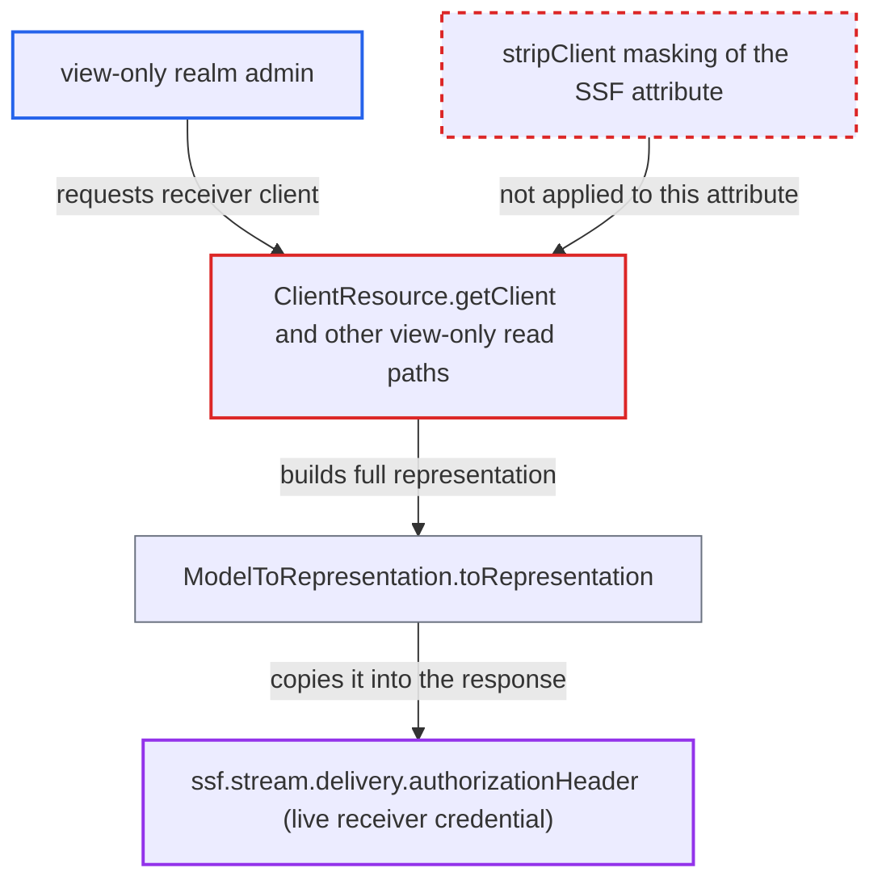

# stripClient leaves SSF push-delivery Authorization header readable by view-only admins

| Field | Value |
|---|---|
| ID | `find_01HEvrYZNJDuWz57FuCp9qnB` |
| Severity | **Low** |
| Status | open |
| CWE | CWE-212 — Sensitive Information Exposure |
| Created | 2026-10-27T21:56:46.348604Z |
| Claude Security | https://claude.ai/security/findings/find_01HEvrYZNJDuWz57FuCp9qnB |

## Description

A realm admin who can only view clients can read the live push-delivery credential of an SSF receiver in clear text. This needs the experimental SSF feature enabled and a push stream that carries an authorization header. `StripSecretsUtils.stripClient` masks only a fixed list of secrets and does not know the attribute `ssf.stream.delivery.authorizationHeader`.

1. **SSF transmitter** stores the push stream's authorization header as a plaintext client attribute. The value is written as is to `ssf.stream.delivery.authorizationHeader`, and receiver-supplied values cannot be vault references, so the stored value is the live credential. ([`ssf/transmitter/src/main/java/org/keycloak/ssf/transmitter/stream/storage/client/ClientStreamStore.java:677-691`](https://github.com/cx-benchmark/keycloak/blob/1d7be35d0764060a8143fc74b0aabf2442743be4/ssf/transmitter/src/main/java/org/keycloak/ssf/transmitter/stream/storage/client/ClientStreamStore.java#L677-L691))
2. **attacker (view-only admin)** requests the receiver client through a read path that needs only view permission. The main path is `GET /admin/realms/{realm}/clients/{id}`, handled by `ClientResource.getClient`, which asks only for view access. ([`services/src/main/java/org/keycloak/services/resources/admin/ClientResource.java:209-216`](https://github.com/cx-benchmark/keycloak/blob/1d7be35d0764060a8143fc74b0aabf2442743be4/services/src/main/java/org/keycloak/services/resources/admin/ClientResource.java#L209-L216))
3. **`ModelToRepresentation.toRepresentation`** copies the client's attributes into the representation. Every attribute except `type` is copied, so the stored SSF credential is included. ([`server-spi-private/src/main/java/org/keycloak/models/utils/ModelToRepresentation.java:907`](https://github.com/cx-benchmark/keycloak/blob/1d7be35d0764060a8143fc74b0aabf2442743be4/server-spi-private/src/main/java/org/keycloak/models/utils/ModelToRepresentation.java#L907))
4. **`StripSecretsUtils.stripClient`** masks only its fixed list of secrets and leaves the SSF header alone. It handles `secret`, `registrationAccessToken`, the `client.secret.rotated` attribute and attributes ending in `private.key`, and nothing else. ([`server-spi-private/src/main/java/org/keycloak/models/utils/StripSecretsUtils.java:242-262`](https://github.com/cx-benchmark/keycloak/blob/1d7be35d0764060a8143fc74b0aabf2442743be4/server-spi-private/src/main/java/org/keycloak/models/utils/StripSecretsUtils.java#L242-L262))
5. **admin API** returns the representation with the literal credential to the caller. The client-registration GET with a view-only admin token takes the same unmasked path. ([`services/src/main/java/org/keycloak/services/clientregistration/AbstractClientRegistrationProvider.java:172-184`](https://github.com/cx-benchmark/keycloak/blob/1d7be35d0764060a8143fc74b0aabf2442743be4/services/src/main/java/org/keycloak/services/clientregistration/AbstractClientRegistrationProvider.java#L172-L184))

## Assessment

The attacker is a realm admin with only `view-clients`, or with FGAP view permission on the receiver client. The SSF feature, which is `Type.EXPERIMENTAL`, must be enabled. A receiver must also have a push stream with an `authorization_header`. The attacker needs only a normal admin API call. Other ways to the same value are `ClientsResource.getClients`, the client-registration GET with a view-only admin token, partial export with clients (through `stripRealm`), and stored admin-event representations.

Impact: The attacker reads the credential Keycloak sends as the `Authorization` header to the SSF receiver's push endpoint. The project treats this value as write-only, and `SsfAdminResource.getClientStream` hides it from view-level callers. No Keycloak data is changed and service is not degraded.

Subsequent-system impact: The leaked value lets the attacker send HTTP POSTs to the receiver's SSF push endpoint that the receiver accepts as coming from Keycloak at the transport level. Forged security event tokens still need the realm's signing key. A receiver that validates signatures therefore limits this to unsolicited or invalid payloads.

## Recommendation

(1) `StripSecretsUtils.stripClient` lists secret client attributes by hard-coded name and suffix. It was not updated when the SSF transmitter began storing a delivery credential in `ssf.stream.delivery.authorizationHeader`, so view-only reads, exports and admin events leak it.

Fix criteria: Every path that applies `stripClient` returns `ssf.stream.delivery.authorizationHeader` masked. These paths are the view-only client GET, the client list, partial export and the admin-event representation. Vault expressions may stay as they are, as with other secrets. To verify, register an SSF stream with push delivery. Then read the receiver client as a `view-clients`-only admin and through partial export. The attribute value must be the mask constant.

(2) Secret client attributes are found by name, so any module that adds a new secret attribute silently falls outside the redaction.

Fix criteria: Secret client attributes are declared by the module that owns them, or follow a recognised secret naming convention. `stripClient` then masks them without per-attribute edits. A test that enumerates the attributes written by SSF and asserts they are masked after `stripClient` passes.

## Evidence

**https://github.com/cx-benchmark/keycloak**

- [`server-spi-private/src/main/java/org/keycloak/models/utils/StripSecretsUtils.java:242-262`](https://github.com/cx-benchmark/keycloak/blob/1d7be35d0764060a8143fc74b0aabf2442743be4/server-spi-private/src/main/java/org/keycloak/models/utils/StripSecretsUtils.java#L242-L262)
- [`services/src/main/java/org/keycloak/services/resources/admin/ClientResource.java:209-216`](https://github.com/cx-benchmark/keycloak/blob/1d7be35d0764060a8143fc74b0aabf2442743be4/services/src/main/java/org/keycloak/services/resources/admin/ClientResource.java#L209-L216)
- [`server-spi-private/src/main/java/org/keycloak/models/utils/ModelToRepresentation.java:907`](https://github.com/cx-benchmark/keycloak/blob/1d7be35d0764060a8143fc74b0aabf2442743be4/server-spi-private/src/main/java/org/keycloak/models/utils/ModelToRepresentation.java#L907)
- [`ssf/transmitter/src/main/java/org/keycloak/ssf/transmitter/stream/storage/client/ClientStreamStore.java:677-691`](https://github.com/cx-benchmark/keycloak/blob/1d7be35d0764060a8143fc74b0aabf2442743be4/ssf/transmitter/src/main/java/org/keycloak/ssf/transmitter/stream/storage/client/ClientStreamStore.java#L677-L691)
- [`ssf/transmitter/src/main/java/org/keycloak/ssf/transmitter/stream/StreamService.java:769-788`](https://github.com/cx-benchmark/keycloak/blob/1d7be35d0764060a8143fc74b0aabf2442743be4/ssf/transmitter/src/main/java/org/keycloak/ssf/transmitter/stream/StreamService.java#L769-L788)
- [`ssf/transmitter/src/main/java/org/keycloak/ssf/transmitter/delivery/push/PushDeliveryService.java:143-145`](https://github.com/cx-benchmark/keycloak/blob/1d7be35d0764060a8143fc74b0aabf2442743be4/ssf/transmitter/src/main/java/org/keycloak/ssf/transmitter/delivery/push/PushDeliveryService.java#L143-L145)
- [`ssf/services/src/main/java/org/keycloak/ssf/services/admin/SsfAdminResource.java:313-320`](https://github.com/cx-benchmark/keycloak/blob/1d7be35d0764060a8143fc74b0aabf2442743be4/ssf/services/src/main/java/org/keycloak/ssf/services/admin/SsfAdminResource.java#L313-L320)
- [`services/src/main/java/org/keycloak/services/clientregistration/AbstractClientRegistrationProvider.java:172-184`](https://github.com/cx-benchmark/keycloak/blob/1d7be35d0764060a8143fc74b0aabf2442743be4/services/src/main/java/org/keycloak/services/clientregistration/AbstractClientRegistrationProvider.java#L172-L184)

