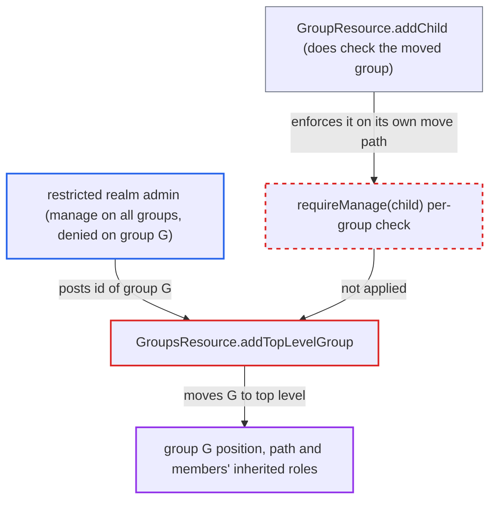

# Top-level group move skips per-group manage check, bypassing FGAP v2 resource-specific deny

| Field | Value |
|---|---|
| ID | `find_019x5iXU2Zx6aW865xToksix` |
| Severity | **Low** |
| Status | open |
| CWE | CWE-862 — Missing authorization |
| Created | 2026-10-27T21:26:46.247995Z |
| Claude Security | https://claude.ai/security/findings/find_019x5iXU2Zx6aW865xToksix |

## Description

An admin who is denied `manage` on a specific group can still move that group to the top level of the hierarchy. Moving it changes its path and strips the roles its members inherited from the old parent groups. This needs fine-grained admin permissions v2 (FGAP v2) with a `manage` grant on all groups. The cause is `GroupsResource.addTopLevelGroup`, which checks only the realm-wide `auth.groups().requireManage()` and never checks the moved group.

1. **restricted realm admin** sends a POST to `/admin/realms/{realm}/groups` with the id of the protected group. The body carries an existing `id`, for example `{"id":"<G>","name":"G"}`, where G is a group the admin is explicitly denied `manage` on.
2. **the handler `addTopLevelGroup`** runs only the realm-wide check `auth.groups().requireManage()`. This check passes because the admin holds `manage` on the Groups resource type, and the specific group is never checked. ([`services/src/main/java/org/keycloak/services/resources/admin/GroupsResource.java:206-233`](https://github.com/cx-benchmark/keycloak/blob/1d7be35d0764060a8143fc74b0aabf2442743be4/services/src/main/java/org/keycloak/services/resources/admin/GroupsResource.java#L206-L233))
3. **the handler `addTopLevelGroup`** loads the existing group by id and calls `realm.moveGroup(child, null)`. This detaches the group from its parent and makes it a top-level group, without a call to `auth.groups().requireManage(child)`. ([`services/src/main/java/org/keycloak/services/resources/admin/GroupsResource.java:206-233`](https://github.com/cx-benchmark/keycloak/blob/1d7be35d0764060a8143fc74b0aabf2442743be4/services/src/main/java/org/keycloak/services/resources/admin/GroupsResource.java#L206-L233))
4. **FGAP v2 permission logic** is never asked about the specific group. `canManage()` is true from the type-level grant, while `canManage(group)` would be false because resource-specific permissions take precedence. That second check is the one that is skipped. ([`services/src/main/java/org/keycloak/services/resources/admin/fgap/GroupPermissionsV2.java:59-74`](https://github.com/cx-benchmark/keycloak/blob/1d7be35d0764060a8143fc74b0aabf2442743be4/services/src/main/java/org/keycloak/services/resources/admin/fgap/GroupPermissionsV2.java#L59-L74))

## Assessment

The attacker is a realm admin who can reach the Admin REST API. They hold a `manage` permission on all groups under FGAP v2. They are also explicitly denied `manage` on a specific group, such as a protected administrators' group. This is a deployment configuration. In legacy FGAP v1 the report says the same missing check matters only in theory. There `canManage()` is the `manage-users` role, which already implies `canManage(group)`.

Impact: The restricted admin can change the position and path of a group they were denied, which removes the roles its members inherited from the former ancestors. This can lock other administrators out of their functions. It also breaks path-based configuration such as group policies and IdP/LDAP group mappers that use the old path. The flaw cannot be used to gain roles, and no data is disclosed.

## Recommendation

`GroupsResource.addTopLevelGroup` moves an existing group under only the realm-wide `requireManage()` check. It omits the per-group `requireManage(child)` that `GroupResource.addChild` enforces, so resource-specific FGAP denials on the moved group are ignored.

Fix criteria: Moving an existing group to the top level requires manage permission on that specific group (`auth.groups().requireManage(child)`) in addition to the realm-wide check. An admin with a type-level `manage` grant and a resource-specific `manage` deny on group G gets 403 when posting G's id. G keeps its parent.

## Evidence

**https://github.com/cx-benchmark/keycloak**

- [`services/src/main/java/org/keycloak/services/resources/admin/GroupsResource.java:206-233`](https://github.com/cx-benchmark/keycloak/blob/1d7be35d0764060a8143fc74b0aabf2442743be4/services/src/main/java/org/keycloak/services/resources/admin/GroupsResource.java#L206-L233)
- [`services/src/main/java/org/keycloak/services/resources/admin/GroupResource.java:254-263`](https://github.com/cx-benchmark/keycloak/blob/1d7be35d0764060a8143fc74b0aabf2442743be4/services/src/main/java/org/keycloak/services/resources/admin/GroupResource.java#L254-L263)
- [`services/src/main/java/org/keycloak/services/resources/admin/fgap/GroupPermissionsV2.java:59-74`](https://github.com/cx-benchmark/keycloak/blob/1d7be35d0764060a8143fc74b0aabf2442743be4/services/src/main/java/org/keycloak/services/resources/admin/fgap/GroupPermissionsV2.java#L59-L74)

