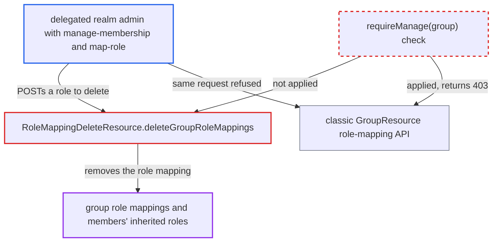

# UI-ext bulk role-mapping delete on groups requires only manage-membership instead of manage

| Field | Value |
|---|---|
| ID | `find_01FbVUxBKW9SKaiwG4x8YXR4` |
| Severity | **Low** |
| Status | open |
| CWE | CWE-863 — Incorrect Authorization |
| Created | 2026-10-27T22:18:08.268257Z |
| Claude Security | https://claude.ai/security/findings/find_01FbVUxBKW9SKaiwG4x8YXR4 |

## Description

A delegated realm admin who may only manage a group's membership can remove roles from that group's role mappings. Every member who gets the role only through the group loses it. The attacker needs fine-grained admin permissions (FGAP) enabled, `manage-membership` on the group and `map-role` on the role. The endpoint `deleteGroupRoleMappings` checks `requireManageMembership(group)` instead of `requireManage(group)`.

1. **delegated realm admin** sends a POST to the UI-ext delete endpoint for group G. The body names the role to remove, for example `[{"roleId":"<R id>"}]`, sent to `/admin/realms/{realm}/ui-ext/role-mapping-delete/groups/{id}`. The admin holds `manage-membership` on G and `map-role` on R, but not `manage` on G.
2. **the handler `deleteGroupRoleMappings`** authorizes the caller with `auth.groups().requireManageMembership(group)`. This check passes for a delegate whose only group grant is `manage-membership`. The classic API requires `requireManage(group)` here. ([`rest/admin-ui-ext/src/main/java/org/keycloak/admin/ui/rest/RoleMappingDeleteResource.java:57-65`](https://github.com/cx-benchmark/keycloak/blob/1d7be35d0764060a8143fc74b0aabf2442743be4/rest/admin-ui-ext/src/main/java/org/keycloak/admin/ui/rest/RoleMappingDeleteResource.java#L57-L65))
3. **the handler `deleteGroupRoleMappings`** checks only `auth.roles().requireMapRole(role)` for each requested role. The admin holds `map-role` on R, so this passes. Nothing checks `manage` on the group. ([`rest/admin-ui-ext/src/main/java/org/keycloak/admin/ui/rest/RoleMappingDeleteResource.java:154-168`](https://github.com/cx-benchmark/keycloak/blob/1d7be35d0764060a8143fc74b0aabf2442743be4/rest/admin-ui-ext/src/main/java/org/keycloak/admin/ui/rest/RoleMappingDeleteResource.java#L154-L168))
4. **the handler `deleteGroupRoleMappings`** calls `group.deleteRoleMapping(role)`. The role mapping is removed from the group, so members who inherit R only through G lose it. ([`rest/admin-ui-ext/src/main/java/org/keycloak/admin/ui/rest/RoleMappingDeleteResource.java:154-168`](https://github.com/cx-benchmark/keycloak/blob/1d7be35d0764060a8143fc74b0aabf2442743be4/rest/admin-ui-ext/src/main/java/org/keycloak/admin/ui/rest/RoleMappingDeleteResource.java#L154-L168))

## Assessment

The attacker is an authenticated delegated realm admin in a realm with fine-grained admin permissions enabled. They hold `manage-membership` on a group and `map-role` on a role, or `map-roles` on the role's client. They do not hold `manage` on the group. The admin-UI extension is enabled by default through the `ADMIN_V2` feature. No user interaction is needed. The report names no other way in.

Impact: The attacker can remove roles they are allowed to map from a group they may not manage. This can cut other users off from applications or admin functions. Roles cannot be added through this endpoint, and nothing is disclosed.

## Recommendation

`deleteGroupRoleMappings` uses the membership permission `requireManageMembership` to gate changes to a group's role mappings. Every other code path treats this as a group `manage` operation.

Fix criteria: The UI-ext endpoint requires `auth.groups().requireManage(group)` as well as `requireMapRole` for each role, the same as the classic Admin API. An FGAP delegate with only `manage-membership` on a group (plus `map-role` on a role) gets 403 from `POST .../ui-ext/role-mapping-delete/groups/{id}`. The group's role mappings are unchanged after that request. The test `RoleResourceTypeEvaluationTest.testUiExtGroupRoleMappingDeleteRespectsPerRolePermission` is updated to match.

## Evidence

**https://github.com/cx-benchmark/keycloak**

- [`rest/admin-ui-ext/src/main/java/org/keycloak/admin/ui/rest/RoleMappingDeleteResource.java:57-65`](https://github.com/cx-benchmark/keycloak/blob/1d7be35d0764060a8143fc74b0aabf2442743be4/rest/admin-ui-ext/src/main/java/org/keycloak/admin/ui/rest/RoleMappingDeleteResource.java#L57-L65)
- [`rest/admin-ui-ext/src/main/java/org/keycloak/admin/ui/rest/RoleMappingDeleteResource.java:154-168`](https://github.com/cx-benchmark/keycloak/blob/1d7be35d0764060a8143fc74b0aabf2442743be4/rest/admin-ui-ext/src/main/java/org/keycloak/admin/ui/rest/RoleMappingDeleteResource.java#L154-L168)
- [`services/src/main/java/org/keycloak/services/resources/admin/GroupResource.java:319-324`](https://github.com/cx-benchmark/keycloak/blob/1d7be35d0764060a8143fc74b0aabf2442743be4/services/src/main/java/org/keycloak/services/resources/admin/GroupResource.java#L319-L324)
- [`services/src/main/java/org/keycloak/services/resources/admin/RoleMapperResource.java:325-333`](https://github.com/cx-benchmark/keycloak/blob/1d7be35d0764060a8143fc74b0aabf2442743be4/services/src/main/java/org/keycloak/services/resources/admin/RoleMapperResource.java#L325-L333)
- [`services/src/main/java/org/keycloak/services/resources/admin/fgap/GroupPermissionsV2.java:95-101`](https://github.com/cx-benchmark/keycloak/blob/1d7be35d0764060a8143fc74b0aabf2442743be4/services/src/main/java/org/keycloak/services/resources/admin/fgap/GroupPermissionsV2.java#L95-L101)
- [`services/src/main/java/org/keycloak/services/resources/admin/fgap/GroupPermissions.java:358-366`](https://github.com/cx-benchmark/keycloak/blob/1d7be35d0764060a8143fc74b0aabf2442743be4/services/src/main/java/org/keycloak/services/resources/admin/fgap/GroupPermissions.java#L358-L366)
- [`js/apps/admin-ui/src/groups/GroupsSection.tsx:76-77`](https://github.com/cx-benchmark/keycloak/blob/1d7be35d0764060a8143fc74b0aabf2442743be4/js/apps/admin-ui/src/groups/GroupsSection.tsx#L76-L77)

