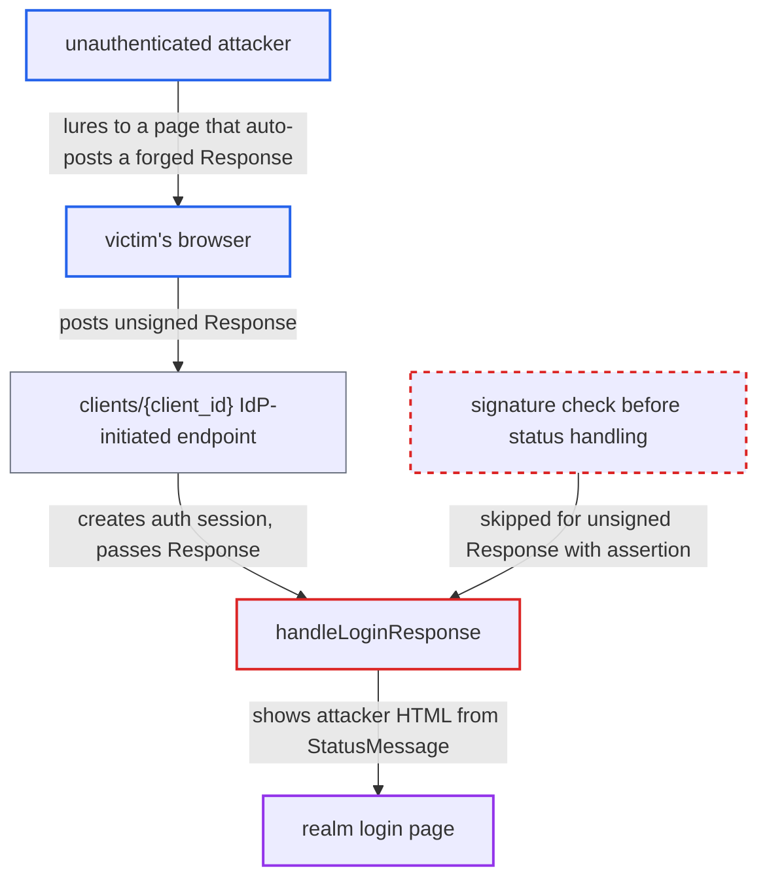

# Unsigned SAML error Response's StatusMessage rendered as HTML on broker login page

| Field | Value |
|---|---|
| ID | `find_01EMyFZF4yP2zweFGMhrWraC` |
| Severity | **Low** |
| Status | open |
| CWE | CWE-347 — Improper signature verification |
| Created | 2026-10-27T21:23:53.142155Z |
| Claude Security | https://claude.ai/security/findings/find_01EMyFZF4yP2zweFGMhrWraC |

## Description

An unauthenticated remote attacker can show attacker-chosen links, images and formatted text inside the realm's genuine Keycloak login page, which makes phishing easy. Script execution is blocked. The attack needs a victim's browser to visit the attacker's page. It works because `handleLoginResponse` uses the SAML `StatusMessage` before any signature check, and `PostBinding.verifySignature` skips verification for unsigned Responses that contain an assertion.

1. **attacker** builds an unsigned SAML Response with a failed status. The Response uses `StatusCode=Responder`, puts HTML in `StatusMessage`, includes one dummy `saml:Assertion` and leaves out Destination, then is base64-encoded.
2. **attacker** hosts a page that auto-POSTs the Response as `SAMLResponse` to the IdP-initiated endpoint. The target is `/realms/{realm}/broker/{alias}/endpoint/clients/{urlName}`. `samlIdpInitiatedSSO` creates a fresh authentication session for any enabled SAML client with a matching `saml_idp_initiated_sso_url_name`, so no RelayState or prior browser state is needed. ([`services/src/main/java/org/keycloak/broker/saml/SAMLEndpoint.java:756-783`](https://github.com/cx-benchmark/keycloak/blob/1d7be35d0764060a8143fc74b0aabf2442743be4/services/src/main/java/org/keycloak/broker/saml/SAMLEndpoint.java#L756-L783))
3. **victim's browser** visits the attacker's page and posts the forged Response to Keycloak. The report treats this as a passive victim action: visiting the page is enough.
4. **`handleSamlResponse`** accepts the Response without a Destination. A Destination is required only when a Signature element is present, so the forged Response passes this check. ([`services/src/main/java/org/keycloak/broker/saml/SAMLEndpoint.java:803-815`](https://github.com/cx-benchmark/keycloak/blob/1d7be35d0764060a8143fc74b0aabf2442743be4/services/src/main/java/org/keycloak/broker/saml/SAMLEndpoint.java#L803-L815))
5. **`PostBinding.verifySignature`** skips signature verification for the Response. The document has no `ds:Signature` and is a `ResponseType` with at least one assertion, so verification is skipped even with `validateSignature=true`. ([`services/src/main/java/org/keycloak/broker/saml/SAMLEndpoint.java:957-968`](https://github.com/cx-benchmark/keycloak/blob/1d7be35d0764060a8143fc74b0aabf2442743be4/services/src/main/java/org/keycloak/broker/saml/SAMLEndpoint.java#L957-L968))
6. **`handleLoginResponse`** handles the non-Success status and passes `StatusMessage` to `callback.error(...)`. This branch runs before any signature validation, and the dummy assertion is never examined. ([`services/src/main/java/org/keycloak/broker/saml/SAMLEndpoint.java:564-572`](https://github.com/cx-benchmark/keycloak/blob/1d7be35d0764060a8143fc74b0aabf2442743be4/services/src/main/java/org/keycloak/broker/saml/SAMLEndpoint.java#L564-L572))
7. **`error()` and the login template** renders the attacker's message on the login page. The string goes through `browserAuthentication(authSession, message)` and is rendered with `kcSanitize(...)?no_esc`, which still allows links, images and formatting. ([`services/src/main/java/org/keycloak/services/resources/IdentityBrokerService.java:1139-1155`](https://github.com/cx-benchmark/keycloak/blob/1d7be35d0764060a8143fc74b0aabf2442743be4/services/src/main/java/org/keycloak/services/resources/IdentityBrokerService.java#L1139-L1155))

## Assessment

The attacker is unauthenticated and remote. The target realm needs a SAML identity provider whose alias is visible on the login page. It also needs an enabled SAML client with an IdP-initiated SSO URL name (`saml_idp_initiated_sso_url_name`). The attacker needs a victim to visit a page they host. The forged Response also works against the plain `endpoint`, not only `endpoint/clients/{id}`, but the report relies on the `clients/{client_id}` route because it needs no RelayState or existing browser state. The same forged message can also steer the flow: `login_required` leads to `protocol.sendError` to the client, and `AUTHENTICATION_EXPIRED_MESSAGE` leads to `retryLogin`. The report calls both benign.

Impact: The attacker controls visible content on the realm's real login page: text, links to external sites and images. This is a content-spoofing and phishing primitive. `kcSanitize` blocks script execution, and nothing is changed beyond creating an authentication session.

## Recommendation

(1) `handleLoginResponse` reads the Status and `StatusMessage` before any signature check. `PostBinding.verifySignature` also skips message-level verification for any `ResponseType` that contains an assertion, even though that assertion is never validated on the error branch.

Fix criteria: No field of a SAML Response, including Status and `StatusMessage`, affects user-visible output or flow decisions until the Response, or for success responses its assertion, has passed signature verification when `validateSignature` is enabled. A non-Success Response is rejected unless the message itself is signed and valid. Test: POST an unsigned failed-status Response with a dummy assertion to both `endpoint` and `endpoint/clients/{id}` on an IdP with `validateSignature=true`. The result must be a generic invalid-signature error that does not echo `StatusMessage`.

(2) The IdP-supplied free-text `StatusMessage` is used as the UI error message and rendered through `kcSanitize(...)?no_esc`, which allows links and images. Even a legitimately signed but attacker-influenced message therefore becomes HTML on the login page.

Fix criteria: The login page shows only a fixed, localized message key for IdP errors, such as `Messages.IDENTITY_PROVIDER_LOGIN_FAILURE`. At most, the IdP's `StatusMessage` is logged. Any IdP text that is still shown is rendered as escaped plain text. Test: a `StatusMessage` containing an `<a href>` is not rendered as a link.

## Evidence

**https://github.com/cx-benchmark/keycloak**

- [`services/src/main/java/org/keycloak/broker/saml/SAMLEndpoint.java:564-572`](https://github.com/cx-benchmark/keycloak/blob/1d7be35d0764060a8143fc74b0aabf2442743be4/services/src/main/java/org/keycloak/broker/saml/SAMLEndpoint.java#L564-L572)
- [`services/src/main/java/org/keycloak/broker/saml/SAMLEndpoint.java:957-968`](https://github.com/cx-benchmark/keycloak/blob/1d7be35d0764060a8143fc74b0aabf2442743be4/services/src/main/java/org/keycloak/broker/saml/SAMLEndpoint.java#L957-L968)
- [`services/src/main/java/org/keycloak/broker/saml/SAMLEndpoint.java:803-815`](https://github.com/cx-benchmark/keycloak/blob/1d7be35d0764060a8143fc74b0aabf2442743be4/services/src/main/java/org/keycloak/broker/saml/SAMLEndpoint.java#L803-L815)
- [`services/src/main/java/org/keycloak/broker/saml/SAMLEndpoint.java:756-783`](https://github.com/cx-benchmark/keycloak/blob/1d7be35d0764060a8143fc74b0aabf2442743be4/services/src/main/java/org/keycloak/broker/saml/SAMLEndpoint.java#L756-L783)
- [`services/src/main/java/org/keycloak/services/resources/IdentityBrokerService.java:1139-1155`](https://github.com/cx-benchmark/keycloak/blob/1d7be35d0764060a8143fc74b0aabf2442743be4/services/src/main/java/org/keycloak/services/resources/IdentityBrokerService.java#L1139-L1155)

