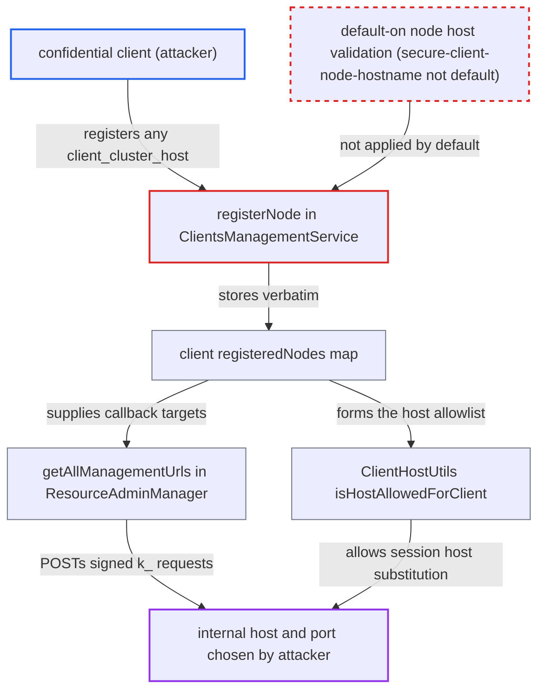

# Unvalidated client-registered cluster node hosts drive Keycloak outbound callbacks (blind SSRF)

| Field | Value |
|---|---|
| ID | `find_01WzVVfWY8Dd5XdP797aVeMh` |
| Severity | **Low** |
| Status | open |
| CWE | CWE-918 — Server-side request forgery |
| Created | 2026-10-27T21:19:25.199719Z |
| Claude Security | https://claude.ai/security/findings/find_01WzVVfWY8Dd5XdP797aVeMh |

## Description

Any confidential client with valid credentials can make the Keycloak server send signed HTTP POST requests to a host and port the client picks, including internal services. The attack is blind, because responses are never returned. It works because `registerNode` in `ClientsManagementService` stores `client_cluster_host` with only a null/blank check. `getAllManagementUrls` and `isHostAllowedForClient` then trust that value as an admin-approved destination.

1. **attacker with a confidential client's credentials** posts to `register-node` with `client_cluster_host=10.0.0.5:8080`. The endpoint accepts registrations from every authenticated non-public client, and the value can carry a port. ([`services/src/main/java/org/keycloak/services/resources/ClientsManagementService.java:115-150`](https://github.com/cx-benchmark/keycloak/blob/1d7be35d0764060a8143fc74b0aabf2442743be4/services/src/main/java/org/keycloak/services/resources/ClientsManagementService.java#L115-L150))
2. **the handler `registerNode`** stores the host verbatim in the client's `registeredNodes`. `getClientClusterHost` rejects only null or blank values, and the `secure-client-node-hostname` executor that would validate the host is not in any shipped default profile or policy. ([`services/src/main/java/org/keycloak/services/resources/ClientsManagementService.java:206-215`](https://github.com/cx-benchmark/keycloak/blob/1d7be35d0764060a8143fc74b0aabf2442743be4/services/src/main/java/org/keycloak/services/resources/ClientsManagementService.java#L206-L215))
3. **`getAllManagementUrls`** swaps the host of the admin-configured management URL for each registered node. Once any node exists, the admin-configured host is no longer used. ([`services/src/main/java/org/keycloak/services/managers/ResourceAdminManager.java:97-118`](https://github.com/cx-benchmark/keycloak/blob/1d7be35d0764060a8143fc74b0aabf2442743be4/services/src/main/java/org/keycloak/services/managers/ResourceAdminManager.java#L97-L118))
4. **`ResourceAdminManager`** POSTs signed `k_logout`, `k_push_not_before` and `k_test_available` requests to the attacker-chosen host. This happens when an admin runs push-revocation, logout-all or test-availability. `DefaultHttpClientFactory` has no destination allow or deny list. ([`services/src/main/java/org/keycloak/services/managers/ResourceAdminManager.java:326-345`](https://github.com/cx-benchmark/keycloak/blob/1d7be35d0764060a8143fc74b0aabf2442743be4/services/src/main/java/org/keycloak/services/managers/ResourceAdminManager.java#L326-L345))
5. **attacker** sends `client_session_host` on a token request when the configured URL contains `${application.session.host}`. `isHostAllowedForClient` builds its allowlist from the registered node keys, so the self-registered host passes and the raw value, port included, is stored in the client session. ([`services/src/main/java/org/keycloak/protocol/oidc/utils/ClientHostUtils.java:65-93`](https://github.com/cx-benchmark/keycloak/blob/1d7be35d0764060a8143fc74b0aabf2442743be4/services/src/main/java/org/keycloak/protocol/oidc/utils/ClientHostUtils.java#L65-L93))
6. **`ResourceAdminManager`** substitutes the stored session host into the backchannel-logout or management URL and POSTs there when the session is logged out. The logout token or logout action goes to the host the attacker chose. ([`services/src/main/java/org/keycloak/services/managers/ResourceAdminManager.java:183-208`](https://github.com/cx-benchmark/keycloak/blob/1d7be35d0764060a8143fc74b0aabf2442743be4/services/src/main/java/org/keycloak/services/managers/ResourceAdminManager.java#L183-L208))

## Assessment

The attacker holds the credentials of a confidential client, either a malicious client or a compromised one. An admin must have set a management or backchannel-logout URL for that client. The attacker registers a node with `register-node`, which succeeds when no client policy with the `secure-client-node-hostname` executor is configured (the default). There are two ways the request then goes out. If the configured URL uses `${application.session.host}`, the attacker sends `client_session_state` and `client_session_host` on a token request and logs the session out. Otherwise the request goes out when an admin runs push-revocation, logout-all or test-availability. Responses are never returned to the attacker. The project documents the issue and the opt-in executor, but the endpoint stays open to every confidential client.

Impact: The client changes server behaviour that should be admin-controlled. It extends the `client_session_host` allowlist and redirects the destinations of Keycloak's signed management callbacks. Admin-initiated logout and revocation broadcasts for that client no longer reach the configured host. No Keycloak data is disclosed, and the effect stays within the attacker's own client.

Subsequent-system impact: Hosts reachable from the Keycloak server, including internal services, receive attacker-directed HTTP POSTs from the server's network identity. The body is a Keycloak-signed JWT or `logout_token` form. The path ends in a fixed `k_*` segment or an admin-set path. The attack is blind, so the only effect is triggering side effects on endpoints that act on any POST.

## Recommendation

(1) `registerNode` saves a client-supplied host as a trusted callback destination with no default-on validation. Safety depends entirely on an optional client-policy executor.

Fix criteria: With no client policy configured, `register-node` rejects a `client_cluster_host` that is not a bare DNS name or IP, meaning one with a port, path or userinfo. It also rejects a host that does not match an administrator-controlled constraint, such as the host of the client's management or root URL, or an admin allowlist. Registering `169.254.169.254` or `host:8080` in a realm with default policies returns 400.

(2) `getAllManagementUrls` and `isHostAllowedForClient` treat `registeredNodes` as already validated, even when no executor checked them. Client-supplied hosts therefore become outbound request targets.

Fix criteria: Outbound management and backchannel-logout hosts are checked at use time against administrator-controlled configuration, whatever way the node was registered. With a registered node that no policy validated, pointing at an unrelated host, push-revocation, logout-all and placeholder-based backchannel logout send no request to that host.

## Evidence

**https://github.com/cx-benchmark/keycloak**

- [`services/src/main/java/org/keycloak/services/resources/ClientsManagementService.java:115-150`](https://github.com/cx-benchmark/keycloak/blob/1d7be35d0764060a8143fc74b0aabf2442743be4/services/src/main/java/org/keycloak/services/resources/ClientsManagementService.java#L115-L150)
- [`services/src/main/java/org/keycloak/services/resources/ClientsManagementService.java:206-215`](https://github.com/cx-benchmark/keycloak/blob/1d7be35d0764060a8143fc74b0aabf2442743be4/services/src/main/java/org/keycloak/services/resources/ClientsManagementService.java#L206-L215)
- [`services/src/main/java/org/keycloak/services/managers/ResourceAdminManager.java:97-118`](https://github.com/cx-benchmark/keycloak/blob/1d7be35d0764060a8143fc74b0aabf2442743be4/services/src/main/java/org/keycloak/services/managers/ResourceAdminManager.java#L97-L118)
- [`services/src/main/java/org/keycloak/services/managers/ResourceAdminManager.java:326-345`](https://github.com/cx-benchmark/keycloak/blob/1d7be35d0764060a8143fc74b0aabf2442743be4/services/src/main/java/org/keycloak/services/managers/ResourceAdminManager.java#L326-L345)
- [`services/src/main/java/org/keycloak/services/managers/ResourceAdminManager.java:183-208`](https://github.com/cx-benchmark/keycloak/blob/1d7be35d0764060a8143fc74b0aabf2442743be4/services/src/main/java/org/keycloak/services/managers/ResourceAdminManager.java#L183-L208)
- [`services/src/main/java/org/keycloak/protocol/oidc/utils/ClientHostUtils.java:65-93`](https://github.com/cx-benchmark/keycloak/blob/1d7be35d0764060a8143fc74b0aabf2442743be4/services/src/main/java/org/keycloak/protocol/oidc/utils/ClientHostUtils.java#L65-L93)
- [`services/src/main/java/org/keycloak/protocol/oidc/grants/OAuth2GrantTypeBase.java:236-259`](https://github.com/cx-benchmark/keycloak/blob/1d7be35d0764060a8143fc74b0aabf2442743be4/services/src/main/java/org/keycloak/protocol/oidc/grants/OAuth2GrantTypeBase.java#L236-L259)
- [`services/src/main/java/org/keycloak/services/clientpolicy/executor/SecureClientNodeExecutor.java:89-95`](https://github.com/cx-benchmark/keycloak/blob/1d7be35d0764060a8143fc74b0aabf2442743be4/services/src/main/java/org/keycloak/services/clientpolicy/executor/SecureClientNodeExecutor.java#L89-L95)
- [`docs/documentation/upgrading/topics/changes/changes-26_8_0.adoc:529-536`](https://github.com/cx-benchmark/keycloak/blob/1d7be35d0764060a8143fc74b0aabf2442743be4/docs/documentation/upgrading/topics/changes/changes-26_8_0.adoc#L529-L536)

