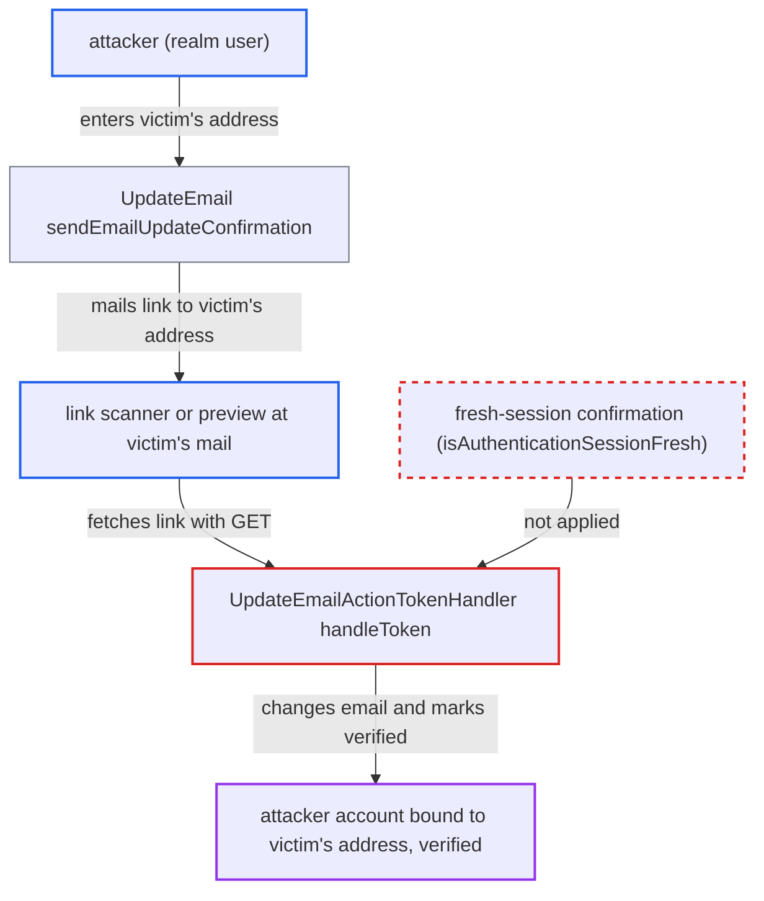

# Update-email action token applies email change on first GET without confirmation step

| Field | Value |
|---|---|
| ID | `find_01N3dfNjSzFULGoQr762JVWM` |
| Severity | **Low** |
| Status | open |
| CWE | CWE-650 — State-changing GET request |
| Created | 2026-10-27T21:29:13.544661Z |
| Claude Security | https://claude.ai/security/findings/find_01N3dfNjSzFULGoQr762JVWM |

## Description

A logged-in realm user can attach an email address they don't own to their own account as a verified address, without the address owner agreeing. It needs the `UPDATE_EMAIL` required action and email verification enabled, plus something on the victim's mail path that fetches the link with GET. `UpdateEmailActionTokenHandler.handleToken` applies the change on the first request and never checks `isAuthenticationSessionFresh()`.

1. **attacker (realm user)** submits the victim's address as the new email in the update-email form. `sendEmailUpdateConfirmation` builds an `UpdateEmailActionToken` for the attacker's own account with `newEmail` set to that address, records `EMAIL_PENDING`, and mails the link to the victim's address. ([`services/src/main/java/org/keycloak/authentication/requiredactions/UpdateEmail.java:222-278`](https://github.com/cx-benchmark/keycloak/blob/1d7be35d0764060a8143fc74b0aabf2442743be4/services/src/main/java/org/keycloak/authentication/requiredactions/UpdateEmail.java#L222-L278))
2. **mail-path software at the victim's side** fetches the mailed link with a plain GET. A security gateway, link rewriter or client preview can do this. The request has no cookies, so the authentication session is fresh. ([`services/src/main/java/org/keycloak/services/resources/LoginActionsService.java:549-570`](https://github.com/cx-benchmark/keycloak/blob/1d7be35d0764060a8143fc74b0aabf2442743be4/services/src/main/java/org/keycloak/services/resources/LoginActionsService.java#L549-L570))
3. **the handler `UpdateEmailActionTokenHandler.handleToken`** applies the email change on that first request. It never checks `tokenContext.isAuthenticationSessionFresh()`. It calls `UpdateEmail.updateEmailNow`, sets `emailVerified` to true and clears `EMAIL_PENDING`, `UPDATE_EMAIL` and `VERIFY_EMAIL`, and logs out the user's other sessions if `logout-sessions` was ticked. ([`services/src/main/java/org/keycloak/authentication/actiontoken/updateemail/UpdateEmailActionTokenHandler.java:59-102`](https://github.com/cx-benchmark/keycloak/blob/1d7be35d0764060a8143fc74b0aabf2442743be4/services/src/main/java/org/keycloak/authentication/actiontoken/updateemail/UpdateEmailActionTokenHandler.java#L59-L102))
4. **the other action-token handlers** show a confirm page for a fresh session instead of acting. For example `VerifyEmailActionTokenHandler` returns an interstitial page with a confirm link carrying a re-bound token. The update-email handler lacks this step. ([`services/src/main/java/org/keycloak/authentication/actiontoken/verifyemail/VerifyEmailActionTokenHandler.java:105-123`](https://github.com/cx-benchmark/keycloak/blob/1d7be35d0764060a8143fc74b0aabf2442743be4/services/src/main/java/org/keycloak/authentication/actiontoken/verifyemail/VerifyEmailActionTokenHandler.java#L105-L123))

## Assessment

The attacker is any authenticated realm user. The realm must have the `UPDATE_EMAIL` required action enabled and email verification on. The attacker opens the update-email form, through the account console with `kc_action=UPDATE_EMAIL` or through the required action, and enters the victim's address. The attack completes only if something on the victim's mail path fetches the link with GET. Examples are a security gateway, a link rewriter or a client-side preview. `LoginActionsService.executeActionTokenHead` already handles HEAD requests, but a GET reaches the handler. The victim is never asked to confirm anything.

Impact: The attacker's account gets the victim's address as a verified email. This blocks the victim from registering or using that address. It also sets up pre-hijacking: a later password reset by the victim lands on the attacker's account, while the attacker keeps existing sessions, offline tokens or other credentials. The effect is limited to the attacker's own user record, the realm's email uniqueness guarantee and the victim's ability to use that address. No other user's data is read directly. The token is not revoked by the handler, and re-use is blocked only by the `EMAIL_PENDING` check.

## Recommendation

`UpdateEmailActionTokenHandler.handleToken` changes the email on the first request, even when `tokenContext.isAuthenticationSessionFresh()` is true. Unlike the other action-token handlers, an automated GET of the mailed link therefore completes the action with no human decision.

Fix criteria: A token arriving in a fresh authentication session does not modify the user. The handler returns an info page whose confirm action carries a token re-bound to the new auth session, the same pattern as `VerifyEmailActionTokenHandler`. Only the confirmed, non-fresh request applies `updateEmailNow`, `setEmailVerified` and the logout. To verify, fetch a freshly mailed update-email link once with a cookie-less GET. The user's `email`, `emailVerified` and `EMAIL_PENDING` must be unchanged, and no sessions may be logged out. The change must happen only after the confirm link is followed.

## Evidence

**https://github.com/cx-benchmark/keycloak**

- [`services/src/main/java/org/keycloak/authentication/actiontoken/updateemail/UpdateEmailActionTokenHandler.java:59-102`](https://github.com/cx-benchmark/keycloak/blob/1d7be35d0764060a8143fc74b0aabf2442743be4/services/src/main/java/org/keycloak/authentication/actiontoken/updateemail/UpdateEmailActionTokenHandler.java#L59-L102)
- [`services/src/main/java/org/keycloak/authentication/actiontoken/verifyemail/VerifyEmailActionTokenHandler.java:105-123`](https://github.com/cx-benchmark/keycloak/blob/1d7be35d0764060a8143fc74b0aabf2442743be4/services/src/main/java/org/keycloak/authentication/actiontoken/verifyemail/VerifyEmailActionTokenHandler.java#L105-L123)
- [`services/src/main/java/org/keycloak/authentication/requiredactions/UpdateEmail.java:222-278`](https://github.com/cx-benchmark/keycloak/blob/1d7be35d0764060a8143fc74b0aabf2442743be4/services/src/main/java/org/keycloak/authentication/requiredactions/UpdateEmail.java#L222-L278)
- [`services/src/main/java/org/keycloak/services/resources/LoginActionsService.java:549-570`](https://github.com/cx-benchmark/keycloak/blob/1d7be35d0764060a8143fc74b0aabf2442743be4/services/src/main/java/org/keycloak/services/resources/LoginActionsService.java#L549-L570)
- [`themes/src/main/resources/theme/base/email/messages/messages_en.properties:11`](https://github.com/cx-benchmark/keycloak/blob/1d7be35d0764060a8143fc74b0aabf2442743be4/themes/src/main/resources/theme/base/email/messages/messages_en.properties#L11)

