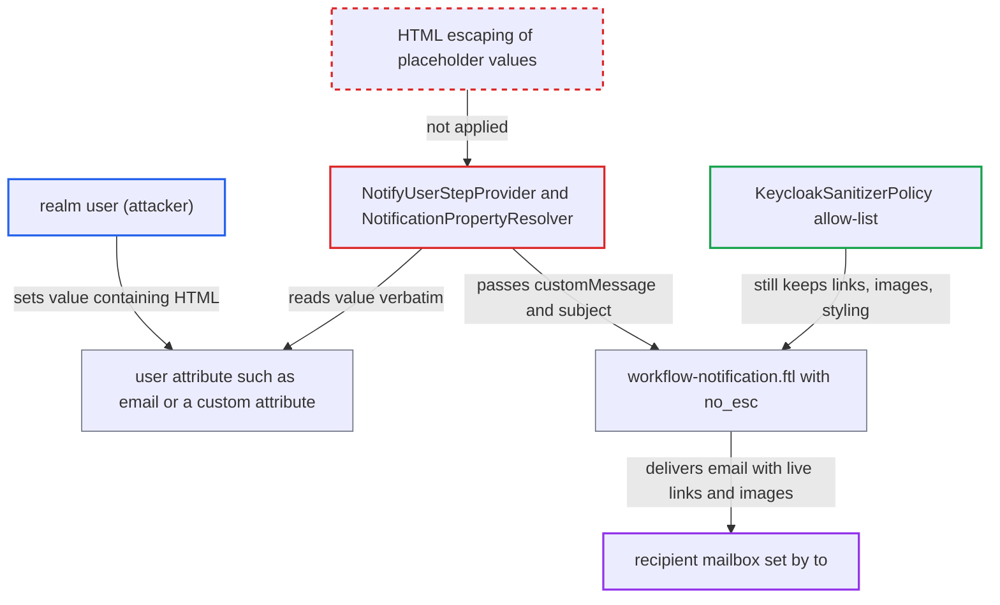

# User attribute values injected unescaped as HTML into workflow notify-user emails

| Field | Value |
|---|---|
| ID | `find_01YKCanf7bwYdcHPkoXYoaLY` |
| Severity | **Low** |
| Status | open |
| CWE | CWE-116 — Improper output escaping |
| Created | 2026-10-27T21:28:26.976026Z |
| Claude Security | https://claude.ai/security/findings/find_01YKCanf7bwYdcHPkoXYoaLY |

## Description

An ordinary realm user can put clickable links, images and styling into a Keycloak notification email. The email goes to another person's mailbox when the administrator has set `to` on the step, and to the user themselves when `to` is not set. It needs an administrator-configured `notify-user` workflow step that uses a `${user.<attribute>}` placeholder. The step puts the raw attribute value into HTML that the template `workflow-notification.ftl` emits with `?no_esc`, so only the sanitizer allow-list stands in the way.

1. **administrator** configures a `notify-user` step that uses a user attribute placeholder. The `subject` or `message` contains `${user.<attribute>}`, such as `${user.email}`, and the step's `to` is set to another mailbox. The docs describe `message` as HTML that may contain these placeholders. ([`docs/documentation/server_admin/topics/workflows/defining-steps.adoc:85-117`](https://github.com/cx-benchmark/keycloak/blob/1d7be35d0764060a8143fc74b0aabf2442743be4/docs/documentation/server_admin/topics/workflows/defining-steps.adoc#L85-L117))
2. **realm user** sets an attribute to a value containing HTML. The user can do this through the Account console/API, registration or update-profile. A custom attribute only has the validators the administrator configured. The default `email` validator accepts a quoted local part containing `<`, `>`, `=`, `:`, `/` and spaces. ([`server-spi-private/src/main/java/org/keycloak/utils/EmailValidationUtil.java:20-28`](https://github.com/cx-benchmark/keycloak/blob/1d7be35d0764060a8143fc74b0aabf2442743be4/server-spi-private/src/main/java/org/keycloak/utils/EmailValidationUtil.java#L20-L28))
3. **the resolver `NotificationPropertyResolver.resolve`** returns the user's attribute value unchanged. It returns `user.getFirstAttribute(attributeKey)` verbatim, and nothing HTML-escapes the value before it is spliced into the administrator's text. ([`services/src/main/java/org/keycloak/models/workflow/NotifyUserStepProvider.java:173-186`](https://github.com/cx-benchmark/keycloak/blob/1d7be35d0764060a8143fc74b0aabf2442743be4/services/src/main/java/org/keycloak/models/workflow/NotifyUserStepProvider.java#L173-L186))
4. **the step `NotifyUserStepProvider`** stores the substituted text as `customMessage` and as the subject key. For the subject, only MessageFormat meta characters are escaped, which is not HTML escaping. ([`services/src/main/java/org/keycloak/models/workflow/NotifyUserStepProvider.java:124-129`](https://github.com/cx-benchmark/keycloak/blob/1d7be35d0764060a8143fc74b0aabf2442743be4/services/src/main/java/org/keycloak/models/workflow/NotifyUserStepProvider.java#L124-L129))
5. **the template `workflow-notification.ftl`** writes the subject and message into the HTML body with `kcSanitize(...)?no_esc`. `?no_esc` switches off the HTML auto-escaping that the HTML output format would otherwise apply, so any markup the sanitizer keeps becomes live HTML. ([`themes/src/main/resources/theme/base/email/html/workflow-notification.ftl:3-6`](https://github.com/cx-benchmark/keycloak/blob/1d7be35d0764060a8143fc74b0aabf2442743be4/themes/src/main/resources/theme/base/email/html/workflow-notification.ftl#L3-L6))
6. **the sanitizer `KeycloakSanitizerPolicy`** lets the attacker's markup through. Its allow-list keeps `a[href]` (http/https/mailto), `img[src]`, inline `style`, headings, tables and `div`. That is enough for disguised links, image beacons and restyled content. ([`services/src/main/java/org/keycloak/theme/KeycloakSanitizerPolicy.java:86-168`](https://github.com/cx-benchmark/keycloak/blob/1d7be35d0764060a8143fc74b0aabf2442743be4/services/src/main/java/org/keycloak/theme/KeycloakSanitizerPolicy.java#L86-L168))
7. **Keycloak** sends the email to the address set in `to`. The recipient is a third party, not the user who controls the attribute, and only has to open the email. ([`services/src/main/java/org/keycloak/models/workflow/NotifyUserStepProvider.java:65-70`](https://github.com/cx-benchmark/keycloak/blob/1d7be35d0764060a8143fc74b0aabf2442743be4/services/src/main/java/org/keycloak/models/workflow/NotifyUserStepProvider.java#L65-L70))

## Assessment

The attacker is an ordinary realm user who can edit their own attributes. Something outside their control must already be in place: an administrator has configured a `notify-user` step whose `message` or `subject` references a user-settable attribute (a custom attribute or `email`). For third-party delivery, the administrator must also have set the step's `to` to another mailbox. The user sets the attribute through the Account console/API, registration or update-profile, for example to a link with the text `Review account` plus an image pointing at an outside host. When the workflow fires, the recipient only has to open the email. Without `to`, the user can only inject into their own email. The Workflows feature is enabled by default (`Type.DEFAULT` in `Profile.Feature`).

Impact: The attacker controls links with disguised text, images and styling inside a Keycloak-sent email to a recipient the administrator chose. This allows phishing and open-tracking. `kcSanitize` strips scripts and event handlers, and no Keycloak data is read or changed, so the impact is limited to the integrity of the email content.

## Recommendation

Values resolved from user attributes for `${user.<attr>}` placeholders are substituted into the administrator-authored HTML `message` and `subject` without HTML escaping. The template then emits the result with `?no_esc`, so the sanitizer allow-list is the only barrier.

Fix criteria: Placeholder values from user attributes, and from any other non-administrator source, are HTML-escaped before substitution into content rendered with `?no_esc`. The administrator's own HTML stays sanitized. Test with a `notify-user` step `message: 
${user.department}
` and `to` set to another mailbox. After the user sets `department` to `<a href="https://x">x</a>`, the delivered HTML email shows the literal text and contains no anchor element. The same holds for a placeholder in `subject`.

## Evidence

**https://github.com/cx-benchmark/keycloak**

- [`services/src/main/java/org/keycloak/models/workflow/NotifyUserStepProvider.java:173-186`](https://github.com/cx-benchmark/keycloak/blob/1d7be35d0764060a8143fc74b0aabf2442743be4/services/src/main/java/org/keycloak/models/workflow/NotifyUserStepProvider.java#L173-L186)
- [`services/src/main/java/org/keycloak/models/workflow/NotifyUserStepProvider.java:86-92`](https://github.com/cx-benchmark/keycloak/blob/1d7be35d0764060a8143fc74b0aabf2442743be4/services/src/main/java/org/keycloak/models/workflow/NotifyUserStepProvider.java#L86-L92)
- [`services/src/main/java/org/keycloak/models/workflow/NotifyUserStepProvider.java:124-129`](https://github.com/cx-benchmark/keycloak/blob/1d7be35d0764060a8143fc74b0aabf2442743be4/services/src/main/java/org/keycloak/models/workflow/NotifyUserStepProvider.java#L124-L129)
- [`themes/src/main/resources/theme/base/email/html/workflow-notification.ftl:3-6`](https://github.com/cx-benchmark/keycloak/blob/1d7be35d0764060a8143fc74b0aabf2442743be4/themes/src/main/resources/theme/base/email/html/workflow-notification.ftl#L3-L6)
- [`services/src/main/java/org/keycloak/theme/freemarker/DefaultFreeMarkerProvider.java:61-64`](https://github.com/cx-benchmark/keycloak/blob/1d7be35d0764060a8143fc74b0aabf2442743be4/services/src/main/java/org/keycloak/theme/freemarker/DefaultFreeMarkerProvider.java#L61-L64)
- [`services/src/main/java/org/keycloak/theme/KeycloakSanitizerPolicy.java:86-168`](https://github.com/cx-benchmark/keycloak/blob/1d7be35d0764060a8143fc74b0aabf2442743be4/services/src/main/java/org/keycloak/theme/KeycloakSanitizerPolicy.java#L86-L168)
- [`services/src/main/java/org/keycloak/models/workflow/NotifyUserStepProvider.java:65-70`](https://github.com/cx-benchmark/keycloak/blob/1d7be35d0764060a8143fc74b0aabf2442743be4/services/src/main/java/org/keycloak/models/workflow/NotifyUserStepProvider.java#L65-L70)
- [`server-spi-private/src/main/java/org/keycloak/utils/EmailValidationUtil.java:20-28`](https://github.com/cx-benchmark/keycloak/blob/1d7be35d0764060a8143fc74b0aabf2442743be4/server-spi-private/src/main/java/org/keycloak/utils/EmailValidationUtil.java#L20-L28)
- [`services/src/main/java/org/keycloak/userprofile/validator/PersonNameProhibitedCharactersValidator.java:42`](https://github.com/cx-benchmark/keycloak/blob/1d7be35d0764060a8143fc74b0aabf2442743be4/services/src/main/java/org/keycloak/userprofile/validator/PersonNameProhibitedCharactersValidator.java#L42)
- [`docs/documentation/server_admin/topics/workflows/defining-steps.adoc:85-117`](https://github.com/cx-benchmark/keycloak/blob/1d7be35d0764060a8143fc74b0aabf2442743be4/docs/documentation/server_admin/topics/workflows/defining-steps.adoc#L85-L117)

