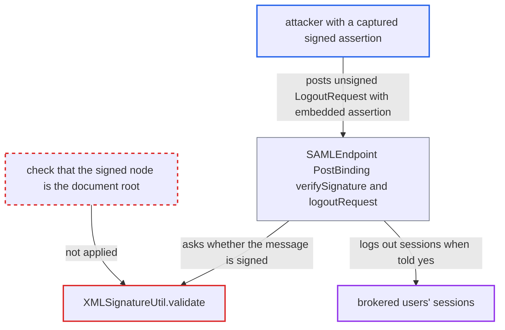

# XML signature validation accepts unsigned SAML requests that embed any signed Assertion

| Field | Value |
|---|---|
| ID | `find_01CXh2VamVmzQrEAwAY9aDcv` |
| Severity | **Low** |
| Status | open |
| CWE | CWE-347 — Improper Verification of Cryptographic Signature |
| Created | 2026-10-27T21:27:48.374386Z |
| Claude Security | https://claude.ai/security/findings/find_01CXh2VamVmzQrEAwAY9aDcv |

## Description

An attacker can end every session of any brokered user whose NameID they know, and can have forged LogoutResponse messages accepted, as often as they like. They need one plaintext `saml:Assertion` signed by the brokered IdP's key, and the broker needs \*Validate Signatures\* on. The signature check in `XMLSignatureUtil.validate` accepts an unsigned message if it contains one validly signed `saml:Assertion`, whatever the root element is.

1. **attacker** obtains a signed assertion. Any plaintext `saml:Assertion` signed by the brokered IdP's key works, for example the attacker's own login assertion read from the browser POST. It may even be expired. Encrypted assertions do not work.
2. **attacker** builds an unsigned `samlp:LogoutRequest` with the assertion inside `samlp:Extensions`. The request has Destination set to the broker endpoint and `NameID` set to the victim's principal value, for example an email. It has no SessionIndex.
3. **attacker** POSTs the request as `SAMLRequest` to `/realms/{realm}/broker/{alias}/endpoint`. The request parsers keep the children of `samlp:Extensions` as opaque DOM, so the embedded assertion does not break parsing. ([`saml-core/src/main/java/org/keycloak/saml/processing/core/parsers/saml/protocol/SAMLRequestAbstractParser.java:63-74`](https://github.com/cx-benchmark/keycloak/blob/1d7be35d0764060a8143fc74b0aabf2442743be4/saml-core/src/main/java/org/keycloak/saml/processing/core/parsers/saml/protocol/SAMLRequestAbstractParser.java#L63-L74))
4. **the method `SAML2Signature.validate`** registers the `ID` of the root and of every `saml:Assertion`, then calls `XMLSignatureUtil.validate`. Because the assertion's `ID` is registered, the `#ID` reference of the borrowed signature resolves and verifies. ([`saml-core/src/main/java/org/keycloak/saml/processing/api/saml/v2/sig/SAML2Signature.java:175-183`](https://github.com/cx-benchmark/keycloak/blob/1d7be35d0764060a8143fc74b0aabf2442743be4/saml-core/src/main/java/org/keycloak/saml/processing/api/saml/v2/sig/SAML2Signature.java#L175-L183))
5. **the method `XMLSignatureUtil.validate`** returns true although the root is unsigned. The root is not in `signedNodes`, but the fallback finds every `saml:Assertion` in the document signed. It does not check that the root is a `samlp:Response`. ([`saml-core/src/main/java/org/keycloak/saml/processing/core/util/XMLSignatureUtil.java:515-528`](https://github.com/cx-benchmark/keycloak/blob/1d7be35d0764060a8143fc74b0aabf2442743be4/saml-core/src/main/java/org/keycloak/saml/processing/core/util/XMLSignatureUtil.java#L515-L528))
6. **the method `SAMLEndpoint.PostBinding.verifySignature`** accepts the document as signed by the IdP. For a non-Response document, the only check is `SamlProtocolUtils.verifyDocumentSignature`, which throws only when the result is false. ([`services/src/main/java/org/keycloak/broker/saml/SAMLEndpoint.java:957-967`](https://github.com/cx-benchmark/keycloak/blob/1d7be35d0764060a8143fc74b0aabf2442743be4/services/src/main/java/org/keycloak/broker/saml/SAMLEndpoint.java#L957-L967))
7. **the method `logoutRequest`** logs out the victim's sessions. With no SessionIndex, it back-channel logs out every session whose broker user id is `alias + "." + NameID`. ([`services/src/main/java/org/keycloak/broker/saml/SAMLEndpoint.java:357-380`](https://github.com/cx-benchmark/keycloak/blob/1d7be35d0764060a8143fc74b0aabf2442743be4/services/src/main/java/org/keycloak/broker/saml/SAMLEndpoint.java#L357-L380))

## Assessment

The attacker needs any plaintext `saml:Assertion` signed by the brokered IdP's key. They also need the victim's NameID, for example an email. The broker must have \*Validate Signatures\* on. That option is turned on automatically when an IdP is created from metadata that has a signing key. `handleSamlRequest` does no other check, not even on the Issuer. Forged `LogoutResponse` messages are accepted the same way. On the IdP side, the same check gates \*Client Signature Required\* for POST requests and for SOAP `ArtifactResolve`. There the borrowed assertion must be signed by the client's own registered key. That holds only when that SP's key also issues assertions. Schema validation is off by default (`picketlink.schema.validate` is false).

Impact: The attacker can log out all sessions, with their client sessions, of any brokered user whose NameID they know, repeatedly. Victims can log in again. The attacker cannot mint assertions, log in as anyone or read data.

## Recommendation

(1) `XMLSignatureUtil.validate` reports success when every `saml:Assertion` in the document is signed, whatever the root element is. A signature over a borrowed assertion is therefore taken as proof that an unrelated protocol message is signed.

Fix criteria: A protocol request or status response (`AuthnRequest`, `LogoutRequest`, `ArtifactResolve`, `LogoutResponse`, etc.) counts as signed only when a valid signature's reference resolves to the document element itself. The assertion-only fallback applies only to `samlp:Response` documents, or to a Response wrapped in an ArtifactResponse. Test: an unsigned LogoutRequest, AuthnRequest or ArtifactResolve carrying a validly signed assertion in `Extensions` is rejected by the broker and IdP endpoints when signatures are required.

(2) `XMLSignatureUtil.validate` returns a bare boolean. Callers (`SamlProtocolUtils.verifyDocumentSignature`, `SAMLEndpoint`, `SamlService`) cannot tell which node a valid signature covered.

Fix criteria: Callers that act on a protocol message can assert that the element they consume is the signed node. That is the root for requests, and the Response or the consumed Assertion for responses. The trust decision depends on the consumed element, not on the presence of any valid signature in the document.

## Evidence

**https://github.com/cx-benchmark/keycloak**

- [`saml-core/src/main/java/org/keycloak/saml/processing/core/util/XMLSignatureUtil.java:515-528`](https://github.com/cx-benchmark/keycloak/blob/1d7be35d0764060a8143fc74b0aabf2442743be4/saml-core/src/main/java/org/keycloak/saml/processing/core/util/XMLSignatureUtil.java#L515-L528)
- [`saml-core/src/main/java/org/keycloak/saml/processing/core/util/XMLSignatureUtil.java:468-495`](https://github.com/cx-benchmark/keycloak/blob/1d7be35d0764060a8143fc74b0aabf2442743be4/saml-core/src/main/java/org/keycloak/saml/processing/core/util/XMLSignatureUtil.java#L468-L495)
- [`saml-core/src/main/java/org/keycloak/saml/processing/api/saml/v2/sig/SAML2Signature.java:175-183`](https://github.com/cx-benchmark/keycloak/blob/1d7be35d0764060a8143fc74b0aabf2442743be4/saml-core/src/main/java/org/keycloak/saml/processing/api/saml/v2/sig/SAML2Signature.java#L175-L183)
- [`services/src/main/java/org/keycloak/protocol/saml/SamlProtocolUtils.java:112-120`](https://github.com/cx-benchmark/keycloak/blob/1d7be35d0764060a8143fc74b0aabf2442743be4/services/src/main/java/org/keycloak/protocol/saml/SamlProtocolUtils.java#L112-L120)
- [`services/src/main/java/org/keycloak/broker/saml/SAMLEndpoint.java:957-967`](https://github.com/cx-benchmark/keycloak/blob/1d7be35d0764060a8143fc74b0aabf2442743be4/services/src/main/java/org/keycloak/broker/saml/SAMLEndpoint.java#L957-L967)
- [`services/src/main/java/org/keycloak/broker/saml/SAMLEndpoint.java:357-380`](https://github.com/cx-benchmark/keycloak/blob/1d7be35d0764060a8143fc74b0aabf2442743be4/services/src/main/java/org/keycloak/broker/saml/SAMLEndpoint.java#L357-L380)
- [`services/src/main/java/org/keycloak/protocol/saml/SamlService.java:1306-1314`](https://github.com/cx-benchmark/keycloak/blob/1d7be35d0764060a8143fc74b0aabf2442743be4/services/src/main/java/org/keycloak/protocol/saml/SamlService.java#L1306-L1314)
- [`saml-core/src/main/java/org/keycloak/saml/processing/core/parsers/saml/protocol/SAMLRequestAbstractParser.java:63-74`](https://github.com/cx-benchmark/keycloak/blob/1d7be35d0764060a8143fc74b0aabf2442743be4/saml-core/src/main/java/org/keycloak/saml/processing/core/parsers/saml/protocol/SAMLRequestAbstractParser.java#L63-L74)

